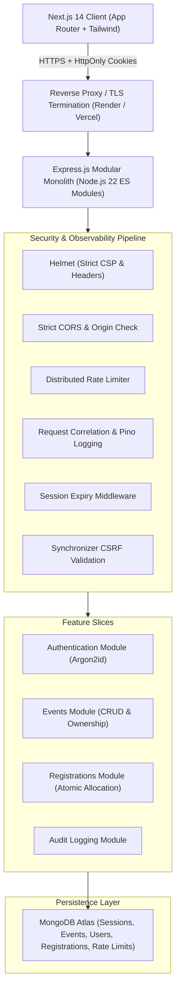

# High-Level Design (HLD) — Eventora

## 1. System Architecture Overview

Eventora is structured as a **Modular Monolith** employing **Vertical Slice Architecture** for feature autonomy, coupled with **Clean Architecture** principles inside each business capability.

---

## 2. Component Responsibilities

### 2.1 Presentation & Client (Next.js 14)
- React Server & Client Components under App Router.
- Unified TanStack Query server-state management.
- Theme switching with `next-themes` and zero-flash CSS custom properties.
- GSAP entrance choreography and interactive transitions.
- Client-side Zod validation mirrors server schemas for immediate user feedback.

### 2.2 Security & HTTP Gateway (Express.js)
- Nonce-free strict Content Security Policy, X-Content-Type-Options, Referrer-Policy via Helmet.
- HttpOnly, SameSite, Secure cookie delivery with server-side session rotation.
- Synchronizer token pattern paired with origin/referer inspection for all mutation requests.
- MongoDB-backed distributed rate limiter mitigating denial-of-service and brute force.

### 2.3 Core Domain Services
- **Auth Service:** Verifies credentials against Argon2id hashes and manages server session lifecycle.
- **Event Service:** Manages event lifecycles, guarantees positive future dates, enforces capacity reduction floors, and isolates organizer ownership.
- **Registration Service:** Executes atomic seat reservation, validates availability against capacity limits, and manages attendee registration records.

### 2.4 Data Tier (MongoDB)
- Document collections: `users`, `events`, `registrations`, `sessions`, `audit_logs`, `rate_limits`.
- Compound unique indexing guarantees zero duplicate bookings per attendee.
- Atomic conditional expressions (`$lt: ['$seatsBooked', '$seatLimit']`) guarantee invariant adherence under concurrency.

