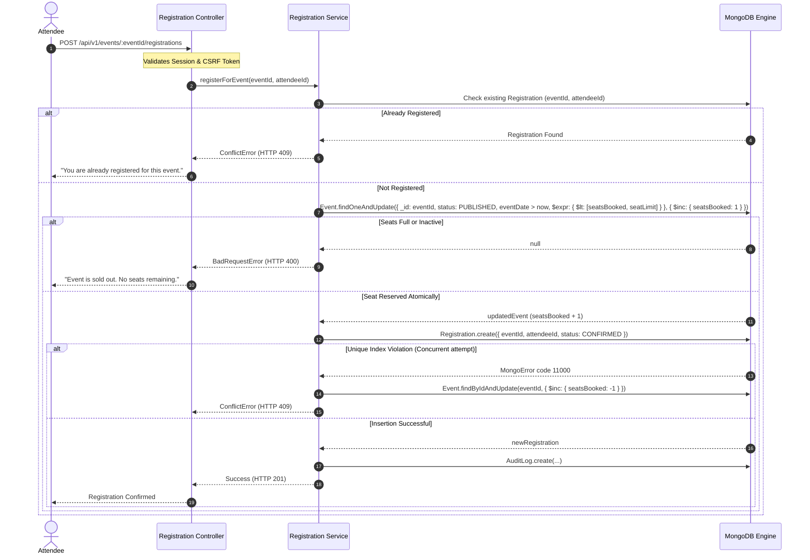

# Low-Level Design (LLD) — Eventora

## 1. Domain Entities & Schemas

### 1.1 User Entity
- **Attributes:**
  - `_id`: ObjectId
  - `name`: String (2-100 chars)
  - `email`: String (RFC 5322 compliant, lowercase)
  - `normalizedEmail`: String (Unique index, normalized lowercase trimmed)
  - `passwordHash`: String (Argon2id format `$argon2id$v=19$m=...`, `select: false`)
  - `role`: Enum `['ATTENDEE', 'ORGANIZER']`, `immutable: true`
  - `createdAt`, `updatedAt`: Timestamps

### 1.2 Event Entity
- **Attributes:**
  - `_id`: ObjectId
  - `title`: String (3-200 chars)
  - `description`: String (10-5000 chars)
  - `eventDate`: Date (Must be future-dated)
  - `venue`: String (3-300 chars)
  - `seatLimit`: Integer (>= 1, max 100,000)
  - `seatsBooked`: Integer (>= 0, default 0)
  - `organizerId`: ObjectId -> User (`index: true`)
  - `status`: Enum `['DRAFT', 'PUBLISHED', 'CANCELLED']`
  - `category`: String
  - `bannerUrl`: String
- **Virtuals:**
  - `remainingSeats`: `max(0, seatLimit - seatsBooked)`
  - `isPast`: `eventDate < Date.now()`

### 1.3 Registration Entity
- **Attributes:**
  - `_id`: ObjectId
  - `eventId`: ObjectId -> Event (`index: true`)
  - `attendeeId`: ObjectId -> User (`index: true`)
  - `status`: Enum `['CONFIRMED', 'CANCELLATION_REQUESTED', 'CANCELLED', 'REJECTED']`
  - `cancellationReason`: String (max 500 chars)
  - `decisionNote`: String (max 500 chars)
  - `decidedBy`: ObjectId -> User
  - `decidedAt`: Date
- **Indexes:**
  - `{ eventId: 1, attendeeId: 1 }` (Unique compound index)
  - `{ attendeeId: 1, createdAt: -1 }`
  - `{ eventId: 1, status: 1 }`

---

## 2. Concurrency & Atomic Seat Allocation Algorithm

