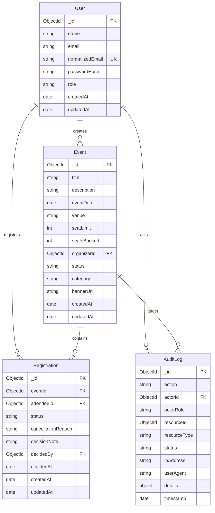

# Database Schema & Data Dictionary — Eventora

## 1. Schema Specifications

## 2. Invariants & Business Rules
1. `Event.seatsBooked` must never exceed `Event.seatLimit`.
2. `Event.seatsBooked` can never be decremented below 0.
3. Compound uniqueness on `Registration`: `{ eventId: 1, attendeeId: 1 }` prevents double booking.
4. `User.role` is immutable.
