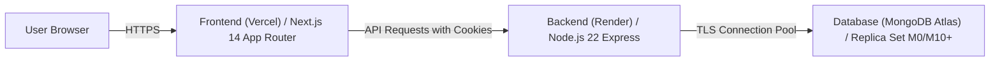

# Production Deployment Guide — Eventora

## 1. Target Architecture



---

## 2. Environment Variables Configuration

### 2.1 Backend (Render Web Service)

#### Render Service Settings:
- **Root Directory:** `server`
- **Environment:** `Node`
- **Build Command:** `npm install` (or `npm ci`)
- **Start Command:** `npm start`
- **Health Check Path:** `/api/v1/health`
- **Blueprint:** `render.yaml` (located at repository root for 1-click Render Blueprint deployments)

#### Environment Variables:
| Variable | Value Description | Production Example |
|---|---|---|
| `PORT` | Listening port (assigned by Render or default) | `5000` |
| `NODE_ENV` | Environment mode | `production` |
| `MONGODB_URI` | MongoDB Atlas Replica Set URI | `mongodb+srv://eventora_app:<password>@cluster0.abcde.mongodb.net/eventora?retryWrites=true&w=majority` |
| `SESSION_SECRET` | Cryptographically random string (min 32 chars) | `openssl rand -hex 32` |
| `ALLOWED_ORIGINS` | Comma-separated allowed frontend URLs | `https://eventora-app.vercel.app` |
| `APP_BASE_URL` | Frontend canonical URL for ticket and email links | `https://eventora-app.vercel.app` |
| `LOG_LEVEL` | Pino logger level | `info` |
| `RESEND_API_KEY` | Resend API Key for transactional emails | `re_live_api_key_here` |
| `EMAIL_FROM` | Verified sender email | `Eventora <onboarding@resend.dev>` |
| `CLOUDINARY_CLOUD_NAME` | Cloudinary Account Cloud Name | `eventora-prod` |
| `CLOUDINARY_API_KEY` | Cloudinary API Key | `123456789012345` |
| `CLOUDINARY_API_SECRET` | Cloudinary Secret (Backend only!) | `abcde_secret_string_here` |

### 2.2 Frontend (Vercel)
| Variable | Value Description | Production Example |
|---|---|---|
| `NEXT_PUBLIC_SITE_URL` | Public Frontend Base URL | `https://eventora-app.vercel.app` |
| `NEXT_PUBLIC_API_URL` | Public API Base URL | `https://eventora-api.onrender.com/api/v1` |

> **Security Notice regarding Cloudinary & Resend:**
> All Cloudinary and Resend credentials exist exclusively on the Express backend (Render). The frontend (Vercel) contains zero Cloudinary/Resend secrets and communicates strictly with the backend REST API via authenticated cookies and CSRF tokens. Banner uploads are submitted directly to the Express backend as `multipart/form-data`.

---

## 3. Database Initialization & Seeding on MongoDB Atlas

To seed demo accounts and sample events directly into a new MongoDB Atlas cluster:

```bash
# In your terminal with MONGODB_URI pointing to your Atlas cluster:
MONGODB_URI="mongodb+srv://..." npm run seed --prefix server
```

This generates:
- Organizer Demo: `organizer@eventora.demo` / `Organizer@123`
- Attendee Demo: `attendee@eventora.demo` / `Attendee@123`
- Pre-populated events across Tech, Design, Workshop, and Sustainability.

