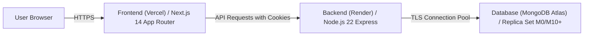

# Production Deployment Guide — Eventora

## 1. Target Architecture



---

## 2. Environment Variables Configuration

### 2.1 Backend (Render)
| Variable | Value Description | Production Example |
|---|---|---|
| `PORT` | Listening port | `5000` |
| `NODE_ENV` | Environment mode | `production` |
| `MONGODB_URI` | MongoDB Atlas Replica Set URI | `mongodb+srv://eventora_app:<password>@cluster0.abcde.mongodb.net/eventora?retryWrites=true&w=majority` |
| `SESSION_SECRET` | Cryptographically random string (min 32 chars) | `openssl rand -hex 32` |
| `ALLOWED_ORIGINS` | Comma-separated allowed frontend URLs | `https://eventora-app.vercel.app` |
| `LOG_LEVEL` | Pino logger level | `info` |
| `CLOUDINARY_CLOUD_NAME` | Cloudinary Account Cloud Name | `eventora-prod` |
| `CLOUDINARY_API_KEY` | Cloudinary API Key | `123456789012345` |
| `CLOUDINARY_API_SECRET` | Cloudinary Secret (Backend only!) | `abcde_secret_string_here` |

### 2.2 Frontend (Vercel)
| Variable | Value Description | Production Example |
|---|---|---|
| `NEXT_PUBLIC_API_URL` | Public API Base URL | `https://eventora-api.onrender.com/api/v1` |

> **Security Notice regarding Cloudinary:**
> `CLOUDINARY_API_SECRET` must **NEVER** be placed in the frontend (Vercel) environment variables or client bundles. Direct browser uploads to Cloudinary use cryptographic signatures generated on-the-fly by the backend endpoint (`POST /api/v1/events/image-signature`), which only returns the signature and temporary timestamp.

---

## 3. Database Initialization & Seeding on MongoDB Atlas

To seed demo accounts and sample events directly into a new MongoDB Atlas cluster:

```bash
# In your terminal with MONGODB_URI pointing to your Atlas cluster:
MONGODB_URI="mongodb+srv://..." npm run seed --prefix server
```

This generates:
- Organizer Demo: `organizer@eventora.demo` / `Organizer@123`
- Attendee Demo: `attendee@eventora.demo` / `Attendee@123`
- Pre-populated events across Tech, Design, Workshop, and Sustainability.

