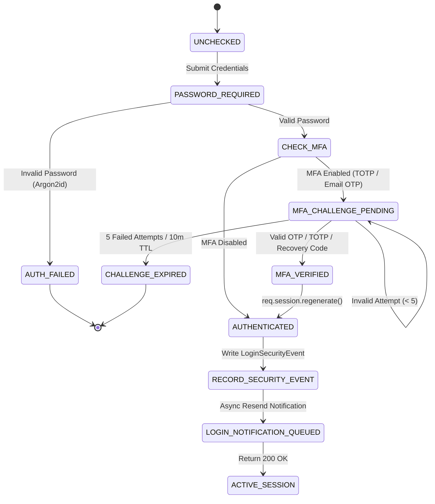

# Authentication, Login Alerts & Multi-Factor Authentication Architecture

## 1. Executive Summary

This document details the architecture, cryptographic controls, state machines, and operational guidelines for Eventora's upgraded authentication and security subsystem.

The upgrade adds enterprise-grade identity assurance while maintaining seamless developer experience and 100% backward compatibility with existing session management, free RSVPs, and Razorpay Test Mode checkout:

1. **Authoritative Email Verification:** Single-use SHA-256 hashed verification tokens, 30-minute expiration, 60-second resend cooldown, and strict unverified account gating.
2. **Real-time Login Notification Alerts:** Triggered on every successful primary/secondary authentication. Captures UTC and formatted timestamps, IPv4/IPv6 client address, approximate GeoIP location (country, region, city) via offline MaxMind-compatible parsing (`geoip-lite`), device/OS/browser family via `ua-parser-js`, and account security direct links.
3. **Dual Multi-Factor Authentication (MFA):**
   - **Email OTP:** 6-digit numeric codes generated via `crypto.randomInt(100000, 1000000)`, HMAC-SHA256 hashed at rest, 5-minute lifetime, 5 maximum failed attempts, Resend email delivery with 60s cooldown.
   - **Authenticator App TOTP:** RFC 6238 compliant, 30-second time-step, 6 digits, SHA-1 HMAC, window $\pm 1$ step (clock skew tolerance), secret encrypted at rest using AES-256-GCM with 96-bit random IV and auth tags.
4. **MFA Emergency Recovery:** 10 single-use formatted codes (`XXXXX-XXXXX`), cryptographically salted and SHA-256 hashed at rest. Single-use consumption with audit logging and password-authenticated regeneration.
5. **Session Fixation & CSRF Immunity:** Double-submit CSRF synchronizer tokens, HTTP-only SameSite cookies, and `req.session.regenerate()` executed upon both primary credential verification and MFA challenge resolution.

---

## 2. Authentication State Machine

The authentication subsystem follows a deterministic state machine:

---

## 3. Cryptographic Storage & Key Derivation

| Secret Type | Storage State | Algorithm / Key Derivation | Expiration / Policy |
| :--- | :--- | :--- | :--- |
| **User Password** | Hashed | Argon2id (memoryCost: 19456 KiB, timeCost: 2, parallelism: 1) | Irreversible |
| **Email Verification Token** | Hashed | SHA-256 hex digest (`crypto.createHash('sha256')`) | 30 minutes (1h TTL index) |
| **Email OTP Code** | Hashed | HMAC-SHA256 (`crypto.createHmac('sha256', SECRET)`) | 5 minutes (Max 5 attempts) |
| **TOTP Secret** | Encrypted | AES-256-GCM with 96-bit random IV & auth tag (`MFA_ENCRYPTION_KEY`) | Permanent until rotated |
| **Recovery Codes** | Hashed | SHA-256 hex digest with unique salt | Single-use consumption |
| **Session ID** | Cookie / MongoDB | Signed cookie (`SESSION_SECRET`), stored in MongoStore | 24 hours |
| **CSRF Token** | Session synchronizer | 32-byte cryptographically random hex | Tied to active session |

---

## 4. API Endpoints Reference

All endpoints are mounted under `/api/v1/auth`:

### Authentication & MFA Challenge Endpoints
- `POST /register`
  - Input: `{ name, email, password, role }`
  - Process: Creates user with `emailVerified: false`, generates verification token, dispatches email verification asynchronously.
  - Returns: `{ success: true, message: "Registration successful...", data: { user } }` (201 Created).
- `POST /login`
  - Input: `{ email, password }`
  - Output if MFA disabled: Sets `eventora.sid` cookie, returns `{ success: true, data: { user } }`.
  - Output if MFA enabled: Returns `{ success: true, data: { mfaRequired: true, challengeToken, allowedFactors, preferredFactor } }`.
- `POST /mfa/verify`
  - Input: `{ challengeToken, factor, code }`
  - Factor types: `TOTP`, `EMAIL_OTP`, `RECOVERY_CODE`.
  - Process: Verifies factor, consumes challenge or recovery code, regenerates session, logs security event, and fires async login alert email.
  - Returns: `{ success: true, data: { user } }`.
- `POST /mfa/resend-otp`
  - Input: `{ challengeToken }`
  - Process: Checks 60s cooldown, issues new 6-digit OTP, updates challenge hash, and emails user.
  - Returns: `{ success: true, message: "A new authentication code has been sent." }`.

### Email Verification Endpoints
- `POST /verify-email`
  - Input: `{ token }` (or query parameter `?token=...`)
  - Process: Validates single-use token hash and expiry; marks `emailVerified: true` and `emailVerifiedAt: new Date()`.
  - Returns: `{ success: true, message: "Email verified successfully." }`.
- `POST /resend-verification`
  - Input: `{ email }` (optional if user session is active)
  - Process: Checks 60s cooldown; generates new token and emails link.
  - Returns: `{ success: true, message: "Verification email sent..." }`.

### Security Settings & Factor Management Endpoints (Requires Authentication)
- `GET /security/status`
  - Returns: MFA status (`emailOtpEnabled`, `totpEnabled`, `recoveryCodesRemaining`, `lastUsedFactor`), email verification status, and last 10 login security events with parsed GeoIP and device info.
- `POST /security/totp/setup`
  - Generates RFC 6238 TOTP secret, returns `{ secret, qrCodeDataUrl }` for Authenticator app scanning.
- `POST /security/totp/confirm`
  - Input: `{ secret, code }`
  - Validates initial code, encrypts secret via AES-256-GCM, activates TOTP, generates 10 recovery codes, and emails MFA enabled confirmation.
  - Returns: `{ success: true, data: { recoveryCodes } }`.
- `POST /security/email-otp/setup`
  - Dispatches test 6-digit code to user's verified email.
- `POST /security/email-otp/confirm`
  - Input: `{ code }`
  - Validates test code, enables Email OTP, generates 10 recovery codes, and emails MFA confirmation.
  - Returns: `{ success: true, data: { recoveryCodes } }`.
- `POST /security/recovery-codes/regenerate`
  - Input: `{ password }`
  - Verifies user password, replaces all remaining recovery codes with 10 newly generated hashed codes, and emails recovery codes regenerated notice.
  - Returns: `{ success: true, data: { recoveryCodes } }`.
- `POST /security/mfa/disable`
  - Input: `{ password }`
  - Verifies user password, deletes encrypted TOTP secret and recovery codes, resets flags to `false`, and emails security alert.
  - Returns: `{ success: true, message: "Two-factor authentication has been disabled." }`.

---

## 5. Route Protection & Unverified Email Gating

The middleware `requireVerifiedEmail` enforces verification policy without blocking unverified users from basic account navigation:

- **Allowed Unverified:**
  - Public event browsing (`GET /api/v1/events`, `GET /api/v1/events/:id`).
  - Account security settings (`GET /api/v1/auth/security/status`).
  - Email verification endpoints (`POST /api/v1/auth/verify-email`, `POST /api/v1/auth/resend-verification`).
- **Gated Behind Email Verification:**
  - Event creation, modification, deletion (`POST/PATCH/DELETE /api/v1/events`).
  - Attendee registration & ticket acquisition (`POST /api/v1/registrations`).
  - Paid event checkout & Razorpay order creation (`POST /api/v1/payments/create-order`).

---

## 6. Environment Variables Reference

| Variable | Required | Default / Fallback | Purpose |
| :--- | :--- | :--- | :--- |
| `MFA_ENCRYPTION_KEY` | Optional | Derived from `SESSION_SECRET` via SHA-256 | 32-byte AES-256-GCM master key for encrypting TOTP secrets at rest. |
| `ENFORCE_EMAIL_VERIFICATION` | Optional | `true` (in non-test environments) | Enforces unverified account action gating. |
| `AUTO_VERIFY_TEST_ACCOUNTS` | Optional | `false` | When `true`, automatically marks seed/demo accounts verified. |
| `RESEND_API_KEY` | Required (Prod) | Simulated mock in tests | Resend email dispatch API key. |
| `RESEND_FROM_EMAIL` | Optional | `Eventora <security@eventora.app>` | Sender address for transactional emails. |
| `CLIENT_URL` | Required | `http://localhost:3000` | Base URL used to build email verification and security management links. |

