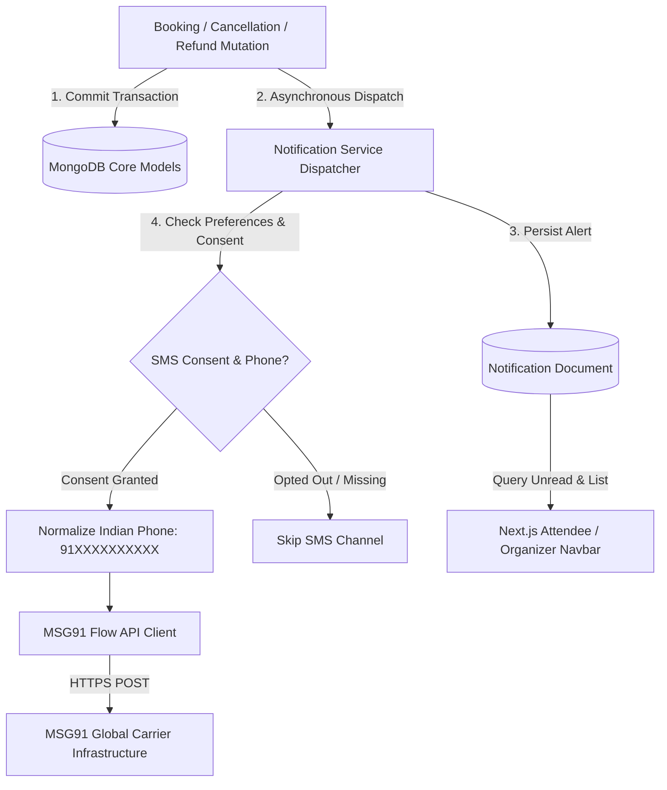

# Eventora Notification Architecture

This document describes the multi-channel notification engine powering Eventora, including transactional SMS via MSG91 Flow API, real-time in-app alerts, privacy consent frameworks, and resilient asynchronous dispatch pipelines.

---

## 1. Notification Subsystem Overview

Eventora decouples core state mutations (ticket bookings, payments, and cancellations) from external communication channels. A failure in an external SMS provider never blocks or aborts a successful database transaction.



---

## 2. MSG91 Flow API Integration for India

### A. Carrier Regulatory Compliance & DLT
In India, transactional messaging is strictly regulated by the Telecom Regulatory Authority of India (TRAI) under Distributed Ledger Technology (DLT) mandates.
Eventora integrates with MSG91's Flow API:
- **Sender ID (`sender`):** 6-character registered header (e.g. `EVNTRA`).
- **Template Flow ID (`template_id`):** Pre-approved DLT template variables.
- **Payload Structure:**
  ```json
  {
    "template_id": "flow_booking_confirmed_placeholder",
    "sender": "EVNTRA",
    "short_url": "0",
    "recipients": [
      {
        "mobiles": "919876543210",
        "name": "Alex Rivera",
        "eventTitle": "Global Tech Summit 2026",
        "amount": "₹499"
      }
    ]
  }
  ```

### B. Indian Mobile Number Normalization
User input for phone numbers varies widely across user demographics. Eventora utilizes strict regex and prefix normalization before gateway handoff:
```javascript
export function normalizeIndianPhone(phone) {
  if (!phone || typeof phone !== 'string') return null;
  const digits = phone.replace(/\D/g, '');
  if (digits.length === 10) {
    return `91${digits}`;
  }
  if (digits.length === 12 && digits.startsWith('91')) {
    return digits;
  }
  return null;
}
```
Non-Indian or malformed phone strings are rejected safely without crashing the notification pipeline.

---

## 3. Privacy, Opt-In Consent & User Preferences

Under Indian privacy principles and standard compliance:
1. **Explicit Consent:** SMS messages are only sent when `user.smsConsent === true` and a valid normalized phone number exists.
2. **Channel Control:** Users can customize their communication preferences:
   ```json
   {
     "sms": true,
     "inApp": true,
     "email": true
   }
   ```
3. **Preference Management:** Attendees can configure phone numbers and toggle transactional SMS consent anytime in their Attendee Portal (`/attendee/registrations`).

---

## 4. In-App Notification System

### A. Lifecycle & Schema
Every notification is stored in the `Notification` collection:
- `userId`: Target recipient.
- `type`: Enum (`BOOKING_CONFIRMED`, `BOOKING_CANCELLED`, `PAYMENT_SUCCESS`, `REFUND_PROCESSED`, etc.).
- `title` & `message`: Human-readable localized text.
- `isRead`: Boolean flag indexed for ultra-fast unread count lookups (`{ userId: 1, isRead: 1 }`).
- `metadata`: Associated `eventId`, `registrationId`, and `paymentId`.

### B. Polling & Performance Optimization
- The frontend `NotificationBell` queries `GET /api/v1/notifications/unread-count` using lightweight projection queries.
- Dropdown details are fetched lazily only when the user opens the bell popover.
- Batch "Mark all as read" executes a single update query (`updateMany({ userId, isRead: false }, { isRead: true })`).

---

## 5. Resilience & Fault Tolerance

1. **Non-Blocking Execution:** `dispatchNotification` is triggered using an outbox / asynchronous promise pattern. Errors caught during carrier network requests are logged via Pino audit logger and never propagated to the end-user request response.
2. **Zero-Money / Offline Simulation Mode:** When `MSG91_AUTH_KEY` is omitted or `NODE_ENV === 'test'`, the MSG91 provider automatically operates in mock simulation mode:
   ```javascript
   logger.info({ mobile, templateId, variables }, 'MSG91: [MOCK MODE] Transactional SMS successfully simulated');
   ```
   This ensures local testing, automated CI runs, and developer environments execute without external SMS credits or network dependencies.

