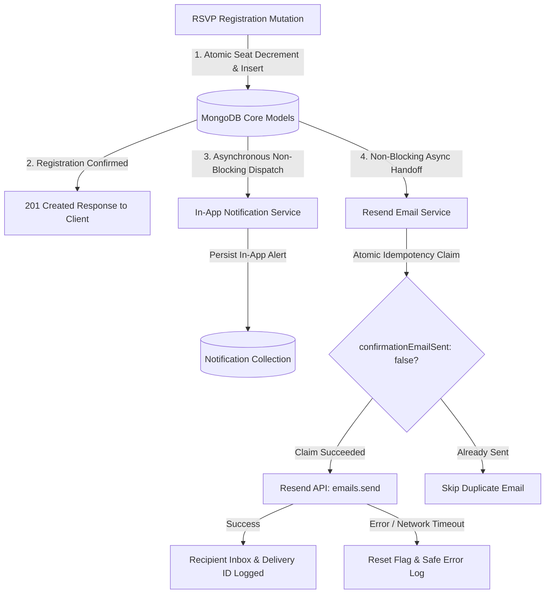

# Eventora Transactional Notification Architecture

This document describes the multi-channel notification engine powering Eventora, including transactional email confirmation via the **Resend API**, real-time in-app alerts, idempotency deduplication, and resilient asynchronous dispatch pipelines.

---

## 1. Notification Subsystem Overview

Eventora decouples core database mutations (event RSVP creation, seat allocation, and cancellations) from external communication channels. A failure or latency spike in an external transactional email provider never blocks, delays, or rolls back a confirmed registration.



---

## 2. Transactional Email via Resend

### A. Non-Blocking Delivery Guarantee
Registration confirmations are dispatched strictly **after** the registration document is persisted and the seat is atomically allocated. The promise is invoked asynchronously with error handling so the HTTP client receives immediate `201 Created` status:
```javascript
// registrationService.js
sendRegistrationConfirmationEmail({
  registrationId: registration._id.toString(),
  attendee: { name: attendee.name, email: attendee.email },
  event
}).catch((err) => {
  logger.error({ err: err?.message, registrationId: registration._id }, 'Background confirmation email error');
});
```

### B. Atomic Idempotency & Deduplication
To guarantee attendees never receive duplicate confirmation emails for the same event registration:
```javascript
const claimed = await Registration.findOneAndUpdate(
  { _id: registrationId, confirmationEmailSent: { $ne: true } },
  { $set: { confirmationEmailSent: true } },
  { new: true }
);

if (!claimed) {
  return { success: false, reason: 'ALREADY_SENT', skipped: true };
}
```
If an upstream carrier network failure occurs, the flag is safely reset to `false` so subsequent manual or background retry jobs can succeed.

### C. Branded Email & Accessible Fallback
The confirmation email contains:
- **Branded Header:** Eventora platform styling with clean dark aesthetic.
- **Confirmation Status Badge:** Visual "RSVP Confirmed" tag.
- **Personalized Greeting:** Attendee name.
- **Event Highlights:** Title, formatted date/time, and venue location.
- **Booking Reference ID:** Unique registration ObjectId.
- **Call-to-Action:** Deep link to `/attendee/registrations` for the digital ticket.
- **Plain-Text Alternative:** Clean, accessible plain-text format matching the HTML copy for legacy mail clients.

---

## 3. In-App Notification System

### A. Lifecycle & Schema
Every user-facing event notice is stored in the `Notification` collection:
- `userId`: Target recipient ObjectId.
- `type`: Enum (`BOOKING_CONFIRMED`, `BOOKING_CANCELLED`, `EVENT_UPDATED`, `EVENT_REMINDER`, `SYSTEM_ALERT`).
- `channel`: `IN_APP`.
- `title` & `message`: Human-readable localized text.
- `isRead`: Boolean flag indexed with `userId` for ultra-fast unread count lookups (`{ userId: 1, isRead: 1 }`).
- `metadata`: Associated `eventId` and `registrationId`.

### B. Polling & Performance Optimization
- The frontend `NotificationBell` queries `GET /api/v1/notifications/unread-count` using lightweight projection queries.
- Dropdown notification lists are fetched lazily only when the attendee or organizer clicks the bell icon.
- Batch "Mark all as read" executes a single update query (`updateMany({ userId, isRead: false }, { isRead: true })`).

---

## 4. Scope Correction & SMS Purge Notice

In accordance with the **Erfolgwerke Event Booking and RSVP Platform** recruitment specification:
- **MSG91 and SMS channels were completely purged** from the codebase.
- User registration requires only standard credentials (`name`, `email`, `password`), eliminating phone requirements.
- Transactional confirmations are delivered reliably via **Resend Email API**, backed by test simulation modes when `RESEND_API_KEY` is in development or mock mode.
