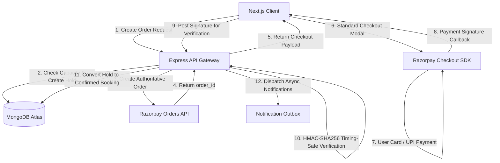
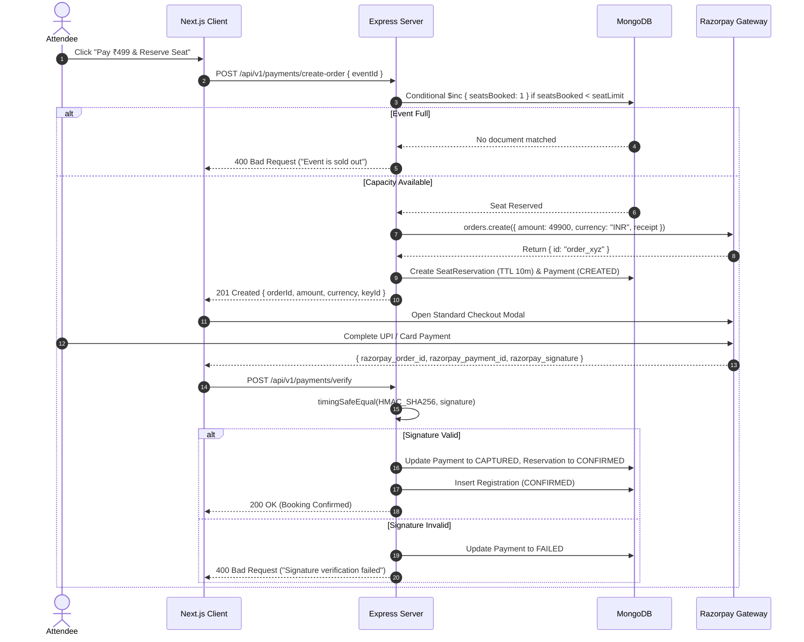
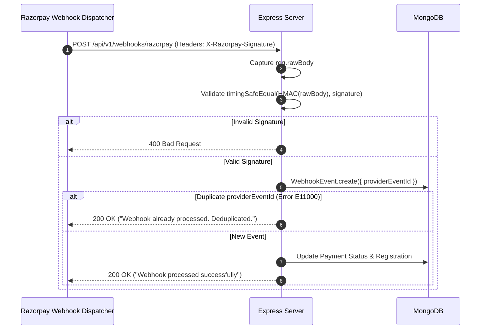
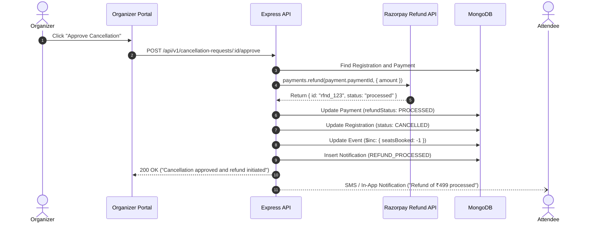

# Eventora Payment Architecture & Gateway Integration

This document details the architectural design, security mechanisms, inventory reservation protocols, and lifecycle workflows of the Razorpay payment subsystem in Eventora.

---

## 1. Executive Architecture Overview

Eventora supports both zero-cost RSVPs and commercial paid event registrations. For paid events, ticket amounts are authoritatively computed on the server in Indian Rupees (INR) and handled in the smallest currency unit (paise).



---

## 2. Two-Phase Seat Hold vs. Free Instant Booking

A core distributed systems challenge in ticketing is preventing inventory overselling without leaving inventory perpetually locked if a user abandons checkout.

### A. Free Events (Direct RSVP)
- Free events require no financial transaction.
- When an attendee submits an RSVP, `registrationService.registerForEvent` executes an atomic conditional update:
  ```javascript
  Event.findOneAndUpdate(
    { _id: eventId, status: 'PUBLISHED', $expr: { $lt: ['$seatsBooked', '$seatLimit'] } },
    { $inc: { seatsBooked: 1 } },
    { new: true }
  );
  ```
- If capacity is available, a `Registration` document is immediately created with status `CONFIRMED`.

### B. Paid Events (Two-Phase Temporary Seat Hold)
- An attendee cannot be confirmed until payment is captured.
- If seats were only reserved *after* payment callback, multiple attendees could simultaneously pay for the last remaining seat, causing an oversold event.
- **Solution:** A 10-minute temporary seat reservation (`SeatReservation` model):
  1. **Phase 1 (Hold & Order):** Atomic conditional increment on `Event.seatsBooked` reserving the seat for `SEAT_HOLD_TTL_MINUTES` (default 10 minutes) and linking it to a `Payment` record with status `CREATED`.
  2. **Phase 2 (Confirmation):** Upon receiving valid cryptographic signature verification, the `SeatReservation` status transitions to `CONFIRMED`, and a `Registration` record is created.
  3. **Auto-Cleanup / Reconciliation:** If the user abandons checkout or the hold window expires, the background reconciliation worker marks the hold `EXPIRED` and atomically decrements `Event.seatsBooked`.



---

## 3. Cryptographic Verification & Webhook Ingestion

### A. Client Signature Verification
Client payment responses contain:
`orderId`, `paymentId`, and `signature`.

The expected signature is generated on the server using HMAC-SHA256 with the secret key:
```javascript
const expectedSignature = crypto
  .createHmac('sha256', process.env.RAZORPAY_KEY_SECRET)
  .update(`${orderId}|${paymentId}`)
  .digest('hex');

const isValid = crypto.timingSafeEqual(
  Buffer.from(expectedSignature, 'utf8'),
  Buffer.from(signature, 'utf8')
);
```
Using `crypto.timingSafeEqual` guards against side-channel timing attacks.

### B. Raw-Body Webhook Verification
Payment providers re-try webhooks over several hours. To ensure raw cryptographic fidelity:
1. `express.json` is configured with a custom `verify` callback capturing `req.rawBody = buf.toString('utf8')`.
2. The webhook HMAC is evaluated directly against the raw binary string matching header `X-Razorpay-Signature`.
3. Webhook endpoints (`/api/v1/webhooks/razorpay`) are explicitly exempt from browser CSRF tokens and Origin headers because they originate from Razorpay servers.

### C. Webhook Deduplication & Durability
Every inbound webhook is recorded in the `WebhookEvent` collection with a unique index on `providerEventId`. Repeated deliveries are identified, marked duplicated, and acknowledged with HTTP 200 without executing duplicate business actions.



---

## 4. Refund & Cancellation Protocol

When an attendee requests cancellation on a paid registration, the cancellation requires explicit organizer approval.

Upon organizer approval:
1. Ownership and authorization are validated (`organizerId === event.organizerId`).
2. An authoritative refund request is dispatched to `razorpay.payments.refund(paymentId, { amount })`.
3. The internal `Payment.refundStatus` transitions to `PROCESSED` (or `PENDING` if queued by provider).
4. The registration status is updated to `CANCELLED`.
5. The held seat capacity on `Event.seatsBooked` is atomically decremented by 1 (`$inc: { seatsBooked: -1 }`), returning the seat to the open public inventory.
6. A transactional SMS and in-app alert are dispatched to the attendee informing them of their refund.



