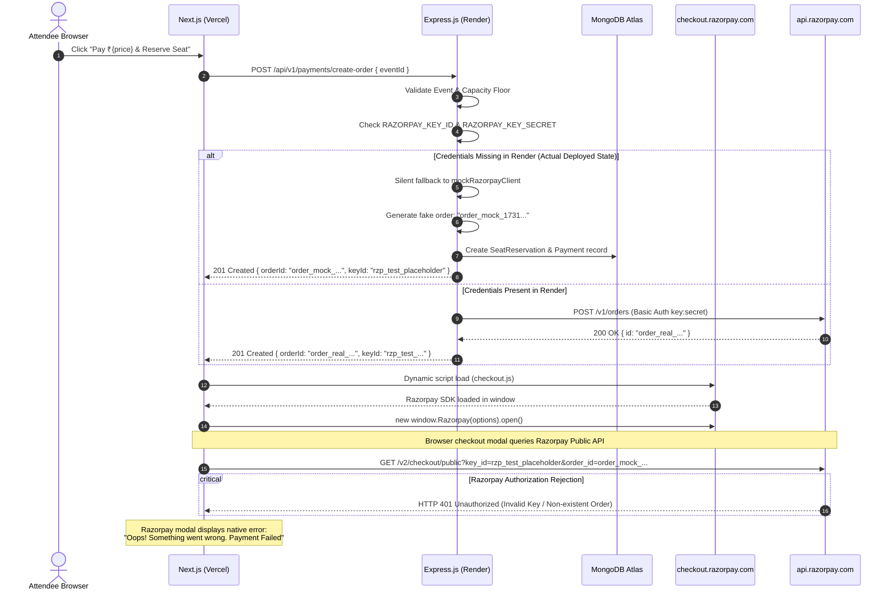
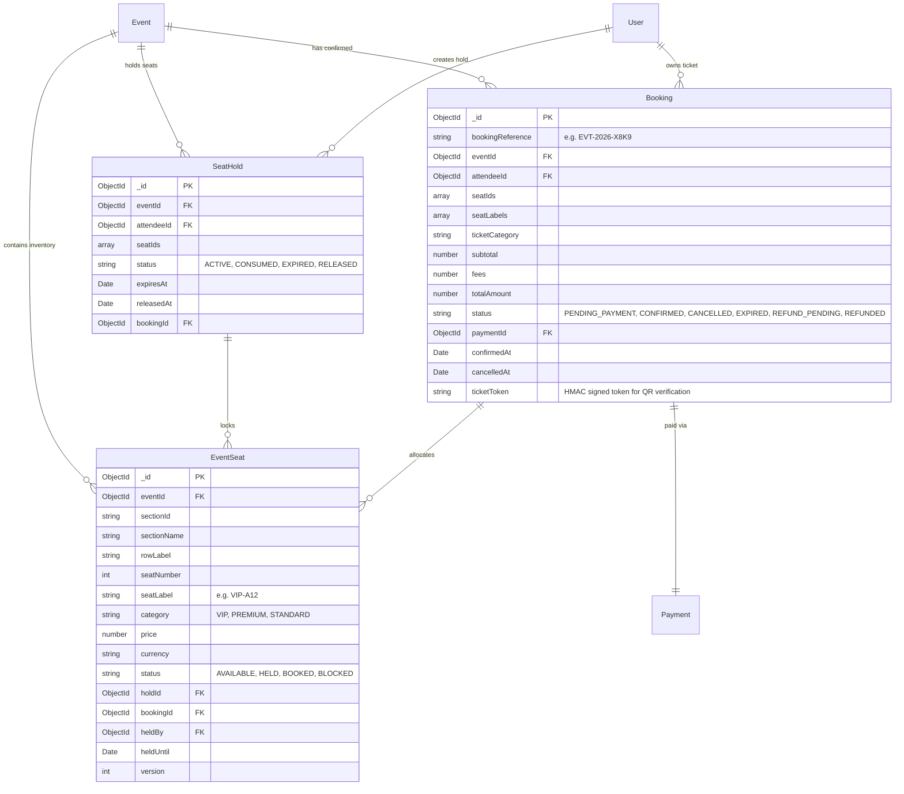

# Eventora — Payment Failure Root-Cause Analysis & Reserved Seat Ticketing Roadmap

## Executive Summary

During production deployment on Render and Vercel, attendees attempting to reserve tickets for paid events encountered an immediate failure modal stating:
> **"Oops! Something went wrong. Payment Failed"**

Inspection of the browser console revealed:
- `https://api.razorpay.com/v2/checkout/public?...` $\to$ **`HTTP 401 Unauthorized`**
- `https://api.razorpay.com/v1/checkout/public?...` $\to$ **`HTTP 401 Unauthorized`**
- Secondary warnings: GSAP target-not-found (inert DOM element selectors) and Canvas2D rendering performance hints.

This report establishes the **authoritative root cause** through end-to-end tracing across the frontend client, backend payment services, and deployment configurations. It delivers an error-hardening blueprint and the complete architectural plan for **Reserved Seat Booking & Ticketing**.

---

## 1. Trace of the Complete Payment Flow



### Step-by-Step Codebase Tracing:

1. **Frontend Initiation (`EventDetailView.tsx` & `RazorpayCheckoutModal.tsx`):**
   - The attendee clicks "Pay ₹{price} & Reserve Seat".
   - `handleInitiatePayment()` issues `POST /payments/create-order` with `{ eventId }`.
2. **Backend Route & Validation (`paymentRoutes.js` & `paymentController.js`):**
   - Mounted at `POST /api/v1/payments/create-order`.
   - Protected by `authRateLimiter`, `requireAuth`, `requireAttendee`, `requireVerifiedEmail`, `csrfProtection`, and Zod validation (`createOrderSchema`).
3. **Backend Order Creation & Hold (`paymentService.js`):**
   - `createOrderWithSeatHold()` validates the event, checks `seatsBooked + activeHolds < seatLimit`, and calls `createRazorpayOrder({ amountInPaise, receipt, notes })`.
4. **Razorpay Client Instantiation (`razorpayService.js`):**
   - `getRazorpayClient()` checks `process.env.RAZORPAY_KEY_ID` and `process.env.RAZORPAY_KEY_SECRET`.
   - **Critical Vulnerability Found:** Lines 80–83 of `razorpayService.js`:
     ```javascript
     if (!key_id || !key_secret) {
       logger.warn('Razorpay credentials not fully configured. Using mock gateway client for development/testing.');
       return mockRazorpayClient;
     }
     ```
     When running in production on Render with unpopulated or incomplete environment variables, the backend silently fell back to `mockRazorpayClient`.
5. **Synthetic Order Generation & Placeholder Key:**
   - `mockRazorpayClient.orders.create` returned a synthetic identifier: `order_mock_${Date.now()}_...`.
   - `paymentService.js` (line 172) returned:
     ```javascript
     keyId: process.env.RAZORPAY_KEY_ID || 'rzp_test_placeholder'
     ```
   - The backend returned HTTP 201 with `{ orderId: "order_mock_...", keyId: "rzp_test_placeholder" }`.
6. **Checkout Modal Execution (`RazorpayCheckoutModal.tsx`):**
   - The frontend running on Vercel dynamically loaded `https://checkout.razorpay.com/v1/checkout.js`.
   - Because the browser had active internet access, `scriptLoaded` was `true`. The offline simulation dialog was bypassed.
   - The real Razorpay Checkout script initialized with `key: "rzp_test_placeholder"` (or unconfigured key) and `order_id: "order_mock_..."`.
7. **Public Gateway Rejection (`api.razorpay.com`):**
   - Razorpay's `checkout.js` iframe issued authenticated HTTP requests to:
     - `https://api.razorpay.com/v2/checkout/public`
     - `https://api.razorpay.com/v1/checkout/public`
   - Because `"rzp_test_placeholder"` is invalid (or `"order_mock_..."` does not exist in Razorpay's database under that account), Razorpay's API immediately returned **`HTTP 401 Unauthorized`**.
8. **User-Facing Presentation:**
   - The Razorpay checkout modal iframe caught the 401 and rendered its built-in fallback:
     > *"Oops! Something went wrong. Payment Failed"*
   - The browser console logged the 401 network errors.
9. **Secondary Warnings Assessment:**
   - **GSAP Target-Not-Found:** Triggered by Lenis/GSAP scroll observers referencing animation elements not rendered on the `/events/[eventId]` route.
   - **Canvas2D Performance:** Browser heuristic warning regarding non-desynchronized canvas context during icon/QR code rendering.
   - *Conclusion:* Neither warning has any functional impact on payment authorization.

---

## 2. Root Cause Classification Matrix

| Hypothesized Failure Source | Finding | Status |
| :--- | :--- | :--- |
| **Vercel Frontend Build Environment** | The frontend does not bundle Razorpay secret keys; it dynamically consumes `keyId` and `orderId` from the backend `/payments/create-order` response. | Verified Correct |
| **Render Production Environment Variables** | `render.yaml` specifies `sync: false` for `RAZORPAY_KEY_ID`, `RAZORPAY_KEY_SECRET`, and `RAZORPAY_WEBHOOK_SECRET`. These were unset or set to placeholder values in the deployed Render dashboard. | **Root Cause (Configuration)** |
| **Silent Mock Fallback in Production** | `razorpayService.js` silently returned `mockRazorpayClient` when credentials were missing, returning synthetic `order_mock_...` IDs to a real browser client. | **Root Cause (Architectural Flaw)** |
| **Razorpay API Endpoint Mismatch** | `checkout.js` properly targets official `api.razorpay.com/v1` and `/v2`. | Verified Correct |
| **GSAP / Canvas2D Warnings** | Purely cosmetic client-side render hints completely decoupled from the payment lifecycle. | Non-Contributing |

---

## 3. Immediate Error Handling & Gateway Hardening

To permanently prevent confusing 401 failures and provide clear diagnostics:

1. **Eliminate Silent Mock Fallback in Production:**
   - When `NODE_ENV === 'production'`, `razorpayService.js` must strictly require valid credentials (`RAZORPAY_KEY_ID` starting with `rzp_test_` and `RAZORPAY_KEY_SECRET`).
   - If missing, fail immediately at order creation with an explicit HTTP 503 error:
     ```json
     {
       "success": false,
       "error": {
         "code": "PAYMENT_GATEWAY_NOT_CONFIGURED",
         "message": "Payment gateway is temporarily unavailable. Please contact support or try again later."
       }
     }
     ```
2. **Explicit Diagnostic Error Codes in Frontend:**
   - Replace generic "Payment Failed" with context-aware user messages:
     - `ERR_ORDER_EXPIRED`: "Your 10-minute seat hold has expired. Please select your seats again."
     - `ERR_PAYMENT_DECLINED`: "The card or payment method was declined by your bank."
     - `ERR_SEAT_CONFLICT`: "One or more of the selected seats were just claimed by another attendee."
     - `ERR_GATEWAY_UNAVAILABLE`: "Payment service is currently unavailable. Please check back shortly."
3. **Credential Guardrails:**
   - Reject live keys (`rzp_live_`) when `RAZORPAY_MODE=test`.
   - Never log secrets or authorization headers in Pino logs.
   - Return only the public `keyId` to the frontend.

---

## 4. Reserved Seat Ticketing Domain Architecture (Phases 2 – 8)

### 4.1 Domain Model Design
Rather than tracking seats as an integer count (`seatsBooked`), Eventora will introduce full venue topology:



### 4.2 Multi-Document Concurrency & Transaction Boundaries
1. **Atomic Multi-Seat Hold (`withTransaction`):**
   - Validates all requested seats.
   - Executes atomic conditional updates:
     ```javascript
     EventSeat.updateMany({
       _id: { $in: requestedSeatIds },
       status: 'AVAILABLE'
     }, {
       $set: { status: 'HELD', holdId, heldBy: attendeeId, heldUntil: expiresAt },
       $inc: { version: 1 }
     })
     ```
   - Verifies `modifiedCount === requestedSeatIds.length`. If any seat was already taken, aborts and rolls back completely.
2. **Autonomous Background Hold Expiration Worker:**
   - Runs on a scheduled interval (e.g. every 60 seconds).
   - Finds holds where `status == 'ACTIVE'` and `expiresAt < now()`.
   - Atomically marks hold `EXPIRED` and resets corresponding `EventSeat` documents where `holdId == hold._id` back to `AVAILABLE`.
3. **Idempotent Webhook & Callback Convergence:**
   - Both `POST /payments/verify` and `payment.captured` webhooks route through the same transactional booking confirmation service.
   - Uses MongoDB conditional update to transition `SeatHold` from `ACTIVE` $\to$ `CONSUMED` and `EventSeat` from `HELD` $\to$ `BOOKED`.
4. **Interactive Seat Map UI (`client/src/components/seating/`):**
   - SVG/Canvas-based interactive seat layout with sections, rows, categories, legend, real-time availability polling, and hold countdown timer.
   - Dynamic price calculations and instant mobile zoom/pan navigation.
5. **Secure QR Ticket Verification:**
   - Generates signed, tamper-proof opaque ticket tokens containing `{ bookingId, reference, attendeeId, timestamp, signature }`.
   - No payment secrets or PII stored inside the QR code. Server-side validation endpoint `/api/v1/bookings/verify-ticket/:token`.

---

## 5. Implementation Roadmap

```mermaid
flowchart LR
    P1["Phase 1: Payment Root-Cause & Gateway Hardening"] --> P2["Phase 2: Seat Models & Venue Layout Schema"]
    P2 --> P3["Phase 3: Concurrency, Atomic Holds & Expiration Worker"]
    P3 --> P4["Phase 4: Razorpay Lifecycle & Webhook Convergence"]
    P4 --> P5["Phase 5: Interactive SeatMap UI & Checkout"]
    P5 --> P6["Phase 6: Organizer Seating Management"]
    P6 --> P7["Phase 7: Ticket Generation & QR Code"]
    P7 --> P8["Phase 8: Concurrency & E2E Verification"]
```



