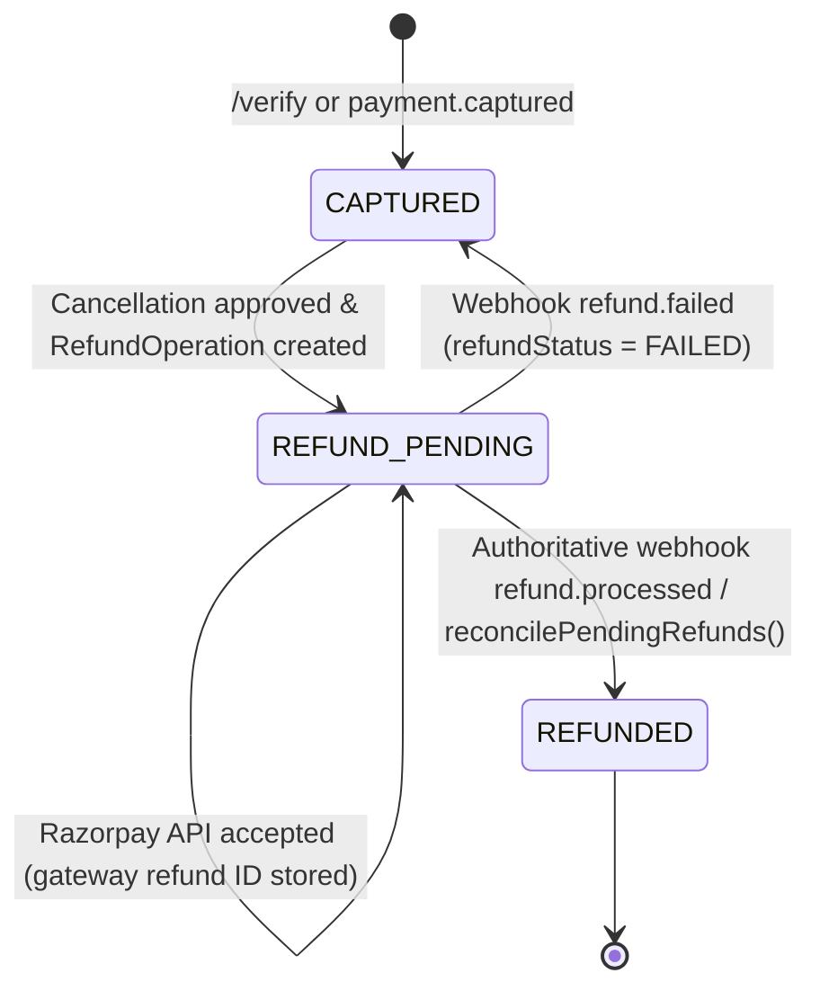

# Eventora — Razorpay Refund Lifecycle Correction & Verification Report

**Date:** November 7, 2026  
**Status:** IMPLEMENTED, CORRECTED & VERIFIED (103/103 Server Tests Passing, Client Production Build Verified)  
**Scope:** Elimination of 4 Razorpay refund defects, durable `RefundOperation` persistence, authoritative webhook confirmation, exactly-once seat release guarantees, and automated reconciliation worker.

---

## 1. Executive Summary

Following a deep audit of Eventora's Razorpay Test Mode implementation, four structural defects and testing gaps were identified:
1. **Premature Status Transition:** When an organizer approved a cancellation request, `registrationService.js` prematurely marked the `Payment` as `REFUNDED` immediately upon receiving the synchronous Razorpay API response, bypassing `PAYMENT_STATUS.REFUND_PENDING`.
2. **Missing Durable Operation & Idempotency Key:** Outbound refunds lacked an independent operational record, making duplicate approval attempts vulnerable to race conditions and rendering ambiguous gateway timeouts unrecoverable.
3. **Double-Decrement Risk in Seat Accounting:** `seatsBooked` was decremented during organizer approval and also inside the `refund.processed` webhook handler without an atomic release flag, creating race conditions.
4. **Lack of Automated Reconciliation & Integration Tests:** Pending and failed refunds had no worker to inspect provider state or retry safely, and webhook handlers for `refund.processed`, `refund.failed`, and `payment.failed` lacked automated integration test coverage.

All four defects have been systematically corrected, hardened with atomic conditional MongoDB operations, backed by a dedicated reconciliation worker, and verified with 103 passing tests.

---

## 2. Corrected Refund State Lifecycle



### Invariants:
- **Synchronous API Acceptance $\neq$ Completed Refund:** Outbound calls to `client.payments.refund()` only transition `Payment.status` to `PAYMENT_STATUS.REFUND_PENDING` and `refundStatus` to `REFUND_STATUS.PENDING`.
- **Authoritative Provider Confirmation:** Only cryptographic webhook verification of `refund.processed` or direct gateway query matching `amount_refunded >= payment.amount` transitions `payment.status` to `REFUNDED` and `refundStatus` to `PROCESSED`.
- **Failure Isolation:** On `refund.failed`, `payment.status` remains in an un-refunded state (`CAPTURED`), `payment.refundStatus` is marked `FAILED`, failure codes are recorded, and user alerts are dispatched.

---

## 3. Durable Refund Operations & Idempotency Strategy

To prevent concurrent approvals from initiating duplicate refunds, a dedicated Mongoose model was introduced:  
[`server/src/modules/payments/RefundOperation.js`](file:///d:/THE%20OMS%20DEVS/WEB%20DEVS/MERN%20PROJECTS/PERSONAL/EVENTORA/server/src/modules/payments/RefundOperation.js)

### Schema & Fields:
- `refundOpId`: Stable internal identifier (e.g. `rfop_1731000000_a1b2`).
- `paymentId` & `registrationId` & `eventId` & `attendeeId` & `organizerId`.
- `orderId` & `gatewayPaymentId` & `gatewayRefundId`.
- `amount` & `currency` (strictly derived from `payment.amount`).
- `status`: `INITIATED` $\rightarrow$ `PENDING` $\rightarrow$ `PROCESSED` | `FAILED` | `MANUAL_RECONCILIATION_REQUIRED`.
- `idempotencyKey`: Unique index on `refund_reg_${registrationId}`.
- `retryCount`, `maxRetries` (default 3), `lastAttemptAt`, `nextRetryAt`, `lastError`.

```javascript
// Idempotent creation enforced by MongoDB unique index
const idempotencyKey = `refund_reg_${registration._id}`;
let refundOp = await RefundOperation.findOne({ idempotencyKey });
if (!refundOp) {
  try {
    refundOp = await RefundOperation.create({
      refundOpId: `rfop_${Date.now()}_${crypto.randomBytes(4).toString('hex')}`,
      paymentId: payment._id,
      registrationId: registration._id,
      eventId: registration.eventId._id,
      attendeeId: registration.attendeeId,
      organizerId: new mongoose.Types.ObjectId(organizerId),
      orderId: payment.orderId,
      gatewayPaymentId: payment.paymentId,
      amount: payment.amount,
      currency: payment.currency || 'INR',
      reason: note || 'Organizer approved cancellation',
      status: 'INITIATED',
      idempotencyKey,
      lastAttemptAt: new Date()
    });
  } catch (dupErr) {
    if (dupErr.code === 11000) {
      refundOp = await RefundOperation.findOne({ idempotencyKey });
    } else {
      throw dupErr;
    }
  }
}
```

---

## 4. Concurrency-Safe Seat Release Guarantee

### Product Decision & Policy:
> **Eventora Canonical Policy:** When an organizer approves a cancellation (`APPROVE`), the attendee's seat is **released immediately back to the event pool**, allowing other attendees to book the vacancy without waiting for banking network refund settlement.

### Exactly-Once Implementation:
To prevent double-decrement when the asynchronous `refund.processed` webhook arrives later, the `Registration` model was extended with:
- `seatReleased: { type: Boolean, default: false, index: true }`
- `seatReleasedAt: { type: Date, default: null }`

Both the cancellation approval path and the webhook path use an atomic conditional update:

```javascript
const seatClaimed = await Registration.findOneAndUpdate(
  {
    _id: registration._id,
    seatReleased: { $ne: true }
  },
  {
    $set: {
      seatReleased: true,
      seatReleasedAt: new Date()
    }
  },
  { new: true }
);

if (seatClaimed) {
  await Event.findOneAndUpdate(
    { _id: registration.eventId, seatsBooked: { $gt: 0 } },
    { $inc: { seatsBooked: -1 } }
  );
}
```

### Guarantees:
1. **Never Decrement Twice:** If the organizer approves cancellation, `seatReleased` is transitioned to `true` and `seatsBooked` is decremented. When `refund.processed` arrives, `seatReleased: { $ne: true }` matches zero documents; the decrement is completely bypassed.
2. **Defensive Clamping:** Every `$inc: { seatsBooked: -1 }` operation is predicated on `{ seatsBooked: { $gt: 0 } }`. Under no circumstances can event bookings fall below zero.

---

## 5. Webhook Handlers Summary

[`server/src/modules/payments/webhook/webhookService.js`](file:///d:/THE%20OMS%20DEVS/WEB%20DEVS/MERN%20PROJECTS/PERSONAL/EVENTORA/server/src/modules/payments/webhook/webhookService.js)

1. **`payment.captured`:** Authoritatively finalizes payment, confirms reservation, creates `Registration` with `seatReleased: false` if user closed checkout before client callback, and triggers confirmation email.
2. **`payment.failed`:** Updates payment to `FAILED`, cancels pending seat hold, records error code/reason, and preserves already captured payments from out-of-order corruption.
3. **`refund.processed`:** Updates payment to `REFUNDED` and `refundStatus = PROCESSED`, synchronizes `Registration`, marks `RefundOperation = PROCESSED`, checks atomic seat release, and notifies attendee.
4. **`refund.failed`:** Updates `refundStatus = FAILED` across `Payment`, `Registration`, and `RefundOperation`, preserves non-refunded status, and dispatches attendee alert.

---

## 6. Reconciliation Worker (`reconcilePendingRefunds`)

Located in [`server/src/modules/payments/paymentService.js`](file:///d:/THE%20OMS%20DEVS/WEB%20DEVS/MERN%20PROJECTS/PERSONAL/EVENTORA/server/src/modules/payments/paymentService.js):

- **Concurrency-Safe:** Guarded by `isRefundReconciliationRunning` flag to avoid overlapping sweeps.
- **Provider Verification Before Retrying:** Always queries Razorpay via `fetchRazorpayPayment(op.gatewayPaymentId)`. If Razorpay reports `amount_refunded >= op.amount`, the operation is marked `PROCESSED` without issuing a duplicate refund.
- **Exponential Backoff:** Retries are scheduled with exponential backoff:
  $$\text{nextRetryAt} = \text{Date.now()} + 2^{\text{retryCount}} \times 60000 \text{ ms}$$
- **Dead-Letter State:** After 3 attempts (`maxRetries`), the operation is permanently marked `MANUAL_RECONCILIATION_REQUIRED` for administrative inspection.

---

## 7. Automated Test Verification Results

### Test Suite Execution:
```bash
npm test --prefix server
```

```text
TAP version 13
1..14
# tests 103
# suites 18
# pass 103
# fail 0
# cancelled 0
# skipped 0
# todo 0
# duration_ms 4016.8054
```

### Coverage Highlights in `paymentsAndWebhooks.test.js`:
- ✅ Test 10: Cancellation approval initiates refund, transitions to `REFUND_PENDING`, stores `RefundOperation`, and releases seat.
- ✅ Test 11: Duplicate cancellation approval returns 400 Bad Request without double-decrementing seats.
- ✅ Test 12: Webhook `refund.processed` authoritatively completes refund without duplicate seat decrement.
- ✅ Test 13: Webhook `refund.failed` records gateway error without falsely marking payment as `REFUNDED`.
- ✅ Test 14: Webhook `payment.failed` cancels pending hold and preserves captured payments.
- ✅ Test 15: Reconciliation worker sweeps pending refunds and safely resolves state without duplicate refunds.
- ✅ Test 16: Defensive seat accounting: `Event.seatsBooked` can never be decremented below 0.
- ✅ Frontend Next.js production build (`npm run build --prefix client`): 15/15 routes compiled with code 0.
