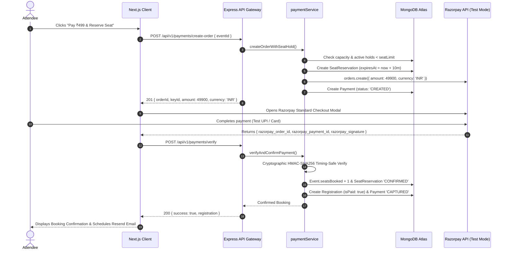
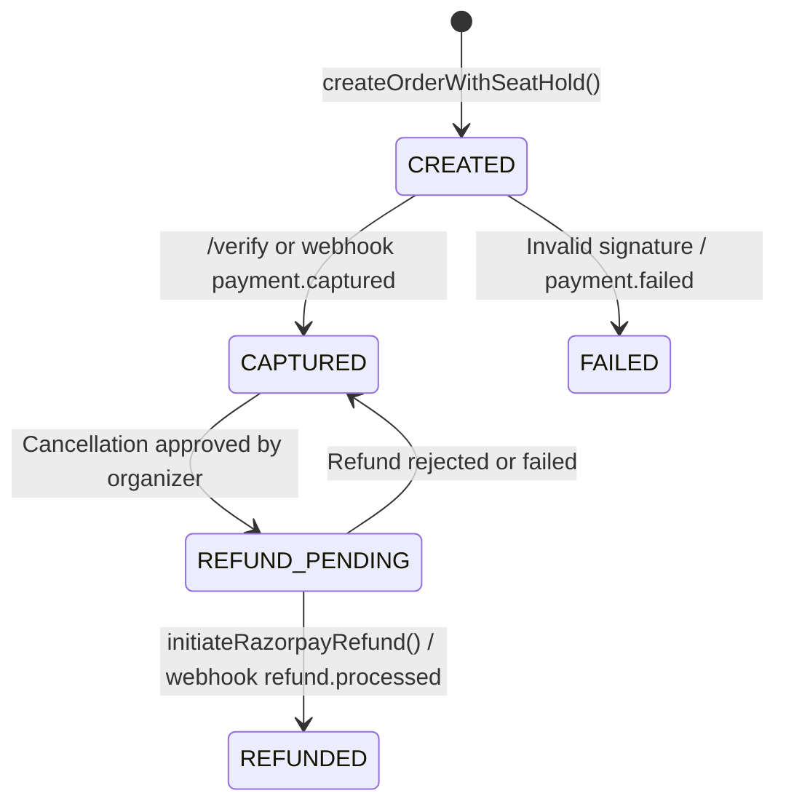

# Eventora — Razorpay Test Mode Payment & Webhook Architecture

**Date:** November 7, 2026  
**Status:** IMPLEMENTED & VERIFIED (85/85 Server Tests Passing, Client Next.js Build Verified)  
**Environment:** Razorpay Test Mode  
**Architecture:** Modular Monolith Vertical Slices (`server/src/modules/payments/`)  

---

## 1. Executive Summary

Eventora now supports **Razorpay Test Mode** payment processing alongside the existing atomic **Free RSVP** registration system. The implementation adheres to strict security standards:
- **Free Events:** Zero payment processing, atomic capacity reservation, and Resend confirmation emails remain completely intact.
- **Paid Events:** Organizers can price events in INR; attendees check out via Razorpay Standard Checkout in Test Mode; temporary 10-minute seat reservations prevent overselling; bookings are authoritatively finalized either via timing-safe HMAC checkout verification or the idempotent asynchronous webhook listener.
- **Zero Frontend Secrets:** Only public key identifiers (`RAZORPAY_KEY_ID`) are shared with the browser. All API secret keys and webhook secrets reside strictly in the Express backend.
- **Webhook Resilience:** Server-to-server webhook requests at `POST /api/v1/webhooks/razorpay` bypass browser-only `originCheckMiddleware` and CSRF guards without weakening protection on application endpoints.

---

## 2. Architecture & Vertical Slice Structure

The payment capability is isolated within the `payments` vertical slice in the backend, and dedicated components on the frontend:

```
server/src/modules/payments/
├── Payment.js                                # Mongoose schema for transaction tracking
├── SeatReservation.js                        # Temporary 10-minute seat holds with TTL
├── WebhookEvent.js                           # Webhook deduplication and audit trail
├── razorpayService.js                        # Official Razorpay SDK, HMAC verification, mock fallback
├── paymentValidation.js                      # Zod validation schemas for orders and checkout
├── paymentService.js                         # Business logic: holds, order creation, capture, refunds
├── paymentController.js                      # Express HTTP controllers
├── paymentRoutes.js                          # REST routes mounted at /api/v1/payments
└── webhook/
    ├── razorpayWebhookController.js          # Webhook handler with raw buffer signature check
    └── webhookService.js                     # Idempotent processor for payment and refund events

client/src/
├── components/payments/
│   └── RazorpayCheckoutModal.tsx             # Dynamic checkout.js loader & offline test simulator
└── components/events/
    └── EventDetailView.tsx                   # Conditional UI: Free RSVP vs Razorpay Checkout
```

---

## 3. Order & Seat Reservation Lifecycle



---

## 4. Webhook Security & Middleware Ordering

A critical architectural challenge identified during the audit was the global production `originCheckMiddleware`, which rejects requests lacking allowed browser `Origin` headers. Razorpay's webhook dispatch servers (`edge.razorpay.com`) never supply browser Origin headers.

### Defense-in-Depth Solution:
1. **Targeted Exemption in `securityMiddleware.js`:**
   ```javascript
   if (req.originalUrl?.startsWith('/api/v1/webhooks/razorpay') || req.path?.startsWith('/api/v1/webhooks/razorpay')) {
     return next();
   }
   ```
2. **Explicit Webhook Mounting in `app.js`:**
   Mounted before standard application routes, unencumbered by CSRF or browser-origin middleware.
3. **Raw Body Buffer Verification:**
   Preserves `req.rawBody` from `express.json({ verify })` so the exact binary digest is checked against `X-Razorpay-Signature`:
   ```javascript
   const expectedSignature = crypto
     .createHmac('sha256', process.env.RAZORPAY_WEBHOOK_SECRET)
     .update(rawBody)
     .digest('hex');

   crypto.timingSafeEqual(Buffer.from(expectedSignature), Buffer.from(signature));
   ```
4. **Exactly-Once Deduplication:**
   Every event ID is durably persisted to `WebhookEvent`. Duplicate deliveries (e.g. from network retries) immediately return HTTP 200 without reprocessing.

---

## 5. Payment State Machine



---

## 6. Seat Hold & Concurrency Policy

1. **Capacity Guarantee:**
   Available seats are calculated as:
   $$\text{Available} = \text{seatLimit} - (\text{seatsBooked} + \text{activeHolds})$$
   Where $\text{activeHolds}$ are records in `SeatReservation` with `status: 'PENDING'` and `expiresAt > new Date()`.
2. **Hold Window:**
   Holds expire automatically after **10 minutes**.
3. **Reconciliation:**
   `reconcileExpiredReservations()` lazily marks past-due holds `EXPIRED`.
4. **Late Payment Recovery:**
   If an attendee completes payment after their hold expired, the verification engine checks whether seats are still remaining before allocating. If the event sold out in the interim, the engine **initiates an automated full refund** to prevent overselling.

---

## 7. Environment Variables Reference

| Variable | Environment | Scope | Description |
|---|---|---|---|
| `RAZORPAY_KEY_ID` | Backend | Public | Test Key ID (`rzp_test_...`) used for SDK and checkout initialization |
| `RAZORPAY_KEY_SECRET` | Backend | Secret | Private API secret used for backend orders API and checkout HMAC verification |
| `RAZORPAY_WEBHOOK_SECRET` | Backend | Secret | Separate secret chosen by developer when creating webhook in Razorpay Dashboard |
| `RAZORPAY_MODE` | Backend | Setting | Must be `test`. Backend automatically rejects live credentials if set to `test`. |

> [!CAUTION]
> **Key Secret vs Webhook Secret:**  
> Never use `RAZORPAY_KEY_SECRET` for webhook signature verification. The webhook secret is an independent value chosen in the Razorpay Dashboard under **Account & Settings → Webhooks**.

---

## 8. Webhook Dashboard Configuration for Render

Once deployed to Render, configure the webhook in the Razorpay Dashboard:

1. **Log in to Razorpay Dashboard** and ensure **Test Mode** toggle is enabled (top-right).
2. Go to **Account & Settings → Webhooks** (under Developer Controls).
3. Click **Add New Webhook**.
4. Set **Webhook URL** to:
   ```text
   https://<YOUR-RENDER-BACKEND-SERVICE>.onrender.com/api/v1/webhooks/razorpay
   ```
5. Enter a secure string in **Secret** (e.g., generate via `openssl rand -hex 24`).
6. Save this exact string in Render as `RAZORPAY_WEBHOOK_SECRET`.
7. Under **Active Events**, select:
   - `payment.captured`
   - `payment.failed`
   - `refund.processed`
   - `refund.failed`
8. Click **Save Webhook**.
