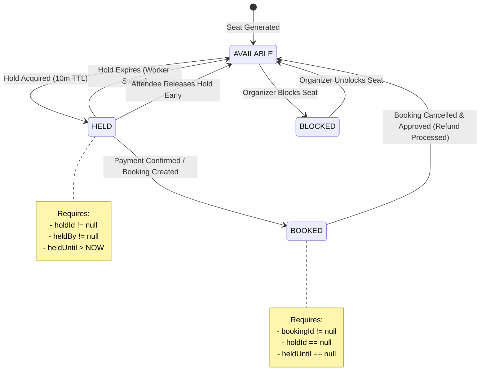
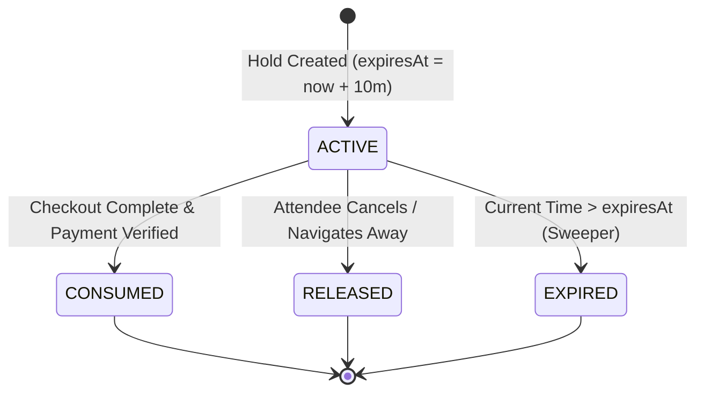
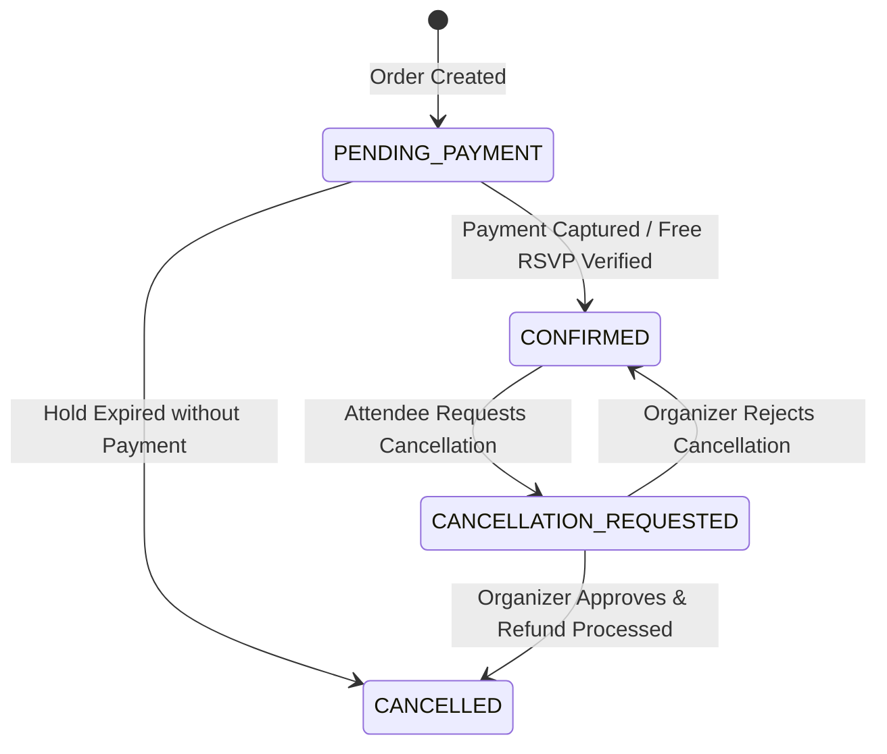
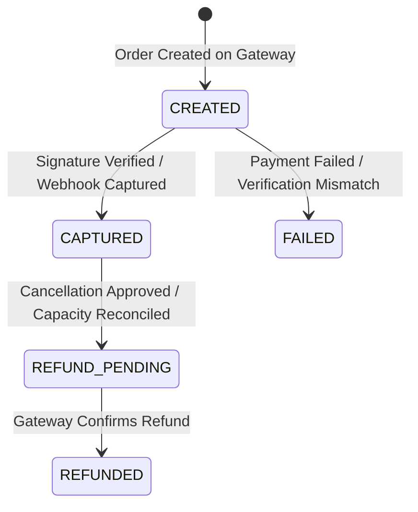

# Booking & Seat Inventory State Machines

## 1. EventSeat State Machine

### Transition Validation Rules
| From State | To State | Trigger | Preconditions |
|---|---|---|---|
| `AVAILABLE` | `HELD` | `createSeatHold` | Event published, future date, seat unreserved |
| `HELD` | `AVAILABLE` | `expireStaleHolds` or `releaseSeatHold` | Hold expired or requested by hold owner |
| `HELD` | `BOOKED` | `verifyAndConfirmPayment` | Hold active, valid signature, atomic transaction |
| `AVAILABLE` | `BLOCKED` | `toggleSeatBlock` | Organizer owns event, seat currently unbooked |
| `BLOCKED` | `AVAILABLE` | `toggleSeatBlock` | Organizer owns event, unblock requested |
| `BOOKED` | `AVAILABLE` | `processCancellationDecision` | Cancellation approved; refund dispatched |

---

## 2. SeatHold State Machine

### Invariants:
- A hold in `CONSUMED`, `RELEASED`, or `EXPIRED` can **never** transition back to `ACTIVE`.
- `expiresAt` is calculated strictly by the server and immutable once created.
- An expired hold cannot be used to confirm a booking.

---

## 3. Booking State Machine

---

## 4. Payment State Machine

