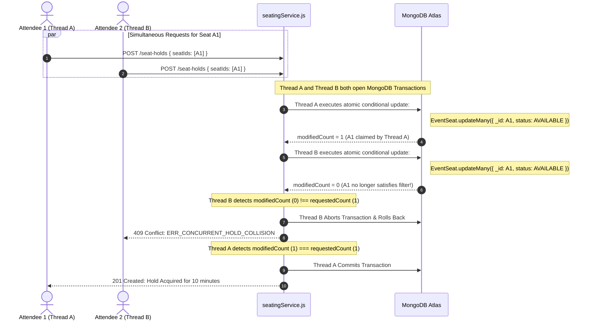

# Concurrency Control Strategy — Double Booking Immunity

## 1. The Double-Booking Threat Model

In high-demand ticketing scenarios (e.g. 20 concurrent attendees clicking seat A1 at the exact same millisecond), naive "read-then-write" application logic will experience a classic race condition:
1. Thread A reads: `A1.status === AVAILABLE`
2. Thread B reads: `A1.status === AVAILABLE`
3. Thread A writes: `A1.status = HELD`
4. Thread B writes: `A1.status = HELD` (overwriting Thread A)
Both attendees believe they reserved the seat, leading to double payment, negative customer experience, and accounting reconciliation failure.

---

## 2. Eventora Concurrency Control Solution

Eventora implements **authoritative backend-level concurrency control** using two complementary layers:
1. **Conditional Atomic Updates with Version Incrementing**
2. **MongoDB Replica Set Multi-Document Transactions (`withTransaction`)**

### 2.1 Concurrency Competition Sequence Diagram



---

## 3. Atomic Multi-Seat Reservation Guarantees

When an attendee requests multiple seats (e.g., `[A1, A2, A3]`):
1. **All-or-Nothing Guarantee**:
   The update query checks that all requested seats match the availability filter:
   ```javascript
   const updateRes = await EventSeat.updateMany(
     {
       _id: { $in: objectSeatIds },
       eventId: new mongoose.Types.ObjectId(eventId),
       $or: [
         { status: SEAT_STATUS.AVAILABLE },
         { status: SEAT_STATUS.HELD, heldUntil: { $lte: new Date() } },
         { status: SEAT_STATUS.HELD, heldBy: new mongoose.Types.ObjectId(attendeeId) }
       ]
     },
     {
       $set: {
         status: SEAT_STATUS.HELD,
         holdId: hold._id,
         heldBy: new mongoose.Types.ObjectId(attendeeId),
         heldUntil: expiresAt
       },
       $inc: { version: 1 }
     },
     session ? { session } : {}
   );

   if (updateRes.modifiedCount !== seatIds.length) {
     // Even if 2 out of 3 were available, we abort and roll back all changes!
     throw new ConflictError('A concurrent booking conflict occurred. Please select your seats again.', {
       code: 'ERR_CONCURRENT_HOLD_COLLISION'
     });
   }
   ```
2. **Compound Index Integrity**:
   The unique index `{ eventId: 1, seatLabel: 1 }` prevents duplicate physical seat records from ever being created at the storage layer.
3. **No Phantom Re-bookings**:
   If an attendee attempts payment after their hold has expired and the seat was claimed by someone else, `verifyAndConfirmPayment` detects that the seat is no longer held by that user and automatically triggers a full refund without stealing the seat.

