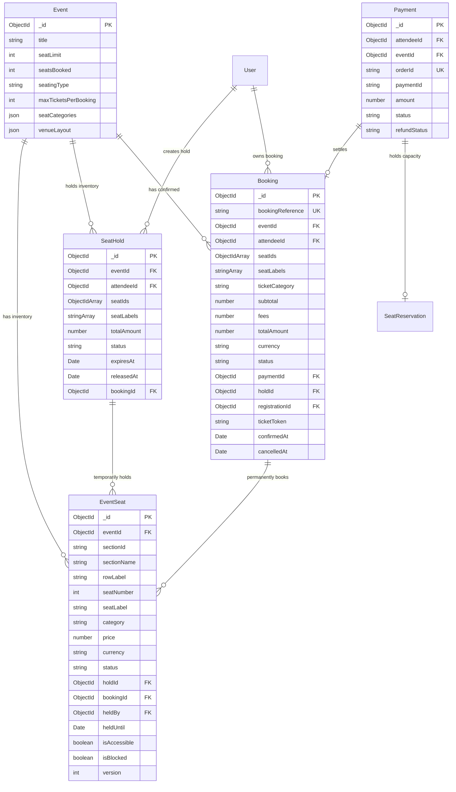

# Database Design & Schemas

## 1. Entity-Relationship Diagram



---

## 2. Schema Specifications

### 2.1 `EventSeat` Collection
```javascript
const eventSeatSchema = new mongoose.Schema(
  {
    eventId: { type: mongoose.Schema.Types.ObjectId, ref: 'Event', required: true, index: true },
    sectionId: { type: String, required: true, trim: true },
    sectionName: { type: String, required: true, trim: true },
    rowLabel: { type: String, required: true, trim: true, uppercase: true },
    seatNumber: { type: Number, required: true, min: 1 },
    seatLabel: { type: String, required: true, trim: true }, // e.g. "A1", "BALCONY-B10"
    category: {
      type: String,
      enum: ['STANDARD', 'PREMIUM', 'VIP', 'ACCESSIBLE'],
      default: 'STANDARD'
    },
    price: { type: Number, required: true, min: 0 },
    currency: { type: String, default: 'INR', uppercase: true },
    status: {
      type: String,
      enum: ['AVAILABLE', 'HELD', 'BOOKED', 'BLOCKED'],
      default: 'AVAILABLE',
      index: true
    },
    holdId: { type: mongoose.Schema.Types.ObjectId, ref: 'SeatHold', default: null, index: true },
    bookingId: { type: mongoose.Schema.Types.ObjectId, ref: 'Booking', default: null, index: true },
    heldBy: { type: mongoose.Schema.Types.ObjectId, ref: 'User', default: null, index: true },
    heldUntil: { type: Date, default: null },
    isAccessible: { type: Boolean, default: false },
    isBlocked: { type: Boolean, default: false },
    version: { type: Number, default: 0 } // Optimistic locking guard
  },
  { timestamps: true }
);

// Indexes
eventSeatSchema.index({ eventId: 1, seatLabel: 1 }, { unique: true });
eventSeatSchema.index({ eventId: 1, status: 1 });
eventSeatSchema.index({ eventId: 1, sectionId: 1, rowLabel: 1 });
eventSeatSchema.index({ holdId: 1, status: 1 });
eventSeatSchema.index({ bookingId: 1, status: 1 });
```

### 2.2 `SeatHold` Collection
```javascript
const seatHoldSchema = new mongoose.Schema(
  {
    eventId: { type: mongoose.Schema.Types.ObjectId, ref: 'Event', required: true, index: true },
    attendeeId: { type: mongoose.Schema.Types.ObjectId, ref: 'User', required: true, index: true },
    seatIds: [{ type: mongoose.Schema.Types.ObjectId, ref: 'EventSeat', required: true }],
    seatLabels: [{ type: String, required: true }],
    totalAmount: { type: Number, required: true, min: 0 },
    status: {
      type: String,
      enum: ['ACTIVE', 'CONSUMED', 'EXPIRED', 'RELEASED'],
      default: 'ACTIVE',
      index: true
    },
    expiresAt: { type: Date, required: true, index: true },
    releasedAt: { type: Date, default: null },
    bookingId: { type: mongoose.Schema.Types.ObjectId, ref: 'Booking', default: null }
  },
  { timestamps: true }
);

seatHoldSchema.index({ eventId: 1, attendeeId: 1, status: 1 });
seatHoldSchema.index({ status: 1, expiresAt: 1 });
```

### 2.3 `Booking` Collection
```javascript
const bookingSchema = new mongoose.Schema(
  {
    bookingReference: {
      type: String,
      required: true,
      unique: true,
      trim: true,
      uppercase: true,
      index: true
    }, // e.g. "EVT-20261108-A9F2"
    eventId: { type: mongoose.Schema.Types.ObjectId, ref: 'Event', required: true, index: true },
    attendeeId: { type: mongoose.Schema.Types.ObjectId, ref: 'User', required: true, index: true },
    seatIds: [{ type: mongoose.Schema.Types.ObjectId, ref: 'EventSeat' }],
    seatLabels: [{ type: String, trim: true }],
    ticketCategory: { type: String, default: 'STANDARD', trim: true },
    subtotal: { type: Number, required: true, min: 0 },
    fees: { type: Number, default: 0, min: 0 },
    totalAmount: { type: Number, required: true, min: 0 },
    currency: { type: String, default: 'INR', uppercase: true },
    status: {
      type: String,
      enum: ['PENDING_PAYMENT', 'CONFIRMED', 'CANCELLED'],
      default: 'PENDING_PAYMENT',
      index: true
    },
    paymentId: { type: mongoose.Schema.Types.ObjectId, ref: 'Payment', default: null, index: true },
    holdId: { type: mongoose.Schema.Types.ObjectId, ref: 'SeatHold', default: null, index: true },
    registrationId: { type: mongoose.Schema.Types.ObjectId, ref: 'Registration', default: null, index: true },
    confirmedAt: { type: Date, default: null },
    cancelledAt: { type: Date, default: null },
    ticketToken: { type: String, default: null, index: true } // Signed HMAC for digital ticket QR verification
  },
  { timestamps: true }
);

bookingSchema.index({ eventId: 1, attendeeId: 1, status: 1 });
bookingSchema.index({ attendeeId: 1, createdAt: -1 });
```

---

## 3. Data Invariants

1. **Uniqueness**: `(eventId, seatLabel)` must be globally unique across all seats in an event. No two seats may share a label.
2. **Exclusivity**: An `EventSeat` cannot simultaneously be linked to two active `SeatHold` records or two `Booking` records.
3. **Atomic Ownership**: In `EventSeat`, whenever `status === 'HELD'`, `holdId`, `heldBy`, and `heldUntil` must be non-null. When `status === 'AVAILABLE'`, `holdId`, `heldBy`, `heldUntil`, and `bookingId` must be `null`.
4. **Capacity Equivalence**: For events configured with `ASSIGNED_SEATING`, `seatLimit === count(EventSeat where eventId = event._id)`.

