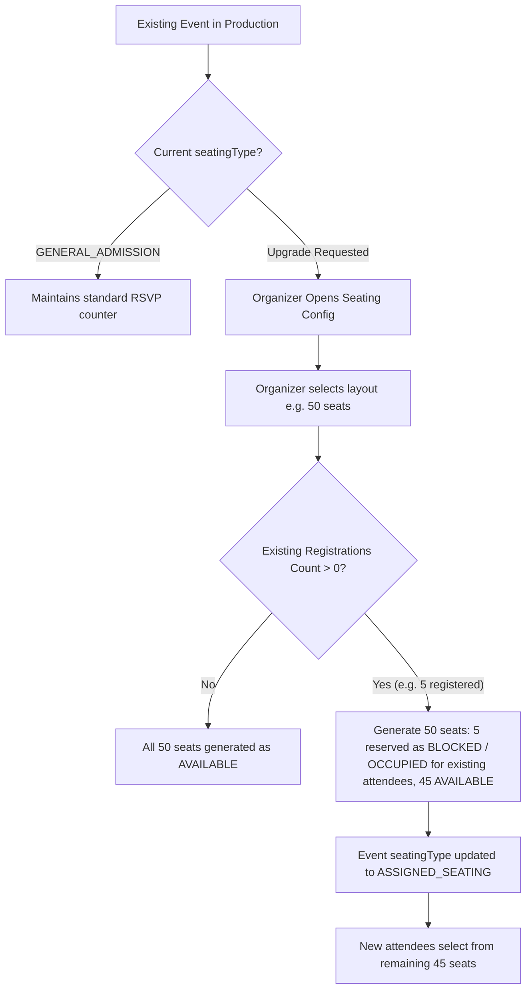

# Backward Compatibility & Migration Plan

## 1. Non-Disruptive Migration Principles

1. **Zero Data Loss**: Existing events, registrations, payments, and audit logs are preserved untouched.
2. **Dual-Mode Coexistence**:
   - `GENERAL_ADMISSION` events use capacity counters (`seatLimit`, `seatsBooked`) and standard RSVP.
   - `ASSIGNED_SEATING` events use individual seat inventory (`EventSeat`, `SeatHold`, `Booking`).
3. **No Fabricated History**: We never invent fictitious seat assignments (e.g. assigning "A1" retroactively) to past attendees of general admission events.
4. **Occupied Capacity Protection**: When an existing event is upgraded from general admission to assigned seating, any existing registrations reduce the available seats so that the total capacity is never exceeded.

---

## 2. Legacy Event Transition Workflow



---

## 3. Migration Script & Routine

A migration script `server/src/scripts/initEventSeating.js` is provided to allow organizers to initialize seating inventory for any event safely:

```javascript
export async function initializeSeatingForEvent(eventId, layout) {
  const event = await Event.findById(eventId);
  if (!event) throw new NotFoundError('Event not found');

  // Verify existing bookings count does not exceed layout seat count
  const existingBookingsCount = event.seatsBooked || 0;
  const totalLayoutSeats = layout.sections.reduce((acc, s) => {
    return acc + s.rows.reduce((rAcc, r) => rAcc + r.seatCount, 0);
  }, 0);

  if (totalLayoutSeats < existingBookingsCount) {
    throw new BadRequestError(
      `Cannot generate layout with ${totalLayoutSeats} seats because event already has ${existingBookingsCount} confirmed attendees.`
    );
  }

  // Generate seats with existing occupancy marked
  return generateEventSeats(eventId, layout, existingBookingsCount);
}
```

---

## 4. Rollback Strategy

If an organizer needs to revert an event with zero seat holds to general admission:
1. Verify no seats have status `HELD` or `BOOKED`.
2. Clear `EventSeat` inventory: `EventSeat.deleteMany({ eventId })`.
3. Reset `event.seatingType = 'GENERAL_ADMISSION'`.
4. Event immediately returns to standard capacity counter mode with zero downtime.

