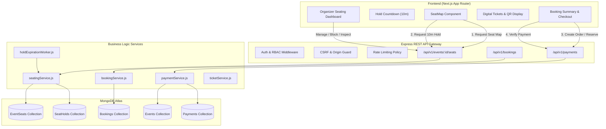
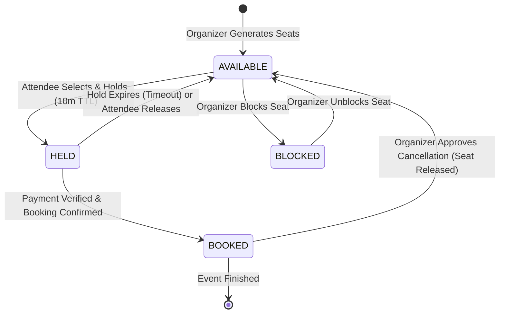
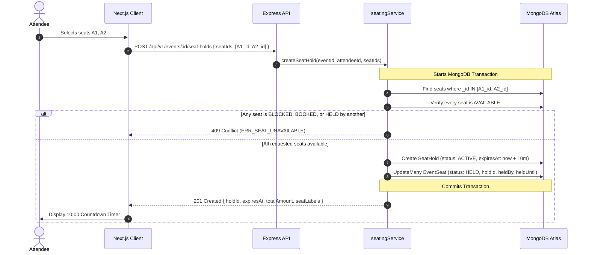
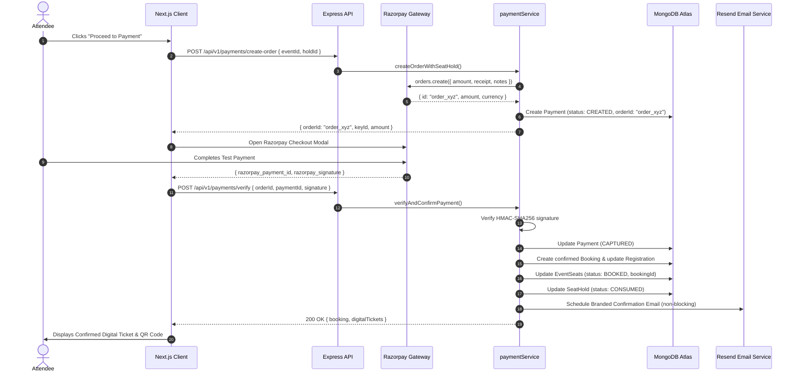
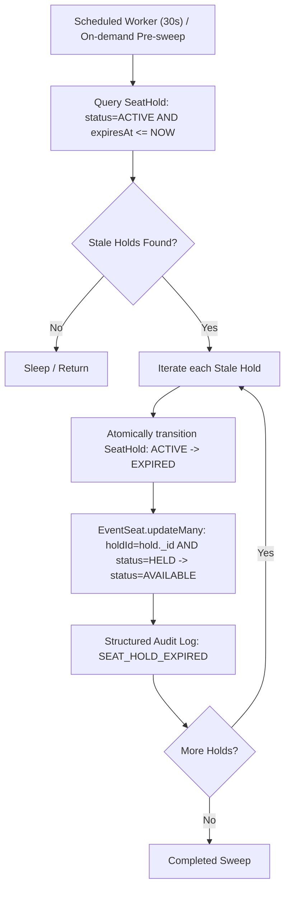

# Seat Booking Architecture Specification

## 1. Architectural Overview

The Eventora Seat Booking System transitions Eventora from a capacity-counter ticketing model to an authoritative, individual-inventory seat reservation engine.

---

## 2. End-to-End Workflows

### 2.1 Seat Lifecycle Workflow

---

### 2.2 Seat Hold Workflow

---

### 2.3 Booking & Payment Verification Workflow

---

### 2.4 Automatic Hold Expiration Sweep

