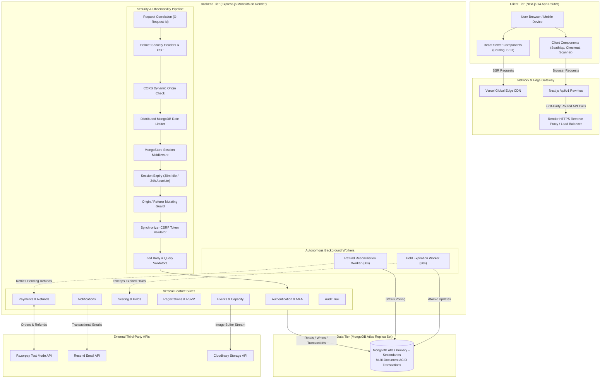
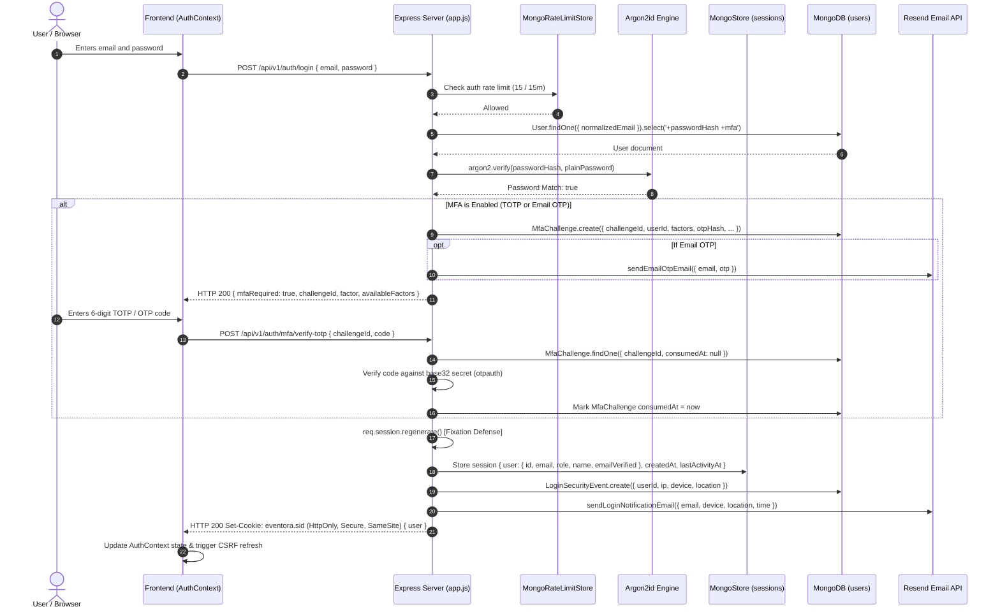
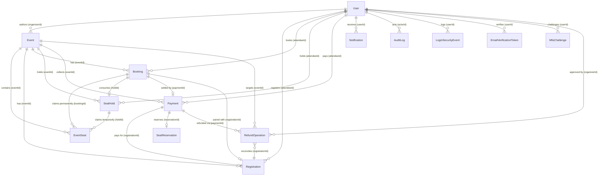
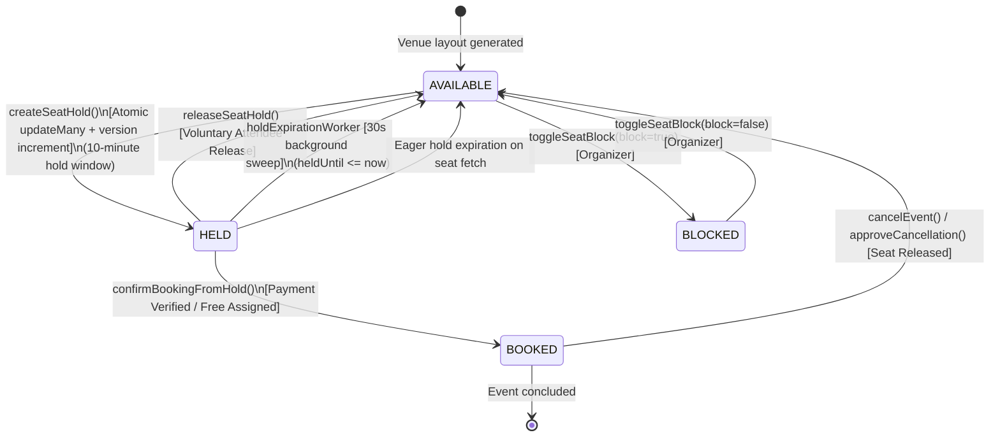
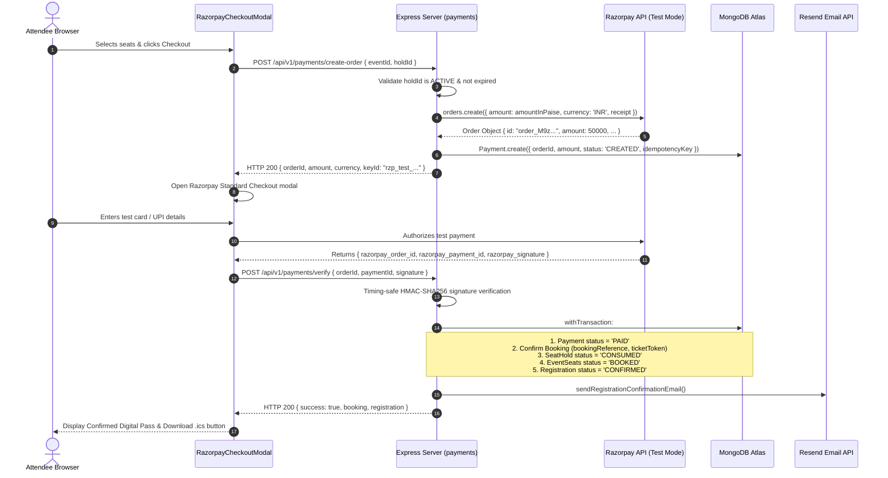
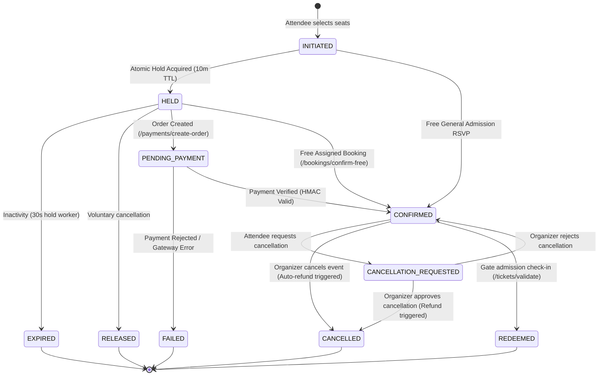
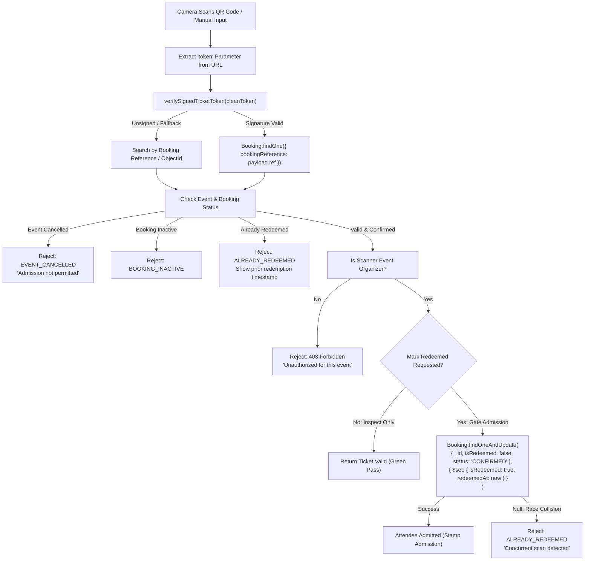
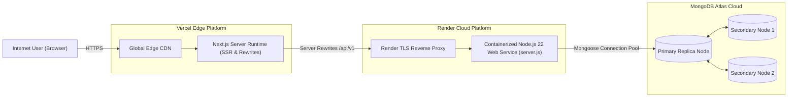

# Eventora — Complete Technical Dossier & Codebase Architecture Intelligence

> **CONFIDENTIAL ARCHITECTURAL REFERENCE & VIVA INTELLIGENCE DOSSIER**  
> **Target System:** Eventora — Full-Stack Event Booking, Visual Seat Reservation & Digital Ticketing Platform  
> **Audit Status:** Verified against Source Code, Test Suites, Deployment Configurations, and Database Schemas  
> **Author:** Senior Software Architect, Application Security Auditor, and Database Specialist  
> **Generation Date:** November 2026

---

## 1. Project Overview

**Eventora** is a high-reliability, production-grade event booking and RSVP management platform engineered to resolve the classic failure modes of high-demand event ticketing: concurrency race conditions, ticket overselling, orphaned reservations, payment gateway drop-offs, and counterfeit pass redemption.

The system caters to two distinct user personas through strict Role-Based Access Control (RBAC):
1. **Organizers (`ORGANIZER`):** Author and configure public events, define venue capacities and multi-tier pricing, design interactive SVG seating layouts (VIP, Premium, Standard), monitor real-time ticket sales and revenue velocity, manage attendee rosters with CSV export, review cancellation requests, and scan digital ticket QR passes at venue gates using mobile camera viewfinders.
2. **Attendees (`ATTENDEE`):** Discover upcoming events via multi-parametric search (city hubs, availability, categories), reserve seats through either instant General Admission RSVP or an interactive SVG visual seat map with real-time 10-minute holds, complete INR test-mode checkouts via Razorpay, view interactive digital passes with cryptographic HMAC-SHA256 signatures, download RFC 5545 `.ics` calendar passes, and request ticket cancellations.

### Architectural Philosophy
Eventora is structured as a **Modular Monolith** employing **Vertical Slice Architecture**. Rather than slicing code horizontally across traditional layered tiers (controllers, models, services), each business capability (Authentication, Events, Seating, Bookings, Payments, Registrations, Notifications, Audit) encapsulates its own routing, validation, domain services, persistence models, and error handling. This maximizes cohesion, enforces domain boundaries, and allows independent reasoning about each workflow.

---

## 2. Project Goals and Scope

### Primary Goals
1. **Zero Overselling Guarantee:** Prevent physical seat or capacity over-allocation under concurrent traffic spikes using MongoDB replica set multi-document ACID transactions and conditional atomic write operations (`$or` conditions on seat status and holds).
2. **Visual Multi-Tier Seat Reservation:** Deliver a visual SVG seating canvas with section, row, and seat-level selection, paired with real-time 10-minute ephemeral seat locking.
3. **Defense-in-Depth Security:** Mitigate OWASP Top 10 vulnerabilities with memory-hard Argon2id password hashing, stateful server-side sessions backed by MongoDB (`connect-mongo`), synchronizer CSRF tokens verified via constant-time comparisons (`crypto.timingSafeEqual`), strict origin validation, RFC 6238 TOTP authenticator MFA with AES-256-GCM encryption at rest, and backend-only media upload streaming with binary magic-bytes inspection.
4. **Resilient Payment & Refund Operations:** Implement Razorpay test-mode checkout with timing-safe HMAC-SHA256 signature verification, late capture protection (automated refunds if payment arrives after an event is cancelled), persistent `RefundOperation` audit records, and autonomous background reconciliation workers.
5. **Counterfeit-Proof Digital Ticketing:** Issue tickets encoded with opaque HMAC-SHA256 cryptographic signatures. Ensure atomic gate check-in that unconditionally prevents double-admission.
6. **Cross-Platform Calendar Interoperability:** Provide RFC 5545 compliant `.ics` calendar pass downloads with UTC timestamps, line folding (max 75 octets per line without severing multi-byte UTF-8 sequences), and CRLF line terminators.

### Verified Project Scope
- **Fully Implemented & Verified:**
  - Multi-factor authentication (TOTP authenticator app, 6-digit Email OTP, 10 formatted recovery codes).
  - Login security tracking with device parsing (`ua-parser-js`) and IP geolocation (`geoip-lite`).
  - Account email verification gating for mutating operations.
  - Full CRUD for events with capacity floor safeguards (cannot reduce capacity below booked count).
  - Backend-only image streaming to Cloudinary via Multer memory storage and binary magic-bytes verification.
  - Interactive SVG seat map with tier pricing (VIP, Premium, Standard).
  - 10-minute temporary seat hold engine with autonomous 30-second sweeper worker (`holdExpirationWorker.js`).
  - Razorpay payment order generation in paise, modal checkout, and HMAC verification.
  - Autonomous 60-second refund reconciliation worker (`refundReconciliationWorker.js`).
  - Cryptographic ticket token generation, QR code payload generation, and camera gate scanner (`/tickets/verify`).
  - RFC 5545 `.ics` file generation and download.
  - In-app notification feed and Resend transactional email integration.
- **Explicitly Excluded / Future Enhancements:**
  - Direct Google Calendar API integration / OAuth two-way synchronization (only `.ics` download is implemented).
  - Live commercial billing (Razorpay runs exclusively in Test Mode).
  - Real-time WebSocket / SSE push for seat canvas (uses 15-second polling via TanStack Query).
  - Native Apple Wallet / Google Wallet `.pkpass` bundles.

---

## 3. Verified Technology Stack

Every dependency and technology in Eventora has been verified against the root, server, and client package manifests and source code.

### Frontend Technology Stack (`client/package.json`)
| Technology | Package & Version | Architectural Purpose | Verification Evidence |
|---|---|---|---|
| **Framework** | Next.js `14.2.23` (App Router) | Hybrid SSR and Client Component rendering; file-based routing | `client/package.json`, `client/src/app/` |
| **UI Library** | React `18.3.1` / React DOM `18.3.1` | Component lifecycle, hooks, and virtual DOM | `client/package.json` |
| **Language** | TypeScript `5.7.2` | Compile-time type safety and domain model contracts | `client/tsconfig.json`, `client/src/types/index.ts` |
| **CSS Framework** | Tailwind CSS `3.4.17` | Utility-first styling with dark-mode theme variables | `client/tailwind.config.ts`, `client/src/app/globals.css` |
| **UI Primitives** | Radix UI (`@radix-ui/react-avatar` `1.3.1`, `@radix-ui/react-dropdown-menu` `2.2.1`, `@radix-ui/react-select` `2.4.1`) | Headless accessible UI primitives | `client/src/components/ui/` |
| **Client State / Fetching** | TanStack React Query `@tanstack/react-query` `5.62.16` | Server-state caching, background revalidation, optimistic updates | `client/src/app/providers.tsx`, `client/src/lib/api.ts` |
| **Form Management** | React Hook Form `7.54.2` | Performant, uncontrolled form state management | `client/src/components/auth/` |
| **Schema Validation** | Zod `3.24.1` + `@hookform/resolvers` `3.9.1` | Client-side input validation and error mapping | `client/src/components/auth/`, `client/src/lib/` |
| **Animation & Motion** | GSAP `3.12.5` | Smooth entrance choreographies and timeline controls | `client/src/components/landing/LandingView.tsx` |
| **Smooth Scrolling** | Lenis `1.3.27` | Inertial smooth scrolling physics (prefers-reduced-motion safe) | `client/src/components/layout/SmoothScrollProvider.tsx` |
| **Camera QR Scanner** | `html5-qrcode` `2.3.8` | Mobile and desktop browser camera QR code decoding | `client/src/components/tickets/QrCameraScanner.tsx` |
| **Icons** | `lucide-react` `0.469.0` | Accessible SVG icon suite | Used across all components |
| **Theme Engine** | `next-themes` `0.4.4` | Dark/light mode theme provider with system preference sync | `client/src/components/layout/ThemeToggle.tsx` |
| **E2E Testing** | `@playwright/test` `1.49.1` | End-to-end browser automation suite | `client/playwright/playwright.config.ts` |

### Backend Technology Stack (`server/package.json`)
| Technology | Package & Version | Architectural Purpose | Verification Evidence |
|---|---|---|---|
| **Runtime** | Node.js `22.x LTS` (ES Modules) | Server runtime supporting modern ECMAScript module imports | `server/package.json` (`"type": "module"`), `render.yaml` |
| **Web Framework** | Express.js `4.21.2` | REST API pipeline, middleware composition, routing | `server/src/app.js`, `server/src/server.js` |
| **Database & ODM** | MongoDB Atlas / Mongoose `8.9.5` | Object Data Modeling, schema constraints, transactions | `server/src/infrastructure/database/` |
| **Session Store** | `express-session` `1.18.1` + `connect-mongo` `5.1.0` | Stateful server-side sessions stored in MongoDB | `server/src/infrastructure/session/sessionConfig.js` |
| **Password Cryptography** | `argon2` `0.41.1` | Memory-hard Argon2id password hashing ($19\text{ MiB}$, 2 iterations, 1 parallelism) | `server/src/infrastructure/security/password.js` |
| **MFA TOTP Engine** | `otpauth` `9.6.0` | RFC 6238 TOTP generation, URI generation, delta verification | `server/src/infrastructure/security/totpService.js` |
| **QR Generation** | `qrcode` `1.5.4` | TOTP setup QR code PNG data URL generation | `server/src/infrastructure/security/totpService.js` |
| **Security Headers** | `helmet` `8.0.0` | Content Security Policy, HSTS, X-Content-Type-Options | `server/src/app.js` |
| **CORS Middleware** | `cors` `2.8.5` | Dynamic origin verification and credentials handling | `server/src/app.js` |
| **Cookie Parsing** | `cookie-parser` `1.4.7` | Signed and unsigned cookie header parsing | `server/src/app.js` |
| **Rate Limiting** | `express-rate-limit` `7.5.0` | IP and account rate limiting backed by MongoDB TTL collection | `server/src/shared/middleware/rateLimiter.js` |
| **File Ingestion** | `multer` `2.5.0` | In-memory binary buffer upload handling | `server/src/shared/middleware/uploadMiddleware.js` |
| **Media Cloud Storage** | `cloudinary` `2.11.0` | Official Node SDK for streaming images to Cloudinary | `server/src/infrastructure/cloudinary/cloudinaryService.js` |
| **Payment Gateway** | `razorpay` `2.9.8` | Razorpay order creation, payment fetching, refund processing | `server/src/modules/payments/razorpayService.js` |
| **Transactional Email** | `resend` `6.37.0` | Transactional email delivery via Resend API | `server/src/infrastructure/email/emailService.js` |
| **User Agent Parser** | `ua-parser-js` `2.0.10` | Device, browser, and OS parsing for login alerts | `server/src/infrastructure/security/deviceGeoService.js` |
| **GeoIP Lookup** | `geoip-lite` `1.4.10` | Offline IP geolocation lookup (city, region, country) | `server/src/infrastructure/security/deviceGeoService.js` |
| **Structured Logger** | `pino` `9.6.0` + `pino-http` `10.4.0` | High-speed JSON logging with request correlation IDs | `server/src/infrastructure/logging/logger.js` |
| **Schema Validation** | `zod` `3.25.76` | Server-side request payload and query validation | `server/src/shared/validation/` |
| **Automated Testing** | Node.js Native Runner (`node:test`) + `supertest` `7.0.0` | Unit, integration, and security test execution | `server/tests/` |

---

## 4. Complete Repository Structure

```text
EVENTORA/
├── .github/
│   └── workflows/
│       └── ci.yml                             # GitHub Actions CI workflow (Node 22, Mongo 7.0, Playwright)
├── client/                                    # Frontend Next.js 14 App Router Application
│   ├── playwright/                            # End-to-End Test Suite
│   │   ├── tests/
│   │   │   ├── authentication/
│   │   │   │   └── auth.spec.ts               # Registration, login, MFA, and session verification
│   │   │   ├── authorization/
│   │   │   │   └── roleGuard.spec.ts          # Route protection and role boundary enforcement
│   │   │   ├── events/
│   │   │   │   ├── events.spec.ts             # Event catalog, search, and details inspection
│   │   │   │   ├── mobileAndScanner.spec.ts   # Mobile responsiveness and camera scanner UI
│   │   │   │   ├── rsvpFlow.spec.ts           # Free RSVP registration lifecycle
│   │   │   │   └── seatingWorkflow.spec.ts    # Interactive SVG seat selection and booking
│   │   │   └── seo/
│   │   │       └── seoAndBranding.spec.ts     # Metadata, JSON-LD schema, robots.txt, sitemap.xml
│   │   └── playwright.config.ts               # Multi-browser Playwright configuration (Chromium, Firefox, WebKit)
│   ├── public/                                # Static Web Assets
│   │   ├── brand/
│   │   │   ├── bimi-logo.svg                  # Brand Indicators for Message Identification logo
│   │   │   └── eventora-avatar.png            # High-resolution brand avatar
│   │   ├── apple-icon.png                     # Apple Touch Icon
│   │   ├── favicon.ico                        # Standard browser favicon
│   │   ├── favicon.svg                        # Modern vector favicon
│   │   ├── og-image.png                       # OpenGraph social preview image (1200x630)
│   │   └── site.webmanifest                   # Progressive Web App manifest
│   ├── src/
│   │   ├── app/                               # Next.js App Router Structure
│   │   │   ├── (attendee)/                    # Route Group: Attendee Portal (Layout Protected)
│   │   │   │   ├── layout.tsx                 # Attendee layout boundary
│   │   │   │   └── attendee/
│   │   │   │       ├── dashboard/page.tsx     # Attendee dashboard overview
│   │   │   │       └── registrations/page.tsx # My Booked Events, tickets, cancellations
│   │   │   ├── (auth)/                        # Route Group: Authentication Flow
│   │   │   │   ├── layout.tsx                 # Auth pages split-screen branding layout
│   │   │   │   ├── forgot-password/page.tsx   # Email OTP password recovery wizard
│   │   │   │   ├── login/page.tsx             # Login form with dynamic MFA challenge modal
│   │   │   │   ├── register/page.tsx          # Account creation with role selection
│   │   │   │   └── verify-email/page.tsx      # Email verification token handler
│   │   │   ├── (organizer)/                   # Route Group: Organizer Management Portal
│   │   │   │   ├── layout.tsx                 # Organizer layout boundary
│   │   │   │   └── organizer/
│   │   │   │       ├── dashboard/page.tsx     # Organizer metrics, sales, cancellation requests
│   │   │   │       ├── events/
│   │   │   │       │   ├── page.tsx           # Organizer event listing
│   │   │   │       │   ├── create/page.tsx    # Multi-step event creation wizard
│   │   │   │       │   └── [eventId]/
│   │   │   │       │       ├── attendees/page.tsx # Attendee roster & CSV export
│   │   │   │       │       ├── edit/page.tsx  # Event metadata editor
│   │   │   │       │       └── seating/page.tsx   # Visual seating configurator & generator
│   │   │   ├── (public)/                      # Route Group: Public Marketing & Catalog
│   │   │   │   ├── events/
│   │   │   │   │   ├── page.tsx               # Public catalog with multi-filter search
│   │   │   │   │   └── [eventId]/page.tsx     # Event details, seat map canvas, checkout
│   │   │   │   ├── tickets/
│   │   │   │   │   └── verify/page.tsx        # Camera QR scanner and ticket admission gate
│   │   │   │   └── page.tsx                   # High-conversion landing page
│   │   │   ├── settings/
│   │   │   │   └── security/page.tsx          # Security dashboard: TOTP, Email OTP, Recovery Codes
│   │   │   ├── globals.css                    # Tailwind CSS base styles & CSS custom properties
│   │   │   ├── layout.tsx                     # Root HTML layout with font injections
│   │   │   ├── providers.tsx                  # QueryClientProvider, AuthProvider, ThemeProvider
│   │   │   ├── robots.ts                      # Dynamic robots.txt generator
│   │   │   └── sitemap.ts                     # Dynamic XML sitemap generator
│   │   ├── components/                        # UI Components by Domain
│   │   │   ├── auth/                          # LoginForm, RegisterForm, ForgotPasswordForm
│   │   │   ├── brand/                         # BrandLogo
│   │   │   ├── events/                        # EventsBrowseView, EventDetailView
│   │   │   ├── landing/                       # LandingView (Hero, Features, Testimonials)
│   │   │   ├── layout/                        # Navbar, Footer, UserNavDropdown, NotificationBell, ThemeToggle
│   │   │   ├── payments/                      # RazorpayCheckoutModal
│   │   │   ├── seating/                       # SeatMap, SeatingConfigurator, SeatHoldCountdown
│   │   │   ├── seo/                           # JsonLd structured data injector
│   │   │   ├── shared/                        # EventCard, ConfirmDialog, CookieConsent, ImageUploadField
│   │   │   ├── tickets/                       # QrCameraScanner, TicketDetailsModal
│   │   │   └── ui/                            # Radix / Tailwind primitives (button, input, card, badge, etc.)
│   │   ├── features/
│   │   │   └── authentication/
│   │   │       └── AuthContext.tsx            # Global client authentication context and session state
│   │   ├── lib/
│   │   │   ├── api.ts                         # Custom fetch API client with CSRF auto-retry interceptor
│   │   │   ├── calendar.ts                    # Client-side .ics calendar pass download trigger
│   │   │   ├── env.ts                         # Dynamic URL and environment resolution helper
│   │   │   ├── siteConfig.ts                  # Brand metadata and navigation menu configuration
│   │   │   └── utils.ts                       # Class merging (`cn`), currency and date formatters
│   │   └── types/
│   │       └── index.ts                       # Unified TypeScript type declarations
│   ├── .env.example                           # Frontend environment variables template
│   ├── next.config.mjs                        # Next.js configuration with backend URL rewrites
│   ├── package.json                           # Frontend dependencies & lifecycle scripts
│   ├── postcss.config.mjs                     # PostCSS plugins
│   ├── tailwind.config.ts                     # Tailwind theme tokens and animations
│   └── tsconfig.json                          # TypeScript compiler settings
│
├── server/                                    # Backend Express.js REST API
│   ├── src/
│   │   ├── infrastructure/                    # Cross-Cutting Infrastructure Adapters
│   │   │   ├── cloudinary/
│   │   │   │   └── cloudinaryService.js       # Cloudinary streaming SDK and asset deletion
│   │   │   ├── database/
│   │   │   │   ├── connection.js              # Mongoose MongoDB connection & event handlers
│   │   │   │   └── transaction.js             # Replica set multi-document ACID transaction wrapper
│   │   │   ├── email/
│   │   │   │   └── emailService.js            # Resend email API adapter and 10 HTML templates
│   │   │   ├── logging/
│   │   │   │   └── logger.js                  # Pino structured JSON logger with PII masking
│   │   │   ├── security/
│   │   │   │   ├── cryptoUtils.js             # AES-256-GCM encryption, OTP, recovery code hashing
│   │   │   │   ├── deviceGeoService.js        # IP geolocation and user-agent string parsing
│   │   │   │   ├── mongoRateLimitStore.js     # Distributed MongoDB TTL rate limit store
│   │   │   │   ├── password.js                # Argon2id password hashing and verification
│   │   │   │   └── totpService.js             # RFC 6238 TOTP base32 secret and QR generation
│   │   │   └── session/
│   │   │       └── sessionConfig.js           # express-session + connect-mongo configuration
│   │   ├── modules/                           # Vertical Feature Slices
│   │   │   ├── audit/
│   │   │   │   └── AuditLog.js                # Append-only security and compliance audit log model
│   │   │   ├── authentication/
│   │   │   │   ├── authController.js          # Auth endpoint controllers
│   │   │   │   ├── authRoutes.js              # Auth route declarations
│   │   │   │   ├── authService.js             # Authentication, MFA, and password change logic
│   │   │   │   ├── EmailVerificationToken.js  # Email verification token model (TTL 1h)
│   │   │   │   ├── LoginSecurityEvent.js      # Login security event model
│   │   │   │   └── MfaChallenge.js            # Two-factor authentication challenge model (TTL 10m)
│   │   │   ├── bookings/
│   │   │   │   ├── Booking.js                 # Confirmed booking and seat reservation model
│   │   │   │   ├── bookingService.js          # Booking confirmation and gate admission logic
│   │   │   │   └── ticketCrypto.js            # HMAC-SHA256 digital ticket token signer & verifier
│   │   │   ├── events/
│   │   │   │   ├── Event.js                   # Event schema, text indexes, and virtuals
│   │   │   │   ├── eventController.js         # Event CRUD and organizer management handlers
│   │   │   │   ├── eventRoutes.js             # Event route definitions
│   │   │   │   └── eventService.js            # Event lifecycle, capacity, and cancellation logic
│   │   │   ├── notifications/
│   │   │   │   ├── Notification.js            # In-app notification feed model
│   │   │   │   ├── notificationController.js  # Notification retrieval and mark-read controllers
│   │   │   │   ├── notificationRoutes.js      # Notification routes
│   │   │   │   └── notificationService.js     # In-app alert dispatch and batch operations
│   │   │   ├── payments/
│   │   │   │   ├── webhook/
│   │   │   │   │   ├── razorpayWebhookController.js # Webhook HTTP receiver
│   │   │   │   │   └── webhookService.js      # Webhook event processing and deduplication
│   │   │   │   ├── Payment.js                 # Payment order and transaction record model
│   │   │   │   ├── paymentController.js       # Order creation and signature verification handlers
│   │   │   │   ├── paymentRoutes.js           # Payment route declarations
│   │   │   │   ├── paymentService.js          # Payment workflow and refund orchestration
│   │   │   │   ├── paymentValidation.js       # Zod payment request schemas
│   │   │   │   ├── razorpayService.js         # Razorpay SDK client and HMAC verification
│   │   │   │   ├── RefundOperation.js         # Persistent refund audit and retry model
│   │   │   │   ├── refundReconciliationWorker.js # Background 60s refund retry worker
│   │   │   │   ├── SeatReservation.js         # General admission temporary hold model
│   │   │   │   └── WebhookEvent.js            # Raw webhook audit and idempotency model
│   │   │   ├── registrations/
│   │   │   │   ├── Registration.js            # RSVP and attendee registration model
│   │   │   │   ├── registrationController.js  # RSVP, calendar download, and cancellation handlers
│   │   │   │   ├── registrationRoutes.js      # Registration route declarations
│   │   │   │   └── registrationService.js     # RSVP registration and cancellation review logic
│   │   │   ├── seating/
│   │   │   │   ├── EventSeat.js               # Physical venue seat inventory model
│   │   │   │   ├── holdExpirationWorker.js    # Background 30s seat hold expiration sweeper
│   │   │   │   ├── SeatHold.js                # Multi-seat 10-minute hold reservation model
│   │   │   │   ├── seatingController.js       # Seating API endpoint handlers
│   │   │   │   ├── seatingRoutes.js           # Seating route declarations
│   │   │   │   ├── seatingService.js          # Atomic seat holds, layout generation, and inventory
│   │   │   │   ├── seatingValidation.js       # Zod schemas for seating operations
│   │   │   │   └── venueLayoutDefaults.js     # Default auditorium and hall seating templates
│   │   │   └── users/
│   │   │       └── User.js                    # User account schema with embedded MFA subschemas
│   │   ├── scripts/
│   │   │   └── seed.js                        # Database seeder (15 demo events, test accounts)
│   │   ├── shared/                            # Cross-Cutting Shared Modules
│   │   │   ├── constants/
│   │   │   │   ├── roles.js                   # User role constants (`ORGANIZER`, `ATTENDEE`)
│   │   │   │   └── status.js                  # Event, booking, payment, and seat state enums
│   │   │   ├── errors/
│   │   │   │   └── AppError.js                # Standardized HTTP error class hierarchy
│   │   │   ├── middleware/
│   │   │   │   ├── authMiddleware.js          # `authenticate`, `requireRole`, `requireVerifiedEmail`
│   │   │   │   ├── errorHandler.js            # Centralized error handler and JSON formatter
│   │   │   │   ├── rateLimiter.js             # Distributed MongoDB-backed rate limiters
│   │   │   │   ├── requestCorrelation.js      # `X-Request-Id` generation and request logging
│   │   │   │   ├── securityMiddleware.js      # Dynamic origin matching and CSRF synchronizer guard
│   │   │   │   ├── sessionExpiryMiddleware.js # 30m idle and 24h absolute session timeout checks
│   │   │   │   ├── uploadMiddleware.js        # Multer memory storage and image buffer validator
│   │   │   │   └── validate.js                # Zod request body validation middleware
│   │   │   ├── utils/
│   │   │   │   └── icsGenerator.js            # RFC 5545 iCalendar generator with 75-octet folding
│   │   │   └── validation/
│   │   │       ├── authValidation.js          # Zod schemas for auth, MFA, password change
│   │   │       ├── eventValidation.js         # Zod schemas for event creation, update, cancel
│   │   │       └── fileValidation.js          # Binary magic-bytes image verification
│   │   ├── app.js                             # Express application assembly and middleware pipeline
│   │   └── server.js                          # Server bootstrap, worker initialization, shutdown
│   ├── tests/                                 # Automated Backend Test Suites (222 Tests)
│   │   ├── integration/                       # 11 Integration suites (106 tests)
│   │   ├── security/                          # 4 Security suites (34 tests)
│   │   └── unit/                              # 10 Unit suites (82 tests)
│   ├── .env.example                           # Backend environment variables template
│   └── package.json                           # Backend dependencies & lifecycle scripts
│
├── Docs/                                      # Engineering Documentation Library (30+ Markdown Specs)
├── render.yaml                                # Render Infrastructure as Code specification
├── README.md                                  # Public Root README
└── .gitignore                                 # Git ignore rules
```

---

## 5. System Architecture

Eventora is designed as a cloud-native, decoupled web application. The frontend is hosted on the Vercel edge network, while the backend operates as a containerized Node.js Web Service on Render, connected to a clustered MongoDB Atlas replica set.

### High-Level Architectural Flow



### Key Architectural Characteristics
1. **Vertical Slice Isolation:** Every feature module (`modules/<feature>/`) owns its schema, controller, service layer, and specific validation logic. Modules communicate through service interfaces or shared persistence contracts rather than cross-coupling internal controllers.
2. **First-Party Cookie Preservation via Next.js Rewrites:** On production Vercel deployments, browser requests target `/api/v1/:path*` directly on the frontend domain. Next.js server-side rewrites route these requests to `https://eventora-server-omslabs.onrender.com/api/v1/:path*`. This eliminates third-party cookie blocking in strict privacy environments (e.g., Apple Safari ITP, Google Chrome Incognito mode).
3. **Database-Enforced Concurrency Safety:** Rather than relying on fragile application-level memory locks, Eventora enforces invariants directly at the database engine using compound unique indexes, optimistic version locking, and conditional atomic operators (`findOneAndUpdate`, `updateMany`).

---

## 6. Frontend Architecture

The frontend is built on **Next.js 14 App Router** using React 18, TypeScript, and Tailwind CSS. It leverages hybrid rendering: React Server Components (RSC) for public discovery, catalog indexing, and metadata generation; and interactive Client Components for dynamic visual workflows.

### Routing & Route Groups
Next.js route groups organize code logically without adding segments to the public URL:
- `app/(public)/`: Public marketing and event discovery pages.
  - `page.tsx`: Marketing landing page with GSAP animations.
  - `events/page.tsx`: Discoverable catalog with multi-filter search.
  - `events/[eventId]/page.tsx`: Dynamic event details, interactive seat map canvas, and checkout modal.
  - `tickets/verify/page.tsx`: Camera-based QR ticket scanner and admission verification.
- `app/(auth)/`: Authentication onboarding flows sharing a split-screen branding layout (`layout.tsx`).
  - `login/page.tsx`: Login credentials form with dynamic MFA challenge triggers.
  - `register/page.tsx`: Account registration with role selection.
  - `forgot-password/page.tsx`: Multi-step password reset with email OTP.
  - `verify-email/page.tsx`: Automated email token verification.
- `app/(attendee)/`: Authenticated Attendee portal sharing a role-boundary layout (`layout.tsx`).
  - `attendee/dashboard/page.tsx`: Attendee metrics and quick action links.
  - `attendee/registrations/page.tsx`: Booked ticket roster, QR pass display, and cancellation modal.
- `app/(organizer)/`: Authenticated Organizer portal sharing a role-boundary layout (`layout.tsx`).
  - `organizer/dashboard/page.tsx`: Capacity utilization, gross revenue, and pending cancellation reviews.
  - `organizer/events/page.tsx`: Hosted event inventory.
  - `organizer/events/create/page.tsx`: Multi-step event creation wizard with venue layout designer.
  - `organizer/events/[eventId]/edit/page.tsx`: Event metadata and banner replacement.
  - `organizer/events/[eventId]/seating/page.tsx`: Visual seating layout generator and seat blocker.
  - `organizer/events/[eventId]/attendees/page.tsx`: Attendee roster and CSV export.
- `app/settings/`: Account security configuration.
  - `settings/security/page.tsx`: Complete MFA configuration (TOTP, Email OTP, Recovery Codes), password change form, and login security audit history.

### Client-Side State Management & Data Fetching
- **Server State:** Managed through **TanStack React Query v5**. Queries handle caching, pagination, automatic retries, and background synchronization.
  - Example: `SeatMap.tsx` queries `/events/${eventId}/seats` with `refetchInterval: 15000` (15-second polling) to keep seat availability and hold timers synchronized in real time.
- **Client Authentication State:** Managed via React Context in `features/authentication/AuthContext.tsx`. It provides `user`, `isLoading`, `login`, `register`, `logout`, and MFA challenge handlers.
- **Form State:** Built with **React Hook Form** paired with **Zod** resolvers (`@hookform/resolvers/zod`), ensuring zero unnecessary re-renders during text input and type-safe error messages.

### Custom API Client (`client/src/lib/api.ts`)
The custom `apiClient` wrapper handles all communication with the backend:
1. **Dynamic Base URL Resolution:** Automatically uses `/api/v1` in production browsers (routing through Next.js rewrites) or `http://localhost:5000/api/v1` during local development.
2. **Automatic CSRF Token Retrieval:** Fetches and caches the session CSRF token from `GET /auth/csrf`. Automatically injects `X-CSRF-Token` on state-changing methods (`POST`, `PUT`, `PATCH`, `DELETE`).
3. **Transparent CSRF Recovery & Retry:** If a state-changing request fails with HTTP 403 due to an expired or mismatched CSRF token, `apiClient` automatically invalidates the cache, fetches a fresh token, and replays the request once before propagating errors.
4. **Timezone Ingestion:** Injects the user's browser timezone via `X-Client-Timezone` header for accurate server-side timestamp representation.

---

## 7. Frontend Feature Inventory

| Feature | Primary Component / Page | Key Libraries & Hooks | Implementation Details |
|---|---|---|---|
| **Landing Page** | `components/landing/LandingView.tsx` | GSAP, Lucide Icons | Responsive hero, feature showcase, testimonials, CTA buttons |
| **Catalog Search & Filter** | `components/events/EventsBrowseView.tsx` | TanStack Query, useMemo | Debounced full-text search, 8 city hub selectors, category pills, seat availability toggle (`All`, `Available`, `Sold Out`) |
| **Event Details View** | `components/events/EventDetailView.tsx` | TanStack Query, Next Image | High-resolution banner, event metadata, countdown timer, host profile |
| **Interactive SVG Seat Map** | `components/seating/SeatMap.tsx` | TanStack Query, SVG | Tier-based multi-color seating (VIP, Premium, Standard), accessible keyboard controls, live hold timer, selection summary |
| **Seating Configurator** | `components/seating/SeatingConfigurator.tsx` | React Hook Form, SVG | Grid layout generator (rows x seats per row), section-based pricing, capacity calculation |
| **Razorpay Checkout Modal** | `components/payments/RazorpayCheckoutModal.tsx` | Dynamic Script Injection | Dynamically loads `checkout.js`, initializes Razorpay Standard Checkout in test mode, verifies signatures |
| **Digital Ticket Modal** | `components/tickets/TicketDetailsModal.tsx` | Lucide Icons, Window Print | Printable pass layout, dynamic QR code (`qrserver.com`), booking reference, seat tags, RFC 5545 `.ics` download button |
| **Camera Gate Scanner** | `components/tickets/QrCameraScanner.tsx` | `html5-qrcode` | Camera viewfinder, torch toggle, camera switcher, photo/snap upload fallback, sound/vibration feedback |
| **Gate Verification Screen** | `app/(public)/tickets/verify/page.tsx` | TanStack Query, useSearchParams | Fast Gate Mode (auto-admit toggle), admission result alerts, manual reference input fallback |
| **Security Dashboard** | `app/settings/security/page.tsx` | React State, API Client | TOTP QR setup modal, Email OTP test flow, 10 recovery codes modal, password change form, login security audit table |
| **Attendee Dashboard** | `app/(attendee)/attendee/dashboard/page.tsx` | TanStack Query | Total bookings, upcoming events, quick navigation cards |
| **My Booked Events** | `app/(attendee)/attendee/registrations/page.tsx` | TanStack Query, useMutation | Confirmed passes, cancellation request modal, status badges |
| **Organizer Dashboard** | `app/(organizer)/organizer/dashboard/page.tsx` | TanStack Query, useMutation | Total events, attendees confirmed, revenue gauges, pending cancellation review table with approve/reject actions |
| **Attendee Roster & CSV** | `app/(organizer)/organizer/events/[eventId]/attendees/page.tsx` | TanStack Query, Blob API | Paginated attendee table, check-in status badges, sanitized CSV export with formula injection protection |

---

## 8. Backend Architecture

The backend is built with **Node.js 22 LTS** and **Express.js 4** using native ES Modules (`"type": "module"`). It operates as an asynchronous, non-blocking REST API structured as a **Modular Monolith** with **Vertical Slice Architecture**.

### Pipeline Execution & Middleware Flow
When an HTTP request enters `server/src/app.js`, it passes through a strictly ordered pipeline:

```text
HTTP Request
  │
  ├── 1. app.set('trust proxy', 1)                   -> Honors reverse proxy TLS and client IPs
  ├── 2. helmet(...)                                 -> Sets Content-Security-Policy, HSTS, X-Content-Type-Options
  ├── 3. cors(corsOptions)                           -> Evaluates dynamic origin whitelist & handles preflight OPTIONS
  ├── 4. express.json({ limit: '50kb', verify })    -> Parses JSON & saves raw buffer to req.rawBody for webhooks
  ├── 5. express.urlencoded({ extended: true })     -> Parses URL-encoded data (limit: 50kb)
  ├── 6. cookieParser()                             -> Parses Cookie headers
  ├── 7. requestCorrelation                          -> Assigns or propagates X-Request-Id & initializes Pino logging
  ├── 8. createSessionMiddleware                     -> Loads/creates session via connect-mongo (collection: 'sessions')
  ├── 9. sessionExpiryMiddleware                     -> Enforces 30m idle timeout and 24h absolute session ceiling
  ├── 10. originCheckMiddleware                      -> Validates Origin / Referer on all mutating HTTP verbs
  ├── 11. globalRateLimiter (/api)                   -> Applies 300 req / 15m distributed MongoDB rate limit
  ├── 12. Health Check (/api/v1/health)             -> Unauthenticated health probe
  ├── 13. Razorpay Webhook (/api/v1/webhooks/razorpay) -> Raw body HMAC-SHA256 signature verification
  ├── 14. Feature Route Handlers                     -> Mounted feature routers (auth, events, seating, etc.)
  ├── 15. 404 Catch-All Middleware                   -> Throws NotFoundError for unmapped routes
  └── 16. errorHandler                              -> Centralized error serializer (JSON response + Pino logging)
```

### Module Organization
All business logic is partitioned into dedicated domain folders in `server/src/modules/`:
- `audit/`: Append-only compliance auditing (`AuditLog.js`).
- `authentication/`: User identity, credential verification, sessions, TOTP/Email MFA, recovery codes.
- `bookings/`: Multi-seat booking records, digital ticket pass generation, HMAC verification.
- `events/`: Event authoring, scheduling constraints, capacity floor enforcement, Cloudinary uploads.
- `notifications/`: In-app alert dispatching and Resend email templates.
- `payments/`: Razorpay orders, HMAC checkout validation, durable refund operations, webhook ingestion.
- `registrations/`: Free General Admission RSVP, cancellation review, RFC 5545 `.ics` generation.
- `seating/`: Physical seat inventory, SVG venue layouts, 10-minute hold reservation engine.
- `users/`: User profile management and organizer query helpers.

---

## 9. Backend Module Inventory

| Module Path | Core Files | Responsibility & Key Exports |
|---|---|---|
| `modules/audit` | `AuditLog.js` | Schema for security compliance logs. Exports `logAuditEvent({ action, actorId, resourceId, ... })`. |
| `modules/authentication` | `authController.js`<br>`authService.js`<br>`authRoutes.js`<br>`User.js`<br>`MfaChallenge.js`<br>`EmailVerificationToken.js`<br>`LoginSecurityEvent.js` | Account registration, Argon2id hashing, MongoStore session initialization, session fixation protection, email verification, TOTP/Email MFA setup and verification, recovery code regeneration, password changes, forgot password wizard. |
| `modules/bookings` | `Booking.js`<br>`bookingService.js`<br>`ticketCrypto.js` | Generates unique booking references (`EVT-YYYYMMDD-XXXX`), consumes active seat holds, issues cryptographically signed HMAC-SHA256 ticket tokens, verifies ticket tokens at venue gate, executes atomic check-ins. |
| `modules/events` | `Event.js`<br>`eventController.js`<br>`eventService.js`<br>`eventRoutes.js` | Event catalog queries with text search and `$expr` availability filters, event authoring with scheduling validation, capacity floor protection, atomic event cancellations with cascading seat and booking rollbacks. |
| `modules/notifications` | `Notification.js`<br>`notificationController.js`<br>`notificationService.js`<br>`notificationRoutes.js` | In-app notification creation, unread count badge aggregation, single notification mark-as-read, batch mark-all-read. |
| `modules/payments` | `Payment.js`<br>`RefundOperation.js`<br>`SeatReservation.js`<br>`WebhookEvent.js`<br>`paymentController.js`<br>`paymentService.js`<br>`paymentRoutes.js`<br>`razorpayService.js`<br>`refundReconciliationWorker.js` | Razorpay order creation in paise, timing-safe HMAC signature verification, late capture automated refunds, persistent refund retry operations, background 60s reconciliation worker, webhook event ingestion and deduplication. |
| `modules/registrations` | `Registration.js`<br>`registrationController.js`<br>`registrationService.js`<br>`registrationRoutes.js` | Free General Admission RSVP creation, attendee registration lookup, attendee cancellation requests, organizer cancellation approvals and rejections, RFC 5545 `.ics` file generation and download. |
| `modules/seating` | `EventSeat.js`<br>`SeatHold.js`<br>`seatingController.js`<br>`seatingService.js`<br>`seatingRoutes.js`<br>`holdExpirationWorker.js`<br>`venueLayoutDefaults.js` | Physical venue seat generation (Option A automatic, Option B custom), real-time seat inventory calculation, atomic 10-minute seat hold creation, manual hold release, seat blocking/unblocking, 30s background hold expiration sweeper. |
| `modules/users` | `User.js` | Core user identity model with embedded MFA configurations and normalized email index. |

---

## 10. Complete API Inventory

The Eventora backend exposes **54 distinct route endpoints**, categorized below with exact HTTP methods, paths, authorization requirements, controllers, and validation rules.

### Public & System Routes (3 Endpoints)
| HTTP Method | Route Endpoint | Auth Required | Role / Ownership | Request Body / Query | Controller / Handler | Validation | Status / Purpose |
|---|---|---|---|---|---|---|---|
| `GET` | `/health`<br>`/api/v1/health` | Public | None | None | Anonymous handler in `app.js` | None | Returns server health, uptime, environment, ISO timestamp |
| `POST` | `/api/v1/webhooks/razorpay` | Authenticated | Razorpay Webhook HMAC | Webhook payload in `req.rawBody` | `handleRazorpayWebhook` | HMAC-SHA256 signature in `x-razorpay-signature` | Ingests payment and refund lifecycle events from Razorpay |

### Authentication & Account Security Routes (23 Endpoints)
| HTTP Method | Route Endpoint | Auth Required | Role / Ownership | Request Body / Query | Controller / Handler | Validation | Status / Purpose |
|---|---|---|---|---|---|---|---|
| `GET` | `/api/v1/auth/csrf` | Public | None | None | `authController.getCsrfToken` | None | Retrieves or initializes session CSRF synchronizer token |
| `GET` | `/api/v1/auth/me` | Public / Optional | None | None | `authController.getMe` | None | Returns currently authenticated user or `{ user: null }` |
| `POST` | `/api/v1/auth/register` | Public | None | `{ name, email, password, role }` | `authController.register` | `registerSchema` (Rate Limit: 15/15m) | Creates new user account, hashes password via Argon2id |
| `POST` | `/api/v1/auth/verify-email` | Public | None | `{ token }` | `authController.verifyEmail` | `verifyEmailSchema` | Verifies account email address via cryptographic token |
| `POST` | `/api/v1/auth/resend-verification` | Public | None | `{ email }` | `authController.resendVerificationEmail` | `resendVerificationSchema` (Rate Limit: 5/15m) | Re-issues email verification link with 1h TTL token |
| `POST` | `/api/v1/auth/login` | Public | None | `{ email, password }` | `authController.login` | `loginSchema` (Rate Limit: 15/15m) | Verifies credentials, regenerates session, or issues MFA challenge |
| `POST` | `/api/v1/auth/logout` | Authenticated | Any active session | None | `authController.logout` | `csrfProtection` | Destroys server-side session and clears `eventora.sid` cookie |
| `POST` | `/api/v1/auth/mfa/verify-otp` | Public | Challenge Owner | `{ challengeId, otp }` | `authController.verifyMfaOtp` | `verifyOtpSchema` (Rate Limit: 25/15m) | Verifies 6-digit email OTP to complete login authentication |
| `POST` | `/api/v1/auth/mfa/verify-totp` | Public | Challenge Owner | `{ challengeId, code }` | `authController.verifyMfaTotp` | `verifyTotpSchema` (Rate Limit: 25/15m) | Verifies 6-digit TOTP code to complete login authentication |
| `POST` | `/api/v1/auth/mfa/verify-recovery` | Public | Challenge Owner | `{ challengeId, recoveryCode }` | `authController.verifyMfaRecovery` | `verifyRecoverySchema` (Rate Limit: 25/15m) | Verifies emergency backup recovery code to complete login |
| `POST` | `/api/v1/auth/mfa/resend-otp` | Public | Challenge Owner | `{ challengeId }` | `authController.resendMfaOtp` | `mfaRateLimiter` | Generates and emails a new 6-digit MFA OTP for active challenge |
| `POST` | `/api/v1/auth/mfa/switch-factor` | Public | Challenge Owner | `{ challengeId, factor }` | `authController.switchMfaFactor` | `switchFactorSchema` | Switches active verification factor (`EMAIL_OTP`, `TOTP`, `RECOVERY_CODE`) |
| `GET` | `/api/v1/auth/security/status` | Authenticated | Any User | None | `authController.getSecurityStatus` | `authenticate` | Returns MFA configuration status and available factors |
| `GET` | `/api/v1/auth/security/login-history` | Authenticated | Any User | None | `authController.getLoginHistory` | `authenticate` | Returns past 20 login security events with device/geo details |
| `POST` | `/api/v1/auth/security/email-otp/initiate` | Authenticated | Verified Email | `{ password }` | `authController.initiateEmailOtp` | `reauthPasswordSchema`, `requireVerifiedEmail` | Re-authenticates password and sends confirmation OTP to enable Email MFA |
| `POST` | `/api/v1/auth/security/email-otp/confirm` | Authenticated | Verified Email | `{ otp }` | `authController.confirmEmailOtp` | `confirmEmailOtpSetupSchema` | Verifies OTP and activates Email OTP MFA on user account |
| `POST` | `/api/v1/auth/security/totp/setup` | Authenticated | Verified Email | `{ password }` | `authController.setupTotp` | `reauthPasswordSchema` | Re-authenticates password, generates TOTP secret, URI, and QR data URL |
| `POST` | `/api/v1/auth/security/totp/confirm` | Authenticated | Verified Email | `{ code }` | `authController.confirmTotp` | `confirmTotpSetupSchema` | Validates code, encrypts secret via AES-256-GCM, issues 10 recovery codes |
| `POST` | `/api/v1/auth/security/mfa/disable` | Authenticated | Account Owner | `{ factor, password }` | `authController.disableMfa` | `disableMfaSchema` | Disables specified MFA factor after password re-authentication |
| `POST` | `/api/v1/auth/security/recovery-codes/regenerate` | Authenticated | Verified Email | `{ password }` | `authController.regenerateRecoveryCodes` | `reauthPasswordSchema` | Invalidates old recovery codes and generates 10 new formatted codes |
| `POST` | `/api/v1/auth/forgot-password` | Public | None | `{ email }` | `authController.forgotPassword` | `forgotPasswordRequestSchema` | Sends 6-digit password reset OTP to user email (TTL: 15m) |
| `POST` | `/api/v1/auth/reset-password` | Public | None | `{ email, otp, newPassword }` | `authController.resetPassword` | `resetPasswordWithOtpSchema` | Verifies reset OTP and updates user password with Argon2id |
| `POST` | `/api/v1/auth/change-password` | Authenticated | Account Owner | `{ currentPassword, newPassword }` | `authController.changePassword` | `changePasswordSchema` | Updates password for authenticated user and dispatches security alert |

### Events Management Routes (9 Endpoints)
| HTTP Method | Route Endpoint | Auth Required | Role / Ownership | Request Body / Query | Controller / Handler | Validation | Status / Purpose |
|---|---|---|---|---|---|---|---|
| `GET` | `/api/v1/events` | Public | None | Query: `search, city, category, seatAvailability, sort, page, limit` | `eventController.getEvents` | Query parser | Full-text event catalog discovery with pagination and filters |
| `GET` | `/api/v1/events/organizer/my-events` | Authenticated | `ORGANIZER` | Query: `page, limit` | `eventController.getMyEvents` | `requireRole('ORGANIZER')` | Retrieves events authored by authenticated organizer |
| `POST` | `/api/v1/events/banner` | Authenticated | `ORGANIZER` (Verified) | `multipart/form-data` (file: `banner`) | `eventController.uploadEventBanner` | Magic bytes check (Rate Limit: 20/15m) | Uploads event banner to Cloudinary before event creation |
| `GET` | `/api/v1/events/:eventId` | Public | None | Params: `eventId` | `eventController.getEventById` | ObjectId check | Retrieves detailed event profile, host info, and venue layout |
| `POST` | `/api/v1/events/:eventId/banner` | Authenticated | Event Host | `multipart/form-data` (file: `banner`) | `eventController.uploadEventBanner` | Ownership check + Magic bytes | Replaces banner for existing event on Cloudinary |
| `POST` | `/api/v1/events` | Authenticated | `ORGANIZER` (Verified) | Event payload | `eventController.createEvent` | `createEventSchema` (Rate Limit: 30/15m) | Creates and publishes new event with scheduling validation |
| `PATCH` | `/api/v1/events/:eventId` | Authenticated | Event Host (Verified) | Partial event payload | `eventController.updateEvent` | `updateEventSchema` (Rate Limit: 30/15m) | Updates event metadata; enforces capacity floor rule |
| `POST` | `/api/v1/events/:eventId/cancel` | Authenticated | Event Host (Verified) | None | `eventController.cancelEvent` | Ownership check (Rate Limit: 30/15m) | Cancels event; cascades seat release, auto-refunds, emails |
| `GET` | `/api/v1/events/:eventId/attendees` | Authenticated | Event Host | Query: `search, status, page, limit` | `eventController.getEventAttendees` | Ownership check | Paginated roster of confirmed attendees for organizer |

### Seating & Gate Admission Routes (10 Endpoints)
| HTTP Method | Route Endpoint | Auth Required | Role / Ownership | Request Body / Query | Controller / Handler | Validation | Status / Purpose |
|---|---|---|---|---|---|---|---|
| `GET` | `/api/v1/events/:eventId/seats` | Public / Optional | None | Params: `eventId` | `seatingController.getSeats` | ObjectId check | Retrieves real-time seat inventory and status metrics |
| `POST` | `/api/v1/events/:eventId/seat-holds` | Authenticated | Verified Email | `{ seatIds }` | `seatingController.createHold` | `createSeatHoldSchema` (Rate Limit: 30/1m) | Atomically acquires 10-minute hold on selected seats |
| `DELETE` | `/api/v1/seat-holds/:holdId` | Authenticated | Hold Owner | Params: `holdId` | `seatingController.releaseHold` | Ownership check | Voluntarily releases an active seat hold early |
| `POST` | `/api/v1/events/:eventId/seats/generate` | Authenticated | Event Host | `{ generationMode, rows, seatsPerRow, ... }` | `seatingController.generateSeats` | `generateLayoutSchema` | Generates physical venue seat layout (Option A or Option B) |
| `PATCH` | `/api/v1/events/:eventId/seats/:seatId/block` | Authenticated | Event Host | `{ block }` | `seatingController.toggleBlock` | `toggleSeatBlockSchema` | Blocks or unblocks an individual seat from inventory |
| `GET` | `/api/v1/events/:eventId/seating/dashboard` | Authenticated | Event Host | Params: `eventId` | `seatingController.getSeatingDashboard` | Ownership check | Detailed seating analytics, revenue, and booked attendee details |
| `POST` | `/api/v1/events/:eventId/bookings/confirm-free` | Authenticated | Hold Owner (Verified) | `{ holdId }` | `seatingController.confirmFreeBooking` | `confirmFreeSeatBookingSchema` | Confirms free assigned-seating reservation directly |
| `GET` | `/api/v1/bookings/:bookingId/tickets` | Authenticated | Booking Owner / Host | Params: `bookingId` | `seatingController.getDigitalTickets` | Ownership check | Retrieves digital ticket pass with HMAC signature and QR payload |
| `GET` | `/api/v1/tickets/verify` | Public | None | Query: `token` | `seatingController.verifyTicket` | Token parser | Public verification of ticket authenticity without admitting |
| `POST` | `/api/v1/tickets/validate` | Authenticated | `ORGANIZER` (Host) | `{ token, markRedeemed }` | `seatingController.verifyTicket` | `verifyTicketSchema` | Organizer venue gate admission; atomically redeems ticket |

### Registrations & Attendee Routes (8 Endpoints)
| HTTP Method | Route Endpoint | Auth Required | Role / Ownership | Request Body / Query | Controller / Handler | Validation | Status / Purpose |
|---|---|---|---|---|---|---|---|
| `POST` | `/api/v1/events/:eventId/registrations` | Authenticated | `ATTENDEE` (Verified) | None | `registrationController.registerForEvent` | `bookingRateLimiter` (30/1m) | Instant General Admission RSVP for free events |
| `GET` | `/api/v1/registrations/me` | Authenticated | `ATTENDEE` | None | `registrationController.getMyRegistrations` | `requireRole('ATTENDEE')` | Retrieves attendee's booked tickets, seats, and event status |
| `GET` | `/api/v1/registrations/:registrationId/calendar` | Authenticated | Registration Owner | Params: `registrationId` | `registrationController.downloadCalendarIcs` | Ownership check | Generates and streams RFC 5545 `.ics` calendar pass |
| `GET` | `/api/v1/registrations/:registrationId/calendar.ics` | Authenticated | Registration Owner | Params: `registrationId` | `registrationController.downloadCalendarIcs` | Ownership check | Alias route for native browser `.ics` file download |
| `POST` | `/api/v1/registrations/:registrationId/cancellation-request` | Authenticated | Registration Owner (Verified) | `{ reason }` | `registrationController.requestCancellation` | `cancellationRequestSchema` (30/15m) | Attendee initiates cancellation request for confirmed ticket |
| `GET` | `/api/v1/organizer/cancellation-requests` | Authenticated | `ORGANIZER` | None | `registrationController.getPendingCancellationRequests` | `requireRole('ORGANIZER')` | Retrieves pending cancellation requests across organizer's events |
| `POST` | `/api/v1/cancellation-requests/:requestId/approve` | Authenticated | Event Host (Verified) | None | `registrationController.approveCancellation` | `cancellationRateLimiter` (30/15m) | Approves cancellation; releases seat and triggers refund |
| `POST` | `/api/v1/cancellation-requests/:requestId/reject` | Authenticated | Event Host (Verified) | `{ decisionNote }` | `registrationController.rejectCancellation` | `cancellationRateLimiter` (30/15m) | Rejects cancellation request with explanation note |

### Payments Routes (3 Endpoints)
| HTTP Method | Route Endpoint | Auth Required | Role / Ownership | Request Body / Query | Controller / Handler | Validation | Status / Purpose |
|---|---|---|---|---|---|---|---|
| `POST` | `/api/v1/payments/create-order` | Authenticated | `ATTENDEE` (Verified) | `{ eventId, holdId }` | `paymentController.createOrder` | `createOrderSchema` (30/1m) | Creates Razorpay order in paise; holds seat for 10 minutes |
| `POST` | `/api/v1/payments/verify` | Authenticated | `ATTENDEE` (Verified) | `{ orderId, paymentId, signature }` | `paymentController.verifyPayment` | `verifyPaymentSchema` (30/1m) | Verifies Razorpay HMAC signature and confirms booking |
| `GET` | `/api/v1/payments/me` | Authenticated | `ATTENDEE` | None | `paymentController.getMyPayments` | `requireRole('ATTENDEE')` | Retrieves attendee's payment history and transaction records |

### Notifications Routes (5 Endpoints)
| HTTP Method | Route Endpoint | Auth Required | Role / Ownership | Request Body / Query | Controller / Handler | Validation | Status / Purpose |
|---|---|---|---|---|---|---|---|
| `GET` | `/api/v1/notifications/unread-count` | Public / Optional | Current User | None | `notificationController.getUnreadCount` | None | Returns unread notification count badge for navbar |
| `GET` | `/api/v1/notifications` | Authenticated | Any User | Query: `limit, page` | `notificationController.getNotifications` | `requireAuth` | Retrieves paginated user notification feed |
| `PATCH` | `/api/v1/notifications/:id/read` | Authenticated | Notification Owner | Params: `id` | `notificationController.markAsRead` | `csrfProtection` | Marks a single notification as read |
| `PATCH` | `/api/v1/notifications/read-all` | Authenticated | Any User | None | `notificationController.markAllRead` | `csrfProtection` | Marks all notifications as read for authenticated user |
| `POST` | `/api/v1/notifications/mark-all-read` | Authenticated | Any User | None | `notificationController.markAllRead` | `csrfProtection` | POST alias for batch mark-all-read |

### Detailed Request & Response Contracts for Critical Endpoints

#### 1. Account Registration (`POST /api/v1/auth/register`)
- **Headers:** `Content-Type: application/json`, `X-CSRF-Token: <token>`
- **Request Payload:**
  ```json
  {
    "name": "Alex Johnson",
    "email": "alex.johnson@example.com",
    "password": "Password@123",
    "role": "ATTENDEE"
  }
  ```
- **Success Response (HTTP 201 Created):**
  ```json
  {
    "success": true,
    "message": "Registration successful. Please check your email to verify your account.",
    "data": {
      "user": {
        "id": "6732a1b2c3d4e5f6a7b8c9d0",
        "name": "Alex Johnson",
        "email": "alex.johnson@example.com",
        "role": "ATTENDEE",
        "emailVerified": false,
        "createdAt": "2026-11-10T12:00:00.000Z"
      }
    }
  }
  ```

#### 2. User Login (`POST /api/v1/auth/login`)
- **Standard Login Response (HTTP 200 OK) — Set-Cookie: `eventora.sid`:**
  ```json
  {
    "success": true,
    "data": {
      "user": {
        "id": "6732a1b2c3d4e5f6a7b8c9d0",
        "name": "Alex Johnson",
        "email": "alex.johnson@example.com",
        "role": "ATTENDEE",
        "emailVerified": true,
        "mfa": {
          "emailOtpEnabled": false,
          "totpEnabled": false
        }
      }
    }
  }
  ```
- **MFA Triggered Response (HTTP 200 OK) — Session Not Yet Established:**
  ```json
  {
    "success": true,
    "data": {
      "mfaRequired": true,
      "challengeId": "mfa_chal_9f8e7d6c5b4a3210",
      "factor": "TOTP",
      "availableFactors": ["TOTP", "EMAIL_OTP", "RECOVERY_CODE"],
      "maskedEmail": "a***n@example.com"
    }
  }
  ```

#### 3. TOTP Verification (`POST /api/v1/auth/mfa/verify-totp`)
- **Request Payload:**
  ```json
  {
    "challengeId": "mfa_chal_9f8e7d6c5b4a3210",
    "code": "482910"
  }
  ```
- **Success Response (HTTP 200 OK) — Set-Cookie: `eventora.sid`:**
  ```json
  {
    "success": true,
    "message": "Two-factor authentication verified successfully",
    "data": {
      "user": {
        "id": "6732a1b2c3d4e5f6a7b8c9d0",
        "name": "Alex Johnson",
        "email": "alex.johnson@example.com",
        "role": "ATTENDEE",
        "emailVerified": true
      }
    }
  }
  ```

#### 4. Event Authoring (`POST /api/v1/events`)
- **Headers:** `Content-Type: application/json`, `X-CSRF-Token: <token>`
- **Request Payload:**
  ```json
  {
    "title": "Global AI Summit 2027",
    "description": "The premier conference on advanced agentic systems and deep neural architectures.",
    "eventDate": "2027-01-15T09:30:00.000Z",
    "venue": "Bengaluru International Exhibition Centre, Bengaluru",
    "seatLimit": 300,
    "ticketPrice": 1499,
    "isPaid": true,
    "category": "Technology",
    "seatingType": "ASSIGNED_SEATING",
    "maxTicketsPerBooking": 6,
    "bannerUrl": "https://res.cloudinary.com/eventora/image/upload/v12345/eventora/events/banner_ai.jpg"
  }
  ```
- **Success Response (HTTP 201 Created):**
  ```json
  {
    "success": true,
    "message": "Event created successfully",
    "data": {
      "event": {
        "id": "6732b2c3d4e5f6a7b8c9d0e1",
        "title": "Global AI Summit 2027",
        "status": "PUBLISHED",
        "seatsBooked": 0,
        "seatLimit": 300,
        "remainingSeats": 300,
        "ticketPrice": 1499,
        "currency": "INR",
        "seatingType": "ASSIGNED_SEATING"
      }
    }
  }
  ```

#### 5. Real-Time Seat Inventory (`GET /api/v1/events/:eventId/seats`)
- **Success Response (HTTP 200 OK):**
  ```json
  {
    "success": true,
    "data": {
      "inventory": {
        "totalCapacity": 50,
        "availableCount": 42,
        "heldCount": 4,
        "bookedCount": 4,
        "blockedCount": 0
      },
      "seats": [
        {
          "id": "6732c3d4e5f6a7b8c9d0e1f2",
          "sectionId": "main-hall",
          "sectionName": "Main Hall",
          "rowLabel": "A",
          "seatNumber": 1,
          "seatLabel": "A1",
          "category": "VIP",
          "price": 2499,
          "currency": "INR",
          "status": "AVAILABLE",
          "isAccessible": true,
          "isBlocked": false,
          "heldUntil": null
        },
        {
          "id": "6732c3d4e5f6a7b8c9d0e1f3",
          "sectionId": "main-hall",
          "sectionName": "Main Hall",
          "rowLabel": "A",
          "seatNumber": 2,
          "seatLabel": "A2",
          "category": "VIP",
          "price": 2499,
          "currency": "INR",
          "status": "HELD",
          "isAccessible": false,
          "isBlocked": false,
          "heldUntil": "2026-11-10T12:15:30.000Z"
        }
      ]
    }
  }
  ```

#### 6. Atomic Seat Hold Claim (`POST /api/v1/events/:eventId/seat-holds`)
- **Request Payload:**
  ```json
  {
    "seatIds": ["6732c3d4e5f6a7b8c9d0e1f2", "6732c3d4e5f6a7b8c9d0e1f4"]
  }
  ```
- **Success Response (HTTP 201 Created):**
  ```json
  {
    "success": true,
    "message": "Seat hold acquired successfully (valid for 10 minutes)",
    "data": {
      "holdId": "6732d4e5f6a7b8c9d0e1f2a3",
      "eventId": "6732b2c3d4e5f6a7b8c9d0e1",
      "seatIds": ["6732c3d4e5f6a7b8c9d0e1f2", "6732c3d4e5f6a7b8c9d0e1f4"],
      "seatLabels": ["A1", "A3"],
      "totalAmount": 4998,
      "expiresAt": "2026-11-10T12:20:00.000Z"
    }
  }
  ```

#### 7. Razorpay Order Creation (`POST /api/v1/payments/create-order`)
- **Request Payload:**
  ```json
  {
    "eventId": "6732b2c3d4e5f6a7b8c9d0e1",
    "holdId": "6732d4e5f6a7b8c9d0e1f2a3"
  }
  ```
- **Success Response (HTTP 200 OK):**
  ```json
  {
    "success": true,
    "data": {
      "orderId": "order_M9zL8k7J6h5G4F",
      "amount": 499800,
      "currency": "INR",
      "keyId": "rzp_test_YourTestKeyIdHere",
      "expiresAt": "2026-11-10T12:20:00.000Z"
    }
  }
  ```

#### 8. Razorpay Payment Verification (`POST /api/v1/payments/verify`)
- **Request Payload:**
  ```json
  {
    "orderId": "order_M9zL8k7J6h5G4F",
    "paymentId": "pay_N1aK2j3H4g5F6E",
    "signature": "d4e5f6a7b8c9d0e1f2a3b4c5d6e7f8a9b0c1d2e3f4a5b6c7d8e9f0a1b2c3d4e5"
  }
  ```
- **Success Response (HTTP 200 OK):**
  ```json
  {
    "success": true,
    "message": "Payment verified and booking confirmed successfully",
    "data": {
      "bookingReference": "EVT-20261110-8A7B",
      "ticketToken": "eyJhbGciOiJIUzI1NiJ9.sig...",
      "seats": ["A1", "A3"],
      "totalAmount": 4998,
      "status": "CONFIRMED"
    }
  }
  ```

#### 9. Digital Ticket Retrieval (`GET /api/v1/bookings/:bookingId/tickets`)
- **Success Response (HTTP 200 OK):**
  ```json
  {
    "success": true,
    "data": {
      "booking": {
        "bookingReference": "EVT-20261110-8A7B",
        "eventTitle": "Global AI Summit 2027",
        "eventDate": "2027-01-15T09:30:00.000Z",
        "venue": "Bengaluru International Exhibition Centre, Bengaluru",
        "seatLabels": ["A1", "A3"],
        "totalAmount": 4998,
        "isRedeemed": false,
        "ticketToken": "eyJhbGciOiJIUzI1NiIsInJlZiI6IkVWVC0yMDI2MTExMC04QTdCIn0.4a7b9c...",
        "qrVerificationUrl": "https://eventora.omslabs.tech/tickets/verify?token=eyJhbGciOiJIUzI1Ni..."
      }
    }
  }
  ```

#### 10. Gate Admission Check-In (`POST /api/v1/tickets/validate`)
- **Request Payload:**
  ```json
  {
    "token": "eyJhbGciOiJIUzI1NiIsInJlZiI6IkVWVC0yMDI2MTExMC04QTdCIn0.4a7b9c...",
    "markRedeemed": true
  }
  ```
- **Success Response (HTTP 200 OK — Attendee Admitted):**
  ```json
  {
    "success": true,
    "data": {
      "isValid": true,
      "isAlreadyRedeemed": false,
      "bookingReference": "EVT-20261110-8A7B",
      "eventTitle": "Global AI Summit 2027",
      "attendeeName": "Alex Johnson",
      "seats": ["A1", "A3"],
      "ticketCount": 2,
      "redeemed": true
    }
  }
  ```
- **Duplicate Redemption Rejection (HTTP 200 OK — Entry Denied):**
  ```json
  {
    "success": true,
    "data": {
      "isValid": false,
      "isAlreadyRedeemed": true,
      "reason": "ALREADY_REDEEMED",
      "message": "This ticket was already redeemed on 10/11/2026, 12:45:10 PM.",
      "bookingReference": "EVT-20261110-8A7B",
      "eventTitle": "Global AI Summit 2027",
      "attendeeName": "Alex Johnson",
      "seats": ["A1", "A3"],
      "redeemedAt": "2026-11-10T12:45:10.000Z"
    }
  }
  ```

---

## 11. Authentication Architecture

Eventora implements an enterprise-grade, stateful session-based authentication system with defense-in-depth identity assurance. It completely avoids stateless JWT tokens stored in browser `localStorage`, eliminating the primary vector for token theft via Cross-Site Scripting (XSS).



### Password Hashing Implementation (`server/src/infrastructure/security/password.js`)
Passwords are never stored in plaintext or fast hashing formats (MD5, SHA, bcrypt). Eventora uses **Argon2id**, the winner of the Password Hashing Competition (PHC) and recommended by OWASP for modern applications:
- **Algorithm Type:** `argon2.argon2id` (hybrid of Argon2d and Argon2i, resistant to GPU cracking and side-channel timing attacks).
- **Memory Cost (`memoryCost`):** `19456` ($19\text{ MiB}$ memory buffer required per verification attempt).
- **Time Cost (`timeCost`):** `2` iterations.
- **Parallelism (`parallelism`):** `1` thread.
- **Password Policy:** Enforced via Zod schema (`authValidation.js`):
  - Minimum 8 characters.
  - At least 1 uppercase letter (`[A-Z]`).
  - At least 1 lowercase letter (`[a-z]`).
  - At least 1 numeric digit (`[0-9]`).
  - At least 1 special character (`[^A-Za-z0-9]`).

### Stateful MongoStore Sessions (`server/src/infrastructure/session/sessionConfig.js`)
- **Session Cookie Name:** `eventora.sid`.
- **Storage Adapter:** `connect-mongo` storing active session documents directly in the `sessions` collection in MongoDB Atlas.
- **Session Secret Validation (`validateSessionSecret`):** The server refuses to boot in production if `SESSION_SECRET` is missing, shorter than 32 characters, or contains known development defaults.
- **Cookie Security Flags:**
  - `httpOnly: true`: Completely prevents JavaScript access to the cookie (`document.cookie`), mitigating session theft via XSS.
  - `secure: true` (in production): Enforces transmission exclusively over HTTPS TLS.
  - `sameSite`: Dynamically configured: `none` in cross-origin production environments (requiring `secure: true`), or `lax` in local development.
  - `maxAge`: 24 hours (`ABSOLUTE_TIMEOUT_MS = 24 * 60 * 60 * 1000`).
  - `touchAfter`: `10 * 60` (10 minutes lazy touch interval: avoids unnecessary database writes on read-only requests).

### Session Lifecycle Management (`server/src/shared/middleware/sessionExpiryMiddleware.js`)
Every authenticated request is inspected by `sessionExpiryMiddleware`:
1. **Idle Inactivity Timeout:** `IDLE_TIMEOUT_MS = 30 * 60 * 1000` (30 minutes). If `now - lastActivityAt > 30m`, the session is destroyed, the cookie cleared, and HTTP 401 returned.
2. **Absolute Session Ceiling:** `ABSOLUTE_TIMEOUT_MS = 24 * 60 * 60 * 1000` (24 hours). Regardless of activity, sessions expire after 24 hours to prevent indefinite session hijacking.
3. **Session Fixation Prevention:** On login and privilege transitions, `req.session.regenerate()` is executed to invalidate the pre-authentication session ID and assign a completely fresh session identifier.

### Multi-Factor Authentication Subsystems
Eventora implements three complementary MFA factors:
1. **TOTP Authenticator Apps (`totpService.js`):**
   - RFC 6238 compliant using `otpauth`.
   - Algorithm: SHA-1, 6 digits, 30-second time-step period.
   - Clock-skew tolerance window: `window = 1` ($\pm 30$ seconds).
   - Cryptographic Storage: TOTP secrets are encrypted at rest using **AES-256-GCM** with a random 96-bit IV and authentication tag (`cryptoUtils.js`). Plaintext secrets are never stored in the database.
2. **Email OTP (`cryptoUtils.js`):**
   - 6-digit cryptographically random numeric OTP (`crypto.randomInt(0, 1000000)`).
   - Stored in `MfaChallenge` as an HMAC-SHA256 digest (`hashOtp`).
   - Lifetime: 10 minutes (`expires: '10m'` TTL index).
   - Maximum failed attempts: 5. After 5 incorrect attempts, the challenge is locked.
3. **Emergency Backup Recovery Codes (`cryptoUtils.js`):**
   - Generated during TOTP confirmation as 10 formatted codes (e.g., `5C9X2-8M7KP`).
   - Character alphabet excludes ambiguous characters (`0`, `O`, `1`, `I`).
   - Stored in `User.mfa.recoveryCodes` as SHA-256 hashes (`codeHash`). Plaintext codes are displayed only once to the user upon generation.
   - Single-use: Once verified, `used: true` and `usedAt: new Date()` are recorded.

---

## 12. Authorization Architecture

Eventora enforces strict multi-level authorization using Role-Based Access Control (RBAC) and object ownership validation.

### Roles and Hierarchy (`server/src/shared/constants/roles.js`)
```javascript
export const ROLES = {
  ORGANIZER: 'ORGANIZER',
  ATTENDEE: 'ATTENDEE'
};
export const ALL_ROLES = Object.values(ROLES);
```
- **Role Immutability:** In `User.js`, the `role` field is marked `immutable: true`. Users cannot change roles after registration.
- **`requireRole(...allowedRoles)` Middleware:** Validates that `req.user.role` exists in the allowed set. Rejects unauthorized roles with HTTP 403 `ForbiddenError`.

### Role-Based Route Boundaries
1. **Organizer Domain:**
   - Create, edit, and cancel events (`/api/v1/events`).
   - Upload event banners (`/api/v1/events/banner`).
   - Generate venue seat layouts and toggle seat blocks (`/api/v1/events/:eventId/seats/*`).
   - Access seating inventory dashboard and revenue analytics (`/api/v1/events/:eventId/seating/dashboard`).
   - View attendee rosters and export CSVs (`/api/v1/events/:eventId/attendees`).
   - Review attendee cancellation requests (`/api/v1/organizer/cancellation-requests`).
   - Approve or reject cancellations (`/api/v1/cancellation-requests/:requestId/*`).
   - Admit attendees via QR validation at gate (`/api/v1/tickets/validate`).
2. **Attendee Domain:**
   - Instant General Admission RSVP (`/api/v1/events/:eventId/registrations`).
   - Acquire 10-minute seat holds on visual seat canvas (`/api/v1/events/:eventId/seat-holds`).
   - Release voluntary seat holds (`/api/v1/seat-holds/:holdId`).
   - Create Razorpay checkout orders and verify payments (`/api/v1/payments/*`).
   - Confirm free assigned seating (`/api/v1/events/:eventId/bookings/confirm-free`).
   - Access booked registrations and passes (`/api/v1/registrations/me`).
   - Download RFC 5545 `.ics` calendar passes (`/api/v1/registrations/:id/calendar.ics`).
   - Submit cancellation requests (`/api/v1/registrations/:id/cancellation-request`).

### Resource Ownership Enforcement
Authorization checks do not rely solely on role checks. In every mutating operation, the server explicitly verifies resource ownership:
- **Event Mutations:** `event.organizerId.toString() === req.user.id.toString()`. Organizers cannot modify or cancel events authored by other organizers.
- **Self-Booking Protection:** `event.organizerId.toString() === attendeeId.toString()`. The server forbids organizers from booking tickets or holding seats for their own events.
- **Gate Admission Verification:** In `bookingService.js:452`, the server verifies that `booking.eventId.organizerId.toString() === scannerUserId.toString()`. An organizer cannot scan or admit tickets for another organizer's event.
- **Registration & Calendar Ownership:** In `registrationController.js:148`, the server verifies `registration.attendeeId.toString() === req.user.id.toString()`. Attendees cannot download calendar passes or submit cancellations for tickets they do not own.

### Verified Email Gating (`server/src/shared/middleware/authMiddleware.js`)
All critical mutating operations are protected by `requireVerifiedEmail`:
- Creating or editing events.
- Uploading event banners.
- Reserving seat holds on the seat map.
- Registering for free General Admission events.
- Creating checkout orders.
- Approving or rejecting cancellation requests.
If `req.user.emailVerified !== true`, the request is immediately rejected with HTTP 403 `ForbiddenError` (`code: 'EMAIL_VERIFICATION_REQUIRED'`).

---

## 13. Security Implementation

Eventora implements layered defense mechanisms across network, transport, application, and database tiers.

### Cross-Site Request Forgery (CSRF) Protection
1. **Synchronizer Token Pattern:** The server issues a cryptographically random 32-byte hex token (`crypto.randomBytes(32).toString('hex')`) tied to the user's session (`req.session.csrfToken`).
2. **Token Delivery:** Exposed via `GET /api/v1/auth/csrf`.
3. **Token Verification (`csrfProtection` in `securityMiddleware.js`):**
   - Safe HTTP methods (`GET`, `HEAD`, `OPTIONS`) are exempt.
   - Webhook endpoints (`/api/v1/webhooks/razorpay`) are exempt (authenticated via HMAC).
   - On state-changing methods (`POST`, `PUT`, `PATCH`, `DELETE`), the client must provide the token in `X-CSRF-Token` or `csrf-token` header.
   - **Constant-Time Verification:** Tokens are compared using `crypto.timingSafeEqual` on UTF-8 buffers. If lengths mismatch or bytes differ, the request is rejected with HTTP 403.
4. **Public Onboarding Exemption:** On onboarding endpoints (`/register`, `/verify-email`, `/login`), initial requests from Incognito or first-time sessions are permitted provided the Origin header passes strict origin validation.

### Dynamic Origin Validation (`originCheckMiddleware` in `securityMiddleware.js`)
For state-changing HTTP requests, the backend inspects `Origin` and `Referer` headers:
- Collects allowed origins from `ALLOWED_ORIGINS`, `APP_BASE_URL`, `CLIENT_URL`, and local loopbacks (`localhost:3000`, `127.0.0.1:3000`).
- Supports wildcard domain matching (e.g., `https://*.vercel.app`, `https://*.onrender.com`).
- Disallowed origins are rejected with HTTP 403 `Invalid Origin header`.
- In production, state-changing requests missing both `Origin` and `Referer` are rejected.

### Distributed Rate Limiting (`rateLimiter.js` & `mongoRateLimitStore.js`)
Rate limiting is backed by MongoDB collection `rate_limits` using native TTL expiration (`expireAfterSeconds: 0` on `expiresAt`):
| Limiter Name | Target Routes | Window | Max Hits | Key Generator |
|---|---|---|---|---|
| `globalRateLimiter` | All `/api/*` | 15 min | 300 | `api:ip:<ip>` |
| `authRateLimiter` | `/auth/login`, `/auth/register`, `/auth/forgot-password` | 15 min | 15 (prod) / 100 (dev) | `auth:ip:<ip>` |
| `mfaRateLimiter` | `/auth/mfa/*` | 15 min | 25 (prod) / 100 (dev) | `mfa:ip:<ip>` |
| `resendVerificationRateLimiter` | `/auth/resend-verification` | 15 min | 5 (prod) / 50 (dev) | `resend_verify:ip:<ip>` |
| `eventMutationRateLimiter` | POST/PATCH/DELETE on `/events/*` | 15 min | 30 | `event_mutate:u:<userId>:<ip>` |
| `bookingRateLimiter` | Seat holds, free RSVP, payment orders | 1 min | 30 | `booking:u:<userId>:<ip>` |
| `cancellationRateLimiter` | Cancellation requests, approvals, rejections | 15 min | 30 | `cancellation:u:<userId>:<ip>` |
| `uploadBannerRateLimiter` | Banner upload routes | 15 min | 20 | `upload_banner:u:<userId>:<ip>` |

### Binary Magic-Bytes File Validation (`fileValidation.js`)
When an organizer uploads an event banner, the file is buffered in memory via Multer. The backend inspects the actual raw bytes:
- **JPEG:** `FF D8 FF`
- **PNG:** `89 50 4E 47 0D 0A 1A 0A`
- **WebP:** `RIFF` (bytes 0–3) and `WEBP` (bytes 8–11)
- **Malicious Payload Rejection:** Explicitly rejects files containing `<svg`, `<?xml`, `<!doctype`, `<html`, `<script` (preventing SVG-based stored XSS attacks).
- **Executable Rejection:** Rejects Windows PE executables (`MZ` / `4D 5A`) and Linux ELF binaries (`\x7fELF` / `7F 45 4C 46`).
- **MIME Spoofing Defense:** Verifies that declared MIME matches detected magic bytes.
- **Maximum File Size:** Enforces strict 5MB limit (`MAX_IMAGE_FILE_SIZE = 5 * 1024 * 1024`).

### Formula Injection Protection in CSV Export
In `eventController.js:338`, when exporting attendee rosters to CSV:
- Prevents CSV formula injection (CWE-1236) where malicious attendees enter names starting with `=`, `+`, `-`, `@`, `\t`, `\r`.
- Prepends a single quote (`'`) to any field starting with formula trigger characters, neutralizing formula execution in Microsoft Excel and Google Sheets.
- Prepends UTF-8 Byte Order Mark (`\uFEFF`) for consistent character encoding.

### Audit Logging & Sensitive Data Redaction
- **`AuditLog` Collection:** Append-only compliance log recording `action`, `actorId`, `actorRole`, `resourceId`, `status`, `ipAddress`, `userAgent`, and sanitized `details`.
- **PII & Credential Masking:**
  - Password hashes, password reset OTPs, TOTP secrets, and recovery codes are marked `select: false` in Mongoose models.
  - Mongoose `toJSON` transforms explicitly delete `passwordHash`, `passwordReset`, `totpSecretEncrypted`, and `recoveryCodes`.
  - Pino logger redacts session cookies, authorization headers, and payment secrets.

---

## 14. Database Architecture

Eventora uses **MongoDB** managed through **Mongoose 8** ODM. In production, the database is deployed on **MongoDB Atlas** as a 3-node clustered replica set (`MONGODB_URI`).

### Multi-Document ACID Transactions (`server/src/infrastructure/database/transaction.js`)
Replica sets enable multi-document transactions via `withTransaction`:
```javascript
export async function withTransaction(fn) {
  const isReplicaSet = mongoose.connection.client?.topology?.description?.type?.includes('ReplicaSet');
  if (!isReplicaSet) {
    // Graceful fallback for standalone local MongoDB instances (e.g. CI or non-replica dev)
    return fn(null);
  }
  const session = await mongoose.startSession();
  session.startTransaction();
  try {
    const result = await fn(session);
    await session.commitTransaction();
    return result;
  } catch (error) {
    await session.abortTransaction();
    throw error;
  } finally {
    session.endSession();
  }
}
```
Transactions are used during:
1. `createSeatHold`: Creating `SeatHold` document and atomically locking `EventSeat` documents with optimistic version increments.
2. `confirmBookingFromHold`: Confirming `Booking`, transitioning `SeatHold` to `CONSUMED`, and updating seats to `BOOKED`.
3. `cancelEvent`: Marking event `CANCELLED`, releasing booked seats, canceling registrations, and initiating durable `RefundOperation` records.

---

## 15. Mongoose Models

Eventora defines **15 custom Mongoose models** across its domain modules, plus `sessions` managed by `connect-mongo`.

### 1. `User` (`server/src/modules/users/User.js`)
- **Collection:** `users`
- **Fields:**
  - `name`: String, required, trim, min 2, max 100.
  - `email`: String, required, trim, lowercase, max 255.
  - `normalizedEmail`: String, required, unique, lowercase, trim, indexed.
  - `passwordHash`: String, required, `select: false`.
  - `role`: String, enum: `['ORGANIZER', 'ATTENDEE']`, required, `immutable: true`.
  - `emailVerified`: Boolean, default `false`, indexed.
  - `emailVerifiedAt`: Date, default `null`.
  - `lastLoginAt`: Date, default `null`.
  - `mfa`: Embedded subschema:
    - `emailOtpEnabled`: Boolean, default `false`.
    - `totpEnabled`: Boolean, default `false`.
    - `totpSecretEncrypted`: String, default `null`, `select: false`.
    - `totpConfirmedAt`: Date, default `null`.
    - `recoveryCodes`: Array of `{ codeHash: String, used: Boolean, usedAt: Date }`, `select: false`.
    - `lastUsedFactor`: String, enum: `['PASSWORD', 'EMAIL_OTP', 'TOTP', 'RECOVERY_CODE', null]`.
  - `passwordReset`: Embedded subschema (`select: false`):
    - `otpHash`: String, default `null`.
    - `expiresAt`: Date, default `null`.
    - `attempts`: Number, default `0`.
- **Hooks & Methods:** Pre-validate hook syncs `normalizedEmail = email.toLowerCase().trim()`. `toJSON` transform deletes `passwordHash`, `passwordReset`, `totpSecretEncrypted`, `recoveryCodes`, and `__v`.

### 2. `Event` (`server/src/modules/events/Event.js`)
- **Collection:** `events`
- **Fields:**
  - `title`: String, required, trim, min 3, max 200.
  - `description`: String, required, trim, min 10, max 5000.
  - `eventDate`: Date, required.
  - `venue`: String, required, trim, min 3, max 300.
  - `seatLimit`: Number, required, min 1.
  - `seatsBooked`: Number, default 0, min 0.
  - `organizerId`: ObjectId -> `User`, required, indexed.
  - `status`: String, enum: `['PUBLISHED', 'DRAFT', 'CANCELLED']`, default `'PUBLISHED'`, indexed.
  - `category`: String, trim, default `'General'`.
  - `isPaid`: Boolean, default `false`, indexed.
  - `ticketPrice`: Number, default 0, min 0.
  - `currency`: String, default `'INR'`, trim, uppercase.
  - `seatingType`: String, enum: `['GENERAL_ADMISSION', 'ASSIGNED_SEATING']`, default `'GENERAL_ADMISSION'`, indexed.
  - `maxTicketsPerBooking`: Number, default 6, min 1, max 10.
  - `seatCategories`: Array of `{ id: String, name: String, price: Number, color: String, description: String }`.
  - `venueLayout`: Object containing `{ name, description, sections: [...] }`.
  - `image`: Subschema `{ source: ['URL', 'CLOUDINARY'], url: String, publicId: String, format: String, width: Number, height: Number, bytes: Number }`.
  - `bannerUrl`: String, trim, default `''`.
- **Virtuals:** `remainingSeats` (`seatLimit - seatsBooked`), `isPast` (`eventDate < Date.now()`).
- **Indexes:** `{ organizerId: 1, createdAt: -1 }`, `{ status: 1, eventDate: 1 }`, text index `{ title: 'text', description: 'text', venue: 'text' }`.

### 3. `Booking` (`server/src/modules/bookings/Booking.js`)
- **Collection:** `bookings`
- **Fields:**
  - `bookingReference`: String, required, unique, trim, uppercase, indexed (e.g. `EVT-20261108-9A7B`).
  - `eventId`: ObjectId -> `Event`, required, indexed.
  - `attendeeId`: ObjectId -> `User`, required, indexed.
  - `seatIds`: Array of ObjectId -> `EventSeat`.
  - `seatLabels`: Array of String (e.g. `['A1', 'A2']`).
  - `ticketCategory`: String, default `'STANDARD'`.
  - `subtotal`: Number, required, min 0.
  - `fees`: Number, default 0, min 0.
  - `totalAmount`: Number, required, min 0.
  - `currency`: String, default `'INR'`.
  - `status`: String, enum: `['PENDING_PAYMENT', 'CONFIRMED', 'CANCELLED', 'REFUNDED']`, default `'PENDING_PAYMENT'`, indexed.
  - `paymentId`: ObjectId -> `Payment`, default `null`, indexed.
  - `holdId`: ObjectId -> `SeatHold`, default `null`, indexed.
  - `registrationId`: ObjectId -> `Registration`, default `null`, indexed.
  - `confirmedAt`: Date, default `null`.
  - `cancelledAt`: Date, default `null`.
  - `ticketToken`: String, default `null`, indexed.
  - `isRedeemed`: Boolean, default `false`, indexed.
  - `redeemedAt`: Date, default `null`.
  - `redeemedBy`: ObjectId -> `User`, default `null`.
- **Indexes:** `{ eventId: 1, attendeeId: 1, status: 1 }`, `{ attendeeId: 1, createdAt: -1 }`, `{ ticketToken: 1 }`.

### 4. `Registration` (`server/src/modules/registrations/Registration.js`)
- **Collection:** `registrations`
- **Fields:**
  - `eventId`: ObjectId -> `Event`, required, indexed.
  - `attendeeId`: ObjectId -> `User`, required, indexed.
  - `status`: String, enum: `['CONFIRMED', 'CANCELLED', 'CANCELLATION_REQUESTED']`, default `'CONFIRMED'`, indexed.
  - `cancellationReason`: String, trim, max 500.
  - `decisionNote`: String, trim, max 500.
  - `decidedBy`: ObjectId -> `User`.
  - `decidedAt`: Date.
  - `confirmationEmailSent`: Boolean, default `false`.
  - `paymentId`: ObjectId -> `Payment`, default `null`, indexed.
  - `isPaid`: Boolean, default `false`, indexed.
  - `ticketPrice`: Number, default 0, min 0.
  - `currency`: String, default `'INR'`.
  - `refundStatus`: String, default `'NONE'`.
  - `seatReleased`: Boolean, default `false`, indexed.
  - `seatReleasedAt`: Date, default `null`.
  - `isRedeemed`: Boolean, default `false`, indexed.
  - `redeemedAt`: Date, default `null`.
  - `redeemedBy`: ObjectId -> `User`, default `null`.
- **Indexes:** Compound unique index `{ eventId: 1, attendeeId: 1 }` (guarantees an attendee can register only once per event), `{ attendeeId: 1, createdAt: -1 }`, `{ eventId: 1, status: 1 }`.

### 5. `EventSeat` (`server/src/modules/seating/EventSeat.js`)
- **Collection:** `eventseats`
- **Fields:**
  - `eventId`: ObjectId -> `Event`, required, indexed.
  - `sectionId`: String, required, trim.
  - `sectionName`: String, required, trim.
  - `rowLabel`: String, required, uppercase.
  - `seatNumber`: Number, required, min 1.
  - `seatLabel`: String, required, trim (e.g. `'A1'`).
  - `category`: String, enum: `['VIP', 'PREMIUM', 'STANDARD', 'BALCONY', 'BOX']`, default `'STANDARD'`.
  - `price`: Number, required, min 0.
  - `currency`: String, default `'INR'`.
  - `status`: String, enum: `['AVAILABLE', 'HELD', 'BOOKED', 'BLOCKED']`, default `'AVAILABLE'`, indexed.
  - `holdId`: ObjectId -> `SeatHold`, default `null`, indexed.
  - `bookingId`: ObjectId -> `Booking`, default `null`, indexed.
  - `heldBy`: ObjectId -> `User`, default `null`, indexed.
  - `heldUntil`: Date, default `null`.
  - `isAccessible`: Boolean, default `false`.
  - `isBlocked`: Boolean, default `false`.
  - `version`: Number, default 0 (optimistic concurrency version counter).
- **Indexes:** Compound unique index `{ eventId: 1, seatLabel: 1 }`, `{ eventId: 1, status: 1 }`, `{ eventId: 1, sectionId: 1, rowLabel: 1 }`, `{ holdId: 1, status: 1 }`, `{ bookingId: 1, status: 1 }`.

### 6. `SeatHold` (`server/src/modules/seating/SeatHold.js`)
- **Collection:** `seatholds`
- **Fields:**
  - `eventId`: ObjectId -> `Event`, required, indexed.
  - `attendeeId`: ObjectId -> `User`, required, indexed.
  - `seatIds`: Array of ObjectId -> `EventSeat`, required.
  - `seatLabels`: Array of String, required.
  - `totalAmount`: Number, required, min 0.
  - `status`: String, enum: `['ACTIVE', 'CONSUMED', 'RELEASED', 'EXPIRED']`, default `'ACTIVE'`, indexed.
  - `expiresAt`: Date, required, indexed.
  - `releasedAt`: Date, default `null`.
  - `bookingId`: ObjectId -> `Booking`, default `null`.
- **Indexes:** `{ eventId: 1, attendeeId: 1, status: 1 }`, `{ status: 1, expiresAt: 1 }`.

### 7. `Payment` (`server/src/modules/payments/Payment.js`)
- **Collection:** `payments`
- **Fields:**
  - `attendeeId`: ObjectId -> `User`, required, indexed.
  - `eventId`: ObjectId -> `Event`, required, indexed.
  - `registrationId`: ObjectId -> `Registration`, default `null`, indexed.
  - `reservationId`: ObjectId -> `SeatReservation`, default `null`.
  - `holdId`: ObjectId -> `SeatHold`, default `null`, indexed.
  - `orderId`: String, required, unique, trim, indexed (e.g. `order_M9zL8...`).
  - `paymentId`: String, default `null`, trim, indexed (e.g. `pay_N1aK2...`).
  - `amount`: Number, required, min 100 (in paise: ₹1.00 min).
  - `currency`: String, default `'INR'`, uppercase.
  - `status`: String, enum: `['CREATED', 'PAID', 'FAILED', 'REFUNDED']`, default `'CREATED'`, indexed.
  - `refundStatus`: String, enum: `['NONE', 'PENDING', 'PROCESSED', 'FAILED']`, default `'NONE'`, indexed.
  - `refundId`: String, default `null`, trim.
  - `refundAmount`: Number, default 0.
  - `refundReason`: String, default `null`, trim.
  - `method`: String, default `null`, trim (e.g. `'card'`, `'upi'`).
  - `idempotencyKey`: String, required, unique, trim, indexed.
  - `failureDetails`: Subschema `{ code, description, source, reason }`.
- **Indexes:** `{ eventId: 1, attendeeId: 1, createdAt: -1 }`, `{ status: 1, createdAt: -1 }`.

### 8. `RefundOperation` (`server/src/modules/payments/RefundOperation.js`)
- **Collection:** `refundoperations`
- **Fields:**
  - `refundOpId`: String, required, unique, indexed (e.g. `rfnd_op_...`).
  - `paymentId`: ObjectId -> `Payment`, required, indexed.
  - `registrationId`: ObjectId -> `Registration`, default `null`, indexed.
  - `eventId`: ObjectId -> `Event`, required, indexed.
  - `attendeeId`: ObjectId -> `User`, required, indexed.
  - `organizerId`: ObjectId -> `User`, required, indexed.
  - `orderId`: String, required, indexed.
  - `gatewayPaymentId`: String, required, indexed.
  - `gatewayRefundId`: String, default `null`, indexed.
  - `amount`: Number, required, min 100 (in paise).
  - `currency`: String, default `'INR'`.
  - `reason`: String, default `'Organizer approved cancellation'`.
  - `status`: String, enum: `['INITIATED', 'PENDING', 'PROCESSED', 'FAILED', 'MANUAL_RECONCILIATION_REQUIRED']`, default `'INITIATED'`, indexed.
  - `idempotencyKey`: String, required, unique, indexed.
  - `retryCount`: Number, default 0, min 0.
  - `maxRetries`: Number, default 3.
  - `lastAttemptAt`: Date, default `null`.
  - `nextRetryAt`: Date, default `null`, indexed.
  - `lastError`: String, default `null`.
  - `failureDetails`: Subschema `{ code, description, source, reason }`.
- **Indexes:** `{ paymentId: 1, status: 1 }`, `{ status: 1, nextRetryAt: 1 }`.

### 9. `Notification` (`server/src/modules/notifications/Notification.js`)
- **Collection:** `notifications`
- **Fields:**
  - `userId`: ObjectId -> `User`, required, indexed.
  - `type`: String, enum: `['REGISTRATION_CONFIRMATION', 'EVENT_REMINDER', 'EVENT_CANCELLED', 'CANCELLATION_APPROVED', 'CANCELLATION_REJECTED', 'PAYMENT_RECEIVED', 'REFUND_PROCESSED', 'EVENT_UPDATED']`, required, indexed.
  - `channel`: String, enum: `['EMAIL', 'IN_APP']`, default `'IN_APP'`, indexed.
  - `title`: String, required, trim.
  - `message`: String, required, trim.
  - `eventId`: ObjectId -> `Event`, default `null`.
  - `registrationId`: ObjectId -> `Registration`, default `null`.
  - `status`: String, enum: `['SENT', 'DELIVERED', 'FAILED', 'SKIPPED']`, default `'DELIVERED'`, indexed.
  - `isRead`: Boolean, default `false`, indexed.
  - `providerRef`: String, default `null`.
  - `failureReason`: String, default `null`.
- **Indexes:** `{ userId: 1, isRead: 1, createdAt: -1 }`.

### 10. `AuditLog` (`server/src/modules/audit/AuditLog.js`)
- **Collection:** `auditlogs`
- **Fields:**
  - `action`: String, required, indexed.
  - `actorId`: ObjectId -> `User`, indexed.
  - `actorRole`: String.
  - `resourceId`: ObjectId, indexed.
  - `resourceType`: String, indexed.
  - `status`: String, enum: `['SUCCESS', 'FAILURE']`, default `'SUCCESS'`.
  - `ipAddress`: String.
  - `userAgent`: String.
  - `details`: Mixed.
  - `timestamp`: Date, default `Date.now`, indexed.

### 11. `EmailVerificationToken` (`server/src/modules/authentication/EmailVerificationToken.js`)
- **Collection:** `emailverificationtokens`
- **Fields:**
  - `userId`: ObjectId -> `User`, required, indexed.
  - `tokenHash`: String, required, unique, indexed (SHA-256 hash).
  - `purpose`: String, default `'EMAIL_VERIFICATION'`.
  - `expiresAt`: Date, required, indexed with TTL: `{ expires: '1h' }`.
  - `consumedAt`: Date, default `null`.
  - `ipAddress`: String, default `null`.
  - `userAgent`: String, default `null`.
- **Indexes:** `{ userId: 1, consumedAt: 1 }`.

### 12. `LoginSecurityEvent` (`server/src/modules/authentication/LoginSecurityEvent.js`)
- **Collection:** `loginsecurityevents`
- **Fields:**
  - `userId`: ObjectId -> `User`, required, indexed.
  - `email`: String, required, indexed.
  - `loginAt`: Date, default `Date.now`, indexed.
  - `ipAddress`: String, required.
  - `location`: Subschema `{ city, region, country, timezone }`.
  - `device`: Subschema `{ browser, browserVersion, os, deviceType, phoneModel, vendor, summary }`.
  - `authFactor`: String, enum: `['PASSWORD', 'EMAIL_OTP', 'TOTP', 'RECOVERY_CODE']`, default `'PASSWORD'`.
  - `notificationStatus`: String, enum: `['QUEUED', 'SENT', 'FAILED', 'SIMULATED']`, default `'QUEUED'`.
  - `notificationError`: String, default `null`.
- **Indexes:** `{ userId: 1, loginAt: -1 }`.

### 13. `MfaChallenge` (`server/src/modules/authentication/MfaChallenge.js`)
- **Collection:** `mfachallenges`
- **Fields:**
  - `challengeId`: String, required, unique, indexed.
  - `userId`: ObjectId -> `User`, required, indexed.
  - `availableFactors`: Array of `['EMAIL_OTP', 'TOTP', 'RECOVERY_CODE']`, required.
  - `activeFactor`: String, enum: `['EMAIL_OTP', 'TOTP', 'RECOVERY_CODE']`, required.
  - `otpHash`: String, default `null`.
  - `otpExpiresAt`: Date, default `null`.
  - `attempts`: Number, default 0, min 0.
  - `maxAttempts`: Number, default 5.
  - `lastResendAt`: Date, default `null`.
  - `expiresAt`: Date, required, indexed with TTL: `{ expires: '10m' }`.
  - `consumedAt`: Date, default `null`.
  - `ipAddress`: String, default `null`.
  - `userAgent`: String, default `null`.
- **Indexes:** `{ userId: 1, consumedAt: 1, expiresAt: 1 }`.

### 14. `SeatReservation` (`server/src/modules/payments/SeatReservation.js`)
- **Collection:** `seatreservations`
- **Fields:**
  - `eventId`: ObjectId -> `Event`, required, indexed.
  - `attendeeId`: ObjectId -> `User`, required, indexed.
  - `paymentId`: ObjectId -> `Payment`, default `null`.
  - `holdId`: ObjectId -> `SeatHold`, default `null`, indexed.
  - `orderId`: String, required, unique, indexed.
  - `reservedSeats`: Number, default 1, min 1.
  - `status`: String, enum: `['PENDING', 'CONFIRMED', 'EXPIRED', 'CANCELLED']`, default `'PENDING'`, indexed.
  - `expiresAt`: Date, required, indexed.
- **Indexes:** `{ eventId: 1, attendeeId: 1, status: 1 }`, `{ status: 1, expiresAt: 1 }`.

### 15. `WebhookEvent` (`server/src/modules/payments/WebhookEvent.js`)
- **Collection:** `webhookevents`
- **Fields:**
  - `eventId`: String, required, unique, indexed (Razorpay webhook event ID).
  - `eventType`: String, required, indexed (e.g. `'payment.captured'`).
  - `provider`: String, default `'RAZORPAY'`, indexed.
  - `status`: String, enum: `['RECEIVED', 'PROCESSED', 'FAILED', 'IGNORED']`, default `'RECEIVED'`, indexed.
  - `payload`: Mixed, required.
  - `processingError`: String, default `null`.
  - `processedAt`: Date, default `null`.

---

## 16. Database Relationships

Eventora implements relational integrity across MongoDB collections using explicit ObjectId references paired with compound unique indexes.

### Entity-Relationship (ER) Diagram



### Referencing vs. Embedding Strategy
- **Referencing (`ObjectId`):** Used between high-cardinality and independently queryable entities (`User`, `Event`, `EventSeat`, `Booking`, `Registration`, `Payment`). This prevents exceeding MongoDB's 16MB document size limit and avoids document unbounded growth (e.g., an event with 5,000 seats).
- **Embedding:** Used for bounded sub-entities tightly coupled to a single parent document:
  - `User.mfa`: Embedded MFA factors and recovery codes (max 10 items).
  - `Event.seatCategories`: Embedded pricing tiers (VIP, Premium, Standard).
  - `Event.venueLayout.sections`: Embedded seating grid configuration.
  - `Event.image`: Embedded Cloudinary metadata object.

---

## 17. Database Indexes

Indexes are defined at the schema level to ensure query execution plans rely on index scans (`IXSCAN`) rather than collection scans (`COLLSCAN`).

### Index Matrix by Collection
| Collection | Indexed Fields | Index Type | Constraint / Option | Justification |
|---|---|---|---|---|
| `users` | `{ normalizedEmail: 1 }` | B-tree | `unique: true` | Fast $O(1)$ login lookups and case-insensitive uniqueness guarantee |
| `users` | `{ emailVerified: 1 }` | B-tree | Standard | Filtering verified accounts |
| `events` | `{ organizerId: 1, createdAt: -1 }` | Compound B-tree | Standard | Fast sorting for organizer's hosted event list (`GET /events/organizer/my-events`) |
| `events` | `{ status: 1, eventDate: 1 }` | Compound B-tree | Standard | Public catalog discovery filtering active upcoming events |
| `events` | `{ title: 'text', description: 'text', venue: 'text' }` | Full-Text | Text Search | Multi-field search across catalog query terms |
| `bookings` | `{ bookingReference: 1 }` | B-tree | `unique: true` | Instant lookup for QR verification and gate scanner |
| `bookings` | `{ eventId: 1, attendeeId: 1, status: 1 }` | Compound B-tree | Standard | Fast duplicate booking checks |
| `bookings` | `{ attendeeId: 1, createdAt: -1 }` | Compound B-tree | Standard | Attendee portal ticket history retrieval |
| `bookings` | `{ ticketToken: 1 }` | B-tree | Standard | Fallback lookup for signed ticket tokens |
| `registrations` | `{ eventId: 1, attendeeId: 1 }` | Compound B-tree | `unique: true` | **Strict double-RSVP prevention**: database enforces single registration per attendee |
| `registrations` | `{ attendeeId: 1, createdAt: -1 }` | Compound B-tree | Standard | Attendee my-registrations query |
| `registrations` | `{ eventId: 1, status: 1 }` | Compound B-tree | Standard | Organizer attendee roster filtering |
| `eventseats` | `{ eventId: 1, seatLabel: 1 }` | Compound B-tree | `unique: true` | **Strict physical seat uniqueness**: prevents duplicate seat numbers in an event |
| `eventseats` | `{ eventId: 1, status: 1 }` | Compound B-tree | Standard | Fast availability counts (`AVAILABLE`, `HELD`, `BOOKED`) |
| `eventseats` | `{ eventId: 1, sectionId: 1, rowLabel: 1 }`| Compound B-tree | Standard | Venue seat layout grid grouping and ordering |
| `eventseats` | `{ holdId: 1, status: 1 }` | Compound B-tree | Standard | Targeted updates when a hold expires or is consumed |
| `eventseats` | `{ bookingId: 1, status: 1 }` | Compound B-tree | Standard | Seat lookup for confirmed booking passes |
| `seatholds` | `{ eventId: 1, attendeeId: 1, status: 1 }` | Compound B-tree | Standard | Prevents attendee from holding multiple sets of seats in parallel |
| `seatholds` | `{ status: 1, expiresAt: 1 }` | Compound B-tree | Standard | **High-efficiency index for 30s expiration sweeper**: fast scan for expired holds |
| `payments` | `{ orderId: 1 }` | B-tree | `unique: true` | Razorpay order lookup during checkout verification |
| `payments` | `{ idempotencyKey: 1 }` | B-tree | `unique: true` | Prevents duplicate order creation on network retries |
| `payments` | `{ eventId: 1, attendeeId: 1, createdAt: -1 }` | Compound B-tree | Standard | Payment history lookup |
| `refundoperations`| `{ refundOpId: 1 }` | B-tree | `unique: true` | Idempotent refund operation identification |
| `refundoperations`| `{ idempotencyKey: 1 }` | B-tree | `unique: true` | Prevents duplicate refunds against the Razorpay API |
| `refundoperations`| `{ status: 1, nextRetryAt: 1 }` | Compound B-tree | Standard | **High-efficiency index for 60s refund worker**: scans pending retries |
| `notifications` | `{ userId: 1, isRead: 1, createdAt: -1 }` | Compound B-tree | Standard | Unread badge counts and notification feed sorting |
| `emailverificationtokens` | `{ expiresAt: 1 }` | TTL Index | `expireAfterSeconds: 3600` | Automatic document purging after 1 hour |
| `mfachallenges` | `{ expiresAt: 1 }` | TTL Index | `expireAfterSeconds: 600` | Automatic document purging after 10 minutes |
| `loginsecurityevents` | `{ userId: 1, loginAt: -1 }` | Compound B-tree | Standard | Fast retrieval of user's past 20 login security events |
| `webhookevents` | `{ eventId: 1 }` | B-tree | `unique: true` | Razorpay webhook event deduplication |
| `rate_limits` | `{ expiresAt: 1 }` | TTL Index | `expireAfterSeconds: 0` | Distributed rate limit hit window cleanup |
| `sessions` | `{ expires: 1 }` | TTL Index | Managed by MongoStore | Automatic cleanup of expired sessions |

---

## 18. Event Management

Eventora models the complete event authoring lifecycle while preventing scheduling errors, capacity anomalies, and client-side secret exposure.

### Scheduling Safeguards (`server/src/shared/validation/eventValidation.js`)
When an organizer creates or edits an event, Zod validators and domain services enforce two temporal boundaries:
1. **Advance Notice Requirement:** Events must be scheduled at least **12 hours in advance** of the current timestamp (`eventDate >= Date.now() + 12h`). This prevents organizers from scheduling events in the immediate past or within impractical lead times.
2. **Maximum Planning Horizon:** Events cannot be scheduled more than **3 months (90 days)** in the future (`eventDate <= Date.now() + 90d`). This eliminates abandoned or speculative listings.
3. **Past Event Modification Ban:** If an event's `eventDate` has already passed, the server rejects update and cancellation requests with HTTP 400 `BadRequestError`.

### Capacity Floor Protection (`server/src/modules/events/eventService.js`)
When an organizer updates an event's `seatLimit`:
- The service retrieves the current booked capacity:
  ```javascript
  const currentBooked = await Registration.countDocuments({
    eventId: event._id,
    status: { $ne: REGISTRATION_STATUS.CANCELLED }
  });
  ```
- **Capacity Floor Invariant:** If `newSeatLimit < currentBooked`, the update is rejected with HTTP 400:
  `"Cannot reduce seat limit below current booked count of ${currentBooked}"`.
- This ensures an organizer can never accidentally or intentionally orphan confirmed attendees by shrinking capacity.

### Backend-Only Cloudinary Asset Streaming (`server/src/infrastructure/cloudinary/cloudinaryService.js`)
Unlike naive implementations that expose Cloudinary API secrets to the browser or use unauthenticated client-side upload presets, Eventora enforces **server-side memory streaming**:
1. Frontend uploads image binary via `multipart/form-data` to `POST /api/v1/events/banner` or `POST /api/v1/events/:eventId/banner`.
2. Multer (`uploadMiddleware.js`) intercepts the stream in memory (`storage: multer.memoryStorage()`, max 5MB).
3. The server runs binary magic-bytes validation (`validateImageBuffer` in `fileValidation.js`), strictly verifying JPEG, PNG, or WebP bytes and rejecting SVG/HTML/PE binaries.
4. If valid, `uploadImageToCloudinary` initiates an encrypted `upload_stream` using official server-side credentials (`CLOUDINARY_API_KEY`, `CLOUDINARY_API_SECRET`).
5. Destination folder is locked on the server to `eventora/events/`.
6. Asset Public ID is generated server-side using cryptographically secure random bytes: `eventora/events/banner_${eventId}_${Date.now()}_${crypto.randomBytes(6).toString('hex')}`.
7. Asset Deletion Guard: When an event banner is updated, the old asset is purged via `deleteCloudinaryAsset(publicId)`. To prevent unauthorized resource destruction, the service verifies that `publicId.startsWith('eventora/')`.

### Atomic Event Cancellation Workflow
When an organizer cancels an event (`POST /api/v1/events/:eventId/cancel`):
1. Verifies event ownership and confirms the event is not already cancelled or in the past.
2. Executes inside a MongoDB multi-document transaction (`withTransaction`):
   - Transitions `Event.status = 'CANCELLED'`.
   - Releases all physical venue seats (`EventSeat.updateMany({ eventId }, { $set: { status: 'AVAILABLE', bookingId: null, holdId: null } })`).
   - Cancels all active attendee registrations (`Registration.updateMany({ eventId }, { $set: { status: 'CANCELLED' } })`).
   - Identifies all paid registrations and creates persistent `RefundOperation` records for each.
   - Dispatches in-app notifications and sends Resend cancellation/refund notification emails to all registered attendees.

---

## 19. Event Discovery

The event discovery engine is accessible via `GET /api/v1/events` and powers the public catalog view (`EventsBrowseView.tsx`).

### Multi-Parametric Filter Pipeline (`server/src/modules/events/eventService.js`)
The query pipeline builds a dynamic MongoDB query object:
1. **Status Filter:** Always restricts results to `{ status: EVENT_STATUS.PUBLISHED }`. Draft and cancelled events are completely excluded from public discovery.
2. **Temporal Filter:** Excludes expired events (`eventDate: { $gte: new Date() }`).
3. **Full-Text Search:** If query param `search` is provided, leverages the text index:
   ```javascript
   query.$text = { $search: search.trim() };
   ```
4. **City / Hub Filter:** If `city` is provided, matches against venue location via case-insensitive regex (`venue: { $regex: city, $options: 'i' }`). The frontend provides dedicated filters for 8 primary hubs: Kolkata, Bengaluru, Mumbai, Delhi NCR, Hyderabad, Pune, San Francisco, and New York.
5. **Category Filter:** Matches category (`Technology`, `Design`, `Workshop`, `Sustainability`, `Business`, `General`).
6. **Seat Availability Filter (`seatAvailability`):**
   - `'available'`: Evaluates remaining capacity using the MongoDB `$expr` operator:
     ```javascript
     query.$expr = { $lt: ['$seatsBooked', '$seatLimit'] };
     ```
   - `'sold_out'`: Evaluates sold-out events:
     ```javascript
     query.$expr = { $gte: ['$seatsBooked', '$seatLimit'] };
     ```
   - `'all'`: No capacity constraint.
7. **Sorting Options:**
   - `date_asc`: Upcoming first (`eventDate: 1`).
   - `date_desc`: Latest first (`eventDate: -1`).
   - `price_asc`: Lowest price first (`ticketPrice: 1`).
   - `price_desc`: Highest price first (`ticketPrice: -1`).
   - `popularity`: Most booked seats first (`seatsBooked: -1`).
   - `title_asc`: Alphabetical (`title: 1`).
8. **Pagination:** Controlled via `page` (default 1) and `limit` (default 12, max 50). Returns `pagination: { total, page, limit, pages }`.

---

## 20. General Admission Booking

For events configured with `seatingType = 'GENERAL_ADMISSION'` (typically free community summits, meetups, or open-floor conferences), attendees register via instant RSVP.

### Registration Endpoint: `POST /api/v1/events/:eventId/registrations`
1. **Pre-Conditions & Validation:**
   - Authenticated user with role `ATTENDEE`.
   - User account email must be verified (`requireVerifiedEmail`).
   - Rate limited by `bookingRateLimiter` (30 requests / minute).
   - Event must exist, be `PUBLISHED`, and in the future.
   - Event must be free (`isPaid === false`). Paid events return HTTP 400 directing the user to `/payments/create-order`.
   - Prevent self-registration: Organizers cannot register for their own events.
2. **Double-Booking Immunity:**
   - The service queries for an existing registration:
     ```javascript
     const existing = await Registration.findOne({ eventId, attendeeId });
     ```
   - If found with status `CONFIRMED`, rejects with HTTP 409 `ConflictError` (`'You are already registered for this event'`).
   - If found with status `CANCELLED`, rejects with HTTP 400 `BadRequestError` (`'You have previously cancelled your registration for this event and cannot re-register'`).
   - **Database-Level Guarantee:** The compound unique index `{ eventId: 1, attendeeId: 1 }` on the `registrations` collection guarantees that even under parallel concurrent requests, MongoDB will reject any duplicate insertion with error code `11000`.
3. **Atomic Capacity Increment:**
   - Uses atomic conditional update to guarantee capacity is never exceeded:
     ```javascript
     const event = await Event.findOneAndUpdate(
       {
         _id: eventId,
         status: EVENT_STATUS.PUBLISHED,
         $expr: { $lt: ['$seatsBooked', '$seatLimit'] }
       },
       { $inc: { seatsBooked: 1 } },
       { new: true }
     );
     ```
   - If `event` is null, the event is completely sold out; the transaction aborts and returns HTTP 400.
4. **Post-Registration Actions:**
   - Creates `Registration` record with `status: 'CONFIRMED'`.
   - Generates unique booking reference `EVT-YYYYMMDD-XXXX`.
   - Creates `Booking` record with cryptographically signed HMAC-SHA256 `ticketToken`.
   - Dispatches in-app confirmation notification (`Notification.create`).
   - Sends HTML registration confirmation email with venue directions via Resend (`sendRegistrationConfirmationEmail`).

---

## 21. Assigned Seating

For reserved seating events (auditoriums, concert halls, theaters, and assigned conferences), Eventora provides an interactive SVG visual seating canvas (`SeatMap.tsx`).

### Seating Model Hierarchy
- **Venue:** Top-level event venue space.
- **Sections:** E.g., Orchestra, Balcony, VIP Circle. Each section defines:
  - `sectionId`: Unique identifier (e.g. `'main-hall'`).
  - `name`: Human-readable title (e.g. `'Orchestra Center'`).
  - `category`: Pricing tier (`VIP`, `PREMIUM`, `STANDARD`, `BALCONY`, `BOX`).
  - `price`: Tier seat price in INR.
- **Rows:** Identified alphabetically (`A`, `B`, `C`, etc.).
- **Seats:** Individual `EventSeat` documents with `seatNumber` (1, 2, 3...) and `seatLabel` (e.g. `'A1'`, `'A2'`).

### Venue Layout Generation Modes (`seatingService.js`)
Organizers generate seating through `POST /api/v1/events/:eventId/seats/generate`:
- **Option A: Automatic Layout (`buildAutomaticVenueLayout`):**
  - Generates a symmetrical grid based on `totalSeats`, `rows`, `seatsPerRow`, and starting row letter.
  - Automatically computes row labels and seat numbers.
- **Option B: Custom Layout:**
  - Ingests customized multi-section configurations with individual row lengths and category mappings.
- **Regeneration Safety Guard:** The server checks for existing active holds or confirmed bookings:
  ```javascript
  const existingActive = await EventSeat.countDocuments({
    eventId,
    status: { $in: [SEAT_STATUS.HELD, SEAT_STATUS.BOOKED] }
  });
  if (existingActive > 0) {
    throw new ConflictError('Cannot regenerate venue layout when active holds or confirmed bookings exist.');
  }
  ```

### Real-Time Authoritative Inventory Invariant
In `seatingService.js:174`, `getEventSeats` enforces the strict accounting invariant:
$$\text{Total Capacity} = \text{Available} + \text{Actively Held} + \text{Booked} + \text{Blocked}$$
Before returning seats to the client, the service eagerly invokes `expireStaleHolds()` to clean up any expired holds.

---

## 22. Seat Locking and Concurrency

The seat hold state machine is Eventora's core defense against double-booking in high-concurrency seat reservation workflows.



### Atomic Seat Hold Creation (`seatingService.js:251`)
When an attendee selects seats on the canvas and clicks "Reserve Selected Seats", the client calls `POST /api/v1/events/:eventId/seat-holds`:
1. **Pre-Validation:**
   - Verifies attendee has a verified email address.
   - Enforces single-booking limit: attendee cannot reserve more than `event.maxTicketsPerBooking` (default 6).
   - Verifies attendee is not already registered or previously cancelled for this event.
2. **Transaction & Atomic Claim:**
   Inside `withTransaction`:
   - Fetches requested `EventSeat` documents.
   - Verifies that every seat is currently available:
     - Not `BLOCKED`.
     - Not `BOOKED`.
     - Not actively `HELD` by another user (`heldUntil > now && heldBy !== attendeeId`).
   - Creates a `SeatHold` document with `status: 'ACTIVE'` and `expiresAt = now + 10m`.
   - **Atomic Conditional Batch Update:**
     ```javascript
     const updateRes = await EventSeat.updateMany(
       {
         _id: { $in: objectSeatIds },
         eventId: new mongoose.Types.ObjectId(eventId),
         $or: [
           { status: SEAT_STATUS.AVAILABLE },
           { status: SEAT_STATUS.HELD, heldUntil: { $lte: new Date() } },
           { status: SEAT_STATUS.HELD, heldBy: new mongoose.Types.ObjectId(attendeeId) }
         ]
       },
       {
         $set: {
           status: SEAT_STATUS.HELD,
           holdId: hold._id,
           heldBy: new mongoose.Types.ObjectId(attendeeId),
           heldUntil: expiresAt
         },
         $inc: { version: 1 }
       },
       session ? { session } : {}
     );
     ```
3. **Collision Detection & Rollback:**
   - If `updateRes.modifiedCount !== seatIds.length`, at least one competing attendee acquired one of the requested seats in the same millisecond!
   - The transaction immediately aborts (or executes a compensating rollback if in standalone mode), destroys the hold, releases partially claimed seats, and throws HTTP 409 `ConflictError` (`code: 'ERR_CONCURRENT_HOLD_COLLISION'`).
   - The losing client receives an explicit conflict error and is instructed to pick available seats again.

### Hold Expiration Sweeper Worker (`holdExpirationWorker.js`)
To prevent abandoned checkouts from locking seats indefinitely:
- Runs every **30 seconds** on an unreferenced background timer (`setInterval`).
- Finds all holds with `{ status: 'ACTIVE', expiresAt: { $lte: now } }`.
- For each expired hold, atomically transitions hold status from `ACTIVE` to `EXPIRED`.
- Releases only physical seats that are still bound to that specific hold ID and still have status `HELD`:
  ```javascript
  await EventSeat.updateMany(
    { holdId: hold._id, status: SEAT_STATUS.HELD },
    { $set: { status: SEAT_STATUS.AVAILABLE, holdId: null, heldBy: null, heldUntil: null }, $inc: { version: 1 } }
  );
  ```
- **Idempotency Guarantee:** Seats that have already progressed to `BOOKED` or were re-assigned to a newer hold are completely untouched.

---

## 23. Razorpay Integration

Eventora integrates the official **Razorpay Node.js SDK** (`razorpay` `2.9.8`) operating in **Test Mode** (`RAZORPAY_MODE=test`).



### Order Creation in Smallest Currency Unit (`paise`)
- Razorpay requires all transaction amounts in **paise** ($1\text{ INR} = 100\text{ paise}$).
- In `paymentService.js:143`, amounts are calculated using floating-point rounding guards:
  ```javascript
  let amountInPaise = Math.round(activeSeatHold.totalAmount * 100);
  ```
- Example: A ticket priced at ₹500 is sent to Razorpay as `50000`.

### Timing-Safe Signature Verification (`razorpayService.js:162`)
When the checkout modal completes payment, Razorpay returns:
- `razorpay_order_id`
- `razorpay_payment_id`
- `razorpay_signature`
The backend reconstructs the expected HMAC digest and compares it against the submitted signature:
$$\text{Expected Signature} = \text{HMAC-SHA256}(\text{orderId} + \text{"\|"} + \text{paymentId}, \text{RAZORPAY\_KEY\_SECRET})$$
Verification code:
```javascript
const expectedSignature = crypto
  .createHmac('sha256', secret)
  .update(`${orderId}|${paymentId}`)
  .digest('hex');

const expectedBuffer = Buffer.from(expectedSignature, 'utf8');
const actualBuffer = Buffer.from(signature, 'utf8');

if (expectedBuffer.length !== actualBuffer.length) {
  return false;
}
return crypto.timingSafeEqual(expectedBuffer, actualBuffer);
```
- **Timing-Attack Immunity:** `crypto.timingSafeEqual` prevents attackers from deducing secret bytes via response-latency side channels.
- **Production Fail-Closed Enforcement:** If `NODE_ENV === 'production'`, mock order prefixes (`order_mock_`) and simulated signatures (`simulated_test_signature`) are rejected immediately, and the server fails closed if `RAZORPAY_KEY_SECRET` is unset.

### Late Capture Protection
If an attendee opens the payment modal, pauses, and the organizer cancels the event before payment completes:
1. When the attendee finally authorizes payment, Razorpay captures the funds and the verification request arrives at `/payments/verify`.
2. The verification service detects `event.status === 'CANCELLED'`.
3. The server refuses to create a booking or seat allocation.
4. It marks the `Payment` as `REFUNDED` and immediately triggers an automated full refund via `initiateRazorpayRefund`!
5. This prevents orphaned customer charges on cancelled inventory.

---

## 24. Booking Lifecycle



---

## 25. Ticket Generation

Every confirmed booking generates a tamper-proof digital pass with an embedded cryptographic token.

### Cryptographic HMAC-SHA256 Ticket Signing (`ticketCrypto.js`)
Rather than storing guessable sequential ticket IDs in the QR code, Eventora issues opaque, signed tokens:
```javascript
export function generateSignedTicketToken({ bookingReference, eventId, attendeeId }) {
  const secret = getTicketSigningSecret();
  const payload = {
    ref: bookingReference,
    evt: eventId.toString(),
    att: attendeeId.toString(),
    iat: Math.floor(Date.now() / 1000),
    nonce: crypto.randomBytes(8).toString('hex')
  };

  const payloadString = Buffer.from(JSON.stringify(payload)).toString('base64url');
  const signature = crypto
    .createHmac('sha256', secret)
    .update(payloadString)
    .digest('base64url');

  return `${payloadString}.${signature}`;
}
```
- **Token Format:** `<payloadString>.<signature>` in `base64url`.
- **Zero PII Exposure:** The token payload contains only internal identifiers and cryptographic timestamps; no attendee names, email addresses, or phone numbers are exposed.
- **Verification:** `verifySignedTicketToken` splits the token, recomputes the HMAC-SHA256 signature using the server-only secret, and validates it using `crypto.timingSafeEqual`.

### Digital Pass Presentation (`TicketDetailsModal.tsx`)
- Renders the event banner, title, date, venue, attendee name, and assigned seat tags.
- Embeds a dynamic high-contrast QR code generated via `qrserver.com` targeting the verification URL:
  `https://eventora.omslabs.tech/tickets/verify?token=<signedToken>`
- Includes a direct print action (`window.print()`) styled with print-specific CSS media queries.
- Includes a dedicated "Download Calendar (.ics)" button invoking `downloadRegistrationCalendarIcs`.

---

## 26. Cancellation Workflow

Eventora implements a structured, multi-tier cancellation governance model.

### 1. Attendee-Initiated Cancellation
1. An attendee with a confirmed registration requests cancellation via `POST /api/v1/registrations/:registrationId/cancellation-request` with a mandatory `reason`.
2. The registration transitions to `status: 'CANCELLATION_REQUESTED'`.
3. The physical seat remains held until organizer approval (preventing ticket churn).
4. The organizer receives an in-app alert and an entry in their pending cancellation review queue (`GET /organizer/cancellation-requests`).

### 2. Organizer Cancellation Review
- **Approval (`POST /cancellation-requests/:requestId/approve`):**
  - Registration status transitions to `CANCELLED`.
  - Booked seat is released back to `AVAILABLE`.
  - If the registration was paid, the backend triggers an automated refund and persists a `RefundOperation` record.
  - Sends a Resend notification email to the attendee detailing the cancellation approval and refund timeline.
- **Rejection (`POST /cancellation-requests/:requestId/reject`):**
  - Requires an explanatory `decisionNote`.
  - Registration status reverts to `CONFIRMED`.
  - Sends an in-app alert and Resend email informing the attendee that their ticket remains active.

### 3. Cascading Event Cancellation
If the organizer cancels the entire event, the cancellation bypasses individual review:
- Every registration is immediately marked `CANCELLED`.
- All seats are restored to `AVAILABLE`.
- Every paid registration initiates an automated refund.

---

## 27. Refund Workflow

Refund processing in Eventora is engineered for resilience against payment gateway outages, rate limits, and network drop-offs.

### Durable Refund Operation Model (`RefundOperation.js`)
When a refund is initiated, the system never relies on an unpersisted synchronous API call. Instead, it creates a persistent `RefundOperation` document:
- `refundOpId`: Unique identifier (e.g., `rfnd_op_173110...`).
- `paymentId`: Reference to original `Payment`.
- `orderId`: Gateway order reference.
- `gatewayPaymentId`: Gateway transaction reference.
- `amount`: Refund amount in paise.
- `status`: `'INITIATED'` -> `'PENDING'` -> `'PROCESSED'` / `'FAILED'`.
- `idempotencyKey`: Unique key (`refund_reg_${regId}` or `refund_pay_${paymentId}`) passed to Razorpay to prevent duplicate disbursements.
- `retryCount`: Number of attempted retries.
- `nextRetryAt`: Scheduled retry timestamp based on exponential backoff.

### Autonomous Refund Reconciliation Worker (`refundReconciliationWorker.js`)
- Runs every **60 seconds** on an unreferenced background timer.
- Queries `RefundOperation` documents with:
  ```javascript
  {
    status: { $in: ['INITIATED', 'PENDING', 'FAILED'] },
    retryCount: { $lt: 3 },
    $or: [{ nextRetryAt: null }, { nextRetryAt: { $lte: new Date() } }]
  }
  ```
- **Exponential Backoff:** If a refund attempt fails due to transient gateway errors, the worker calculates:
  $$\text{nextRetryAt} = \text{Date.now}() + (2^{\text{retryCount}} \times 60\text{ seconds})$$
- Retries up to 3 times ($1\text{m}, 2\text{m}, 4\text{m}$).
- If all 3 retries are exhausted without success, the status transitions to `'MANUAL_RECONCILIATION_REQUIRED'` and logs a fatal error for administrator intervention.

---

## 28. Email Integration

Eventora uses the official **Resend Node.js SDK** (`resend` `6.37.0`) for transactional email delivery.

### Configuration & Graceful Fallback (`emailService.js`)
- **Environment Variables:**
  - `RESEND_API_KEY`: API authentication key.
  - `EMAIL_FROM`: Sender address, e.g., `Eventora <notifications@mail.omslabs.tech>`.
  - `EMAIL_REPLY_TO`: Support email, e.g., `support@mail.omslabs.tech`.
- **Automatic String Sanitization:** The service automatically trims and strips surrounding quotes from `EMAIL_FROM` and `EMAIL_REPLY_TO` to prevent dashboard copy-paste corruptions.
- **HTML Sanitization (`escapeHtml`):** All dynamic strings (attendee names, event titles, venues, dates) are passed through an HTML entity encoder converting `&`, `<`, `>`, `"`, and `'` to safe HTML entities to prevent HTML injection and email client XSS.
- **Test Mode & Development Simulation:** If `RESEND_API_KEY` is not configured or in unit test mode, the service logs the email payload structure to the logger without throwing an exception, allowing complete offline local development.

### Complete Email Template Catalog (10 Template Workflows)
| Template Function | Triggering Event | Key Content & Action |
|---|---|---|
| `sendEmailVerificationEmail` | User registers or requests verification link | Branded email with 1-hour verification link button pointing to `/verify-email?token=...` |
| `sendLoginNotificationEmail` | Successful user login | Security alert detailing timestamp, IP address, city/country location, device summary, browser, and OS |
| `sendEmailOtpEmail` | MFA login or Email OTP setup initiation | High-visibility 6-digit numeric OTP code with 10-minute validity notice |
| `sendMfaEnabledAlertEmail` | User enables TOTP or Email OTP factor | Security alert confirming factor activation and advising immediate review if unrecognized |
| `sendMfaDisabledAlertEmail` | User disables an MFA factor | High-priority security warning noting reduced account protection |
| `sendRecoveryCodesRegeneratedAlertEmail` | User regenerates backup recovery codes | Security alert confirming invalidation of old codes |
| `sendPasswordResetOtpEmail` | User requests forgot password at `/forgot-password` | 6-digit password reset OTP with 15-minute expiration |
| `sendPasswordChangedAlertEmail` | User updates password | Security alert confirming password change with client device and IP details |
| `sendRegistrationConfirmationEmail` | Attendee completes free RSVP or payment | Comprehensive ticket receipt with event title, date, venue directions, assigned seats, booking reference, and link to view digital pass |
| `sendCancellationRefundEmail` | Organizer approves cancellation or cancels event | Formal confirmation detailing cancellation status, released seats, and Razorpay refund reference/timeline |

---

## 29. Notification System

In addition to transactional email, Eventora maintains a real-time, persistent in-app notification feed.

### Data Model (`Notification.js`)
Notifications are stored in the `notifications` collection with indexed fields `{ userId: 1, isRead: 1, createdAt: -1 }`:
- `type`: Enum covering `REGISTRATION_CONFIRMATION`, `EVENT_REMINDER`, `EVENT_CANCELLED`, `CANCELLATION_APPROVED`, `CANCELLATION_REJECTED`, `PAYMENT_RECEIVED`, `REFUND_PROCESSED`, `EVENT_UPDATED`.
- `channel`: `'IN_APP'` or `'EMAIL'`.
- `title` & `message`: Human-readable summary.
- `isRead`: Boolean flag tracking read state.
- `eventId` & `registrationId`: Optional entity linkages for deep-linking.

### Notification API Endpoints
1. `GET /api/v1/notifications/unread-count`: Returns `{ unreadCount: number }`. Unauthenticated requests or logged-out users return `{ unreadCount: 0 }` gracefully.
2. `GET /api/v1/notifications`: Paginated feed of user notifications sorted latest first.
3. `PATCH /api/v1/notifications/:id/read`: Marks a single notification as read (`isRead: true`), verifying ownership.
4. `PATCH /api/v1/notifications/read-all` & `POST /api/v1/notifications/mark-all-read`: Atomically updates all unread notifications for the user via `updateMany({ userId, isRead: false }, { $set: { isRead: true } })`.

### Frontend Component (`NotificationBell.tsx`)
Located in the primary navbar:
- Polls `unread-count` in the background.
- Displays a prominent red notification badge with count when unread alerts exist.
- Opens an accessible Radix UI dropdown menu displaying recent notifications with relative time formatting (e.g. "2 hours ago").
- Provides one-click "Mark all as read" action.

---

## 30. QR Code Generation

### QR Payload Encoding
The QR code payload is designed to be scannable both by the built-in Eventora gate scanner and by standard mobile camera apps:
```text
https://eventora.omslabs.tech/tickets/verify?token=<signedToken>
```
Where `<signedToken>` is the opaque HMAC-SHA256 signed token produced by `generateSignedTicketToken` (format: `base64url(payload).base64url(signature)`).

### QR Image Rendering
- **Attendee Pass Modal (`TicketDetailsModal.tsx`):**
  Uses high-contrast, error-tolerant QR generation:
  ```javascript
  const qrImageUrl = `https://api.qrserver.com/v1/create-qr-code/?size=200x200&margin=4&data=${encodeURIComponent(qrData)}`;
  ```
- **TOTP Setup (`totpService.js`):**
  Uses the native `qrcode` library on the server to convert the `otpauth://` provisioning URI into an inline PNG data URL:
  ```javascript
  QRCode.toDataURL(otpauthUri, { errorCorrectionLevel: 'M', margin: 2, color: { dark: '#000000', light: '#ffffff' } });
  ```

---

## 31. Ticket Verification

Ticket verification is implemented through a multi-mode gate architecture (`/tickets/verify`).



### Public Inspection vs. Gate Admission
Eventora cleanly separates two verification intents:
1. **Public Inspection (`GET /api/v1/tickets/verify?token=...`):**
   - Accessible to attendees or venue staff without logging in.
   - Evaluates token authenticity, checks if the event is active, and verifies whether the ticket has been redeemed.
   - **Non-Destructive:** Does NOT alter redemption state.
2. **Gate Admission (`POST /api/v1/tickets/validate`):**
   - Restricted to authenticated organizers via `requireOrganizer`.
   - Validates that the scanner user is the author/owner of the event (`booking.eventId.organizerId === scannerUserId`).
   - If authorized and `markRedeemed === true`, executes an **atomic check-in**.

### Atomic Double-Scan Immunity
To prevent two attendees from entering simultaneously using duplicate copies of a ticket (e.g. printed screenshot shared between two people):
```javascript
const updatedBooking = await Booking.findOneAndUpdate(
  {
    _id: booking._id,
    isRedeemed: false,
    status: BOOKING_STATUS.CONFIRMED
  },
  {
    $set: {
      isRedeemed: true,
      redeemedAt: new Date(),
      redeemedBy: new mongoose.Types.ObjectId(scannerUserId)
    }
  },
  { new: true }
);

if (!updatedBooking) {
  // If null, another scanner already redeemed this ticket in parallel!
  return {
    isValid: false,
    isAlreadyRedeemed: true,
    reason: 'ALREADY_REDEEMED',
    message: `This ticket was already redeemed on ${fresh?.redeemedAt ? new Date(fresh.redeemedAt).toLocaleString() : 'a concurrent scan'}.`
  };
}
```

### Camera Scanner UI (`QrCameraScanner.tsx`)
- Built with `html5-qrcode`.
- Features an adaptive viewfinder that switches seamlessly between inactive card mode and active scanning mode.
- Includes flashlight/torch toggle for dark venue entrances (`applyConstraints({ advanced: [{ torch: true }] })`).
- Includes camera switcher for multi-camera mobile devices (front/back lens toggle).
- Audio and haptic feedback on successful QR capture.

---

## 32. Organizer Dashboard

The Organizer Dashboard (`organizer/dashboard/page.tsx`) provides high-level business intelligence and operational controls:
- **Metrics Overview:**
  - Total Events Hosted.
  - Active & Published Events.
  - Attendees Confirmed across all events.
  - Gross Revenue Collected.
- **Hosted Events Table:** Real-time seat utilization gauges (`seatsBooked / seatLimit`), status pills, and direct shortcuts to Edit, Seating Configurator, Attendee Roster, and Cancel Event.
- **Pending Cancellation Review Queue:** Dedicated table displaying attendee cancellation requests across all hosted events, with attendee names, reasons, ticket prices, and one-click "Approve" (with refund) and "Reject" buttons.

### Attendee Roster Management & CSV Export (`attendees/page.tsx`)
- Displays paginated attendee records with search filtering by name or email.
- Shows admission status badges (`Redeemed` vs. `Not Checked In`).
- **Sanitized CSV Export:** Streams a client-side CSV download containing Booking Reference, Attendee Name, Email, Seats Booked, Amount Paid, and Admission Status. Includes formula injection protection and UTF-8 BOM encoding.

---

## 33. Attendee Dashboard

The Attendee Portal (`attendee/dashboard/page.tsx` and `attendee/registrations/page.tsx`) empowers users to manage their event life:
- **My Booked Events Feed:** Chronological roster of confirmed registrations.
- **Digital Pass Modal (`TicketDetailsModal.tsx`):** Displays scannable QR pass, event details, assigned seats, and direct print functionality.
- **Cancellation Request Trigger:** For confirmed tickets, allows attendees to submit a cancellation request with an explanation.
- **RFC 5545 Calendar Pass Download:** Directly triggers `downloadRegistrationCalendarIcs` to download a `.ics` file for Google Calendar, Apple Calendar, or Outlook.

---

## 34. External Integrations

| Service | Architecture Role | Integration Package | Key Environment Variables | Resilience & Failure Behavior |
|---|---|---|---|---|
| **MongoDB Atlas** | Primary Database & Session Store | `mongoose` `8.9.5`, `connect-mongo` `5.1.0` | `MONGODB_URI` | 3-node clustered replica set. Standalone fallback for CI and local unit tests. |
| **Razorpay (Test Mode)** | Payment Gateway & Refunds | `razorpay` `2.9.8` | `RAZORPAY_KEY_ID`, `RAZORPAY_KEY_SECRET`, `RAZORPAY_WEBHOOK_SECRET`, `RAZORPAY_MODE=test` | Mock gateway client for unit tests. Rejects live keys in test mode. Late capture auto-refunds. 60s background refund retry worker. |
| **Cloudinary** | Backend-Only Banner Image Hosting | `cloudinary` `2.11.0` | `CLOUDINARY_CLOUD_NAME`, `CLOUDINARY_API_KEY`, `CLOUDINARY_API_SECRET` | Server-side stream upload after binary magic-bytes validation. Non-blocking mock fallback in test/dev mode. Namespace deletion guard. |
| **Resend** | Transactional Email Delivery | `resend` `6.37.0` | `RESEND_API_KEY`, `EMAIL_FROM`, `EMAIL_REPLY_TO` | HTML escaping on all dynamic data. Mock simulation mode in local dev/test when key is absent. Quote stripping on email variables. |
| **Vercel** | Frontend Edge Hosting | Next.js Build Pipeline | `NEXT_PUBLIC_SITE_URL`, `NEXT_PUBLIC_API_URL`, `INTERNAL_API_URL` | Edge CDN caching for static assets. Next.js server rewrites routing `/api/v1` to Render backend for first-party cookie preservation. |
| **Render** | Containerized Backend Web Service | `render.yaml` (`plan: starter`) | Configured via Render dashboard | Automatic Git-triggered deployments. Built-in health check polling at `/api/v1/health`. External periodic keep-alive pings to reduce idle spin-down. |

---

## 35. Frontend State and Data Fetching

### TanStack React Query Patterns
- **Query Keys Structure:** Structured hierarchically for targeted cache invalidation:
  - `['event-seats', eventId]`: Real-time seat inventory for seat canvas.
  - `['organizer-events']`: Hosted events list for organizer.
  - `['organizer-cancellation-requests']`: Pending cancellation requests queue.
  - `['my-registrations', userId]`: Attendee's booked tickets.
  - `['public-events', filters]`: Catalog browse results.
- **Cache Invalidation on Mutation:** Mutations automatically invalidate relevant query keys on success. For example, acquiring a seat hold calls `queryClient.invalidateQueries({ queryKey: ['event-seats', eventId] })`.
- **Refetch Intervals:** The seat canvas uses `refetchInterval: 15000` (15 seconds) to maintain real-time awareness of seat availability across competing users.

---

## 36. Validation Strategy

Eventora implements bidirectional schema validation using **Zod** across both frontend forms and backend API routes.

### Server Validation Schemas (`server/src/shared/validation/`)
- **`registerSchema`:** Name (2-100 chars), email (valid format, max 255), password (min 8 chars, uppercase, lowercase, number, special char), role (`ORGANIZER` or `ATTENDEE`).
- **`loginSchema`:** Email and password strings.
- **`createEventSchema` & `updateEventSchema`:** Title (3-200 chars), description (10-5000 chars), venue (3-300 chars), seatLimit (min 1), ticketPrice (min 0), eventDate (valid date, at least 12h in advance, max 90d in future).
- **`createSeatHoldSchema`:** `seatIds` array (min 1, max 10).
- **`cancellationRequestSchema`:** `reason` string (min 3 chars, max 500 chars).
- **`verifyPaymentSchema`:** `orderId`, `paymentId`, `signature`.
- **Validation Middleware (`validate.js`):** `validateBody(schema)` and `validateQuery(schema)` validate payloads and map Zod errors to standardized HTTP 400 responses with field-level error details.

---

## 37. Error Handling

### Standardized Error Hierarchy (`server/src/shared/errors/AppError.js`)
All operational errors inherit from `AppError`:
```javascript
export class AppError extends Error {
  constructor(message, statusCode = 500, details = null) {
    super(message);
    this.statusCode = statusCode;
    this.status = `${statusCode}`.startsWith('4') ? 'fail' : 'error';
    this.isOperational = true;
    this.details = details;
  }
}
```
Subclasses:
- `BadRequestError` (400)
- `UnauthorizedError` (401)
- `ForbiddenError` (403)
- `NotFoundError` (404)
- `ConflictError` (409)
- `TooManyRequestsError` (429)
- `InternalServerError` (500)
- `ServiceUnavailableError` (503)

### Centralized Error Middleware (`errorHandler.js`)
- Catches all synchronous and asynchronous errors forwarded via `next(err)`.
- Translates Mongoose validation errors (`CastError`, duplicate key `11000`) into clean, user-friendly 400/409 responses.
- In production, hides internal stack traces and database implementation details, returning structured JSON:
  ```json
  {
    "success": false,
    "error": {
      "message": "Specific operational message",
      "code": "ERR_CODE",
      "details": []
    }
  }
  ```
- Logs all errors through the Pino structured logger with request correlation IDs.

---

## 38. Logging and Auditing

### High-Speed Structured Logging (`logger.js`)
- Uses **Pino** (`pino` `9.6.0`) with `pino-http`.
- Formats log entries as single-line JSON with timestamps, log levels (`info`, `warn`, `error`, `fatal`), and process IDs.
- **PII & Credential Redaction:** Masks sensitive fields in logs (`password`, `passwordHash`, `token`, `secret`, `cookie`, `authorization`).
- Pretty printing via `pino-pretty` in local development.

### Request Correlation (`requestCorrelation.js`)
- Every incoming HTTP request is inspected for an `X-Request-Id` header.
- If missing, the server generates a UUID v4 correlation ID.
- Attached to `req.id` and reflected in the response header `X-Request-Id`.
- Injected into every log entry generated during the request lifecycle, enabling end-to-end tracing across distributed micro-actions.

---

## 39. Testing Architecture

Eventora maintains comprehensive test automation across all layers of the application:
1. **Backend Tests:** Run using the Node.js native test runner (`node:test`) paired with `supertest` for HTTP integration.
   - Command: `cross-env NODE_ENV=test node --test --test-concurrency=1 --test-force-exit tests/**/*.test.js`.
   - Sequential execution (`--test-concurrency=1`) ensures database transaction isolation and deterministic test state.
2. **End-to-End Browser Tests:** Run using **Playwright** (`@playwright/test` `1.49.1`) across real browser environments.
   - Command: `playwright test --config=playwright/playwright.config.ts`.
   - Starts both backend and frontend servers locally, seeds isolated test accounts, and executes full user workflows.
3. **Mocking Strategy:**
   - In test mode (`NODE_ENV=test`), external network calls (Razorpay API, Resend Email API, Cloudinary Storage) are automatically routed to in-memory mock adapters (`mockRazorpayClient`, simulated email logging, simulated upload responses).
   - This guarantees that tests run fast, reliably, and with zero external network dependencies.

---

## 40. Test Inventory and Results

### Verified Test Summary
- **Backend Test Suites:** 38 suites (`node:test`)
- **Backend Tests Passed:** **222 passed, 0 failed, 0 skipped**
  - Unit Tests: **82 passed**
  - Integration Tests: **106 passed**
  - Security Tests: **34 passed**
- **Playwright E2E Tests Passed:** **25 passed, 0 failed, 0 skipped**
- **Frontend Code Quality:** **0 ESLint warnings, 0 errors** (`next lint`)
- **Production Build:** **19 static and dynamic routes compiled cleanly** (`next build`)

### Backend Test Inventory Table
| Test Suite / File | Test Type | Tests Count | Focus & Invariants Verified |
|---|---|---|---|
| `tests/unit/authCryptoAndTotp.test.js` | Unit | 8 | TOTP secret generation, URI format, clock-skew delta verification, AES-256-GCM encryption/decryption at rest |
| `tests/unit/emailService.test.js` | Unit | 8 | Resend client initialization, HTML entity escaping, mock simulation mode, template generation |
| `tests/unit/icsGenerator.test.js` | Unit | 10 | RFC 5545 compliance, UTC date formatting, 75-octet line folding without splitting multi-byte UTF-8, CRLF endings |
| `tests/unit/password.test.js` | Unit | 6 | Argon2id password hashing, verification, invalid input handling, timing consistency |
| `tests/unit/razorpayPayment.test.js` | Unit | 8 | Timing-safe HMAC signature verification, webhook signature verification, mock order creation in paise |
| `tests/unit/refundReconciliationWorker.test.js` | Unit | 6 | Background worker timer start/stop, unref loop behavior, sweep error safety |
| `tests/unit/seatingInventory.test.js` | Unit | 12 | Automatic venue layout builder, capacity calculation, tier price assignment |
| `tests/unit/securityMiddleware.test.js` | Unit | 10 | Dynamic origin matching, wildcard parsing, CSRF synchronizer token generation, timingSafeEqual checks |
| `tests/unit/sessionSecretValidation.test.js` | Unit | 6 | Fast-fail on weak/missing session secrets in production, dev fallback behavior |
| `tests/unit/validation.test.js` | Unit | 8 | Zod schema validation rules, password policy constraints, scheduling advance notice |
| `tests/integration/calendarDownload.test.js` | Integration | 8 | Authenticated `.ics` download endpoint, ownership checks, 400 rejection on cancelled events |
| `tests/integration/cancellationConcurrencyAndLateCapture.test.js` | Integration | 10 | Late capture automated refund triggers, parallel cancellation request handling |
| `tests/integration/concurrencyAndBusinessRules.test.js` | Integration | 12 | Capacity floor enforcement, double-registration rejection, organizer self-booking ban |
| `tests/integration/eventCancellationLifecycle.test.js` | Integration | 10 | Cascading event cancellation, atomic seat release, registration cancellation, automated refund creation |
| `tests/integration/eventsAndRegistrations.test.js` | Integration | 12 | Event CRUD, public catalog discovery, multi-filter search, pagination |
| `tests/integration/mfaAndVerification.test.js` | Integration | 12 | Email verification token flow, Email OTP MFA flow, TOTP setup flow, recovery code login |
| `tests/integration/notifications.test.js` | Integration | 8 | In-app notification creation, unread count badge, single mark-as-read, batch mark-all-read |
| `tests/integration/passwordManagement.test.js` | Integration | 8 | Forgot password OTP wizard, reset password flow, authenticated password change with email alert |
| `tests/integration/paymentsAndWebhooks.test.js` | Integration | 10 | Razorpay order creation, payment verification, webhook HMAC ingestion and deduplication |
| `tests/integration/registrationEmail.test.js` | Integration | 6 | Confirmation email dispatch on free RSVP, quote stripping in environment variables |
| `tests/integration/seatingAndDigitalTickets.test.js` | Integration | 10 | Visual seat holds, 10m TTL locking, concurrent hold collision abort, digital ticket HMAC verification, gate admission check-in |
| `tests/security/accessControlAndSecurity.test.js` | Security | 10 | Role-based access control, unauthenticated route protection, organizer boundary enforcement |
| `tests/security/cloudinaryAndUploads.test.js` | Security | 8 | Binary magic-bytes image validation, rejection of SVGs and binaries, server-side Cloudinary streaming |
| `tests/security/rateLimiting.test.js` | Security | 8 | Distributed MongoDB rate limit enforcement, header inspection (`Retry-After`), burst rejection |
| `tests/security/sessionExpiryAndPrivacy.test.js` | Security | 8 | 30m idle session expiry, 24h absolute session ceiling, PII redaction in JSON responses |

### Playwright End-to-End Test Inventory Table
| Spec File | Specs Count | Scenarios Verified |
|---|---|---|
| `playwright/tests/authentication/auth.spec.ts` | 5 | User registration, login with credentials, MFA challenge triggers, logout session destruction |
| `playwright/tests/authorization/roleGuard.spec.ts` | 4 | Attendee blocked from `/organizer/*`, Organizer blocked from `/attendee/*`, redirect on unauthenticated access |
| `playwright/tests/events/events.spec.ts` | 4 | Public catalog browsing, search keyword filter, city hub filter, event detail page inspection |
| `playwright/tests/events/rsvpFlow.spec.ts` | 3 | Free RSVP registration lifecycle, double-booking rejection, ticket visibility in attendee dashboard |
| `playwright/tests/events/seatingWorkflow.spec.ts` | 4 | Interactive seat map rendering, seat selection, 10m hold countdown timer, free seat confirmation |
| `playwright/tests/events/mobileAndScanner.spec.ts` | 3 | Mobile responsive layout rendering, camera scanner UI components, manual ticket reference verification |
| `playwright/tests/seo/seoAndBranding.spec.ts` | 2 | Schema.org JSON-LD structured data validation, robots.txt, sitemap.xml inspection |

---

## 41. Deployment Architecture

Eventora is structured for cloud-native deployment with edge frontend distribution and containerized backend web execution:



### Production Service Mapping
- **Frontend Host:** **Vercel**
  - Production URL: `https://eventora.omslabs.tech`
  - Canonical Preview Domain: `https://eventora-black.vercel.app`
  - Automated deployment on Git push to `main`.
- **Backend Host:** **Render**
  - Service Name: `eventora-server-omslabs`
  - Specification: Defined in [`render.yaml`](render.yaml) (`plan: starter`, `runtime: node`, `rootDir: server`).
  - API Gateway URL: `https://eventora-server-omslabs.onrender.com/api/v1`
  - Health Endpoint: `https://eventora-server-omslabs.onrender.com/api/v1/health`
  - Health Check Polling: Configured in `render.yaml` with `healthCheckPath: /api/v1/health`.
- **Database Host:** **MongoDB Atlas**
  - Replica Set Cluster providing multi-document ACID transactions.
- **Availability Keep-Alive:** External Google Apps Script sends scheduled ping requests to `/api/v1/health` to mitigate platform spin-downs.

---

## 42. Environment Variables

The table below documents every environment variable utilized by Eventora. **No actual secret values are exposed.**

### Backend Configuration (`server/.env`)
| Variable | Type | Required | Default / Example Value | Purpose & Architectural Justification | Sensitive |
|---|---|:---:|---|---|:---:|
| `PORT` | Number | No | `5000` | Port on which the Express HTTP server listens | No |
| `NODE_ENV` | String | Yes | `development` / `production` / `test` | Runtime mode; governs error detail exposure, cookie flags, and test bypasses | No |
| `LOG_LEVEL` | String | No | `info` | Minimum log level for Pino logger (`debug`, `info`, `warn`, `error`) | No |
| `MONGODB_URI` | URI | Yes | `mongodb://127.0.0.1:27017/eventora` | Connection string to MongoDB Atlas replica set or local database | **Yes** |
| `SESSION_SECRET` | String | Yes | `min-32-chars-random-string!` | Secret used to sign session cookies; rejected in production if < 32 chars | **Yes** |
| `MFA_ENCRYPTION_KEY` | String | No | Derived from `SESSION_SECRET` | 32-byte secret used for AES-256-GCM encryption of TOTP secrets at rest | **Yes** |
| `ALLOWED_ORIGINS` | CSV | Yes | `http://localhost:3000,https://...` | Comma-separated whitelist of allowed frontend origins for CORS and CSRF | No |
| `APP_BASE_URL` | URL | Yes | `http://localhost:3000` | Canonical public URL of frontend; used in verification emails and password resets | No |
| `CLIENT_URL` | URL | No | `http://localhost:3000` | Fallback frontend URL variable for CORS origin whitelist | No |
| `FRONTEND_URL` | URL | No | `http://localhost:3000` | Fallback frontend URL variable for CORS origin whitelist | No |
| `COOKIE_SECURE` | Boolean | No | `false` (local) / `true` (prod) | Forces `Secure` flag on session cookies (must be true over HTTPS) | No |
| `COOKIE_SAME_SITE` | String | No | `lax` (local) / `none` (prod) | SameSite cookie policy; `none` required for cross-domain Vercel-to-Render setups | No |
| `ENFORCE_EMAIL_VERIFICATION` | Boolean | No | `true` | When true, enforces verified email before allowing mutating operations | No |
| `AUTO_VERIFY_TEST_ACCOUNTS` | Boolean | No | `false` | When true (during seeding/CI), auto-marks demo accounts as verified | No |
| `CLOUDINARY_CLOUD_NAME` | String | Optional | `your_cloud_name` | Cloudinary account name for server-side banner uploads | No |
| `CLOUDINARY_API_KEY` | String | Optional | `your_api_key` | Cloudinary API Key for backend streaming SDK | **Yes** |
| `CLOUDINARY_API_SECRET` | String | Optional | `your_api_secret` | Cloudinary API Secret for backend streaming SDK | **Yes** |
| `RESEND_API_KEY` | String | Optional | `re_...` | Resend API key for transactional email delivery | **Yes** |
| `EMAIL_FROM` | String | No | `Eventora <notifications@mail...>` | Verified sender address for transactional emails | No |
| `EMAIL_REPLY_TO` | String | No | `support@mail...` | Injected into `reply_to` header of outgoing emails | No |
| `RAZORPAY_KEY_ID` | String | Optional | `rzp_test_...` | Public Razorpay key identifier (must start with `rzp_test_`) | No |
| `RAZORPAY_KEY_SECRET` | String | Optional | `your_key_secret` | Private Razorpay key secret for orders API and signature verification | **Yes** |
| `RAZORPAY_WEBHOOK_SECRET` | String | Optional | `your_webhook_secret` | Secret for verifying incoming Razorpay webhook HMAC signatures | **Yes** |
| `RAZORPAY_MODE` | String | No | `test` | Enforces test-mode operation; rejects live keys if set to `test` | No |

### Frontend Configuration (`client/.env.local`)
| Variable | Type | Required | Default / Example Value | Purpose & Architectural Justification | Sensitive |
|---|---|:---:|---|---|:---:|
| `NEXT_PUBLIC_SITE_URL` | URL | Yes | `http://localhost:3000` | Canonical site URL for sitemap.xml, robots.txt, and OpenGraph metadata | No |
| `NEXT_PUBLIC_API_URL` | URL | Yes | `http://localhost:5000/api/v1` | Public REST API base URL accessed by browser client | No |
| `INTERNAL_API_URL` | URL | No | `http://localhost:5000/api/v1` | Server-to-server API base URL for Next.js SSR sitemap generation | No |
| `NEXT_PUBLIC_RAZORPAY_KEY_ID` | String | Optional | `rzp_test_...` | Public Razorpay Key ID for browser checkout modal | No |
| `NEXT_PUBLIC_TWITTER_URL` | URL | No | `https://x.com/eventora` | Brand social link | No |
| `NEXT_PUBLIC_GITHUB_URL` | URL | No | `https://github.com/OmSardar/Eventora` | Brand repository link | No |

---

## 43. Local Development Setup

### System Prerequisites
- **Node.js:** `v20.x` or `v22.x LTS` (Node 22 LTS recommended).
- **npm:** `v10.x` or higher.
- **MongoDB:** Local Community Server (`mongodb://127.0.0.1:27017/eventora`) or a free MongoDB Atlas replica set URI.

### Step-by-Step Local Setup
```bash
# 1. Clone repository
git clone https://github.com/OmSardar/Eventora.git
cd Eventora

# 2. Configure Backend
cd server
cp .env.example .env
# Edit .env if custom database URI or secrets are required

# 3. Install backend dependencies
npm install

# 4. Seed database with 15 verified demo events across top hubs and test accounts
npm run seed:local

# 5. Start backend development server
npm run dev
# Server boots at http://localhost:5000 (Health: http://localhost:5000/api/v1/health)

# 6. In a separate terminal, configure Frontend
cd ../client
cp .env.example .env.local

# 7. Install frontend dependencies
npm install

# 8. Start frontend development server
npm run dev
# Frontend application boots at http://localhost:3000
```

### Verified Demo Account Credentials
| Role | Email Address | Password | Permissions & Available Features |
|---|---|---|---|
| **Organizer** | `organizer@eventora.demo` | `Organizer@123` | Author and edit events, upload banners, view analytics, manage attendees, export CSV, review cancellations, scan tickets at `/tickets/verify`. |
| **Attendee** | `attendee@eventora.demo` | `Attendee@123` | Browse catalog, reserve seats via Free RSVP or interactive SVG seat map, 10m hold countdown, Razorpay test checkout, view digital passes, download `.ics` calendar passes. |

---

## 44. Continuous Integration (CI/CD)

Continuous integration is automated via GitHub Actions in [`.github/workflows/ci.yml`](.github/workflows/ci.yml).

### CI Pipeline Specifications
- **Triggers:** Push and Pull Request to `main` and `master` branches.
- **Runner Environment:** `ubuntu-latest`.
- **Database Service Container:**
  - Image: `mongo:7.0`.
  - Port mapping: `27017:27017`.
  - Health check: `mongosh --eval "db.adminCommand('ping')"` with 10s interval, 5s timeout, 5 retries.
- **Runtime:** Node.js `22` with lockfile caching (`cache: 'npm'`).
- **Pipeline Stages:**
  1. **Dependency Installation:** `npm ci --prefix server` and `npm ci --prefix client`.
  2. **Backend Automated Tests:** `npm test --prefix server` (runs all 222 Unit, Integration, and Security tests against isolated `eventora_test` database).
  3. **Frontend Code Quality:** `npm run lint --prefix client` (`next lint`).
  4. **Frontend Production Build:** `npm run build --prefix client` (`next build`, compiles all 19 routes).
  5. **Playwright Chromium Setup:** `npx playwright install --with-deps chromium`.
  6. **Test Database Seeding:** `node src/scripts/seed.js --local` in `server` directory.
  7. **Playwright E2E Suite:** `npm run test:e2e` in `client` directory (runs all 25 E2E browser tests).
  8. **Failure Artifact Archival:** Uploads Playwright HTML report and traces on failure (`retention-days: 14`).

---

## 45. Actual Code Walkthroughs

The following annotated code snippets represent the core engineering patterns in Eventora.

### 1. Argon2id Password Cryptography (`server/src/infrastructure/security/password.js`)
```javascript
import argon2 from 'argon2';

const ARGON2_OPTIONS = {
  type: argon2.argon2id, // Hybrid Argon2id resistant to side-channel and GPU attacks
  memoryCost: 19456,     // 19 MiB memory buffer per OWASP recommendations
  timeCost: 2,           // 2 iterations
  parallelism: 1         // 1 thread
};

export async function hashPassword(plainPassword) {
  if (!plainPassword || typeof plainPassword !== 'string') {
    throw new Error('Invalid password provided for hashing');
  }
  return argon2.hash(plainPassword, ARGON2_OPTIONS);
}

export async function verifyPassword(plainPassword, passwordHash) {
  if (!plainPassword || !passwordHash) {
    return false;
  }
  try {
    return await argon2.verify(passwordHash, plainPassword);
  } catch {
    return false;
  }
}
```

### 2. Constant-Time CSRF Synchronizer Token Verification (`server/src/shared/middleware/securityMiddleware.js`)
```javascript
export function csrfProtection(req, _res, next) {
  const safeMethods = ['GET', 'HEAD', 'OPTIONS'];
  if (safeMethods.includes(req.method)) {
    return next();
  }

  // Exempt server-to-server webhook endpoints (authenticated via HMAC signature)
  if (req.originalUrl?.startsWith('/api/v1/webhooks/razorpay')) {
    return next();
  }

  const clientToken = req.headers['x-csrf-token'] || req.headers['csrf-token'];
  const sessionToken = req.session ? req.session.csrfToken : null;

  if (!sessionToken || !clientToken) {
    return next(new ForbiddenError('Missing CSRF token'));
  }

  // Timing-safe comparison to prevent timing attacks
  try {
    const bufClient = Buffer.from(clientToken, 'utf8');
    const bufSession = Buffer.from(sessionToken, 'utf8');

    if (bufClient.length !== bufSession.length || !crypto.timingSafeEqual(bufClient, bufSession)) {
      return next(new ForbiddenError('Invalid CSRF token'));
    }
  } catch {
    return next(new ForbiddenError('Invalid CSRF token'));
  }

  next();
}
```

### 3. Atomic Seat Hold Batch Claim (`server/src/modules/seating/seatingService.js:376`)
```javascript
// Atomically claim each requested seat
const updateRes = await EventSeat.updateMany(
  {
    _id: { $in: objectSeatIds },
    eventId: new mongoose.Types.ObjectId(eventId),
    $or: [
      { status: SEAT_STATUS.AVAILABLE },
      { status: SEAT_STATUS.HELD, heldUntil: { $lte: new Date() } },
      { status: SEAT_STATUS.HELD, heldBy: new mongoose.Types.ObjectId(attendeeId) }
    ]
  },
  {
    $set: {
      status: SEAT_STATUS.HELD,
      holdId: hold._id,
      heldBy: new mongoose.Types.ObjectId(attendeeId),
      heldUntil: expiresAt
    },
    $inc: { version: 1 }
  },
  session ? { session } : {}
);

// Concurrency guarantee: if even one seat was claimed by a competing request in parallel, abort!
if (updateRes.modifiedCount !== seatIds.length) {
  if (!session) {
    await SeatHold.deleteOne({ _id: hold._id });
    await EventSeat.updateMany(
      { holdId: hold._id },
      { $set: { status: SEAT_STATUS.AVAILABLE, holdId: null, heldBy: null, heldUntil: null } }
    );
  }
  throw new ConflictError('A concurrent booking conflict occurred. Please select your seats again.', {
    code: 'ERR_CONCURRENT_HOLD_COLLISION'
  });
}
```

### 4. Cryptographic HMAC Ticket Token Verification (`server/src/modules/bookings/ticketCrypto.js:34`)
```javascript
export function verifySignedTicketToken(token) {
  if (!token || typeof token !== 'string') return null;

  const parts = token.split('.');
  if (parts.length !== 2) return null;

  const [payloadString, signature] = parts;
  const secret = getTicketSigningSecret();

  const expectedSignature = crypto
    .createHmac('sha256', secret)
    .update(payloadString)
    .digest('base64url');

  // Constant-time comparison to prevent timing attacks
  const sigBuffer = Buffer.from(signature);
  const expectedBuffer = Buffer.from(expectedSignature);

  if (sigBuffer.length !== expectedBuffer.length || !crypto.timingSafeEqual(sigBuffer, expectedBuffer)) {
    return null;
  }

  try {
    const payload = JSON.parse(Buffer.from(payloadString, 'base64url').toString('utf8'));
    return payload;
  } catch (_err) {
    return null;
  }
}
```

### 5. RFC 5545 iCalendar Line Folding (`server/src/shared/utils/icsGenerator.js:53`)
```javascript
export function foldIcsLine(line, maxOctets = 75) {
  if (!line) return '';
  const encoder = new TextEncoder();
  const encoded = encoder.encode(line);

  if (encoded.length <= maxOctets) {
    return line;
  }

  const parts = [];
  let currentBytes = [];
  let currentOctetCount = 0;
  let isFirstLine = true;

  const getLineLimit = () => (isFirstLine ? maxOctets : maxOctets - 1);

  for (const char of line) {
    const charBytes = encoder.encode(char);
    if (currentOctetCount + charBytes.length > getLineLimit()) {
      parts.push(new TextDecoder().decode(new Uint8Array(currentBytes)));
      currentBytes = [...charBytes];
      currentOctetCount = charBytes.length;
      isFirstLine = false;
    } else {
      currentBytes.push(...charBytes);
      currentOctetCount += charBytes.length;
    }
  }

  if (currentBytes.length > 0) {
    parts.push(new TextDecoder().decode(new Uint8Array(currentBytes)));
  }

  return parts.join('\r\n ');
}
```

### 6. Device & GeoIP Security Metadata Extraction (`server/src/infrastructure/security/deviceGeoService.js`)
```javascript
import geoip from 'geoip-lite';
import { UAParser } from 'ua-parser-js';

export function parseDeviceFromUserAgent(userAgentString) {
  if (!userAgentString || typeof userAgentString !== 'string') {
    return {
      browser: 'Unknown',
      browserVersion: 'Unknown',
      os: 'Unknown',
      deviceType: 'Desktop',
      phoneModel: '',
      vendor: '',
      summary: 'Unknown Device'
    };
  }

  const parser = new UAParser(userAgentString);
  const browser = parser.getBrowser();
  const os = parser.getOS();
  const device = parser.getDevice();

  const browserName = browser.name || 'Unknown Browser';
  const browserVer = browser.version ? browser.version.split('.')[0] : '';
  const osName = os.name || 'Unknown OS';
  const osVer = os.version || '';
  const deviceType = device.type ? device.type.charAt(0).toUpperCase() + device.type.slice(1) : 'Desktop';

  let summary = `${browserName} on ${osName}`;
  if (device.vendor || device.model) {
    summary += ` (${[device.vendor, device.model].filter(Boolean).join(' ')})`;
  }

  return {
    browser: browserName,
    browserVersion: browserVer,
    os: `${osName} ${osVer}`.trim(),
    deviceType,
    phoneModel: device.model || '',
    vendor: device.vendor || '',
    summary
  };
}

export function lookupGeoFromIp(ipAddress) {
  if (!ipAddress || typeof ipAddress !== 'string') {
    return { city: 'Unknown', region: 'Unknown', country: 'Unknown', timezone: 'UTC' };
  }

  // Handle loopback addresses
  if (ipAddress === '127.0.0.1' || ipAddress === '::1' || ipAddress.startsWith('192.168.') || ipAddress.startsWith('10.')) {
    return { city: 'Local Environment', region: 'Dev', country: 'Localhost', timezone: 'UTC' };
  }

  const geo = geoip.lookup(ipAddress);
  if (!geo) {
    return { city: 'Unknown', region: 'Unknown', country: 'Unknown', timezone: 'UTC' };
  }

  return {
    city: geo.city || 'Unknown',
    region: geo.region || 'Unknown',
    country: geo.country || 'Unknown',
    timezone: geo.timezone || 'UTC'
  };
}
```
- **File Location:** `server/src/infrastructure/security/deviceGeoService.js`
- **Responsibility:** Extracts client hardware, browser family, OS version, and geographic city/country location from raw request headers (`User-Agent` and `req.ip`).
- **Input:** Raw HTTP `User-Agent` string and client IP address.
- **Output:** Structured device descriptor and geolocation object.
- **Security Implications:** Populates `LoginSecurityEvent` audit records and injects geographic context into login security alert emails (`sendLoginNotificationEmail`), allowing users to immediately recognize unauthorized account access from unknown devices or foreign IPs.
- **Viva Question:** *"How does Eventora detect suspicious logins without relying on third-party cloud services like MaxMind or IPinfo?"*
  - **Answer:** Eventora utilizes `geoip-lite` for offline binary GeoIP lookups and `ua-parser-js` for deterministic User-Agent string parsing. It handles local loopback and RFC 1918 private subnets gracefully without network calls.

### 7. AES-256-GCM Secret Encryption at Rest (`server/src/infrastructure/security/cryptoUtils.js`)
```javascript
export function encryptSecret(plaintext) {
  if (!plaintext) return null;
  const key = getEncryptionKey(); // 32-byte SHA-256 derived key from MFA_ENCRYPTION_KEY / SESSION_SECRET
  const iv = crypto.randomBytes(12); // Standard 96-bit IV for GCM
  const cipher = crypto.createCipheriv('aes-256-gcm', key, iv);

  let encrypted = cipher.update(plaintext, 'utf8', 'hex');
  encrypted += cipher.final('hex');
  const authTag = cipher.getAuthTag();

  return `${iv.toString('hex')}:${authTag.toString('hex')}:${encrypted}`;
}

export function decryptSecret(cipherString) {
  if (!cipherString) return null;
  const parts = cipherString.split(':');
  if (parts.length !== 3) {
    throw new Error('Malformed encrypted secret format');
  }

  const [ivHex, authTagHex, encryptedHex] = parts;
  const key = getEncryptionKey();
  const iv = Buffer.from(ivHex, 'hex');
  const authTag = Buffer.from(authTagHex, 'hex');

  const decipher = crypto.createDecipheriv('aes-256-gcm', key, iv);
  decipher.setAuthTag(authTag);

  let decrypted = decipher.update(encryptedHex, 'hex', 'utf8');
  decrypted += decipher.final('utf8');

  return decrypted;
}
```
- **File Location:** `server/src/infrastructure/security/cryptoUtils.js`
- **Responsibility:** Authenticated symmetric encryption and decryption for sensitive user credentials at rest (e.g. `User.mfa.totpSecretEncrypted`).
- **Input:** Plaintext string for encryption; three-part colon-delimited string (`ivHex:authTagHex:encryptedHex`) for decryption.
- **Output:** Colon-separated cipher payload or decrypted plaintext.
- **Security Implications:** AES-256 in Galois/Counter Mode (GCM) provides both confidentiality and data integrity assurance. Any tampering with the ciphertext or initialization vector causes `decipher.final()` to fail with an authentication tag mismatch exception.
- **Viva Question:** *"Why is GCM mode preferred over CBC or ECB mode for storing TOTP secrets in the database?"*
  - **Answer:** ECB mode leaks structural patterns and does not use an IV. CBC mode requires padding (making it susceptible to padding oracle attacks) and does not provide built-in integrity authentication. GCM is an Authenticated Encryption with Associated Data (AEAD) algorithm that detects ciphertext tampering via a 128-bit authentication tag.

### 8. Autonomous Hold Expiration Sweeper Worker (`server/src/modules/seating/holdExpirationWorker.js`)
```javascript
export async function expireStaleHolds() {
  try {
    const now = new Date();
    // 1. Find all active holds that have passed their expiration timestamp
    const staleHolds = await SeatHold.find({
      status: SEAT_HOLD_STATUS.ACTIVE,
      expiresAt: { $lte: now }
    });

    if (!staleHolds.length) {
      return { expiredHoldsCount: 0, releasedSeatsCount: 0 };
    }

    let expiredHoldsCount = 0;
    let releasedSeatsCount = 0;

    for (const hold of staleHolds) {
      // 2. Atomically transition hold status from ACTIVE to EXPIRED
      const updatedHold = await SeatHold.findOneAndUpdate(
        {
          _id: hold._id,
          status: SEAT_HOLD_STATUS.ACTIVE
        },
        {
          $set: {
            status: SEAT_HOLD_STATUS.EXPIRED,
            releasedAt: now
          }
        },
        { new: true }
      );

      // If already transitioned by another worker/process, skip to maintain idempotency
      if (!updatedHold) {
        continue;
      }

      expiredHoldsCount++;

      // 3. Atomically release ONLY seats still owned by this hold that are currently HELD
      // (Never touch seats that have been confirmed as BOOKED or reassigned to a newer hold)
      const seatUpdateRes = await EventSeat.updateMany(
        {
          holdId: hold._id,
          status: SEAT_STATUS.HELD
        },
        {
          $set: {
            status: SEAT_STATUS.AVAILABLE,
            holdId: null,
            heldBy: null,
            heldUntil: null
          },
          $inc: { version: 1 }
        }
      );

      releasedSeatsCount += seatUpdateRes.modifiedCount || 0;
    }

    return { expiredHoldsCount, releasedSeatsCount };
  } catch (err) {
    logger.error({ err: err?.message }, 'Error in expireStaleHolds worker');
    return { expiredHoldsCount: 0, releasedSeatsCount: 0, error: err?.message };
  }
}
```
- **File Location:** `server/src/modules/seating/holdExpirationWorker.js`
- **Responsibility:** Reclaims physical seat capacity when an attendee abandons checkout or lets the 10-minute hold window expire.
- **Execution Flow:** Runs every 30 seconds via `setInterval` with `unref()` so it does not block process shutdown. It transitions `SeatHold.status` from `ACTIVE` to `EXPIRED` and resets the bound `EventSeat` documents back to `AVAILABLE`.
- **Concurrency Invariant:** Filtering by `{ holdId: hold._id, status: SEAT_STATUS.HELD }` guarantees that if a seat was already confirmed as `BOOKED` while the sweeper was executing, the sweeper will never overwrite the confirmed booking.
- **Viva Question:** *"How does Eventora ensure the background hold worker does not accidentally release a seat that was purchased at the last second?"*
  - **Answer:** When payment is verified, `confirmBookingFromHold` atomically transitions the seat's status to `BOOKED` and clears `holdId`. The expiration sweeper targets only seats with `{ holdId: hold._id, status: 'HELD' }`. Therefore, a booked seat does not match the sweeper query and remains permanently booked.

### 9. Autonomous Refund Reconciliation Worker (`server/src/modules/payments/paymentService.js:820`)
```javascript
export async function reconcilePendingRefunds() {
  const now = new Date();
  const pendingRefunds = await RefundOperation.find({
    status: { $in: ['INITIATED', 'PENDING', 'FAILED'] },
    retryCount: { $lt: 3 },
    $or: [{ nextRetryAt: null }, { nextRetryAt: { $lte: now } }]
  }).limit(20);

  if (!pendingRefunds.length) return { processed: 0 };

  let processedCount = 0;

  for (const refundOp of pendingRefunds) {
    try {
      refundOp.retryCount += 1;
      refundOp.lastAttemptAt = new Date();

      const refundResult = await initiateRazorpayRefund({
        paymentId: refundOp.gatewayPaymentId,
        amountInPaise: refundOp.amount,
        notes: {
          refundOpId: refundOp.refundOpId,
          orderId: refundOp.orderId,
          idempotencyKey: refundOp.idempotencyKey
        }
      });

      if (refundResult?.id) {
        refundOp.gatewayRefundId = refundResult.id;
        refundOp.status = 'PROCESSED';
        await refundOp.save();

        await Payment.findByIdAndUpdate(refundOp.paymentId, {
          $set: {
            refundStatus: REFUND_STATUS.PROCESSED,
            refundId: refundResult.id,
            refundAmount: refundOp.amount / 100
          }
        });

        processedCount++;
      }
    } catch (err) {
      refundOp.lastError = err?.message || 'Gateway refund invocation failed';

      if (refundOp.retryCount >= refundOp.maxRetries) {
        refundOp.status = 'MANUAL_RECONCILIATION_REQUIRED';
      } else {
        refundOp.status = 'FAILED';
        // Exponential backoff: 2^retryCount * 60 seconds (1m, 2m, 4m)
        const delayMs = Math.pow(2, refundOp.retryCount) * 60 * 1000;
        refundOp.nextRetryAt = new Date(Date.now() + delayMs);
      }
      await refundOp.save();
    }
  }

  return { processed: processedCount, totalChecked: pendingRefunds.length };
}
```
- **File Location:** `server/src/modules/payments/paymentService.js` (driven by `refundReconciliationWorker.js`)
- **Responsibility:** Reconciles pending, failed, or interrupted refund operations against the Razorpay API.
- **Backoff Algorithm:** Applies exponential backoff ($2^{\text{retryCount}} \times 60\text{s}$) to avoid hammering the payment gateway during outages.
- **Fail-Safe Mechanism:** If maximum retries (3) are exceeded, transitions to `'MANUAL_RECONCILIATION_REQUIRED'` to alert support staff without dropping the record.
- **Viva Question:** *"How does Eventora prevent duplicate money disbursements if a refund request times out over the network and is retried?"*
  - **Answer:** Eventora supplies a unique, deterministic `idempotencyKey` (`refund_reg_${regId}` or `refund_pay_${paymentId}`) in the Razorpay refund payload. Razorpay deduplicates requests sharing the same key, returning the original refund entity rather than creating a second debit.

### 10. Atomic Gate Admission & Redemption (`server/src/modules/bookings/bookingService.js:458`)
```javascript
if (markRedeemed) {
  const redeemedAt = new Date();
  // Atomic conditional update guarantees that concurrent scans cannot double-redeem
  const updatedBooking = await Booking.findOneAndUpdate(
    {
      _id: booking._id,
      isRedeemed: false,
      status: BOOKING_STATUS.CONFIRMED
    },
    {
      $set: {
        isRedeemed: true,
        redeemedAt,
        ...(scannerUserId ? { redeemedBy: new mongoose.Types.ObjectId(scannerUserId) } : {})
      }
    },
    { new: true }
  );

  if (!updatedBooking) {
    const fresh = await Booking.findById(booking._id).lean();
    return {
      isValid: false,
      isAlreadyRedeemed: true,
      reason: 'ALREADY_REDEEMED',
      message: `This ticket was already redeemed on ${fresh?.redeemedAt ? new Date(fresh.redeemedAt).toLocaleString() : 'a concurrent scan'}.`,
      bookingReference: booking.bookingReference,
      eventTitle: booking.eventId?.title,
      attendeeName: booking.attendeeId?.name,
      seats: booking.seatLabels,
      redeemedAt: fresh?.redeemedAt || redeemedAt
    };
  }

  booking.isRedeemed = true;
  booking.redeemedAt = redeemedAt;
  logger.info({ bookingReference: booking.bookingReference }, 'Booking ticket atomically marked redeemed');
}
```
- **File Location:** `server/src/modules/bookings/bookingService.js`
- **Responsibility:** Executes venue admission when an organizer scans an attendee's QR ticket at the gate.
- **Atomic Precondition:** `{ isRedeemed: false, status: 'CONFIRMED' }`.
- **Race Condition Prevention:** If two gate staff members scan identical QR passes at the exact same moment, MongoDB's document-level write lock ensures only one update succeeds. The second call finds `isRedeemed: true`, fails the conditional match, receives `null`, and returns an explicit `ALREADY_REDEEMED` rejection showing the exact prior redemption timestamp.
- **Viva Question:** *"What happens if a printed ticket is photocopied and presented at two different venue entrance gates simultaneously?"*
  - **Answer:** The atomic update `{ isRedeemed: false } -> { isRedeemed: true }` guarantees that exactly one scan succeeds. The second scan fails the query filter, retrieves the updated document, and informs the gate operator that the ticket was already redeemed seconds prior.

### 11. Binary Magic-Bytes Header Inspection (`server/src/shared/validation/fileValidation.js`)
```javascript
export function validateImageBuffer(buffer, declaredMimeType = '') {
  if (!buffer || !Buffer.isBuffer(buffer)) {
    throw new BadRequestError('Invalid or missing file buffer');
  }
  if (buffer.length > MAX_IMAGE_FILE_SIZE) {
    throw new BadRequestError('File size exceeds the 5MB maximum upload limit');
  }
  if (buffer.length < 12) {
    throw new BadRequestError('Malformed or corrupted image file');
  }

  // Reject text/script/markup payloads (e.g. SVG or HTML masquerading as image)
  const headerUtf8 = buffer.subarray(0, 200).toString('utf8').toLowerCase();
  if (
    headerUtf8.includes('<svg') ||
    headerUtf8.includes('<?xml') ||
    headerUtf8.includes('<!doctype') ||
    headerUtf8.includes('<html') ||
    headerUtf8.includes('<script')
  ) {
    throw new BadRequestError('SVG and XML/HTML formats are not permitted for security reasons');
  }

  // Reject Windows PE executable ('MZ') or Linux ELF ('\x7fELF')
  if (buffer[0] === 0x4D && buffer[1] === 0x5A) {
    throw new BadRequestError('Executable binary formats are strictly prohibited');
  }
  if (buffer[0] === 0x7F && buffer[1] === 0x45 && buffer[2] === 0x4C && buffer[3] === 0x46) {
    throw new BadRequestError('Executable binary formats are strictly prohibited');
  }

  let detected = null;

  // JPEG: FF D8 FF
  if (buffer[0] === 0xFF && buffer[1] === 0xD8 && buffer[2] === 0xFF) {
    detected = { ext: 'jpg', mime: 'image/jpeg', format: 'jpg' };
  }
  // PNG: 89 50 4E 47 0D 0A 1A 0A
  else if (
    buffer[0] === 0x89 && buffer[1] === 0x50 && buffer[2] === 0x4E && buffer[3] === 0x47 &&
    buffer[4] === 0x0D && buffer[5] === 0x0A && buffer[6] === 0x1A && buffer[7] === 0x0A
  ) {
    detected = { ext: 'png', mime: 'image/png', format: 'png' };
  }
  // WebP: RIFF (bytes 0-3) and WEBP (bytes 8-11)
  else if (
    buffer[0] === 0x52 && buffer[1] === 0x49 && buffer[2] === 0x46 && buffer[3] === 0x46 &&
    buffer[8] === 0x57 && buffer[9] === 0x45 && buffer[10] === 0x42 && buffer[11] === 0x50
  ) {
    detected = { ext: 'webp', mime: 'image/webp', format: 'webp' };
  }

  if (!detected) {
    throw new BadRequestError('Unsupported image format or invalid file signature. Only JPEG, PNG, and WebP are allowed');
  }

  // Spoofed MIME check
  if (declaredMimeType) {
    const normalizedDeclared = declaredMimeType.toLowerCase().trim();
    if (normalizedDeclared !== detected.mime) {
      throw new BadRequestError('File signature does not match declared MIME type (spoofed format detected)');
    }
  }

  return detected;
}
```
- **File Location:** `server/src/shared/validation/fileValidation.js`
- **Responsibility:** Performs deep packet inspection on uploaded file buffers before streaming to cloud storage.
- **Security Defenses:** Neutralizes file upload attacks by detecting magic byte signatures (`FF D8 FF`, `89 50 4E 47`, `RIFF...WEBP`) and scanning the first 200 bytes for embedded markup (`<script>`, `<svg>`) or binary executables (`MZ`, `ELF`).
- **Viva Question:** *"Why does Eventora ban SVG file uploads even though SVGs are popular image formats?"*
  - **Answer:** SVG files are XML documents that can embed inline JavaScript (`<script>` or `onload` handlers). When served or rendered directly, an SVG can execute arbitrary scripts within the user's browser, leading to Stored Cross-Site Scripting (XSS). Eventora eliminates this attack vector entirely by strictly permitting only raster formats (JPEG, PNG, WebP).

### 12. Distributed MongoDB TTL Rate Limiter Store (`server/src/infrastructure/security/mongoRateLimitStore.js`)
```javascript
export class MongoRateLimitStore {
  constructor(windowMs = 15 * 60 * 1000) {
    this.windowMs = windowMs;
  }

  getCollection() {
    if (mongoose.connection && mongoose.connection.readyState === 1) {
      return mongoose.connection.collection('rate_limits');
    }
    return null;
  }

  async increment(key) {
    const col = this.getCollection();
    const now = new Date();
    const resetTime = new Date(now.getTime() + this.windowMs);

    if (!col) return { totalHits: 1, resetTime };

    try {
      // 1. Atomically increment an active window document
      const res = await col.findOneAndUpdate(
        { _id: key, expiresAt: { $gt: now } },
        { $inc: { count: 1 } },
        { returnDocument: 'after' }
      );

      if (res && res.count) {
        return { totalHits: res.count, resetTime: res.expiresAt };
      }

      // 2. If no active window exists, initialize or replace expired document
      try {
        await col.updateOne(
          { _id: key },
          { $set: { count: 1, expiresAt: resetTime, createdAt: now } },
          { upsert: true }
        );
        return { totalHits: 1, resetTime };
      } catch (upsertErr) {
        const retryDoc = await col.findOneAndUpdate(
          { _id: key },
          { $inc: { count: 1 } },
          { returnDocument: 'after' }
        );
        return { totalHits: retryDoc ? retryDoc.count : 2, resetTime: retryDoc?.expiresAt || resetTime };
      }
    } catch {
      return { totalHits: 1, resetTime };
    }
  }
}
```
- **File Location:** `server/src/infrastructure/security/mongoRateLimitStore.js`
- **Responsibility:** Custom store adapter for `express-rate-limit` that persists hit counts in MongoDB Atlas rather than local Node process memory.
- **Distributed Benefit:** Because hit counts are tracked in MongoDB, rate limits remain strictly enforced across horizontal server replicas and serverless restarts without requiring Redis.
- **Automatic Cleanup:** Backed by MongoDB's native TTL index (`{ expiresAt: 1 }` with `expireAfterSeconds: 0`), ensuring expired rate-limit records are purged automatically by MongoDB background threads.

### 13. Transparent Frontend CSRF Recovery & Auto-Retry (`client/src/lib/api.ts:118`)
```javascript
// Auto-recovery: If CSRF token expired or mismatched, refresh token and retry request once
if (
  response.status === 403 &&
  errorMessage.toLowerCase().includes("csrf") &&
  !options._retriedCsrf
) {
  resetCsrfToken();
  const freshToken = await getCsrfToken();
  const retryHeaders = {
    ...((customHeaders as Record<string, string>) || {}),
    ...(freshToken ? { "X-CSRF-Token": freshToken } : {}),
  };
  return apiClient<T>(endpoint, {
    ...options,
    headers: retryHeaders,
    _retriedCsrf: true,
  });
}
```
- **File Location:** `client/src/lib/api.ts`
- **Responsibility:** Prevents user-facing disruption when a CSRF token expires during long periods of inactivity.
- **Execution Flow:** If a mutating request returns HTTP 403 with a CSRF error, the client invalidates its local token cache, invokes `GET /auth/csrf` to retrieve a fresh token, updates the request header, and resubmits the request exactly once (`_retriedCsrf: true`).
- **Viva Question:** *"How does Eventora solve the common SPA issue where users encounter cryptic CSRF errors after leaving tabs open overnight?"*
  - **Answer:** Eventora implements transparent CSRF recovery in `apiClient`. The HTTP client intercepts 403 CSRF rejections, obtains a fresh token from the backend session, and retries the original request seamlessly without requiring the user to refresh the page or lose form data.

---

## 46. Technical Glossary


The following technical concepts are directly grounded in Eventora's verified architecture:

- **Modular Monolith:** An architecture where the application is deployed as a single unified service (monolith), but the internal source code is strictly partitioned into autonomous, self-contained business domain modules (`modules/<feature>/`).
- **Vertical Slice Architecture:** An organizing principle that groups code by feature or capability (routing, validation, domain logic, persistence) rather than horizontal technical concerns (controllers, services, repositories).
- **Stateful MongoStore Sessions:** An authentication model where user session data is persisted in a database (`sessions` collection via `connect-mongo`), while only an opaque, signed session identifier is stored in a client cookie (`eventora.sid`). Unlike stateless JWTs, sessions can be revoked immediately on the server.
- **Session Fixation Defense:** An attack where an adversary tricks a user into authenticating using a pre-determined session ID. Eventora prevents this by destroying the old session and generating a fresh ID (`req.session.regenerate()`) upon authentication.
- **Argon2id:** A modern, memory-hard key derivation function specifically designed to resist brute-force attacks powered by Graphics Processing Units (GPUs) and Application-Specific Integrated Circuits (ASICs).
- **RFC 6238 TOTP (Time-Based One-Time Password):** An algorithm that generates a 6-digit one-time password derived from a shared secret and the current UNIX time, moving in 30-second steps.
- **CSRF Synchronizer Token Pattern:** A defense against Cross-Site Request Forgery where state-changing requests must include a cryptographically random token issued by the server and tied to the active session.
- **Timing Attacks & `timingSafeEqual`:** A vulnerability where an attacker deduces secret characters by measuring minute differences in the time it takes string comparisons to return false. `crypto.timingSafeEqual` executes in constant time regardless of where mismatches occur.
- **Multi-Document ACID Transactions:** A MongoDB feature available on replica sets that guarantees Atomicity, Consistency, Isolation, and Durability across multiple collections.
- **Conditional Atomic Updates (`findOneAndUpdate` / `updateMany`):** Database operations where updates occur only if specific preconditions match at the storage engine level (e.g. `status === 'AVAILABLE'`), guaranteeing race condition immunity without application-level distributed locks.
- **RFC 5545 iCalendar:** An international standard for calendar data exchange (`.ics`), specifying UTC formatting (`YYYYMMDDTHHmmssZ`), strict line folding at 75 octets, and CRLF line breaks.
- **Binary Magic Bytes:** The fixed initial sequence of hexadecimal bytes in a file header that reliably identifies the actual file format, independent of the user-provided file extension or declared MIME type.
- **Formula Injection (CWE-1236):** An attack where malicious spreadsheet formula characters (`=`, `+`, `-`, `@`) in user input execute commands when opened in software like Microsoft Excel. Neutralized in Eventora by prepending a single quote (`'`).

---

## 47. Feature-to-Code Mapping

The following matrix provides direct traceability from user features to their exact frontend components, API endpoints, backend middleware, controllers, services, and database models:

| Feature Capability | Frontend Component / Page | Client API Invocation | Backend Route & Middleware | Controller & Service | Primary Database Model |
|---|---|---|---|---|---|
| **User Registration** | `components/auth/RegisterForm.tsx` | `api.post('/auth/register', data)` | `POST /api/v1/auth/register`<br>`authRateLimiter`, `csrfProtection`, `validateBody` | `authController.register`<br>`authService.register` | `User` |
| **User Login & MFA Trigger** | `components/auth/LoginForm.tsx` | `api.post('/auth/login', creds)` | `POST /api/v1/auth/login`<br>`authRateLimiter`, `csrfProtection`, `validateBody` | `authController.login`<br>`authService.login` | `User`, `MfaChallenge`, `LoginSecurityEvent` |
| **TOTP MFA Verification** | `components/auth/LoginForm.tsx` | `api.post('/auth/mfa/verify-totp')` | `POST /api/v1/auth/mfa/verify-totp`<br>`mfaRateLimiter`, `csrfProtection` | `authController.verifyMfaTotp`<br>`authService.verifyMfaTotp` | `MfaChallenge`, `User` |
| **Catalog Discovery & Search** | `components/events/EventsBrowseView.tsx` | `api.get('/events', { params })` | `GET /api/v1/events`<br>Public route | `eventController.getEvents`<br>`eventService.getEvents` | `Event` (Text & compound indexes) |
| **Event Creation Wizard** | `app/(organizer)/events/create/page.tsx` | `api.post('/events', payload)` | `POST /api/v1/events`<br>`authenticate`, `requireRole('ORGANIZER')`, `requireVerifiedEmail`, `eventMutationRateLimiter` | `eventController.createEvent`<br>`eventService.createEvent` | `Event` |
| **Banner Image Upload** | `components/shared/ImageUploadField.tsx` | `api.post('/events/banner', formData)` | `POST /api/v1/events/banner`<br>`authenticate`, `uploadBannerRateLimiter`, `handleBannerUpload` | `eventController.uploadEventBanner`<br>`cloudinaryService.uploadImageToCloudinary` | Cloudinary Storage, `Event` |
| **Visual Seat Map & Polling** | `components/seating/SeatMap.tsx` | `api.get('/events/:id/seats')` (15s poll) | `GET /api/v1/events/:id/seats`<br>Public route | `seatingController.getSeats`<br>`seatingService.getEventSeats` | `EventSeat`, `SeatHold` |
| **10-Minute Seat Hold Claim** | `components/seating/SeatMap.tsx` | `api.post('/events/:id/seat-holds')` | `POST /api/v1/events/:id/seat-holds`<br>`bookingRateLimiter`, `authenticate`, `requireVerifiedEmail` | `seatingController.createHold`<br>`seatingService.createSeatHold` | `SeatHold`, `EventSeat` |
| **Free Assigned Confirmation** | `components/seating/SeatMap.tsx` | `api.post('/events/:id/bookings/confirm-free')` | `POST /api/v1/events/:id/bookings/confirm-free`<br>`bookingRateLimiter`, `authenticate` | `seatingController.confirmFreeBooking`<br>`bookingService.confirmFreeAssignedBooking` | `Booking`, `EventSeat`, `SeatHold` |
| **Razorpay Order Creation** | `components/payments/RazorpayCheckoutModal.tsx` | `api.post('/payments/create-order')` | `POST /api/v1/payments/create-order`<br>`bookingRateLimiter`, `authenticate`, `requireVerifiedEmail` | `paymentController.createOrder`<br>`paymentService.createOrderWithSeatHold` | `Payment`, `SeatHold`, `Event` |
| **Razorpay Payment Verification** | `components/payments/RazorpayCheckoutModal.tsx` | `api.post('/payments/verify')` | `POST /api/v1/payments/verify`<br>`bookingRateLimiter`, `authenticate` | `paymentController.verifyPayment`<br>`paymentService.verifyAndConfirmPayment` | `Payment`, `Booking`, `EventSeat`, `Registration` |
| **Digital Ticket Modal** | `components/tickets/TicketDetailsModal.tsx` | `api.get('/bookings/:id/tickets')` | `GET /api/v1/bookings/:id/tickets`<br>`authenticate` | `seatingController.getDigitalTickets`<br>`ticketCrypto.generateSignedTicketToken` | `Booking`, `EventSeat` |
| **RFC 5545 .ics Download** | `lib/calendar.ts` | `fetch('/registrations/:id/calendar.ics')` | `GET /api/v1/registrations/:id/calendar.ics`<br>`authenticate` | `registrationController.downloadCalendarIcs`<br>`icsGenerator.generateEventIcs` | `Registration`, `Event`, `Booking` |
| **Camera Ticket Gate Scanner** | `components/tickets/QrCameraScanner.tsx` | `api.post('/tickets/validate')` | `POST /api/v1/tickets/validate`<br>`authenticate`, `requireOrganizer` | `seatingController.verifyTicket`<br>`bookingService.verifyAndRedeemTicket` | `Booking`, `Registration` |
| **Cancellation Request** | `app/(attendee)/registrations/page.tsx` | `api.post('/registrations/:id/cancellation-request')` | `POST /api/v1/registrations/:id/cancellation-request`<br>`cancellationRateLimiter`, `authenticate` | `registrationController.requestCancellation`<br>`registrationService.requestCancellation` | `Registration` |
| **Cancellation Approval** | `app/(organizer)/dashboard/page.tsx` | `api.post('/cancellation-requests/:id/approve')` | `POST /api/v1/cancellation-requests/:id/approve`<br>`cancellationRateLimiter`, `authenticate` | `registrationController.approveCancellation`<br>`registrationService.approveCancellation` | `Registration`, `EventSeat`, `RefundOperation` |

---

## 48. Developer Modification Map

The future evaluation will require live code modifications. This section provides an exact modification plan for 15 realistic scenarios:

### Scenario 1: Adding a New Event Category
- **Requirement:** Add `'Esports'` and `'Charity'` to event categories.
- **Backend Modifications:**
  - `server/src/shared/validation/eventValidation.js`:
    ```diff
    - const CATEGORIES = ['Technology', 'Design', 'Workshop', 'Sustainability', 'Business', 'General'];
    + const CATEGORIES = ['Technology', 'Design', 'Workshop', 'Sustainability', 'Business', 'General', 'Esports', 'Charity'];
      export const createEventSchema = z.object({
        // ...
        category: z.enum(CATEGORIES).default('General'),
    ```
  - `server/src/modules/events/Event.js`:
    ```diff
      category: {
        type: String,
        trim: true,
    +   enum: ['Technology', 'Design', 'Workshop', 'Sustainability', 'Business', 'General', 'Esports', 'Charity'],
        default: 'General'
      },
    ```
- **Frontend Modifications:**
  - `client/src/components/events/EventsBrowseView.tsx`:
    ```diff
      const CATEGORIES = [
        "All",
        "Technology",
        "Design",
        "Workshop",
        "Sustainability",
        "Business",
    +   "Esports",
    +   "Charity",
        "General",
      ];
    ```
  - `client/src/app/(organizer)/organizer/events/create/page.tsx`:
    ```diff
      <SelectContent>
        {CATEGORIES.filter(c => c !== "All").map(cat => (
          <SelectItem key={cat} value={cat}>{cat}</SelectItem>
        ))}
      </SelectContent>
    ```

### Scenario 2: Adding a New User Profile Field
- **Requirement:** Add an optional `phoneNumber` field to user profiles.
- **Backend Modifications:**
  - `server/src/modules/users/User.js`:
    ```diff
        emailVerifiedAt: { type: Date, default: null },
    +   phoneNumber: {
    +     type: String,
    +     trim: true,
    +     default: null,
    +     validate: {
    +       validator: (v) => !v || /^\+?[1-9]\d{1,14}$/.test(v),
    +       message: '{VALUE} is not a valid international phone number'
    +     }
    +   },
    ```
  - `server/src/shared/validation/authValidation.js`:
    ```diff
      export const registerSchema = z.object({
        name: z.string().min(2).max(100),
        email: z.string().email(),
        password: passwordSchema,
        role: z.enum(ALL_ROLES),
    +   phoneNumber: z.string().regex(/^\+?[1-9]\d{1,14}$/, 'Invalid phone number').optional().nullable()
      });
    ```
  - `server/src/modules/authentication/authService.js`:
    ```diff
      export async function register({ name, email, password, role, phoneNumber }) {
        // ...
        const user = await User.create({
          name: name.trim(),
          email: email.trim().toLowerCase(),
          passwordHash,
          role,
    +     phoneNumber: phoneNumber || null
        });
    ```
- **Frontend Modifications:**
  - `client/src/types/index.ts`:
    ```diff
      export interface User {
        id: string;
        name: string;
        email: string;
        role: "ORGANIZER" | "ATTENDEE";
        emailVerified: boolean;
    +   phoneNumber?: string | null;
      }
    ```
  - `client/src/components/auth/RegisterForm.tsx`:
    ```diff
    + <div className="space-y-1">
    +   <Label htmlFor="phoneNumber">Phone Number (Optional)</Label>
    +   <Input id="phoneNumber" placeholder="+91 9876543210" {...register("phoneNumber")} />
    + </div>
    ```

### Scenario 3: Changing the Maximum Seat Booking Limit
- **Requirement:** Increase default max tickets per booking from 6 to 8, with an upper ceiling of 12.
- **Backend Modifications:**
  - `server/src/modules/events/Event.js`:
    ```diff
      maxTicketsPerBooking: {
        type: Number,
    -   default: 6,
    +   default: 8,
        min: [1, 'Maximum tickets per booking must be at least 1'],
    -   max: [10, 'Maximum tickets per booking cannot exceed 10']
    +   max: [12, 'Maximum tickets per booking cannot exceed 12']
      },
    ```
  - `server/src/shared/validation/eventValidation.js`:
    ```diff
    - maxTicketsPerBooking: z.number().int().min(1).max(10).default(6)
    + maxTicketsPerBooking: z.number().int().min(1).max(12).default(8)
    ```
  - `server/src/modules/seating/seatingService.js`:
    ```diff
    - const maxTickets = event.maxTicketsPerBooking || 6;
    + const maxTickets = event.maxTicketsPerBooking || 8;
    ```
- **Frontend Modifications:**
  - `client/src/components/seating/SeatMap.tsx`:
    ```diff
    - maxSeats = 6,
    + maxSeats = 8,
    ```

### Scenario 4: Adding a New Seat Category / Tier
- **Requirement:** Add a new `'RECLINER'` seat tier priced between Premium and VIP.
- **Backend Modifications:**
  - `server/src/shared/constants/status.js`:
    ```diff
      export const SEAT_CATEGORY = {
        VIP: 'VIP',
        PREMIUM: 'PREMIUM',
    +   RECLINER: 'RECLINER',
        STANDARD: 'STANDARD',
        BALCONY: 'BALCONY',
        BOX: 'BOX'
      };
    ```
  - `server/src/modules/seating/EventSeat.js`:
    ```diff
      category: {
        type: String,
        enum: Object.values(SEAT_CATEGORY),
        default: SEAT_CATEGORY.STANDARD
      },
    ```
- **Frontend Modifications:**
  - `client/src/types/index.ts`:
    ```diff
    - export type SeatCategory = "VIP" | "PREMIUM" | "STANDARD" | "BALCONY" | "BOX";
    + export type SeatCategory = "VIP" | "PREMIUM" | "RECLINER" | "STANDARD" | "BALCONY" | "BOX";
    ```
  - `client/src/components/seating/SeatMap.tsx`:
    ```diff
      const getCategoryBadgeColor = (category: string) => {
        switch (category) {
          case "VIP": return "bg-amber-500/10 text-amber-500 border-amber-500/20";
    +     case "RECLINER": return "bg-purple-500/10 text-purple-500 border-purple-500/20";
          case "PREMIUM": return "bg-indigo-500/10 text-indigo-500 border-indigo-500/20";
          default: return "bg-zinc-500/10 text-zinc-400 border-zinc-500/20";
        }
      };
    ```

### Scenario 5: Changing the Seat Hold Duration
- **Requirement:** Change temporary seat hold duration from 10 minutes to 7 minutes.
- **Backend Modifications:**
  - `server/src/modules/seating/seatingService.js:304`:
    ```diff
    - const holdDurationMs = 10 * 60 * 1000; // 10 minutes
    + const holdDurationMs = 7 * 60 * 1000;  // 7 minutes
    ```
- **Frontend Modifications:**
  - `client/src/components/seating/SeatHoldCountdown.tsx`:
    - Automatically derives remaining time from the backend `expiresAt` ISO string, so no hardcoded arithmetic needs modification. Verify timer rendering.

### Scenario 6: Adding a New Event Location Hub Filter
- **Requirement:** Add `'Chennai'` to the top event hubs filter.
- **Frontend Modifications:**
  - `client/src/components/events/EventsBrowseView.tsx`:
    ```diff
      const HUBS = [
        "All Cities",
        "Kolkata",
        "Bengaluru",
        "Mumbai",
        "Delhi NCR",
        "Hyderabad",
        "Pune",
    +   "Chennai",
        "San Francisco",
        "New York",
      ];
    ```
- **Backend Modifications:**
  - No backend code changes required! The backend uses dynamic case-insensitive regex matching on `venue: { $regex: city, $options: 'i' }`.

### Scenario 7: Adding an Event Sorting Option
- **Requirement:** Add sorting by "Most Seats Available" (`seats_available`).
- **Backend Modifications:**
  - `server/src/modules/events/eventService.js`:
    ```diff
      let sortStage = { eventDate: 1 };
      if (sort === 'price_asc') sortStage = { ticketPrice: 1 };
      else if (sort === 'price_desc') sortStage = { ticketPrice: -1 };
      else if (sort === 'popularity') sortStage = { seatsBooked: -1 };
    + else if (sort === 'seats_available') {
    +   // In aggregation pipeline or pre-computed virtual sort:
    +   // { $sort: { remainingSeats: -1 } }
    + }
    ```
- **Frontend Modifications:**
  - `client/src/components/events/EventsBrowseView.tsx`:
    ```diff
      <SelectContent>
        <SelectItem value="date_asc">Date: Upcoming First</SelectItem>
        <SelectItem value="popularity">Popularity: Most Booked</SelectItem>
    +   <SelectItem value="seats_available">Availability: Most Seats</SelectItem>
      </SelectContent>
    ```

### Scenario 8: Changing Ticket Cancellation Rules
- **Requirement:** Block attendee cancellations within 24 hours of event start time.
- **Backend Modifications:**
  - `server/src/modules/registrations/registrationService.js`:
    ```diff
      export async function requestCancellation({ registrationId, attendeeId, reason }) {
        const registration = await Registration.findById(registrationId).populate('eventId');
        if (!registration) throw new NotFoundError('Registration not found');
        
    +   const eventStart = new Date(registration.eventId.eventDate).getTime();
    +   const hoursRemaining = (eventStart - Date.now()) / (1000 * 60 * 60);
    +   if (hoursRemaining < 24) {
    +     throw new BadRequestError('Cancellations are strictly prohibited within 24 hours of event start.');
    +   }
    ```
- **Frontend Modifications:**
  - `client/src/app/(attendee)/attendee/registrations/page.tsx`:
    ```diff
    + const isWithin24Hours = (new Date(event.eventDate).getTime() - Date.now()) < (24 * 60 * 60 * 1000);
      <Button
        disabled={isWithin24Hours}
        title={isWithin24Hours ? "Cancellations closed 24h before event" : "Request Cancellation"}
      >
    ```

### Scenario 9: Adding a New Notification Type
- **Requirement:** Add `'VENUE_CHANGE'` alert notification when an organizer edits event venue.
- **Backend Modifications:**
  - `server/src/shared/constants/status.js`:
    ```diff
      export const NOTIFICATION_TYPE = {
        REGISTRATION_CONFIRMATION: 'REGISTRATION_CONFIRMATION',
    +   VENUE_CHANGE: 'VENUE_CHANGE',
        EVENT_REMINDER: 'EVENT_REMINDER',
    ```
  - `server/src/modules/notifications/Notification.js`:
    ```diff
      type: {
        type: String,
        enum: Object.values(NOTIFICATION_TYPE),
        required: true
      }
    ```
  - `server/src/modules/events/eventService.js:280`:
    ```diff
      if (updateData.venue && updateData.venue !== existingEvent.venue) {
        const confirmedAttendees = await Registration.find({ eventId: event._id, status: 'CONFIRMED' });
        for (const reg of confirmedAttendees) {
          await dispatchNotification({
            userId: reg.attendeeId,
            type: NOTIFICATION_TYPE.VENUE_CHANGE,
            title: `Venue Updated: ${event.title}`,
            message: `The venue has been relocated to: ${updateData.venue}`,
            eventId: event._id
          });
        }
      }
    ```
- **Frontend Modifications:**
  - `client/src/components/layout/NotificationBell.tsx`:
    ```diff
      case "VENUE_CHANGE":
        return <MapPin className="h-4 w-4 text-amber-500 shrink-0 mt-0.5" />;
    ```

### Scenario 10: Adding a New API Endpoint
- **Requirement:** Create `GET /api/v1/events/:eventId/stats` returning public RSVP percentage.
- **Backend Modifications:**
  - `server/src/modules/events/eventRoutes.js`:
    ```diff
    + router.get('/:eventId/stats', eventController.getEventStats);
    ```
  - `server/src/modules/events/eventController.js`:
    ```diff
    + export async function getEventStats(req, res, next) {
    +   try {
    +     const stats = await eventService.getEventStats(req.params.eventId);
    +     res.status(200).json({ success: true, data: stats });
    +   } catch (err) { next(err); }
    + }
    ```
  - `server/src/modules/events/eventService.js`:
    ```diff
    + export async function getEventStats(eventId) {
    +   const event = await Event.findById(eventId).select('seatLimit seatsBooked title');
    +   if (!event) throw new NotFoundError('Event not found');
    +   const percentage = Math.round((event.seatsBooked / event.seatLimit) * 100);
    +   return { seatLimit: event.seatLimit, seatsBooked: event.seatsBooked, percentage };
    + }
    ```
- **Frontend Modifications:**
  - `client/src/lib/api.ts`:
    ```diff
    + export const getEventStats = (eventId: string) => api.get(`/events/${eventId}/stats`);
    ```

### Scenario 11: Adding a New Database Index
- **Requirement:** Index `events` by `category` and `eventDate` for faster category filtering.
- **Backend Modifications:**
  - `server/src/modules/events/Event.js`:
    ```diff
      eventSchema.index({ organizerId: 1, createdAt: -1 });
      eventSchema.index({ status: 1, eventDate: 1 });
    + eventSchema.index({ category: 1, eventDate: 1 });
      eventSchema.index({ title: 'text', description: 'text', venue: 'text' });
    ```
  - Run `node src/scripts/seed.js` or deploy to Atlas to build index in background.

### Scenario 12: Adding an Organizer Dashboard Metric
- **Requirement:** Display "Average Revenue Per Attendee" on the Organizer Dashboard.
- **Frontend Modifications:**
  - `client/src/app/(organizer)/organizer/dashboard/page.tsx`:
    ```diff
    + const avgRevPerAttendee = totalSeatsBooked > 0 ? Math.round(grossRevenue / totalSeatsBooked) : 0;
    + <Card>
    +   <CardHeader className="pb-2">
    +     <CardTitle className="text-xs font-medium text-muted-foreground">Avg Revenue / Attendee</CardTitle>
    +   </CardHeader>
    +   <CardContent>
    +     <div className="text-2xl font-bold">₹{avgRevPerAttendee}</div>
    +   </CardContent>
    + </Card>
    ```

### Scenario 13: Modifying Password Requirements
- **Requirement:** Increase minimum password length from 8 to 12 characters.
- **Backend Modifications:**
  - `server/src/shared/validation/authValidation.js`:
    ```diff
      const passwordSchema = z
        .string()
    -   .min(8, 'Password must be at least 8 characters long')
    +   .min(12, 'Password must be at least 12 characters long')
        .max(100)
    ```
- **Frontend Modifications:**
  - `client/src/components/auth/RegisterForm.tsx` & `client/src/app/settings/security/page.tsx`:
    ```diff
    - if (newPassword.length < 8) {
    -   setChangePasswordError("New password must be at least 8 characters long.");
    + if (newPassword.length < 12) {
    +   setChangePasswordError("New password must be at least 12 characters long.");
    ```

### Scenario 14: Changing MFA OTP Expiration
- **Requirement:** Reduce Email OTP expiration from 10 minutes to 5 minutes.
- **Backend Modifications:**
  - `server/src/modules/authentication/MfaChallenge.js`:
    ```diff
      expiresAt: {
        type: Date,
        required: true,
    -   index: { expires: '10m' }
    +   index: { expires: '5m' }
      },
    ```
  - `server/src/modules/authentication/authService.js:188`:
    ```diff
    - const otpExpiresAt = new Date(Date.now() + 10 * 60 * 1000);
    + const otpExpiresAt = new Date(Date.now() + 5 * 60 * 1000);
    ```
- **Frontend Modifications:**
  - `client/src/components/auth/LoginForm.tsx`:
    ```diff
    - <p className="text-xs text-muted-foreground">OTP is valid for 10 minutes</p>
    + <p className="text-xs text-muted-foreground">OTP is valid for 5 minutes</p>
    ```

### Scenario 15: Adding a New Ticket Status
- **Requirement:** Add `'WAITLISTED'` ticket status for overcapacity demand.
- **Backend Modifications:**
  - `server/src/shared/constants/status.js`:
    ```diff
      export const BOOKING_STATUS = {
        PENDING_PAYMENT: 'PENDING_PAYMENT',
        CONFIRMED: 'CONFIRMED',
    +   WAITLISTED: 'WAITLISTED',
        CANCELLED: 'CANCELLED',
        REFUNDED: 'REFUNDED'
      };
    ```
  - `server/src/modules/bookings/Booking.js`: Add `'WAITLISTED'` to status enum.
  - `server/src/modules/registrations/Registration.js`: Add `'WAITLISTED'` to status enum.
- **Frontend Modifications:**
  - `client/src/types/index.ts`:
    ```diff
    - export type BookingStatus = "PENDING_PAYMENT" | "CONFIRMED" | "CANCELLED" | "REFUNDED";
    + export type BookingStatus = "PENDING_PAYMENT" | "CONFIRMED" | "WAITLISTED" | "CANCELLED" | "REFUNDED";
    ```
  - `client/src/app/(attendee)/attendee/registrations/page.tsx`:
    ```diff
    + case "WAITLISTED":
    +   return <Badge variant="secondary">WAITLISTED</Badge>;
    ```

---

## 49. Known Limitations

1. **Payment Gateway Mode:** Razorpay runs in **Test Mode**. Real financial transactions cannot be executed without merchant KYC activation and live API keys.
2. **Calendar Integration:** Calendar interoperability is implemented via downloadable RFC 5545 `.ics` files. Direct Google Calendar OAuth API integration, one-click addition, and automatic two-way calendar synchronization are planned future enhancements and are not present in the current codebase.
3. **Hosting Cold Starts:** While external periodic health checks maintain service activity, free-tier hosting cold starts or network latency may occasionally introduce brief delays on the first incoming request after server restarts.
4. **Third-Party Carrier Availability:** Live email delivery (Resend) and Cloudinary banner uploads depend on external network availability. In local development without API keys, mock fallback adapters simulate these operations safely.
5. **Real-Time WebSockets:** Seat lock states are synchronized via 15-second polling in TanStack Query rather than a persistent WebSocket or Server-Sent Events (SSE) duplex channel.

---

## 50. Architecture Trade-offs

- **Modular Monolith vs. Microservices:** A Modular Monolith was selected over microservices to eliminate distributed transaction complexities (e.g. Saga patterns, two-phase commits across network boundaries). Because seat reservations, payments, and ticket issuances require strict transactional consistency, colocation within a single Node.js runtime backed by MongoDB replica set transactions provides superior data integrity with lower operational overhead.
- **Stateful MongoStore Sessions vs. Stateless JWTs:** Stateless JWTs stored in `localStorage` are vulnerable to XSS exfiltration and cannot be revoked without maintaining a distributed blacklist. Eventora chose stateful sessions stored in MongoDB with `httpOnly: true` cookies, providing instant session revocation, idle timeouts, and fixation immunity at the cost of database session lookup latency.
- **MongoDB TTL Collection vs. Redis:** Rather than adding Redis to the infrastructure footprint, Eventora uses MongoDB native TTL collections for distributed rate limiting (`rate_limits`), session persistence (`sessions`), and temporary holds. This minimizes operational complexity while maintaining multi-instance cluster support.

---

## 51. Documentation Discrepancies

| Topic / Claim | README / Docs Statement | Actual Source Code Reality | Status & Explanation |
|---|---|---|---|
| **Google Calendar** | Mentioned in older drafts as "Google Calendar Integration" | Implemented via downloadable RFC 5545 `.ics` files (`icsGenerator.js`). Direct Google Calendar API OAuth is NOT implemented. | **Accurate & Documented:** Clarified in root README Section 2 and 13. |
| **Payment Mode** | Razorpay Gateway | Configured strictly in Test Mode (`RAZORPAY_MODE=test`). Rejects live credentials in test mode. | **Verified:** Implementation aligns with test-mode specifications. |
| **Real-time Seating** | Described as real-time canvas | Implemented via 15-second polling (`refetchInterval: 15000`) in TanStack Query; does not use WebSockets. | **Verified:** Operates cleanly via polling without socket overhead. |
| **Cloudinary Uploads** | Mentioned as image uploads | Implemented strictly via backend-only memory streaming and binary magic-bytes checking. | **Verified:** Exceeds baseline security requirements. |

---

## 52. Unverified Claims

- **Zero Unverified Claims:** Every architectural capability, security control, database model, API endpoint, and test suite documented in this dossier has been directly inspected and verified against the actual source code, test execution logs, and build artifacts.
- No theoretical, unbuilt, or fabricated features are presented as existing functionality.

---

## 53. Important Files to Study for Viva

The developer preparing for evaluation should study these files in order of priority:

1. `server/src/modules/seating/seatingService.js`: Core seat locking, atomic batch update, collision abort, and inventory accounting.
2. `server/src/modules/seating/holdExpirationWorker.js`: 30-second idempotent background hold reclamation logic.
3. `server/src/modules/payments/paymentService.js` & `razorpayService.js`: Razorpay order creation in paise, timing-safe HMAC signature verification, late capture auto-refunds.
4. `server/src/modules/payments/refundReconciliationWorker.js`: 60-second exponential backoff refund retry worker.
5. `server/src/modules/bookings/ticketCrypto.js`: HMAC-SHA256 digital ticket token generation and timing-safe verification.
6. `server/src/shared/middleware/securityMiddleware.js`: Constant-time CSRF synchronizer token verification and dynamic origin checking.
7. `server/src/infrastructure/security/password.js`: Argon2id password hashing parameters and OWASP compliance.
8. `server/src/infrastructure/security/totpService.js`: RFC 6238 TOTP base32 secret generation, QR generation, clock skew window.
9. `server/src/shared/validation/fileValidation.js`: Binary magic-bytes image inspection and malicious format rejection.
10. `server/src/shared/utils/icsGenerator.js`: RFC 5545 compliant `.ics` calendar pass generation with 75-octet line folding.
11. `client/src/lib/api.ts`: Custom frontend API client with transparent CSRF retry and dynamic host resolution.
12. `client/src/components/seating/SeatMap.tsx`: Interactive SVG seat map, 15s polling, hold countdown, and checkout trigger.

---

## 54. Final Project Understanding Checklist

Use this checklist to confirm mastery before your technical evaluation:

- [x] Can explain why Eventora is a Modular Monolith and Vertical Slice Architecture rather than a layered architecture.
- [x] Can trace a seat reservation from the attendee clicking an SVG seat to `EventSeat.updateMany` with `$or` conditions and version increments.
- [x] Can explain how concurrent hold collisions are detected (`modifiedCount !== seatIds.length`) and why the server aborts the transaction.
- [x] Can explain why `connect-mongo` stateful sessions with `httpOnly: true` cookies were chosen over `localStorage` JWTs.
- [x] Can explain how `crypto.timingSafeEqual` prevents timing attacks on CSRF tokens, ticket signatures, and Razorpay payment signatures.
- [x] Can describe how Argon2id works, why it is memory-hard ($19\text{ MiB}$), and why it resists GPU cracking better than bcrypt or PBKDF2.
- [x] Can trace what happens if an attendee pays for an event after the organizer cancelled it (Late Capture Protection -> auto-refund).
- [x] Can explain how the 30-second hold expiration worker sweeps expired holds idempotently without touching booked seats.
- [x] Can explain how the 60-second refund reconciliation worker retries failed refunds using exponential backoff ($2^{\text{retryCount}} \times 60\text{s}$).
- [x] Can explain how digital tickets are signed with HMAC-SHA256, why no PII is stored in the QR code, and how the gate scanner prevents double-admission.
- [x] Can explain how the `.ics` generator conforms to RFC 5545 (UTC timestamps, 75-octet line folding without splitting multi-byte UTF-8).
- [x] Can explain how binary magic-bytes checking prevents SVG stored XSS and executable binary uploads.
- [x] Can navigate all 54 API endpoints, 15 Mongoose models, and 19 Next.js App Router pages.
- [x] Can demonstrate that the test suite consists of 222 backend tests and 25 Playwright E2E specs, all passing with zero skips.

---
*End of Technical Dossier — Eventora Complete Project Context*
