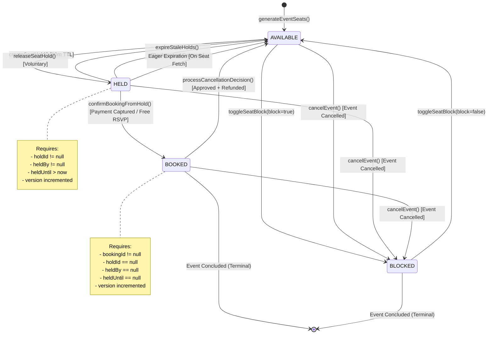
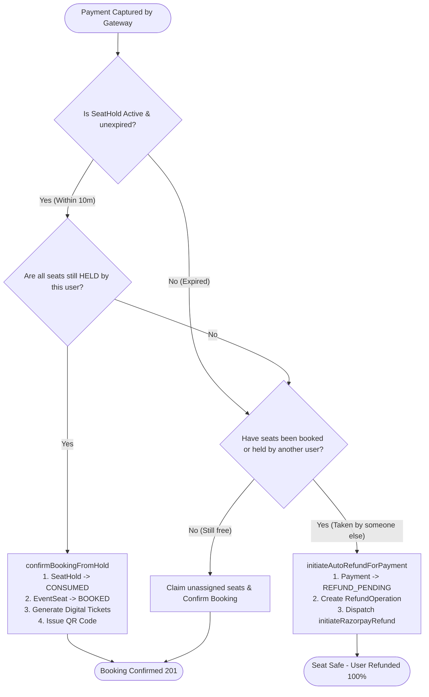
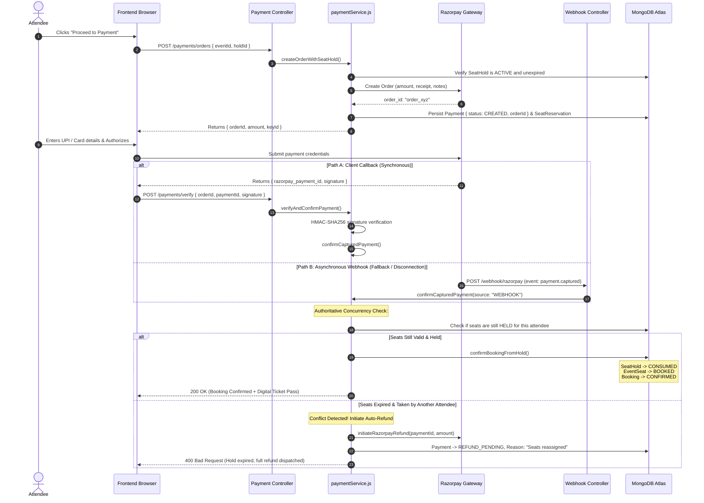

# Temporary Seat Holds and Expiration Management in Eventora

> **Document Type:** Core Architecture & Technical Specification  
> **Target Audience:** Senior Backend Engineers, Database Architects, System Design Interviewers  
> **Associated Documents:**  
> - [Atomic Conditional Updates and Seat Reservation](./seat-locking-atomic-operations.md)  
> - [Optimistic Concurrency Control and Versioning](./seat-locking-version-control.md)

---

## 1. Title and Architectural Overview

In high-concurrency event ticketing systems, inventory management requires a delicate balance between **purchaser convenience** and **inventory liquidity**. When an attendee selects a seat, they need a guaranteed, uninterrupted window to enter their payment credentials, complete multi-factor authentication (3D Secure), and receive payment confirmation without fearing that their seat will be stolen mid-checkout.

However, if an attendee abandons their cart, closes their browser, or experiences network failure, those seats must not remain locked indefinitely. Unpaid holds that do not expire result in **artificial inventory starvation**, where seats appear unavailable to eager buyers, directly reducing venue occupancy and ticket revenue.

Eventora implements an authoritative **Dual-Layer Expiration and Lifecycle Architecture** for temporary seat holds:
1. **The Active 10-Minute Hold Window:** Stored durably across `SeatHold`, `EventSeat`, and `SeatReservation` records.
2. **The 30-Second Background Sweeper Worker (`holdExpirationWorker`):** Periodically sweeps the database to reclaim expired holds asynchronously.
3. **Real-Time Eager Expiration:** Synchronously reclaims stale holds and dynamically projects effective seat availability whenever seat maps or holds are requested.
4. **Idempotent Payment Confirmation & Automated Refund Engine:** Seamlessly transitions seats to `BOOKED` upon successful payment capture, or automatically issues instant gateway refunds if payment arrives after hold expiration and seat reassignment.

---

## 2. Why the Mechanism is Required

### The Inventory Dilemma: HELD vs. BOOKED

In modern e-commerce, naive platforms often make one of two catastrophic design mistakes:

1. **Direct-to-Book Mistake (No Holds):**  
   The platform only updates inventory once payment is confirmed. As a result, hundreds of users enter credit card details for the exact same seat simultaneously. The fastest card processor wins; all other users suffer rejected charges or awkward manual refund requests.
2. **Indefinite Hold Mistake (No Expiration):**  
   The platform marks a seat as unavailable when selected, but relies solely on user action (e.g. clicking "Cancel") to release it. Malicious actors or unintentional cart abandoners lock up the entire venue within minutes, paralyzing event sales.

### The Solution: Temporary Time-Bound Holds

A temporary seat hold creates a soft reservation with a strict, server-enforced **Time-To-Live (TTL)**. During this window, the seat is protected for the holding attendee. Once the TTL elapses, the seat is returned to the public pool automatically without human intervention.

---

## 3. Core Concepts and Terminology

### 3.1 Temporary Seat Hold
A time-delimited lease granted to an attendee over one or more specific physical seats. While the lease is active, the seats cannot be claimed by any other user.

### 3.2 HELD vs. BOOKED
- **HELD:** A transient, conditional state. The seat is reserved in anticipation of payment. Ownership is temporary and bound to an expiration timestamp. No ticket pass exists.
- **BOOKED:** A permanent, immutable state. Payment has been verified (or free RSVP recorded). The seat is permanently allocated to the attendee. A cryptographically signed digital ticket pass is generated.

### 3.3 Hold Expiration
The event where the current system wall-clock time surpasses the lease deadline (`Date.now() > expiresAt`). An expired hold loses all reservation rights.

### 3.4 Background Worker
An asynchronous process or scheduled cron job running independently of incoming HTTP request cycles. It sweeps collections at fixed intervals to reconcile state and clean up stale data.

### 3.5 Eager Expiration (Lazy Reclamation)
A just-in-time evaluation pattern where expiration is checked and applied on-demand during incoming client read/write queries, guaranteeing that clients never observe stale state even if the background worker has not yet ticked.

---

## 4. Eventora Seat State Machine

The physical inventory lifecycle in Eventora is governed by a strict finite state machine defined in `EventSeat` and synchronized with `SeatHold`, `Booking`, and `Payment`.



### Complete State Transition Table

| Source State | Target State | Trigger Operation | File & Method | Preconditions & Validations |
|---|---|---|---|---|
| **`[*]`** | **`AVAILABLE`** | Layout Generation | `seatingService.js`<br/>`generateEventSeats()` | Event exists; zero active holds or confirmed bookings exist. |
| **`AVAILABLE`** | **`HELD`** | Hold Acquisition | `seatingService.js`<br/>`createSeatHold()` | Event is `PUBLISHED`, future date; attendee verified; seat unreserved. |
| **`HELD`** | **`AVAILABLE`** | Voluntary Release | `seatingService.js`<br/>`releaseSeatHold()` | Caller must be the attendee who created the hold (`hold.attendeeId`). |
| **`HELD`** | **`AVAILABLE`** | Background Sweeper | `holdExpirationWorker.js`<br/>`expireStaleHolds()` | `hold.status === ACTIVE` and `expiresAt <= new Date()`. |
| **`HELD`** | **`AVAILABLE`** | Eager Expiration | `seatingService.js`<br/>`getEventSeats()` | Computed on-the-fly if `s.heldUntil <= Date.now()`. |
| **`HELD`** | **`BOOKED`** | Payment Capture / Free Confirm | `bookingService.js`<br/>`confirmBookingFromHold()` | Hold is `ACTIVE`, not expired; payment confirmed or free event. |
| **`AVAILABLE`** | **`BLOCKED`** | Organizer Block | `seatingService.js`<br/>`toggleSeatBlock(true)` | Caller is event organizer; seat not currently `BOOKED`. |
| **`BLOCKED`** | **`AVAILABLE`** | Organizer Unblock | `seatingService.js`<br/>`toggleSeatBlock(false)` | Caller is event organizer; seat currently `BLOCKED`. |
| **`BOOKED`** | **`AVAILABLE`** | Cancellation Approval | `registrationService.js`<br/>`processCancellationDecision()` | Organizer approves cancellation request; gateway refund initiated. |
| **`ANY`** | **`BLOCKED`** | Event Cancellation | `eventService.js`<br/>`cancelEvent()` | Organizer cancels event; all seats blocked; all holds released. |

---

## 5. The Ten-Minute Hold Mechanism

### 5.1 Calculation and Storage of Timestamps

When an attendee requests a hold, the 10-minute duration is strictly computed on the server in [seatingService.js](file:///d:/THE%20OMS%20DEVS/WEB%20DEVS/MERN%20PROJECTS/PERSONAL/EVENTORA/server/src/modules/seating/seatingService.js#L304-L306):

```javascript
// Source: server/src/modules/seating/seatingService.js
const holdDurationMs = 10 * 60 * 1000; // Exactly 10 minutes (600,000 ms)
const expiresAt = new Date(Date.now() + holdDurationMs);
```

This expiration deadline is stored redundantly across three collections to support high-performance querying:
1. **`SeatHold.expiresAt`:** The master record of the reservation lease.
2. **`EventSeat.heldUntil`:** Denormalized directly onto physical seat documents so availability queries don't need expensive joins.
3. **`SeatReservation.expiresAt`:** Used by the payments engine (`paymentService.js`) to coordinate gateway checkout timeouts.

### 5.2 Ownership Verification

A hold is strictly bound to an authenticated attendee:
```javascript
// Verification during booking confirmation (bookingService.js Lines 56-58)
if (hold.attendeeId.toString() !== attendeeId.toString()) {
  throw new ForbiddenError('You are not authorized to claim this seat hold.');
}
```
Competitors cannot intercept or confirm a hold belonging to another user.

### 5.3 What Happens When Payment Arrives Before vs. After Expiration



---

## 6. The Background Expiration Worker

### 6.1 Worker Architecture & Initialization

The background expiration worker is defined in `server/src/modules/seating/holdExpirationWorker.js` and booted during server startup in [server.js](file:///d:/THE%20OMS%20DEVS/WEB%20DEVS/MERN%20PROJECTS/PERSONAL/EVENTORA/server/src/server.js#L22-L23):

```javascript
// Source: server/src/server.js (Lines 22-23)
// Start background worker to automatically sweep expired seat holds (every 30s)
startHoldExpirationWorker(30000);
```

### 6.2 Worker Implementation: [holdExpirationWorker.js](file:///d:/THE%20OMS%20DEVS/WEB%20DEVS/MERN%20PROJECTS/PERSONAL/EVENTORA/server/src/modules/seating/holdExpirationWorker.js#L14-L84)

```javascript
// Source: server/src/modules/seating/holdExpirationWorker.js
export async function expireStaleHolds() {
  try {
    const now = new Date();
    // 1. Find all active holds that have passed their expiration timestamp
    const staleHolds = await SeatHold.find({
      status: SEAT_HOLD_STATUS.ACTIVE,
      expiresAt: { $lte: now }
    });

    if (!staleHolds.length) {
      return { expiredHoldsCount: 0, releasedSeatsCount: 0 };
    }

    let expiredHoldsCount = 0;
    let releasedSeatsCount = 0;

    for (const hold of staleHolds) {
      // 2. Atomically transition hold status from ACTIVE to EXPIRED
      const updatedHold = await SeatHold.findOneAndUpdate(
        {
          _id: hold._id,
          status: SEAT_HOLD_STATUS.ACTIVE
        },
        {
          $set: {
            status: SEAT_HOLD_STATUS.EXPIRED,
            releasedAt: now
          }
        },
        { new: true }
      );

      // If already transitioned by another worker/process, skip to maintain idempotency
      if (!updatedHold) {
        continue;
      }

      expiredHoldsCount++;

      // 3. Atomically release ONLY seats still owned by this hold that are currently HELD
      // (Never touch seats that have been confirmed as BOOKED or reassigned to a newer hold)
      const seatUpdateRes = await EventSeat.updateMany(
        {
          holdId: hold._id,
          status: SEAT_STATUS.HELD
        },
        {
          $set: {
            status: SEAT_STATUS.AVAILABLE,
            holdId: null,
            heldBy: null,
            heldUntil: null
          },
          $inc: { version: 1 }
        }
      );

      releasedSeatsCount += seatUpdateRes.modifiedCount || 0;

      logger.info(
        { holdId: hold._id, eventId: hold.eventId, releasedCount: seatUpdateRes.modifiedCount },
        'Expired stale seat hold and released reserved seats'
      );
    }

    return { expiredHoldsCount, releasedSeatsCount };
  } catch (err) {
    logger.error({ err: err?.message }, 'Error in expireStaleHolds worker');
    return { expiredHoldsCount: 0, releasedSeatsCount: 0, error: err?.message };
  }
}
```

### 6.3 Critical Concurrency Defenses in the Worker

1. **Two-Step Atomic Transition:**
   The worker does not blindly release seats. It first transitions the `SeatHold` document using `findOneAndUpdate({ _id: hold._id, status: 'ACTIVE' }, { $set: { status: 'EXPIRED' } })`. If two worker instances (or a worker and an eager fetch) target the same hold simultaneously, only one receives the updated document; the other receives `null` and skips execution.
2. **Targeted Seat Releasing Predicate:**
   When updating `EventSeat`, the query explicitly checks:
   ```javascript
   { holdId: hold._id, status: SEAT_STATUS.HELD }
   ```
   **Why this is vital:** If the attendee completed payment a millisecond prior, `confirmBookingFromHold` transitioned the seat to `status: BOOKED` and set `holdId: null`. The worker's update query will match **zero seats**, guaranteeing that a newly booked seat is **never** accidentally overwritten back to `AVAILABLE`.

---

## 7. Eager Expiration (Real-Time Availability Projection)

Relying entirely on a 30-second background worker leaves a potential 29-second gap where a seat's hold has elapsed, but it still appears locked in the database. Eventora solves this with **Eager Expiration**.

### 7.1 How Eager Expiration Works

Whenever an attendee fetches the seat layout via `GET /api/v1/events/:eventId/seats`, Eventora executes [seatingService.js](file:///d:/THE%20OMS%20DEVS/WEB%20DEVS/MERN%20PROJECTS/PERSONAL/EVENTORA/server/src/modules/seating/seatingService.js#L182-L215):

```javascript
// Source: server/src/modules/seating/seatingService.js (Lines 182-215)
// 1. Trigger an immediate background sweep on demand
await expireStaleHolds();

const seats = await EventSeat.find({ eventId: new mongoose.Types.ObjectId(eventId) })
  .sort({ sectionId: 1, rowLabel: 1, seatNumber: 1 })
  .lean();

const now = Date.now();
// ...
const mappedSeats = seats.map((s) => {
  let effectiveStatus = s.status;

  if (s.isBlocked || s.status === SEAT_STATUS.BLOCKED) {
    effectiveStatus = SEAT_STATUS.BLOCKED;
    blockedCount++;
  } else if (s.status === SEAT_STATUS.BOOKED) {
    effectiveStatus = SEAT_STATUS.BOOKED;
    bookedCount++;
  } else if (s.status === SEAT_STATUS.HELD) {
    // Dynamic real-time evaluation
    if (s.heldUntil && new Date(s.heldUntil).getTime() > now) {
      effectiveStatus = SEAT_STATUS.HELD;
      heldCount++;
    } else {
      // Hold has elapsed! Present seat as AVAILABLE to the user immediately
      effectiveStatus = SEAT_STATUS.AVAILABLE;
      availableCount++;
    }
  } else {
    effectiveStatus = SEAT_STATUS.AVAILABLE;
    availableCount++;
  }
  // ...
});
```

### 7.2 Detailed Real-World Chronology

```text
8:00:00 PM - User A holds Seat A1 (Hold expires at 8:10:00 PM).
8:10:00 PM - Seat hold officially expires.
8:10:15 PM - (Background sweeper is scheduled to run next at 8:10:30 PM; has not run yet).
8:10:16 PM - User B requests the seat layout (GET /events/123/seats).
8:10:16 PM - Eventora executes getEventSeats():
             1. Calls expireStaleHolds() eagerly -> Expired hold reclaimed immediately!
             2. In-memory projector verifies s.heldUntil <= now -> Flags seat as AVAILABLE.
8:10:17 PM - User B sees Seat A1 highlighted in green (AVAILABLE).
8:10:18 PM - User B clicks "Hold Seat A1".
8:10:18 PM - createSeatHold() executes successfully for User B.
```

### Why Eager and Background Expiration Complement Each Other
- **Background Worker:** Ensures system-wide eventual consistency, reclaiming abandoned holds across all events even if nobody is currently viewing the seat map.
- **Eager Expiration:** Guarantees instantaneous consistency on active, high-traffic events, eliminating lag and maximizing inventory turnover.

---

## 8. Payment Integration & Webhook Lifecycle

The seat hold lifecycle intersects directly with payment processing. The payment subsystem must never confirm a booking for an expired hold whose seats were reassigned.



### 8.1 Key Payment States vs. Seat States

| Payment Status (`PAYMENT_STATUS`) | Seat Status (`SEAT_STATUS`) | Hold Status (`SEAT_HOLD_STATUS`) | Meaning |
|---|---|---|---|
| `CREATED` | `HELD` | `ACTIVE` | Checkout initiated; attendee has 10 minutes to pay. |
| `CAPTURED` | `BOOKED` | `CONSUMED` | Payment successful; seats permanently confirmed. |
| `FAILED` | `AVAILABLE` | `RELEASED` / `EXPIRED` | Payment declined; seats returned to pool. |
| `REFUND_PENDING` | `AVAILABLE` / `BOOKED` (other) | `EXPIRED` | Late payment arrived after seats were reassigned; auto-refund initiated. |
| `REFUNDED` | `AVAILABLE` | `EXPIRED` / `RELEASED` | Full refund settled back to attendee's bank account. |

### 8.2 Late Payment Defense: [paymentService.js](file:///d:/THE%20OMS%20DEVS/WEB%20DEVS/MERN%20PROJECTS/PERSONAL/EVENTORA/server/src/modules/payments/paymentService.js#L422-L458)

If an attendee completes checkout after their 10-minute hold has expired, Eventora refuses to double-book:

```javascript
// Source: server/src/modules/payments/paymentService.js (Lines 422-458)
const seatsTakenByOther = seatsToClaim.some((s) => {
  if (s.status === SEAT_STATUS.BOOKED) return true;
  if (s.status === SEAT_STATUS.BLOCKED) return true;
  if (
    s.status === SEAT_STATUS.HELD &&
    s.heldBy &&
    s.heldBy.toString() !== payment.attendeeId.toString()
  ) {
    if (s.heldUntil && new Date(s.heldUntil).getTime() > Date.now()) return true;
  }
  return false;
});

if (seatHold && !canConfirmAssignedSeats) {
  logger.warn(
    { orderId: payment.orderId, paymentId, holdId: seatHold._id },
    'Payment captured after hold expired and seats were reassigned. Initiating automated refund.'
  );
  await initiateAutoRefundForPayment({
    payment,
    paymentId,
    event,
    reason: 'Seats reassigned after hold expired'
  });
  throw new BadRequestError('Seat hold expired and selected seats were assigned to another attendee. A full refund has been initiated.');
}
```

---

## 9. Database and Scheduling Considerations

### 9.1 Why MongoDB TTL Indexes Cannot Manage Seat Availability
MongoDB provides Time-To-Live (TTL) indexes (e.g. `{ expireAfterSeconds: 0 }`). Many junior engineers suggest using TTL indexes to automatically expire seat holds.

**Why TTL indexes fail for physical seat inventory:**
1. **Document Destruction:** A MongoDB TTL index **deletes the entire document**. If placed on `EventSeat`, MongoDB would permanently erase the physical seats from the database, destroying the venue layout!
2. **Unpredictable Timing:** MongoDB's background TTL monitor thread runs once every 60 seconds. A TTL index cannot guarantee strict millisecond or 10-minute deadlines.
3. **No Field Reset:** TTL indexes cannot execute `$set: { status: 'AVAILABLE' }`; they can only drop documents.

Hence, TTL indexes are unsuitable for inventory state machines. Dedicated background workers combined with conditional queries are required.

### 9.2 What Happens If Two Workers Attempt to Release the Same Expired Hold?
In a horizontally scaled deployment with multiple server nodes, background worker intervals may overlap. Eventora ensures absolute safety via **Atomic Pre-Commit Handshake**:
```javascript
const updatedHold = await SeatHold.findOneAndUpdate(
  { _id: hold._id, status: SEAT_HOLD_STATUS.ACTIVE },
  { $set: { status: SEAT_HOLD_STATUS.EXPIRED, releasedAt: now } },
  { new: true }
);

if (!updatedHold) continue; // Worker B gets null and backs off!
```
Only the worker instance that successfully transitions `SeatHold` from `ACTIVE` to `EXPIRED` is granted permission to modify `EventSeat`. Duplicate sweeps are impossible.

---

## 10. Failure Scenarios and Edge Cases

### 10.1 Background Worker Crashes or Is Delayed
If the Node.js event loop is blocked or the process restarts:
- **Resilience:** When any attendee opens the seat map or attempts a reservation, **Eager Expiration** runs inline (`await expireStaleHolds()`), immediately purging stale records.
- Even if the background worker was paused for an hour, the very first user interaction triggers cleanup instantly.

### 10.2 User Navigates Away from Checkout Early
If an attendee decides not to purchase, they can click "Cancel":
- Frontend invokes `DELETE /api/v1/events/seat-holds/:holdId`.
- Controller invokes `releaseSeatHold()` ([seatingService.js](file:///d:/THE%20OMS%20DEVS/WEB%20DEVS/MERN%20PROJECTS/PERSONAL/EVENTORA/server/src/modules/seating/seatingService.js#L440-L480)).
- `SeatHold.status` immediately transitions to `RELEASED`.
- Seats return to `AVAILABLE` without forcing other customers to wait for the 10-minute timeout.

### 10.3 Webhook Arrives Before Client Redirect
In slow network environments, Razorpay's webhook may hit the server before the browser finishes redirecting:
- Handled idempotently by `confirmCapturedPayment()`.
- Whichever pathway arrives first confirms the booking. When the second pathway arrives, it detects `payment.status === 'CAPTURED'` and safely returns the existing confirmed booking without duplicate processing.

---

## 11. Security Considerations

1. **Server-Authoritative Expiration:**  
   Clients cannot supply their own expiration timestamp. `expiresAt` is calculated strictly via server system clock (`Date.now() + 10 * 60 * 1000`).
2. **Denial-of-Inventory Mitigation:**  
   Users cannot spam holds to lock up a venue because:
   - Hold routes enforce `requireVerifiedEmail`.
   - `bookingRateLimiter` restricts request frequency.
   - Event limits restrict maximum seats per hold (`maxTicketsPerBooking`).
   - Active registration checks prevent attendees who cancelled from holding seats again.
3. **Cryptographic Webhook Signatures:**  
   Webhook requests must match the `RAZORPAY_WEBHOOK_SECRET` HMAC signature, preventing forged payment captures.

---

## 12. Performance and Scalability Considerations

- **Index Optimization for Sweepers:**  
  [SeatHold.js](file:///d:/THE%20OMS%20DEVS/WEB%20DEVS/MERN%20PROJECTS/PERSONAL/EVENTORA/server/src/modules/seating/SeatHold.js#L71) defines a compound index:
  ```javascript
  seatHoldSchema.index({ status: 1, expiresAt: 1 });
  ```
  This allows the 30-second sweeper to find expired holds via an efficient B-tree index range scan in $O(\log N)$ time, bypassing full collection scans.
- **Lean Querying:**  
  `getEventSeats()` uses `.lean()`, bypassing Mongoose hydration overhead and reducing memory consumption by over 70% during large layout queries.

---

## 13. Common Implementation Mistakes

| Common Mistake | Consequence in Production | Eventora Solution |
|---|---|---|
| **Using MongoDB TTL index on seats** | Completely deletes physical seat documents, destroying venue layouts. | Background sweeper updating status to `AVAILABLE`. |
| **Releasing seats without checking `holdId`** | Accidental unbooking: releases seats that were already paid for or re-held. | Query requires `{ holdId: hold._id, status: 'HELD' }`. |
| **Trusting client checkout time** | Attackers spoof local device clocks to extend holds indefinitely. | Server computes `Date.now() + 10 * 60 * 1000`. |
| **Double-booking on late payment** | Sells the same seat to two paying customers when hold expires. | Detects reassignment and automatically triggers gateway refund. |

---

## 14. Technical Interview Preparation (15 Questions & Answers)

### Beginner Level

#### Q1: What is the difference between a HELD seat and a BOOKED seat?
**Answer:** A `HELD` seat is a temporary, conditional reservation with an active expiration timestamp (10 minutes in Eventora), held while the user completes payment. A `BOOKED` seat is a permanent allocation backed by verified payment or free registration, accompanied by a digital ticket pass.

#### Q2: Why is a 10-minute hold window necessary in ticket booking platforms?
**Answer:** A 10-minute hold window gives users sufficient time to select ticket types, enter billing details, complete 3D Secure / OTP verification, and review orders without the seat being bought by someone else mid-checkout. Simultaneously, it limits the duration unsold seats remain locked if the user abandons their cart.

#### Q3: What happens when an attendee voluntarily deselects a seat or cancels checkout?
**Answer:** The frontend calls `DELETE /api/v1/events/seat-holds/:holdId`. Eventora's `releaseSeatHold()` service marks the hold as `RELEASED`, clears `holdId` and `heldBy` on the seats, transitions them back to `AVAILABLE`, and increments their `version` field so other buyers can reserve them immediately.

#### Q4: What is the purpose of the 30-second background worker?
**Answer:** The background worker (`startHoldExpirationWorker`) runs every 30 seconds to sweep the database for holds whose `expiresAt` timestamp has passed, transition their status to `EXPIRED`, and return the physical seats to `AVAILABLE`.

#### Q5: Can an attendee extend their hold indefinitely?
**Answer:** No. Hold duration is strictly controlled by the backend server. Re-holding seats requires re-submitting through rate-limited endpoints, and if any competitor claims the seat upon expiration, the original user's request will fail.

---

### Intermediate Level

#### Q6: Why can't we use MongoDB's native TTL (Time-To-Live) index on the `EventSeat` collection?
**Answer:** MongoDB TTL indexes work by **permanently deleting** expired documents from the collection. If applied to `EventSeat`, MongoDB would delete the seat records entirely, destroying the venue layout and inventory structure. TTL indexes cannot perform partial field updates (e.g. changing `status` to `AVAILABLE`). Therefore, an active background worker updating document fields is required.

#### Q7: How does Eventora prevent a background sweeper from releasing a seat that was confirmed as BOOKED just as the worker was running?
**Answer:** Through conditional atomic filters in `holdExpirationWorker.js`. When updating seats, the query filter specifies:
```javascript
{ holdId: hold._id, status: SEAT_STATUS.HELD }
```
If the attendee completed checkout a moment earlier, `confirmBookingFromHold()` transitioned the seat to `status: BOOKED` and set `holdId: null`. The worker's update filter matches 0 documents and leaves the booked seat untouched.

#### Q8: What is "Eager Expiration" and why is it necessary if we already have a 30-second background worker?
**Answer:** Eager expiration evaluates hold expiration dynamically during incoming client requests (such as fetching seat layouts or creating new holds). It is necessary because a 30-second background worker leaves an inherent window where a hold has expired in real time, but the worker has not yet ticked. Eager expiration eliminates this lag by recalculating effective availability on-the-fly, ensuring that buyers see up-to-the-millisecond seat availability.

#### Q9: How does Eventora handle a late payment that captures after the 10-minute hold has expired and the seat was purchased by someone else?
**Answer:** In `paymentService.js` (`confirmCapturedPayment`), before confirming the booking, the backend queries `EventSeat` to verify that the seats are still held by the paying attendee. If another user claimed the seats, `canConfirmAssignedSeats` evaluates to `false`. The backend refuses to confirm the booking, logs the conflict, and calls `initiateAutoRefundForPayment()` to immediately refund the customer's money via Razorpay.

#### Q10: What indexes are critical to make hold expiration performant across millions of seat records?
**Answer:** In `SeatHold`, the compound index `{ status: 1, expiresAt: 1 }` enables the sweeper to identify expired active holds via index range scans without scanning un-held documents. In `EventSeat`, the indexes `{ holdId: 1, status: 1 }` and `{ eventId: 1, status: 1 }` allow instant lookups and batch status updates during release cycles.

---

### Advanced Level

#### Q11: Walk through the race condition between `confirmBookingFromHold` and `expireStaleHolds`, and explain how Eventora resolves it.
**Answer:**
1. At $T_{expire}$, a user submits payment while the background sweeper runs.
2. In `confirmBookingFromHold()`, `EventSeat.updateMany()` checks `{ status: HELD, holdId: hold._id }` and sets `status: BOOKED`.
3. In `expireStaleHolds()`, the worker first attempts `SeatHold.findOneAndUpdate({ _id: hold._id, status: 'ACTIVE' }, { $set: { status: 'EXPIRED' } })`.
4. If `confirmBooking` acquires the database document lock first, `SeatHold.status` becomes `CONSUMED`. When the sweeper tries to match `status: 'ACTIVE'`, it fails and skips the hold.
5. If the sweeper acquires the lock first, `SeatHold.status` becomes `EXPIRED`. When `confirmBooking` checks `hold.status !== ACTIVE`, it aborts and triggers an automated refund. Under both interleavings, state consistency is 100% preserved.

#### Q12: How does Eventora achieve multi-worker idempotency if multiple server instances run `startHoldExpirationWorker` simultaneously?
**Answer:** The worker uses an atomic compare-and-swap pattern:
```javascript
const updatedHold = await SeatHold.findOneAndUpdate(
  { _id: hold._id, status: SEAT_HOLD_STATUS.ACTIVE },
  { $set: { status: SEAT_HOLD_STATUS.EXPIRED, releasedAt: now } },
  { new: true }
);
if (!updatedHold) continue;
```
If Instance 1 and Instance 2 both query the same expired hold, only one instance successfully executes `findOneAndUpdate` while `status` is `ACTIVE`. The losing instance receives `null` and skips the seat release phase, preventing duplicate operations and redundant database writes.

#### Q13: Why does `getEventSeats` project effective status in-memory rather than waiting for the database write?
**Answer:** Direct in-memory projection (`s.heldUntil <= now ? AVAILABLE : HELD`) provides zero-latency read consistency. Even if the database write is still queued or executing in the background, the HTTP response returned to the client displays the authoritative, logically correct state without waiting on database write acknowledgments.

#### Q14: How does the cancellation flow interact with physical seat availability?
**Answer:** When an organizer approves an attendee's cancellation request via `processCancellationDecision()`, the service executes:
1. `Registration.findOneAndUpdate({ _id, seatReleased: { $ne: true } })` to guarantee exactly-once seat release.
2. `EventSeat.updateMany({ bookingId: booking._id }, { $set: { status: AVAILABLE, bookingId: null }, $inc: { version: 1 } })`.
This releases the physical seats back into the available pool, decrements `event.seatsBooked`, and advances the version counter.

#### Q15: What architectural patterns would you introduce if Eventora grew to 100,000 concurrent ticket buyers per second?
**Answer:**
1. **Redis-Backed Ephemeral Hold State:** Store temporary holds in Redis hashes with native Redis key expiration (`EXPIRE 600`), and publish expiration events via Redis Keyspace Notifications.
2. **Virtual Waiting Room (Queue):** Place incoming checkout attempts into an Amazon SQS / Apache Kafka queue to throttle inbound traffic to the database's write capacity.
3. **Database Sharding:** Shard the `EventSeat` collection by `eventId` as the shard key, ensuring that high-concurrency writes for different events hit different MongoDB shard replica sets.

---

## 15. Concise Interview-Ready Summary (Elevator Pitch)

> "In Eventora, temporary seat reservations are managed via an authoritative **Dual-Layer Expiration and Lifecycle Architecture**. When an attendee selects seats, `createSeatHold()` acquires an atomic 10-minute hold by updating the `EventSeat` documents to `HELD` and recording an immutable `expiresAt` deadline on both the seat and a parent `SeatHold` document.
>
> To guarantee inventory liquidity, a dedicated background worker sweeps every 30 seconds to reclaim expired holds. To eliminate the 30-second latency window, we implement **Eager Expiration**: every seat map fetch dynamically inspects `heldUntil` timestamps, instantly presenting expired holds as available.
>
> If an attendee completes payment after expiration and their seats were claimed by another buyer, our payment reconciliation detects the state collision, refuses to double-book, and automatically dispatches a 100% gateway refund via Razorpay. This provides an enterprise-grade booking experience that protects both attendee trust and organizer revenue."

---

## 16. Key Takeaways

1. **Temporary holds are essential for high-demand booking platforms.** They prevent checkout collision while maintaining inventory liquidity.
2. **Never use MongoDB TTL indexes for entity state management.** TTL deletes documents; use background sweepers and atomic status updates instead.
3. **Combine background sweepers with eager expiration.** This delivers defense-in-depth: background workers ensure eventual consistency, while eager checks deliver instant real-time accuracy.
4. **Always scope sweeper updates by hold ID and status.** Releasing seats using `{ holdId: hold._id, status: 'HELD' }` prevents accidentally unseating a customer who just completed payment.
5. **Enforce automatic refunds for late checkout captures.** If payment succeeds after hold expiration and seat reassignment, prioritize data integrity by issuing an automated gateway refund rather than double-booking.

