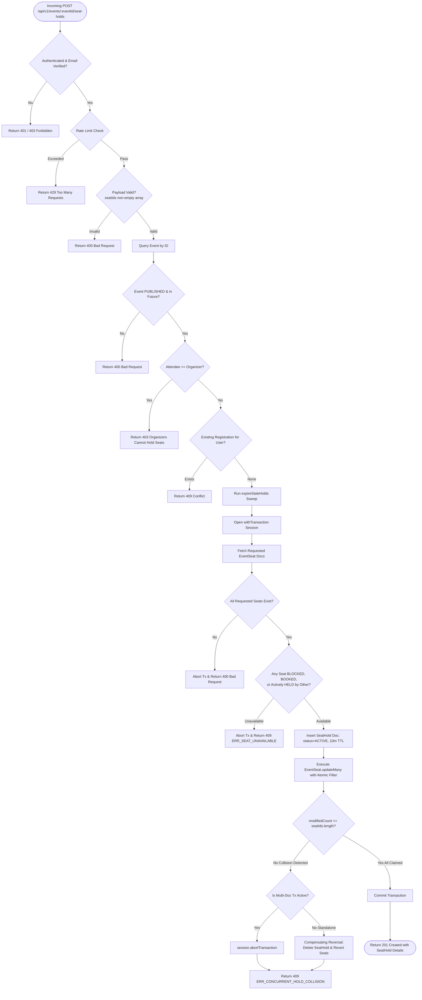
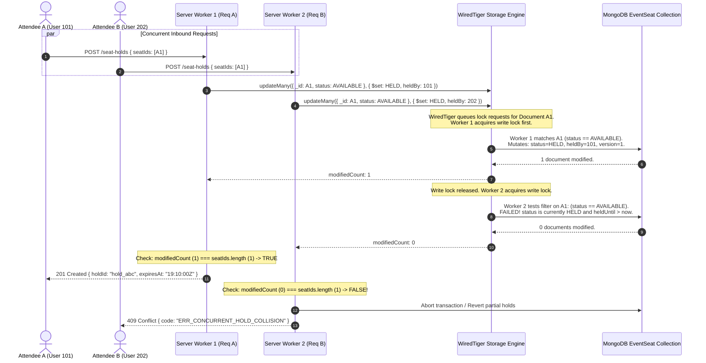

# Atomic Conditional Updates and Seat Reservation in Eventora

> **Document Type:** Core Architecture & Technical Specification  
> **Target Audience:** Senior Backend Engineers, Database Architects, System Design Interviewers  
> **Associated Documents:**  
> - [Optimistic Concurrency Control and Versioning](./seat-locking-version-control.md)  
> - [Temporary Seat Holds and Expiration Management](./seat-hold-expiration.md)

---

## 1. Title and Architectural Overview

In a ticketing platform like Eventora, seat reservation is the quintessential high-concurrency bottleneck. When high-demand events (e.g., arena concerts, flagship tech conferences, or major sports tournaments) open for registration, thousands of concurrent HTTP requests compete for a limited inventory of physical seats.

The primary engineering challenge is **Double-Booking Immunity**: guaranteeing that under no circumstances can two distinct attendees hold, pay for, or be issued confirmed tickets for the exact same seat.

Eventora achieves double-booking immunity through **Atomic Conditional Database Updates** executed at the database engine layer (MongoDB WiredTiger), augmented by multi-document ACID transactions via replica set sessions. Rather than relying on fragile application-level read-then-write patterns or distributed locks that introduce single points of failure and latency overhead, Eventora delegates isolation directly to MongoDB's atomic write primitives: `updateMany()` and `findOneAndUpdate()` with compound predicate filters.

---

## 2. Why the Mechanism is Required

### The Flaw of Naive "Read-Then-Write" Patterns

In an unoptimized web application running on Node.js, an engineer might implement seat reservation like this:

```javascript
// ANTIPATTERN: Race-Condition Prone Seat Reservation
async function naiveReserveSeat(seatId, userId) {
  // Step 1: Read state from database
  const seat = await EventSeat.findById(seatId);

  // Step 2: In-memory business logic check
  if (seat.status === 'AVAILABLE') {
    // Step 3: Write state back to database
    seat.status = 'HELD';
    seat.heldBy = userId;
    await seat.save();
    return { success: true };
  }

  throw new Error('Seat already taken');
}
```

This pattern completely breaks down under concurrency.

### Concurrency Vulnerability Window

Node.js is single-threaded regarding JavaScript execution, but its asynchronous I/O allows thousands of incoming HTTP requests to be handled concurrently. Between Step 1 (`findById`) and Step 3 (`save`), the Node.js event loop yields control to handle other pending microtasks and database network I/O.

```text
Time   Thread / Request 1 (User A)         Thread / Request 2 (User B)
 │
 t0    Read seat A1 -> Status: AVAILABLE
 t1                                        Read seat A1 -> Status: AVAILABLE
 t2    In-memory check passes (AVAILABLE)
 t3                                        In-memory check passes (AVAILABLE)
 t4    Writes A1 -> HELD (User A)
 t5                                        Writes A1 -> HELD (User B - Overwrites User A!)
 ▼
Result: Both users receive HTTP 200 OK. Both users proceed to checkout.
        One seat is sold twice. Catastrophic data corruption.
```

To eliminate this vulnerability, the read predicate and the write mutation **must be collapsed into a single, indivisible operation executed by the database engine itself**.

---

## 3. Core Concepts and Terminology

### 3.1 Concurrency
Concurrency is the ability of an application or database system to process multiple operations or transactions over overlapping time periods. In web backends, concurrency arises when multiple independent client HTTP connections execute controller actions simultaneously.

### 3.2 Race Condition
A race condition is an anomalous behavioral flaw where the outcome of an operation depends on the unpredictable sequence or timing of concurrent execution threads or processes. In booking platforms, race conditions occur when two threads access shared mutable state without synchronization.

### 3.3 Double-Booking
Double-booking is the catastrophic business state where two or more distinct customers hold valid, conflicting claims to the exact same inventory unit (seat, room, ticket, or appointment) at the same time.

### 3.4 Why Simultaneous HTTP Requests Create Booking Conflicts
Web servers handle requests via worker pools or asynchronous non-blocking event loops. Because network packets arrive from different clients across different network sockets within microseconds of each other, their execution interleaves. If database mutations are non-atomic, queries will read stale uncommitted states, leading to lost updates and conflicting state transitions.

### 3.5 Atomic Database Operations
An atomic database operation is a primitive operation that is executed in its entirety or not at all. Crucially, intermediate states are never visible to concurrent queries. In MongoDB, any write operation on a single document (such as `updateOne`, `findOneAndUpdate`, or operations within an internal document lock) is strictly atomic. By specifying conditional query filters in the mutation statement, the database engine checks availability and applies changes in a single uninterrupted hardware-level lock cycle.

### 3.6 Difference Between Atomicity and Database Transactions
| Dimension | Atomic Operation (`updateOne` / `updateMany`) | Multi-Document Transaction (`withTransaction`) |
|---|---|---|
| **Scope** | Single document or atomic query batch at the storage engine level. | Multiple documents across one or more collections. |
| **ACID Guarantee** | Provides single-operation Atomicity and Isolation without transaction overhead. | Full ACID (Atomicity, Consistency, Isolation, Durability) across diverse documents. |
| **Performance Impact** | Extremely low latency (< 2ms); minimal memory and lock contention. | Higher overhead: transaction snapshots, lock maintenance, commit/abort latency. |
| **Rollback Mechanism** | Natural: if the condition does not match, zero documents are modified. | Explicit rollback via `abortTransaction()` restores pre-transaction snapshot. |
| **Eventora Usage** | Used on `EventSeat` state mutations to enforce immediate conditional claiming. | Envelops `SeatHold` creation, `EventSeat` updates, and fallback compensation. |

---

## 4. Eventora-Specific Architecture & Implementation

Eventora implements seat reservation in `server/src/modules/seating/seatingService.js` through `createSeatHold()`.

### Comprehensive Execution Flow



### Detailed Execution Steps in `createSeatHold()`

1. **Routing and Middleware Gateways**  
   - Handled by `server/src/modules/seating/seatingRoutes.js`.
   - Protected by `bookingRateLimiter` (prevents script-based brute-force seat spamming).
   - Protected by `authenticate` (requires valid session user).
   - Protected by `requireVerifiedEmail` (prevents spam bot accounts).
   - Protected by `csrfProtection` (verifies double-submit cookie / anti-CSRF token).
   - Validated against Joi/Zod schema `createSeatHoldSchema`.

2. **Pre-Flight Sanity Validations**  
   - The event must exist and have `status === EVENT_STATUS.PUBLISHED`.
   - The event date must be in the future (`event.eventDate > Date.now()`).
   - The requested seat count cannot exceed `event.maxTicketsPerBooking` (default: 6).
   - The attendee cannot be the event organizer (`event.organizerId !== attendeeId`).
   - The attendee must not have an active or previously cancelled registration for this event.

3. **Eager Stale Hold Sweep**  
   - Invokes `await expireStaleHolds()` before attempting the transaction. This reclaims seats whose 10-minute hold window expired, ensuring maximum availability.

4. **Multi-Document ACID Session Initiation**  
   - The core reservation logic runs inside `withTransaction(async (session) => { ... })`.
   - If connected to a replica set (MongoDB Atlas / clustered environment), operations join a single transactional session.

5. **Seat Fetch & In-Memory Preliminary Availability Inspection**  
   - Queries `EventSeat` documents matching `_id: { $in: objectSeatIds }, eventId`.
   - Validates that every requested seat exists in the inventory.
   - Computes total price.
   - Performs a preliminary check: flags any seat that is `BLOCKED`, `BOOKED`, or currently `HELD` by another user with `heldUntil > Date.now()`. If found, throws `ConflictError('ERR_SEAT_UNAVAILABLE')`.

6. **Creation of the `SeatHold` Document**  
   - Inserts a new `SeatHold` document with `status: SEAT_HOLD_STATUS.ACTIVE` and `expiresAt: new Date(Date.now() + 10 * 60 * 1000)`.

7. **The Conditional Atomic Update (`EventSeat.updateMany`)**  
   - The definitive gate of truth. Executes an atomic query that updates the physical seats **only if** they are still available at the exact millisecond the database engine acquires the document write lock.

8. **Modified Count Verification & Concurrency Guarantee**  
   - Checks `updateRes.modifiedCount === seatIds.length`.
   - If `modifiedCount` does not match the exact number of requested seats, a race condition occurred. The transaction aborts and all partial changes are rolled back.

---

## 5. Actual Source Code and Deep Walkthrough

Below is the production implementation extracted directly from [seatingService.js](file:///d:/THE%20OMS%20DEVS/WEB%20DEVS/MERN%20PROJECTS/PERSONAL/EVENTORA/server/src/modules/seating/seatingService.js#L253-L435):

```javascript
// Source: server/src/modules/seating/seatingService.js
export async function createSeatHold({ eventId, attendeeId, seatIds, ipAddress, userAgent }) {
  if (!mongoose.Types.ObjectId.isValid(eventId)) {
    throw new BadRequestError('Invalid event ID format.');
  }

  if (!Array.isArray(seatIds) || seatIds.length === 0) {
    throw new BadRequestError('At least one seat must be selected.');
  }

  const event = await Event.findById(eventId);
  if (!event) {
    throw new NotFoundError('Event not found.');
  }

  if (event.status !== EVENT_STATUS.PUBLISHED) {
    throw new BadRequestError('Cannot reserve seats for an unpublished or cancelled event.');
  }

  if (new Date(event.eventDate).getTime() <= Date.now()) {
    throw new BadRequestError('Cannot book seats for a past event.');
  }

  const maxTickets = event.maxTicketsPerBooking || 6;
  if (seatIds.length > maxTickets) {
    throw new BadRequestError(`You cannot reserve more than ${maxTickets} seats in a single booking.`);
  }

  if (event.organizerId.toString() === attendeeId.toString()) {
    throw new ForbiddenError('Organizers cannot hold seats for their own events.');
  }

  // Prevent holding seats if attendee is already registered or previously cancelled
  const existingRegistration = await Registration.findOne({
    eventId: new mongoose.Types.ObjectId(eventId),
    attendeeId: new mongoose.Types.ObjectId(attendeeId)
  });

  if (existingRegistration) {
    if (existingRegistration.status === REGISTRATION_STATUS.CANCELLED) {
      throw new BadRequestError('You have previously cancelled your registration for this event and cannot reserve seats.');
    }
    if (existingRegistration.status === REGISTRATION_STATUS.CANCELLATION_REQUESTED) {
      throw new ConflictError('A cancellation request is pending for this event.');
    }
    throw new ConflictError('You are already registered for this event.');
  }

  // Pre-cleanup of any expired holds
  await expireStaleHolds();

  const objectSeatIds = seatIds.map((id) => new mongoose.Types.ObjectId(id));
  const holdDurationMs = 10 * 60 * 1000; // 10 minutes
  const expiresAt = new Date(Date.now() + holdDurationMs);

  return withTransaction(async (session) => {
    // 1. Fetch requested seats
    const seats = await EventSeat.find(
      {
        _id: { $in: objectSeatIds },
        eventId: new mongoose.Types.ObjectId(eventId)
      },
      null,
      session ? { session } : {}
    );

    if (seats.length !== seatIds.length) {
      throw new BadRequestError('One or more requested seats could not be found for this event.');
    }

    // 2. Validate availability of every seat
    const unavailableSeats = [];
    let calculatedTotal = 0;
    const seatLabels = [];

    for (const seat of seats) {
      seatLabels.push(seat.seatLabel);
      calculatedTotal += seat.price;

      if (seat.status === SEAT_STATUS.BLOCKED) {
        unavailableSeats.push({ seatLabel: seat.seatLabel, reason: 'BLOCKED' });
        continue;
      }

      if (seat.status === SEAT_STATUS.BOOKED) {
        unavailableSeats.push({ seatLabel: seat.seatLabel, reason: 'ALREADY_BOOKED' });
        continue;
      }

      // If currently HELD, verify if it's still active
      if (seat.status === SEAT_STATUS.HELD) {
        if (seat.heldUntil && new Date(seat.heldUntil).getTime() > Date.now()) {
          // Check if held by this same user
          if (seat.heldBy && seat.heldBy.toString() !== attendeeId.toString()) {
            unavailableSeats.push({ seatLabel: seat.seatLabel, reason: 'HELD_BY_ANOTHER_USER' });
          }
        }
      }
    }

    if (unavailableSeats.length > 0) {
      throw new ConflictError('One or more of the selected seats are no longer available.', {
        code: 'ERR_SEAT_UNAVAILABLE',
        unavailableSeats
      });
    }

    // 3. Create the SeatHold document
    const [hold] = await SeatHold.create(
      [
        {
          eventId: new mongoose.Types.ObjectId(eventId),
          attendeeId: new mongoose.Types.ObjectId(attendeeId),
          seatIds: objectSeatIds,
          seatLabels,
          totalAmount: calculatedTotal,
          status: SEAT_HOLD_STATUS.ACTIVE,
          expiresAt
        }
      ],
      session ? { session } : {}
    );

    // 4. Atomically claim each requested seat
    const updateRes = await EventSeat.updateMany(
      {
        _id: { $in: objectSeatIds },
        eventId: new mongoose.Types.ObjectId(eventId),
        $or: [
          { status: SEAT_STATUS.AVAILABLE },
          { status: SEAT_STATUS.HELD, heldUntil: { $lte: new Date() } },
          { status: SEAT_STATUS.HELD, heldBy: new mongoose.Types.ObjectId(attendeeId) }
        ]
      },
      {
        $set: {
          status: SEAT_STATUS.HELD,
          holdId: hold._id,
          heldBy: new mongoose.Types.ObjectId(attendeeId),
          heldUntil: expiresAt
        },
        $inc: { version: 1 }
      },
      session ? { session } : {}
    );

    // Concurrency guarantee: if even one seat was claimed by a competing request in parallel, abort!
    if (updateRes.modifiedCount !== seatIds.length) {
      if (!session) {
        // Compensating rollback for standalone environments (or when replica sets are not active)
        await SeatHold.deleteOne({ _id: hold._id });
        await EventSeat.updateMany(
          { holdId: hold._id },
          {
            $set: {
              status: SEAT_STATUS.AVAILABLE,
              holdId: null,
              heldBy: null,
              heldUntil: null
            }
          }
        );
      }
      throw new ConflictError('A concurrent booking conflict occurred. Please select your seats again.', {
        code: 'ERR_CONCURRENT_HOLD_COLLISION'
      });
    }

    logger.info(
      { holdId: hold._id, attendeeId, seatCount: seatIds.length, totalAmount: calculatedTotal },
      'Successfully acquired atomic seat hold'
    );

    return {
      id: hold._id.toString(),
      holdId: hold._id.toString(),
      eventId: eventId.toString(),
      seatIds: objectSeatIds.map((id) => id.toString()),
      seatLabels,
      totalAmount: calculatedTotal,
      expiresAt: hold.expiresAt
    };
  });
}
```

### Detailed Breakdown of the Atomic Update Statement

Let us dissect the update query (lines 376–396):

```javascript
const updateRes = await EventSeat.updateMany(
  {
    _id: { $in: objectSeatIds },
    eventId: new mongoose.Types.ObjectId(eventId),
    $or: [
      { status: SEAT_STATUS.AVAILABLE },
      { status: SEAT_STATUS.HELD, heldUntil: { $lte: new Date() } },
      { status: SEAT_STATUS.HELD, heldBy: new mongoose.Types.ObjectId(attendeeId) }
    ]
  },
  {
    $set: {
      status: SEAT_STATUS.HELD,
      holdId: hold._id,
      heldBy: new mongoose.Types.ObjectId(attendeeId),
      heldUntil: expiresAt
    },
    $inc: { version: 1 }
  },
  session ? { session } : {}
);
```

#### 1. Filter Predicates
- `_id: { $in: objectSeatIds }`: Scopes the mutation strictly to the requested seats.
- `eventId: new mongoose.Types.ObjectId(eventId)`: Scopes the query to the specific event, taking advantage of the compound index `{ eventId: 1, status: 1 }`.
- `$or: [ ... ]`: The critical conditional barrier:
  - `{ status: SEAT_STATUS.AVAILABLE }`: Matches seats that are completely unreserved.
  - `{ status: SEAT_STATUS.HELD, heldUntil: { $lte: new Date() } }`: Inline hold reclamation! If a seat has a status of `HELD` but its expiration timestamp is in the past, it is treated as available and re-held on the fly.
  - `{ status: SEAT_STATUS.HELD, heldBy: new mongoose.Types.ObjectId(attendeeId) }`: Re-entrance / idempotency! If the same attendee is refreshing or extending their existing hold, the update succeeds without conflicting with themselves.

#### 2. Atomic Mutation Operators
- `$set: { status: 'HELD', holdId, heldBy, heldUntil }`: Atomically reassigns ownership, binds the hold record, and sets the new 10-minute expiration deadline.
- `$inc: { version: 1 }`: Atomically increments the optimistic locking version number. Even if status remains `HELD` during an extension, the version changes, alerting any concurrent observers that the document mutated.

#### 3. Concurrency Evaluation Logic
```javascript
if (updateRes.modifiedCount !== seatIds.length) { ... }
```
- MongoDB's `updateMany` returns an acknowledgment object containing `matchedCount` and `modifiedCount`.
- Because MongoDB modifies matching documents under internal document-level write locks (in WiredTiger), if two requests target the same seat simultaneously, only the first request matches the `$or` filter.
- For the second request, `status` is already `HELD` (and `heldUntil > now`), so the filter matches 0 documents.
- If an attendee requested 3 seats `[A1, A2, A3]` and A1 was claimed concurrently by someone else, `updateRes.modifiedCount` will equal 2, not 3.
- Eventora's invariant is **All-or-Nothing**. If even a single seat fails to modify, the system rejects the entire reservation.

#### 4. Dual-Environment Compensation (Replica Sets vs. Standalone MongoDB)
- In a production replica set, `session.abortTransaction()` automatically wipes out both the created `SeatHold` and any partially updated `EventSeat` documents, rolling back to the exact pre-transaction state.
- In standalone local development environments where transactions are unavailable (`session === null`), Eventora executes an explicit **Compensating Rollback**:
  ```javascript
  await SeatHold.deleteOne({ _id: hold._id });
  await EventSeat.updateMany(
    { holdId: hold._id },
    { $set: { status: SEAT_STATUS.AVAILABLE, holdId: null, heldBy: null, heldUntil: null } }
  );
  ```
  This dual-mode resilience ensures zero orphaned records in any environment.

---

## 6. Execution Walkthrough: Race Condition Competition

### The Scenario
- Seat: `A1`
- Initial State: `status: AVAILABLE`, `version: 0`, `holdId: null`
- Two users (User A and User B) click "Reserve Seat A1" simultaneously at `19:00:00.000Z`.

### Sequence Diagram



### Database State Transitions

#### Step 1: Initial Database State
```json
{
  "_id": "6639f1a0e1b2c3d4e5f60001",
  "seatLabel": "A1",
  "status": "AVAILABLE",
  "holdId": null,
  "bookingId": null,
  "heldBy": null,
  "heldUntil": null,
  "version": 0
}
```

#### Step 2: User A's Update Executes
User A's query arrives at WiredTiger storage engine first:
```json
// Query filter:
{ "_id": "6639f1a0e1b2c3d4e5f60001", "status": "AVAILABLE" }
// Matched: 1 document. Modified: 1 document.
```
Database state immediately becomes:
```json
{
  "_id": "6639f1a0e1b2c3d4e5f60001",
  "seatLabel": "A1",
  "status": "HELD",
  "holdId": "6639f1b2e1b2c3d4e5f60999",
  "bookingId": null,
  "heldBy": "6639f000e1b2c3d4e5f61111",
  "heldUntil": "2026-11-13T19:10:00.000Z",
  "version": 1
}
```

#### Step 3: User B's Update Executes
Microseconds later, User B's query arrives:
```json
// Query filter:
{ "_id": "6639f1a0e1b2c3d4e5f60001", "status": "AVAILABLE" }
// Matched: 0 documents! Modified: 0 documents!
```
- `updateRes.modifiedCount` is `0`.
- The application evaluates `updateRes.modifiedCount (0) !== seatIds.length (1)`.
- User B's transaction aborts.
- Final state remains cleanly assigned to User A. Zero data corruption.

---

## 7. Failure Scenarios and Edge Cases

### 7.1 Seat Already Held by Another User
If User B requests seat `A1` while User A holds it:
- The preliminary in-memory check (`seatingService.js` lines 342–350) detects:
  `seat.status === 'HELD' && seat.heldUntil > Date.now() && seat.heldBy !== attendeeId`.
- The API immediately throws a structured `ConflictError`:
  ```json
  {
    "success": false,
    "error": {
      "message": "One or more of the selected seats are no longer available.",
      "code": "ERR_SEAT_UNAVAILABLE",
      "details": {
        "unavailableSeats": [{ "seatLabel": "A1", "reason": "HELD_BY_ANOTHER_USER" }]
      }
    }
  }
  ```

### 7.2 Seat Already Booked
If a seat has completed checkout (`status === 'BOOKED'`):
- The preliminary check detects `seat.status === 'BOOKED'`.
- The query filter for `updateMany` explicitly requires `status === 'AVAILABLE'` or expired hold.
- Result: Fast-fail with `ERR_SEAT_UNAVAILABLE` (reason: `ALREADY_BOOKED`).

### 7.3 Seat Blocked by Organizer
An organizer can administrative-block seats for VIPs, production gear, or sound mixing via `toggleSeatBlock()`:
- `isBlocked: true` and `status === 'BLOCKED'`.
- Result: Rejected immediately with reason `BLOCKED`.

### 7.4 Multi-Seat Partial Collision (Split Reservation)
- Attendee requests `[A1, A2, A3]`.
- `A1` and `A2` are `AVAILABLE`. `A3` is concurrently snapped up by someone else.
- `EventSeat.updateMany()` matches and modifies only 2 documents.
- Result: `updateRes.modifiedCount (2) !== seatIds.length (3)`.
- Condition triggers: Entire transaction aborts. `A1` and `A2` are **not held** by this user; they are returned to their previous state. The user receives `409 ERR_CONCURRENT_HOLD_COLLISION`.

### 7.5 Database Server Failure During Transaction
- If MongoDB crashes or network partitions during `createSeatHold`:
- Because of MongoDB replica set write concern (`majority`), uncommitted transactions are cleanly rolled back by the cluster during election of a new primary.
- The client receives an HTTP 500 error; zero dirty state is persisted.

---

## 8. Security Considerations

1. **Attendee Cannot Block Competitors Without Verification**  
   - Route requires `requireVerifiedEmail`. Spammers cannot generate disposable burner accounts to lock up entire venues.
2. **Rate Limiting Protection**  
   - `bookingRateLimiter` enforces strict request ceilings per IP/user session, mitigating denial-of-inventory attacks.
3. **Strict Ownership Scoping**  
   - An organizer cannot hold seats for their own event (`event.organizerId === attendeeId`), preventing organizers from creating artificial scarcity.
4. **No Privilege Escalation via Payload Tampering**  
   - Price calculation is strictly performed on the backend by aggregating database `seat.price` values. Client-submitted prices are ignored.

---

## 9. Performance and Scalability Considerations

### Indexing Architecture
The atomic conditional update relies on two composite indexes defined in [EventSeat.js](file:///d:/THE%20OMS%20DEVS/WEB%20DEVS/MERN%20PROJECTS/PERSONAL%20/EVENTORA/server/src/modules/seating/EventSeat.js#L107-L115):

```javascript
// Compound unique index guaranteeing no duplicate seat labels per event
eventSeatSchema.index({ eventId: 1, seatLabel: 1 }, { unique: true });

// Compound query indexes for high-throughput availability and hold lookups
eventSeatSchema.index({ eventId: 1, status: 1 });
eventSeatSchema.index({ holdId: 1, status: 1 });
```

- When `updateMany` searches for `_id: { $in: objectSeatIds }, eventId, status: AVAILABLE`, MongoDB utilizes the primary index on `_id` intersected with `{ eventId: 1, status: 1 }`.
- Lookups are `IXSCAN` (Index Scan) requiring `O(log N)` complexity, preventing collection scans (`COLLSCAN`).

### WiredTiger Document-Level Concurrency
Unlike legacy databases that lock entire tables or collections, MongoDB's WiredTiger engine uses lock-free optimistic concurrency at the cache level and fine-grained document-level locking during writes. Multiple concurrent holds on different seats in the same venue execute in parallel with zero lock contention.

---

## 10. Common Implementation Mistakes

| Common Mistake | Consequence in Production | Eventora Solution |
|---|---|---|
| **Relying on in-memory Node.js locks (e.g. `async-mutex`)** | Breaks immediately once the backend scales to 2+ cluster nodes or containers. | Concurrency logic is enforced in the centralized database layer. |
| **Using `findOne` followed by `save()`** | Classic race condition: two workers read `AVAILABLE` before either writes `HELD`. | Uses atomic conditional query `updateMany({ status: AVAILABLE }, { $set })`. |
| **Assuming `modifiedCount === matchedCount`** | If a document already has the desired fields, `modifiedCount` could be 0 while `matchedCount` is 1. | In Eventora, the transition is from `AVAILABLE` to `HELD`, so a successful match always produces a modification (`$inc: { version: 1 }` guarantees document mutation). |
| **Not checking `modifiedCount === requestedSeatCount`** | Partial booking anomaly: user receives 2 of 4 requested seats without knowing. | Strict equality check triggers full transactional abort if count mismatches. |

---

## 11. Technical Interview Preparation (15 Questions & Answers)

### Beginner Level

#### Q1: What is a race condition in web applications?
**Answer:** A race condition occurs when two or more concurrent processes or threads access shared data and try to modify it at the same time, where the final outcome depends on the non-deterministic timing of execution. In ticket booking, if two requests check seat availability concurrently before updating it, both might conclude the seat is available and attempt to claim it, leading to a race condition.

#### Q2: What does "atomicity" mean in the context of database updates?
**Answer:** Atomicity is the "all-or-nothing" property of database operations. An atomic update means that all changes in the statement are executed completely or none are executed, and no external reader can ever observe an intermediate, partially applied state.

#### Q3: Why is Node.js's single-threaded nature not enough to prevent double-booking?
**Answer:** While Node.js executes JavaScript on a single thread (one call stack), it utilizes an asynchronous, non-blocking I/O event loop. Database queries (e.g., `await EventSeat.findById()`) yield the thread back to the event loop. While the database is processing User A's read, User B's read request is pulled from the queue and executed. Both requests read identical uncommitted database states.

#### Q4: What is the purpose of the MongoDB `$set` operator in `createSeatHold()`?
**Answer:** `$set` performs an atomic in-place modification of specified document fields without replacing the entire document. In `createSeatHold()`, it transitions `status` to `HELD`, sets `heldBy` to the user's ObjectId, assigns `holdId`, and updates `heldUntil` to 10 minutes in the future.

#### Q5: What is the difference between `matchedCount` and `modifiedCount` in MongoDB update results?
**Answer:** `matchedCount` reflects the number of documents that matched the query filter criteria. `modifiedCount` reflects the number of documents that actually underwent changes. If a document matched the query but the update would set values identical to its existing data, `modifiedCount` is 0. In Eventora, because `$inc: { version: 1 }` is applied alongside the status transition, any matched seat is guaranteed to be modified.

---

### Intermediate Level

#### Q6: How does Eventora prevent double-booking without using distributed locks like Redis Redlock?
**Answer:** Eventora delegates concurrency control directly to MongoDB's internal document-level locking via **conditional atomic updates**. In `seatingService.js`, `EventSeat.updateMany()` specifies an atomic predicate: the seat must match the requested ID **and** its status must be `AVAILABLE` (or expired). When multiple requests attempt this update simultaneously, MongoDB's WiredTiger engine serializes the write locks on each document. The first request mutates the status to `HELD`. Subsequent requests fail the filter condition, modifying 0 documents. The application detects `modifiedCount !== seatIds.length` and rejects the competing request with an HTTP 409 Conflict.

#### Q7: Why does Eventora check `updateRes.modifiedCount !== seatIds.length` rather than simply checking if `modifiedCount > 0`?
**Answer:** To enforce an **All-or-Nothing** multi-seat guarantee. If an attendee requests 4 adjacent seats `[B1, B2, B3, B4]`, and an independent concurrent request captures `B4`, `modifiedCount` would be 3. If Eventora only checked `modifiedCount > 0`, the attendee would be assigned an incomplete booking of 3 seats while being charged for 4, or their group would be split unexpectedly. By verifying that `modifiedCount` strictly equals `seatIds.length`, Eventora ensures that either the full requested block is secured, or the transaction aborts completely.

#### Q8: How does `createSeatHold()` handle seats whose hold time has expired without requiring a separate pre-cleaning query?
**Answer:** Eventora includes an inline reclamation clause in the conditional filter:
```javascript
$or: [
  { status: SEAT_STATUS.AVAILABLE },
  { status: SEAT_STATUS.HELD, heldUntil: { $lte: new Date() } },
  { status: SEAT_STATUS.HELD, heldBy: attendeeId }
]
```
If a seat is marked `HELD` in the database, but its `heldUntil` timestamp is in the past, the conditional update treats it as available and re-holds it in the same atomic operation.

#### Q9: What role does `withTransaction` play in `seatingService.js`?
**Answer:** `withTransaction` provides multi-document ACID isolation across the `SeatHold` collection and the `EventSeat` collection. It ensures that the insertion of the `SeatHold` document and the batch modification of `EventSeat` documents either both commit durably or both roll back. Furthermore, `withTransaction` features environment detection: on replica sets, it uses native MongoDB transactions; on standalone databases, it gracefully falls back to explicit compensating rollback actions.

#### Q10: What would happen if an attendee tries to reserve seats for an event they organize?
**Answer:** In `createSeatHold()`, Eventora explicitly validates:
```javascript
if (event.organizerId.toString() === attendeeId.toString()) {
  throw new ForbiddenError('Organizers cannot hold seats for their own events.');
}
```
This is a critical security protection that stops organizers from holding their own seats to manipulate supply or bypass billing rules.

---

### Advanced Level

#### Q11: Explain the difference between MongoDB's WiredTiger storage engine document-level concurrency and traditional relational row-level locking.
**Answer:** WiredTiger implements multi-version concurrency control (MVCC) and optimistic concurrency control at the cache layer. Readers do not block writers, and writers do not block readers. When a write operation begins, WiredTiger acquires an exclusive in-memory ticket/lock on the targeted document record. In contrast, traditional RDBMS systems using two-phase locking (2PL) often lock index ranges (gap locks) or entire pages, which can unintentionally block adjacent rows. WiredTiger's document-level isolation ensures that concurrent bookings for different seats in the same venue proceed with zero storage-level lock contention.

#### Q12: Walk through what happens under high load if 500 users attempt to hold the exact same seat within a 100ms window.
**Answer:**
1. 500 HTTP requests hit the Express server, pass rate limiting, and execute `createSeatHold()`.
2. All 500 requests perform an initial read query and see the seat as `AVAILABLE`.
3. All 500 workers dispatch `EventSeat.updateMany()` to MongoDB.
4. MongoDB queues the write operations for that specific document.
5. Request #1 acquires the document write lock, verifies the predicate (`status === AVAILABLE`), updates `status` to `HELD`, increments `version`, and commits. `modifiedCount = 1`.
6. Requests #2 through #500 acquire the write lock sequentially. By the time each acquires the lock, `status` is already `HELD` and `heldUntil` is in the future. The filter condition fails.
7. Requests #2 through #500 receive `modifiedCount = 0`.
8. Their transactions abort, and they return HTTP 409 `ERR_CONCURRENT_HOLD_COLLISION` to the clients.
9. System integrity remains 100% consistent with zero deadlocks and zero double-bookings.

#### Q13: Why does `createSeatHold()` perform an initial `find()` query if the subsequent `updateMany()` is atomic anyway?
**Answer:** The initial `find()` query serves three essential architectural purposes:
1. **Dynamic Price and Metadata Aggregation:** Different seats have different prices (e.g. VIP vs Standard). The service must read the prices from the database to compute the authoritative `totalAmount` for the `SeatHold` document.
2. **Granular User Feedback:** If a seat is blocked by an organizer or already permanently booked, the pre-check identifies the specific seat label and reason (e.g., `ALREADY_BOOKED` vs `BLOCKED`), allowing the frontend to show clear error messages.
3. **Optimistic Fast-Failure:** If a seat is obviously booked or blocked, throwing early prevents opening unnecessary transaction sessions and reduces write lock queue pressure on MongoDB.

#### Q14: How does Eventora prevent phantom re-bookings if an attendee's hold expires while they are entering their credit card details?
**Answer:** This is protected by two layers:
1. In `paymentService.js` (`createOrderWithSeatHold`), the system verifies that the hold is still active (`expiresAt > now`).
2. When payment confirmation arrives via client callback or webhook (`confirmCapturedPayment`), the system re-queries `EventSeat`. If the hold expired and another attendee claimed the seats, the system detects this state conflict (`canConfirmAssignedSeats === false`), refuses to confirm the booking, and automatically dispatches an authoritative refund to the user via Razorpay (`initiateAutoRefundForPayment`).

#### Q15: How does Eventora ensure idempotency if a user double-clicks the "Hold Seat" button?
**Answer:** The conditional filter includes:
```javascript
{ status: SEAT_STATUS.HELD, heldBy: new mongoose.Types.ObjectId(attendeeId) }
```
If the same user submits a second identical request while their hold is already active, the filter recognizes that the seat is already held by them. It safely updates the hold deadline rather than throwing a collision error, providing a seamless idempotent user experience.

---

## 12. Concise Interview-Ready Summary (Elevator Pitch)

> "In Eventora, we prevent double-booking under extreme concurrency by leveraging **Conditional Atomic Updates** directly at the MongoDB WiredTiger storage layer. Rather than using fragile read-then-write code or heavy distributed locks, our `createSeatHold()` service executes an atomic `updateMany` that mutates the seat status to `HELD` only if the seat is currently `AVAILABLE` or held under an expired timestamp.
>
> Because WiredTiger applies writes under strict document-level locks, competing requests are serialized by the database engine. If two users click the same seat at the exact same millisecond, only the first request matches the filter and returns a `modifiedCount` of 1; the competing request returns 0. The backend detects that `modifiedCount` does not match the requested count, aborts the transaction, and returns a 409 Conflict. This provides ironclad double-booking immunity with sub-5 millisecond response times."

---

## 13. Key Takeaways

1. **Never rely on application memory for concurrency control in distributed web systems.** An in-memory check (`if (seat.status === 'AVAILABLE')`) followed by an asynchronous `save()` is fundamentally broken under concurrent loads.
2. **Push the condition into the database write statement.** Using MongoDB query filters in `updateOne` or `updateMany` guarantees atomic evaluation and mutation.
3. **Always verify `modifiedCount === requestedSeatCount`.** In multi-seat reservations, this ensures All-or-Nothing transactional integrity.
4. **Use inline expiration reclamation.** Checking `{ heldUntil: { $lte: new Date() } }` in the atomic update filter eliminates race conditions between background cleanup workers and incoming reservation requests.
5. **Support dual-mode transactions.** Providing multi-document ACID transactions on replica sets while including explicit compensating rollback logic ensures full reliability across both production and local development environments.

