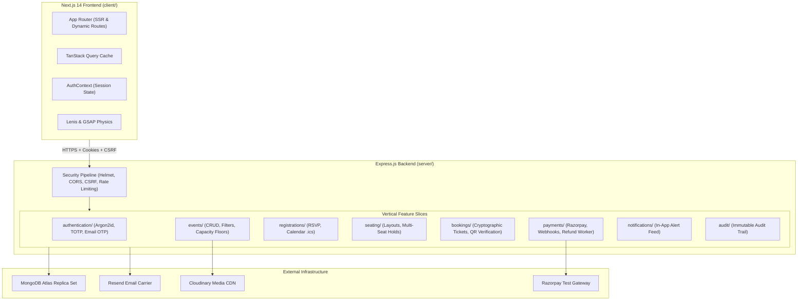

# Eventora — Production Event Booking & RSVP Platform

[](https://github.com/OmSardar/Eventora/actions/workflows/ci.yml)
[](server/README.md)
[](client/tsconfig.json)
[](LICENSE)

Eventora is an enterprise-grade, full-stack event discovery, seat reservation, and booking platform engineered with **Next.js 14**, **Node.js 22**, **Express.js 4**, and **MongoDB Atlas**. Built to withstand high-concurrency flash crowds, it guarantees atomic seat reservation invariants, multi-seat interactive selection, durable Razorpay payment workflows, automated background refund reconciliation, cryptographic gate check-in, RFC 5545 calendar integration, transactional email delivery, and zero-client-credential Cloudinary media storage.

---

## 1. Project Introduction and Purpose

Eventora solves the critical concurrency and integrity vulnerabilities commonly found in traditional event reservation software:
- **Flash Crowd Overbooking:** High-volume concurrent requests competing for finite seats often cause overselling when inventory checks and decrements are not atomic. Eventora solves this via database-level conditional mutations and MongoDB replica set transactions.
- **Double-Booking Collisions:** Flawed idempotency controls allow attendees to submit multiple simultaneous registrations for the same event, artificially exhausting capacity. Eventora enforces compound unique database indexes (`{ eventId: 1, attendeeId: 1 }`).
- **Client Credential Leaks:** Direct browser-to-cloud uploads frequently expose third-party cloud credentials or allow unvalidated file types (e.g. Stored XSS via malicious SVGs). Eventora enforces a zero-client-credential backend upload boundary with cryptographic binary magic-bytes verification.
- **Inconsistent Delivery Guarantees:** Third-party gateway timeouts during notification or email dispatching often roll back valid database transactions. Eventora decouples side-effect dispatches from database commits.

---

## 2. Main Features

- **Authentication & RBAC:** Stateful sessions backed by MongoDB (`connect-mongo`), Argon2id password hashing, RFC 6238 TOTP Authenticator app MFA, Email OTP MFA, 10 hashed recovery codes, and strict role guards (`ORGANIZER`, `ATTENDEE`).
- **Atomic Free RSVP:** Guaranteed single-seat reservation with conditional hardware document locking preventing venue capacity breaches.
- **Interactive Assigned Seating:** Visual SVG seating map supporting multi-seat selection, tier-based pricing (VIP, Standard, Economy), and a 10-minute temporary seat hold with automatic server-side expiration.
- **Razorpay Payments & Reconciliation:** Test-mode payment integration for paid events, cryptographic HMAC signature verification, late payment capture protection, and automated background refund reconciliation.
- **P1 Event Cancellation Lifecycle:** Atomic database state transition cascading parent event cancellation to registrations, bookings, seat inventory, and active holds, while issuing refunds and sending cancellation notices.
- **Gate Check-in QR Scanner:** Camera-based QR ticket scanner (`html5-qrcode`) on `/tickets/verify` validating signed HMAC ticket tokens with concurrent double-redemption prevention.
- **Add to Calendar (.ics) Download:** RFC 5545 compliant `.ics` calendar passes with UTC timestamps and line folding, directly opening in Google Calendar, Apple Calendar, and Microsoft Outlook.
- **Transactional Emails & In-App Alerts:** Branded email receipts dispatched via the Resend API alongside a persistent real-time in-app notification feed.
- **Backend-Only Media Management:** Multer in-memory buffering with binary magic-bytes validation (JPEG, PNG, WebP only) and server-side Cloudinary streaming.
- **Minimalist Monochrome UI:** Dark/light mode theme switching (`next-themes`), smooth inertial scrolling physics via Lenis and GSAP ScrollTrigger, and comprehensive technical SEO.

---

## 3. Technology Stack

### Frontend (`client/`)
- **Framework:** Next.js 14.2.23 (App Router with Server & Client Components)
- **Language:** TypeScript 5.7 (Strict static typing)
- **UI & Styling:** Tailwind CSS 3.4, Radix UI primitives, Lucide React icons
- **State & Data Fetching:** TanStack React Query v5, React Context (`AuthContext`)
- **Forms & Validation:** React Hook Form 7.54, Zod 3.24
- **Animation & Physics:** Lenis 1.3, GSAP 3.12 (ScrollTrigger)
- **QR Scanner:** html5-qrcode 2.3.8

### Backend (`server/`)
- **Runtime:** Node.js 22 LTS (ES Modules)
- **Web Framework:** Express.js 4.21.2
- **Database & ODM:** MongoDB Atlas Clustered Replica Set, Mongoose 8.9.5
- **Session Management:** express-session 1.18, connect-mongo 5.1
- **Cryptography:** Argon2id (`argon2`), AES-256-GCM, HMAC-SHA256, OTPAuth 9.6
- **Logging & Security:** Pino 9.6, Helmet 8.0, CORS 2.8, express-rate-limit 7.5
- **Gateways & SDKs:** Razorpay 2.9.8, Resend 6.37.0, Cloudinary 2.11.0, Multer 2.5
- **Testing:** Node.js Native Test Runner (`node:test`), Supertest 7.0

---

## 4. Architecture Overview

Eventora is architected as a **Modular Monolith** applying **Vertical Slice Architecture** for domain capabilities and a **Shared Kernel** for cross-cutting policies:



---

## 5. Current Repository Structure

```text
Eventora/
├── .github/                   # GitHub Actions continuous integration workflows
│   └── workflows/ci.yml       # Automated backend test, lint, and build pipeline
├── client/                    # Next.js 14 frontend web application
│   ├── playwright/            # End-to-end browser automation suites
│   ├── public/                # Static brand assets, favicon.svg, webmanifest
│   ├── scripts/               # Production asset generation scripts
│   ├── src/
│   │   ├── app/               # App Router route groups: (public), (auth), (attendee), (organizer)
│   │   ├── components/        # UI components: ui, events, tickets, seating, payments, layout
│   │   ├── features/          # Feature contexts (AuthContext, role guards)
│   │   ├── lib/               # Utilities (api client, calendar .ics helper, env, siteConfig)
│   │   └── types/             # TypeScript domain interfaces and API contracts
│   ├── .env.example           # Frontend environment variable template
│   ├── package.json           # Frontend package manifest
│   └── README.md              # Detailed frontend architectural documentation
├── Docs/                      # Comprehensive technical documentation & specifications
│   ├── 01-requirements/       # SRS and requirements traceability matrix
│   ├── 02-system-design/      # High-Level and Low-Level system design
│   ├── 03-database-design/    # Mongoose schemas, data dictionaries, indexes
│   ├── 04-api-documentation/  # REST API specification & OpenAPI 3.0 yaml
│   ├── 05-security/           # STRIDE threat model & rate limiting policy
│   ├── 06-testing/            # Quality assurance test strategy
│   ├── 07-deployment/         # Render, Vercel & MongoDB Atlas deployment manual
│   ├── 08-seo/                # Technical SEO & structured data guide
│   ├── 09-production-readiness/# Production audit reports & verification checklists
│   ├── 10-seat-booking/       # Interactive seating & reservation specifications
│   ├── security/              # Git history security hygiene verification
│   └── README.md              # Master documentation index
├── server/                    # Node.js 22 LTS / Express.js REST API
│   ├── src/
│   │   ├── infrastructure/    # Adapters: cloudinary, database, email, logging, security, session
│   │   ├── modules/           # Slices: audit, auth, bookings, events, notifications, payments, registrations, seating, users
│   │   ├── scripts/           # Database seeder (seed.js)
│   │   ├── shared/            # Kernel: constants, errors, middleware, utils, validation
│   │   ├── app.js             # Express application pipeline
│   │   └── server.js          # Server bootstrap, workers & graceful shutdown
│   ├── tests/                 # 212 automated tests across unit, integration, and security suites
│   ├── .env.example           # Backend environment variable template
│   ├── package.json           # Backend package manifest & test scripts
│   └── README.md              # Detailed backend architectural documentation
├── .env.example               # Root repository environment variable template
├── .gitignore                 # Strict ignore rules for dependencies, env files, and secrets
├── README.md                  # Master project documentation
└── render.yaml                # Infrastructure as Code for Render Web Service deployment
```

---

## 6. Frontend Architecture

The frontend is implemented with Next.js 14 App Router:
- **Server Components (RSC):** Utilized for the homepage, event catalog, and event detail views to maximize first-contentful-paint (FCP) and provide pre-rendered JSON-LD structured metadata for search crawlers.
- **Client Components (`"use client"`):** Utilized for interactive islands including the SVG seating canvas, authentication forms, QR gate scanner, and checkout modal.
- **Route Groups & Access Guards:**
  - `app/(public)` — Publicly accessible event catalog and details.
  - `app/(auth)` — Authentication, password reset, and email verification.
  - `app/(attendee)` — Authenticated attendee dashboard and ticket passes.
  - `app/(organizer)` — Authenticated organizer dashboard, event authoring, and attendee rosters.
- **Centralized API Client (`client/src/lib/api.ts`):** Automatically injects cached synchronizer CSRF tokens (`X-CSRF-Token`) on all mutating requests and passes `credentials: "include"`.

---

## 7. Backend Architecture

The backend operates as an Express 4 modular application running on Node.js 22 LTS:
- **Strict Middleware Pipeline:**
  1. `pino-http` request correlation and latency tracking.
  2. `helmet` HTTP security headers with restrictive Content-Security-Policy (CSP).
  3. `cors` exact-origin matching with wildcard preview support.
  4. `cookie-parser` and `express-session` with MongoDB MongoStore session persistence.
  5. `sessionExpiryMiddleware` enforcing 30-minute idle and 24-hour absolute session limits.
  6. Rate limiting tiers (Auth, Mutations, Uploads, Gate Scans, Webhooks).
  7. `csrfProtection` validating Origin headers and cryptographic synchronizer tokens.
  8. Zod schema validation middleware (`validateBody`).
  9. Domain controller execution and centralized RFC-compliant `errorHandler`.

---

## 8. Database Design Overview

Eventora utilizes MongoDB Atlas with clustered replica set transactions:
- **`users`:** Accounts, Argon2id hashes, roles, AES-256-GCM encrypted TOTP secrets, single-use recovery code hashes, email verification tokens.
- **`events`:** Event title, description, UTC `eventDate`, venue, capacity, booked count, seating type, category, status (`PUBLISHED`, `CANCELLED`).
- **`registrations`:** Attendee RSVPs. Compound unique index `{ eventId: 1, attendeeId: 1 }` guarantees double-booking immunity.
- **`bookings`:** Multi-seat orders linking seats, HMAC ticket tokens, booking references, and payment records.
- **`eventseats`:** Physical seat inventory. Compound unique index `{ eventId: 1, seatLabel: 1 }`. Statuses: `AVAILABLE`, `HELD`, `BOOKED`, `BLOCKED`.
- **`seatholds`:** 10-minute multi-seat temporary hold records.
- **`payments` & `refundoperations`:** Razorpay orders, transaction references, idempotency keys, and automated refund state machines.

---

## 9. Authentication and Authorization

- **Argon2id Hashing:** Password hashing configured with OWASP-recommended memory cost ($64\text{MB}$), time cost ($3$ iterations), and parallelism ($4$). Minimum 10 characters with uppercase, digit, and symbol.
- **Stateful MongoStore Sessions:** Session cookies are `httpOnly: true`, `secure: true` in production, with `sameSite: "none"` (cross-site) or `"lax"` (local).
- **Session Fixation Defense:** Calls `req.session.regenerate()` upon login and privilege elevation.
- **Multi-Factor Authentication (MFA):**
  - **Authenticator App (TOTP):** RFC 6238 time-based tokens with AES-256-GCM encryption at rest.
  - **Email OTP:** Cryptographically hashed 6-digit numeric codes with 10-minute expiration.
  - **Recovery Codes:** 10 single-use hashed recovery codes generated during MFA enrollment.
- **Email Verification Gating:** Critical actions (event creation, RSVP, seat hold, checkout) require verified email status (`requireVerifiedEmail`).

---

## 10. Event Creation and Management

Organizers author and manage events with enforced business integrity:
- **Validation:** Scheduled events must be at least 12 hours in the future and within 3 months.
- **Capacity Floor Protection:** Organizers cannot reduce an event's seat limit below the currently booked count.
- **Seating Configuration:** Organizers can choose `GENERAL_ADMISSION` (flat capacity) or `ASSIGNED_SEATING` (custom venue layouts, tiers, and rows).
- **Media Uploads:** Banners are uploaded through backend-only streams directly to Cloudinary with file format and size limits.

---

## 11. Attendee Registration and Booking

- **Free RSVP (General Admission):** Executed via an atomic conditional update:
  ```javascript
  Event.findOneAndUpdate(
    { _id: eventId, status: "PUBLISHED", $expr: { $lt: ["$seatsBooked", "$seatLimit"] } },
    { $inc: { seatsBooked: 1 } },
    { new: true }
  );
  ```
  If capacity is exhausted, the conditional update returns `null`, preventing overselling.
- **Double-Booking Immunity:** The compound unique index `{ eventId: 1, attendeeId: 1 }` rejects duplicate registrations with HTTP 409 Conflict.
- **Attendee Cancellation Request:** Attendees can submit a cancellation request with an optional reason. The seat remains held until approved by the organizer.

---

## 12. Assigned Seating and Seat Holds

- **Multi-Seat Atomic Claims:** Attendees select up to 6 seats simultaneously. The backend claims all seats in a single atomic transaction.
- **10-Minute Hold Window:** Holds transition seats to `HELD` with an expiration timestamp (`heldUntil = now + 10m`).
- **Interactive Visual Canvas:** Frontend SVG canvas renders available, held, and booked seats with real-time countdown timers.
- **Hold Expiration Worker (`holdExpirationWorker.js`):** Runs every 30 seconds to reclaim expired holds and release seats back to `AVAILABLE`.

---

## 13. Payment and Razorpay Integration

- **Razorpay Test Mode:** Built for test-mode transactions using test card and UPI simulators.
- **Order Generation (`/api/v1/payments/create-order`):** Creates Razorpay order and pairs it with a 10-minute `SeatReservation` hold.
- **Signature Verification (`/api/v1/payments/verify`):** Verifies cryptographic HMAC-SHA256 signature (`orderId + "|" + paymentId`) using timing-safe string comparison.
- **Late Capture Guard:** If an attendee authorizes payment after an event is cancelled, the backend rejects registration creation, aborts capacity allocation, and triggers an automated refund.

---

## 14. Refund Processing and Reconciliation Worker

- **Durable Refund Operations:** Refunds create persistent `RefundOperation` records with unique idempotency keys (`refund_reg_${regId}` or `refund_pay_${paymentId}`).
- **Refund Reconciliation Worker (`refundReconciliationWorker.js`):**
  - Runs every 60 seconds on an unreferenced background interval.
  - Queries pending and failed refund operations where `nextRetryAt <= now`.
  - Verifies status against authoritative Razorpay API endpoints.
  - Implements exponential backoff ($2^{\text{retryCount}} \times 60\text{s}$) with a maximum retry ceiling transitioning to `MANUAL_RECONCILIATION_REQUIRED`.
  - Non-overlapping execution lock (`isSweepRunning`) guarantees worker thread safety.

---

## 15. QR Ticket Generation and Verification

- **Cryptographic HMAC Pass Tokens:** Tickets contain a cryptographically signed payload (`ticketToken`) encoding booking reference, event ID, attendee ID, and HMAC-SHA256 signature.
- **Digital Pass Display:** Attendee ticket modal renders an interactive pass with scannable QR code, booking details, and assigned seat tags.
- **Gate-Side Scanner Tool (`/tickets/verify`):** Organizers use camera-based scanning or manual entry to admit attendees.
- **Atomic Double-Scan Immunity:** Gate validation marks tickets redeemed via conditional atomic update (`isRedeemed: false -> true`), preventing ticket pass re-use.
- **Cancelled Event Rejection:** QR verification strictly rejects tickets for cancelled events with reason `EVENT_CANCELLED`.

---

## 16. Email Notifications

- **Resend Integration (`resend`):** Transactional email delivery via verified domain senders.
- **Templates:**
  - Email Verification receipt with secure confirmation link.
  - Sign-in Security Alert with offline GeoIP location and device detection.
  - Free RSVP Confirmation with booking reference and event details.
  - Paid Booking & Seat Pass Receipt with itemized breakdown.
  - Event Cancellation Notice with refund confirmation details.
- **Non-Blocking Resilience:** Email carrier timeouts or delivery errors never roll back successfully committed database transactions.

---

## 17. In-App Notifications

- **Notification Feed (`/api/v1/notifications`):** Real-time in-app notification center for attendees and organizers.
- **Notification Types:**
  - `EVENT_CANCELLED`
  - `BOOKING_CONFIRMED`
  - `CANCELLATION_REQUESTED`
  - `CANCELLATION_APPROVED`
  - `CANCELLATION_REJECTED`
- **Badge Counter:** Real-time unread badge count with single-click mark-as-read and batch mark-all-read.

---

## 18. Calendar (.ics) Download

- **RFC 5545 Compliance:** Native `.ics` calendar generation implemented in [`icsGenerator.js`](server/src/shared/utils/icsGenerator.js).
- **Timezone Safety:** All timestamps (`DTSTART`, `DTEND`, `DTSTAMP`) formatted strictly in UTC (`YYYYMMDDTHHmmssZ`) per RFC 5545 Form #2, ensuring native timezone conversion in Google Calendar, Apple Calendar, and Outlook.
- **Line Folding & Escaping:** Automatically folds lines longer than 75 octets with `\r\n ` while preserving multi-byte UTF-8 glyphs, and escapes `\\`, `\;`, `\,`, and newlines.
- **Security & Authorization:** Available only to authenticated attendees for events they are confirmed for (`GET /api/v1/registrations/:id/calendar.ics`). Cancelled events return HTTP 400.

---

## 19. Event Banner Uploads Through Cloudinary

- **Zero-Client-Credential Architecture:** Frontend never receives Cloudinary API secrets or unsigned upload presets.
- **In-Memory Buffering:** Uploads are streamed through Multer memory storage (`5MB` ceiling).
- **Binary Magic-Bytes Verification:** Files are inspected byte-by-byte for valid magic headers (JPEG `FF D8 FF`, PNG `89 50 4E 47`, WebP `52 49 46 46`). Rejects malicious SVGs, HTML, and executables.
- **Server SDK Streaming:** Clean files are streamed to Cloudinary using the official backend SDK and stored with non-guessable identifiers.

---

## 20. Search, Filtering and Organizer Dashboard

- **Event Discovery Catalog (`/events`):** Full-text search on title, description, and venue, accompanied by category pill filtering and pagination.
- **Organizer Dashboard (`/organizer/dashboard`):** Real-time analytics displaying total hosted events, active registrations, ticket revenue, and capacity utilization.
- **Attendee Roster Management:** Organizers can inspect registered attendee rosters, download attendee lists, and review pending cancellation requests.

---

## 21. Security Measures

- **Distributed Rate Limiting:** MongoDB-backed rate limiters for authentication (`15 req / 15m`), event mutations (`25 req / 15m`), banner uploads (`5 req / 15m`), and ticket scans.
- **Synchronizer Token CSRF Defense:** Custom CSRF protection issuing unique tokens to verify Origin and custom headers.
- **CORS Exact-Origin Matching:** Strict whitelist matching client domains and Vercel preview environments.
- **Session Expiry:** Enforces 30-minute idle inactivity timeout and 24-hour absolute session ceiling.
- **Input Validation:** Every endpoint validates payloads against strict Zod schemas before hitting domain services.

---

## 22. Testing Strategy and Test Commands

Eventora features **212 automated backend tests** running on Node.js native test runner (`node:test`) and Playwright E2E browser suites:

```bash
# ----------------------------------------------------
# Backend Tests (212 Tests across 35 Suites)
# ----------------------------------------------------
# Run all backend tests
npm test --prefix server

# Run backend unit tests (74 tests)
npm run test:unit --prefix server

# Run backend integration tests (104 tests)
npm run test:integration --prefix server

# Run backend security tests (34 tests)
npm run test:security --prefix server

# ----------------------------------------------------
# Frontend Code Quality & Verification
# ----------------------------------------------------
# Run Next.js ESLint
npm run lint --prefix client

# Run Next.js production build (19 routes)
npm run build --prefix client

# Run Playwright E2E tests
npm run test:e2e --prefix client
```

---

## 23. Local Development Setup

### Prerequisites
- Node.js 22 LTS or higher
- MongoDB instance (local community edition or free MongoDB Atlas URI)
- npm 10+

### Setup Steps
```bash
# 1. Clone repository
git clone https://github.com/OmSardar/Eventora.git
cd Eventora

# 2. Install dependencies for server and client
cd server && npm install
cd ../client && npm install
cd ..

# 3. Configure backend environment
cp server/.env.example server/.env
# Edit server/.env with your local MongoDB URI and session secret

# 4. Configure frontend environment
cp client/.env.example client/.env
# Edit client/.env with NEXT_PUBLIC_API_URL=http://localhost:5000/api/v1

# 5. Seed demo database (Optional)
cd server && npm run seed
cd ..

# 6. Start development servers
# Terminal 1: Backend API (Port 5000)
cd server && npm run dev

# Terminal 2: Frontend Client (Port 3000)
cd client && npm run dev
```

---

## 24. Environment Variables and Configuration

A master environment template is provided in [`.env.example`](.env.example).

### Backend Variables (`server/.env`)
| Variable | Required | Description | Safe Placeholder |
|---|:---:|---|---|
| `PORT` | Yes | Local server HTTP port | `5000` |
| `NODE_ENV` | Yes | Environment mode (`development`, `test`, `production`) | `development` |
| `MONGODB_URI` | Yes | MongoDB Atlas replica set connection string | `mongodb://127.0.0.1:27017/eventora` |
| `SESSION_SECRET` | Yes | Cryptographic secret for signing session cookies | `min-32-chars-random-secret-key!` |
| `ALLOWED_ORIGINS` | Yes | Comma-separated list of allowed frontend origins | `http://localhost:3000,https://eventora.omslabs.tech` |
| `APP_BASE_URL` | Yes | Primary public frontend URL for emails | `http://localhost:3000` |
| `RESEND_API_KEY` | Optional | Resend API key for transactional emails | `re_test_placeholder` |
| `EMAIL_FROM` | Optional | Verified sender address in Resend | `Eventora <notifications@mail.example.com>` |
| `CLOUDINARY_CLOUD_NAME` | Optional | Cloudinary cloud identifier | `your_cloud_name` |
| `CLOUDINARY_API_KEY` | Optional | Cloudinary API key | `your_api_key` |
| `CLOUDINARY_API_SECRET` | Optional | Cloudinary API secret | `your_api_secret` |
| `RAZORPAY_KEY_ID` | Optional | Public Razorpay Test Key ID | `rzp_test_YourTestKeyId` |
| `RAZORPAY_KEY_SECRET` | Optional | Private Razorpay API Secret | `YourTestKeySecret` |
| `RAZORPAY_WEBHOOK_SECRET` | Optional | Razorpay Webhook HMAC Secret | `YourWebhookSecret` |

### Frontend Variables (`client/.env`)
| Variable | Required | Description | Safe Placeholder |
|---|:---:|---|---|
| `NEXT_PUBLIC_SITE_URL` | Yes | Canonical public site URL | `http://localhost:3000` |
| `NEXT_PUBLIC_API_URL` | Yes | Public REST API base URL | `http://localhost:5000/api/v1` |
| `INTERNAL_API_URL` | No | Server-to-server API URL for Next.js SSR sitemaps | `http://localhost:5000/api/v1` |
| `NEXT_PUBLIC_RAZORPAY_KEY_ID` | Optional | Razorpay Key ID for browser modal | `rzp_test_YourTestKeyId` |

---

## 25. Database Setup and Demo Data

The database seeder initializes verified demo accounts and sample events with full seat layouts:

```bash
cd server && npm run seed
```

Seeded entities include:
- **Organizer Account:** `organizer@eventora.demo` (Password: `Password@123`)
- **Attendee Account:** `attendee@eventora.demo` (Password: `Password@123`)
- **Free General Admission Event:** Global Tech Innovation Summit 2026.
- **Assigned Seating Paid Event:** Symphony Under the Stars (Auditorium layout with VIP, Premium, and Standard rows).

---

## 26. Deployment Architecture

- **Frontend:** Hosted on [Vercel](https://vercel.com) connecting to the Next.js App Router with automatic CDN caching and edge headers.
- **Backend:** Hosted on [Render](https://render.com) as a Node.js Web Service defined via [`render.yaml`](render.yaml) with automatic health-check polling on `/api/v1/health`.
- **Database:** Hosted on [MongoDB Atlas](https://www.mongodb.com/atlas) with a 3-node replica set cluster providing multi-document ACID transactions.

---

## 27. Live Application URLs

- **Frontend Application:** [https://eventora.omslabs.tech](https://eventora.omslabs.tech)
- **Backend API Gateway:** [https://eventora-server-omslabs.onrender.com/api/v1](https://eventora-server-omslabs.onrender.com/api/v1)
- **API Health Check:** [https://eventora-server-omslabs.onrender.com/api/v1/health](https://eventora-server-omslabs.onrender.com/api/v1/health)
- **Source Repository:** [https://github.com/OmSardar/Eventora](https://github.com/OmSardar/Eventora)

---

## 28. Demo Account Instructions

To explore Eventora without registering new accounts:

| Role | Email Address | Password | Permissions & Features |
|---|---|---|---|
| **Organizer** | `organizer@eventora.demo` | `Password@123` | Create/edit events, view attendee rosters, validate ticket QR codes, review cancellations. |
| **Attendee** | `attendee@eventora.demo` | `Password@123` | Browse catalog, reserve seats, download `.ics` calendar passes, view digital ticket passes. |

---

## 29. Known Limitations

- **Email Delivery in Test/Dev:** When `RESEND_API_KEY` is not provided or running in test mode, email delivery is simulated cleanly in server logs.
- **Standalone MongoDB Fallback:** MongoDB transactions require a replica set. When running against a local standalone MongoDB instance, Eventora gracefully falls back to non-transactional operations with manual compensation logic.

---

## 30. Future Improvements

- **WebSockets / Server-Sent Events (SSE):** Push real-time seat lock state changes instantly across multiple browsing clients on the interactive seat canvas.
- **Apple Wallet & Google Wallet Passes:** Native `.pkpass` generation for mobile wallet integration.
- **Promotional Coupon Codes:** Flexible percentage and fixed discount engine for paid event tiers.
- **Multi-Day Conference Schedules:** Sub-sessions, breakout track registrations, and personalized attendee agendas.
