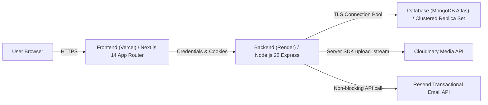

# Eventora — Production Event Booking & RSVP Platform

[](https://github.com/omsardar/eventora/actions/workflows/ci.yml)
[](server/tests/tests.md)
[](LICENSE)

Eventora is a production-quality event booking and RSVP management platform built with **Next.js 14**, **Express.js**, and **MongoDB Atlas**. Engineered as a modular monolith adhering to vertical slice architecture, it guarantees atomic seat reservation consistency under high-concurrency flash crowds, zero-trust backend security boundaries, transactional email receipts via the Resend API, backend-only Cloudinary media management, and a clean monochrome design system.

---

## 1. Project Introduction

### 1.1 The Problem Being Solved
Traditional event reservation platforms often suffer from critical concurrency vulnerabilities:
- **Overbooking Race Conditions:** High-volume flash crowds competing for limited seats can breach venue capacity when reads and writes are not executed atomically.
- **Double-Booking Collisions:** Flawed idempotency controls allow attendees to register multiple times for the same event, artificially exhausting ticket inventories.
- **Client Credential Leaks:** Direct browser-to-cloud uploads frequently expose third-party cloud credentials, upload signatures, and unvalidated file types (leading to Stored XSS via malicious SVGs).
- **Inconsistent Delivery Guarantees:** Third-party provider timeouts during notification dispatching often roll back valid database bookings or block response threads.

Eventora solves these challenges through database-level conditional atomic updates, compound unique indexing, a zero-client-credential backend upload boundary with cryptographic magic-bytes verification, and non-blocking transactional email delivery.

### 1.2 User Roles
Eventora enforces strict, immutable Role-Based Access Control (RBAC):
- **Organizer:** Authors and manages events, adjusts capacity limits (guarded by capacity floors), uploads event banners, views private attendee rosters, cancels events, and reviews attendee cancellation requests.
- **Attendee:** Discovers upcoming published events, searches by keyword and category, reserves seats via Free RSVP with atomic concurrency guarantees, receives Resend email receipts, accesses digital tickets, and requests cancellations.

### 1.3 Project Status & Deployments
- **Project Status:** Production-Ready & Hardened.
- **Frontend Target:** Deployed on [Vercel](https://vercel.com) (Next.js 14 App Router).
- **Backend Target:** Deployed on [Render](https://render.com) (Node.js 22 Web Service via [`render.yaml`](render.yaml)).
- **Database Engine:** [MongoDB Atlas](https://www.mongodb.com/atlas) Clustered Replica Set.
- **Health Check Endpoint:** `https://eventora-api.onrender.com/api/v1/health` (returns HTTP 200 `{ status: "healthy" }`).

---

## 2. Product Capabilities

### Implemented Capabilities

| Capability | Module | Engineering Implementation |
|---|---|---|
| **Authentication** | `authentication` | Stateful sessions in MongoDB (`connect-mongo`), Argon2id password hashing, session fixation rotation (`session.regenerate()`). |
| **Email Verification & Gating** | `authentication` | Single-use SHA-256 hashed tokens, 30-min expiry, 60s cooldown, Resend email dispatch, and action gating (`requireVerifiedEmail`). |
| **Multi-Factor Auth (MFA)** | `authentication` | Dual MFA options: Email OTP (HMAC-SHA256) and Authenticator App TOTP (RFC 6238, AES-256-GCM encrypted secrets at rest), plus 10 hashed single-use recovery codes. |
| **Login Alerts & Audit Log** | `authentication` | Real-time login notification emails with offline MaxMind GeoIP parsing, User-Agent device/browser detection, and immutable login event history. |
| **Role-Based Access Control**| `shared/middleware` | Strict role enforcement (`requireAuth`, `requireOrganizer`, `requireAttendee`), role immutability in MongoDB schema. |
| **Event Discovery & Search** | `events` | Server-rendered catalog, text index keyword search, category pill filtering, pagination, and dynamic OpenGraph metadata. |
| **Atomic Free RSVP** | `registrations` | Conditional atomic update (`$inc: { seatsBooked: 1 }` with `$expr: { $lt: ['$seatsBooked', '$seatLimit'] }`). Hardware-level document locking prevents overselling. |
| **Double-Booking Immunity** | `registrations` | Compound unique index `{ eventId: 1, attendeeId: 1 }` prevents duplicate registrations. |
| **Capacity Floor Protection**| `events` | Organizers cannot reduce an event's seat limit below the currently booked seat count. |
| **Transactional Email** | `infrastructure/email` | Asynchronous booking receipts dispatched via Resend API (`resend`) with atomic deduplication (`confirmationEmailSent`). |
| **Backend-Only Banner Upload**| `events` | Multer in-memory buffering, cryptographic magic-bytes inspection (JPEG, PNG, WebP only; rejects SVGs, HTML, and EXEs), server-side Cloudinary SDK streaming with unique server IDs. |
| **Cancellation Workflow** | `registrations` | Two-phase cancellation: Attendee submits request -> Organizer approves (releasing seat) or rejects. |
| **In-App Notifications** | `notifications` | Real-time notification bell and alert feed for event cancellations, booking confirmations, and cancellation decisions. |
| **Payments & Ticketing** | `payments` | Razorpay Test Mode integration supporting paid event ticketing, 10-minute temporary seat reservations, timing-safe HMAC verification, and server-to-server webhook ingestion. |
| **Smooth Scrolling** | `components/layout` | Inertial smooth scrolling via Lenis synchronized with GSAP ScrollTrigger, honoring `prefers-reduced-motion`. |
| **Technical SEO & Brand Icons**| `app/seo` | Dynamic JSON-LD structured schemas (`Event`, `WebSite`, `Organization`), dynamic `/robots.txt` and `/sitemap.xml`, theme-adaptive SVG and multi-resolution ICO icons. |

### Planned / Out-of-Scope Capabilities
- SMS notifications (MSG91 integration intentionally removed to prioritize Resend email confirmations).

---

## 3. Architecture Overview

Eventora is architected as a **Modular Monolith** applying **Vertical Slice Architecture** for feature boundaries and a **Shared Kernel** for cross-cutting policies.

```mermaid
flowchart TD
    subgraph ClientApp ["Next.js 14 Frontend (client/)"]
        AppRouter["App Router (SSR & Dynamic Routes)"]
        ReactQuery["TanStack Query (Cache & State)"]
        AuthCtx["AuthContext (Session State)"]
        LenisGSAP["Lenis & GSAP ScrollTrigger"]
    end

    subgraph BackendApp ["Express.js Backend (server/)"]
        ExpressPipeline["Express Security Pipeline (Helmet, CORS, CSRF, RateLimit)"]
        
        subgraph FeatureSlices ["Vertical Feature Slices"]
            AuthSlice["authentication/ (Argon2id & Sessions)"]
            EventSlice["events/ (CRUD, Filters, Capacity)"]
            RegSlice["registrations/ (Atomic RSVP & Approvals)"]
            NotifSlice["notifications/ (In-App Feed)"]
            AuditSlice["audit/ (Compliance Audit Logs)"]
        end
        
        subgraph SharedKernel ["Shared Kernel"]
            Middleware["middleware/ (Auth, CSRF, Upload, Errors)"]
            Validation["validation/ (Zod, Magic Bytes)"]
            Errors["errors/ (AppError Hierarchy)"]
        end
    end

    subgraph ExternalServices ["External Infrastructure"]
        Atlas["MongoDB Atlas (Sessions, RateLimits, Documents)"]
        CloudinaryAPI["Cloudinary API (Server SDK Streaming)"]
        ResendAPI["Resend API (Transactional Receipts)"]
    end

    Browser["User Browser"] -->|HTTPS (Cookies & CSRF)| ClientApp
    ClientApp -->|API Requests with HttpOnly Cookies| ExpressPipeline
    ExpressPipeline --> FeatureSlices
    FeatureSlices --> SharedKernel
    FeatureSlices --> Atlas
    EventSlice -->|upload_stream| CloudinaryAPI
    RegSlice -->|emails.send| ResendAPI
```

For comprehensive deep-dive architecture documentation, refer to:
- **[Frontend Root Architecture (`client/client_root.md`)](client/client_root.md)**
- **[Backend Root Architecture (`server/server_root.md`)](server/server_root.md)**

---

## 4. Technology Stack

| Technology | Actual Version | Responsibility in Application | Location |
|---|---|---|---|
| **Node.js** | 22 LTS (ESM) | Backend JavaScript runtime environment | Server |
| **Express.js** | 4.21.2 | REST API routing and middleware pipeline | Server |
| **Next.js** | 14.2.23 (App Router) | Full-stack React framework with SSR & Metadata API | Client |
| **React** | 18.3.1 | UI component rendering library | Client |
| **TypeScript** | 5.7.2 | Strict static typing and contract enforcement | Client |
| **MongoDB & Mongoose** | 8.9.5 | Clustered database engine and ODM | Server |
| **express-session** | 1.18.1 | Stateful HTTP session management | Server |
| **connect-mongo** | 5.1.0 | MongoDB-backed session persistence with native TTL | Server |
| **Argon2id (`argon2`)** | 0.41.1 | OWASP-compliant password hashing algorithm | Server |
| **Razorpay (`razorpay`)** | 2.9.5 | Official SDK for order creation, payments, and refunds | Server |
| **Resend (`resend`)** | 6.37.0 | Official SDK for transactional email confirmation delivery | Server |
| **Cloudinary (`cloudinary`)**| 2.11.0 | Official server-side SDK for media asset storage | Server |
| **Multer (`multer`)** | 2.5.0 | In-memory multipart/form-data upload parsing | Server |
| **Tailwind CSS** | 3.4.17 | Utility-first styling and theme token system | Client |
| **TanStack React Query** | 5.62.16 | Server state caching, background polling, and optimistic invalidation | Client |
| **React Hook Form** | 7.54.2 | High-performance form state management | Client |
| **Zod** | 3.24.1 (client) / 3.25.76 (server) | Schema validation for payloads and form inputs | Client & Server |
| **Lenis (`lenis`)** | 1.1.18 | Smooth scrolling physics engine | Client |
| **GSAP (`gsap`)** | 3.12.5 | Animation platform and ScrollTrigger synchronization | Client |
| **Pino (`pino`)** | 9.6.0 | Structured JSON logger with automated credential redaction | Server |
| **Helmet (`helmet`)** | 8.0.0 | HTTP security headers and Content Security Policy | Server |
| **Node Test Runner** | Native (Node 22) | Automated unit, integration, and security test runner | Server |
| **Playwright** | 1.49.1 | End-to-end browser test automation (Chromium) | Client |

---

## 5. Repository Structure

```text
EVENTORA/
├── README.md            # Main project documentation (Level 1)
├── package.json         # Workspace scripts
├── render.yaml          # Render Blueprint deployment configuration
├── .gitignore           # Git ignore rules
│
├── client/              # Next.js 14 Frontend Application
│   ├── client_root.md   # Comprehensive Frontend Architecture (Level 2)
│   ├── package.json     # Frontend dependencies and scripts
│   ├── next.config.mjs  # Next.js configuration
│   ├── tailwind.config.ts # Styling tokens
│   ├── public/          # Static brand assets, favicon, manifest, OG image
│   ├── playwright/      # Playwright E2E test suites (17 tests)
│   │   └── playwright.md
│   └── src/             # Frontend source code
│       ├── src.md       # Source root documentation
│       ├── app/         # App Router routes and layouts
│       ├── components/  # React views, layout shells, UI primitives
│       ├── features/    # Domain feature slices and AuthContext
│       ├── lib/         # API client, siteConfig, utils
│       └── types/       # TypeScript interfaces and contracts
│
├── server/              # Express.js Backend Application
│   ├── server_root.md   # Comprehensive Backend Architecture (Level 2)
│   ├── package.json     # Backend dependencies and test scripts
│   ├── src/             # Backend source code
│   │   ├── src.md       # Source root documentation
│   │   ├── app.js       # Express application & middleware pipeline
│   │   ├── server.js    # Entry point & graceful shutdown
│   │   ├── infrastructure/ # External adapters, DB, logging, security, session, storage, email
│   │   ├── modules/     # Vertical feature slices (auth, events, registrations, notifications)
│   │   ├── scripts/     # Database seeding and migration utilities
│   │   └── shared/      # Shared kernel (constants, errors, middleware, validation)
│   └── tests/           # Automated test suites (68 tests)
│       └── tests.md     # Unit, integration, and security test breakdown
│
└── Docs/                # Technical documentation and architecture reports
    ├── 01-requirements/
    ├── 02-system-design/
    ├── 03-database/
    ├── 04-api-documentation/ # OpenAPI 3.0.3 specification & REST API reference
    ├── 05-security/
    ├── 06-testing/
    ├── 07-deployment/        # Production deployment guide
    ├── 08-seo/
    └── 09-production-readiness/ # Technical audits and coverage reports
```

---

## 6. Local Development Setup

### 6.1 Prerequisites
- **Node.js:** >= 20.0.0 LTS (Developed and verified on Node.js 22.18.0)
- **npm:** >= 10.0.0
- **MongoDB:** Local instance running at `mongodb://127.0.0.1:27017/eventora` or a free MongoDB Atlas cluster connection string.

### 6.2 Installation Steps
```bash
# 1. Clone the repository
git clone https://github.com/omsardar/eventora.git
cd EVENTORA

# 2. Install workspace dependencies
npm run install:all
```

### 6.3 Configure Environment Variables

Create `server/.env`:
```env
PORT=5000
NODE_ENV=development
LOG_LEVEL=info
MONGODB_URI=mongodb://127.0.0.1:27017/eventora
SESSION_SECRET=eventora-super-secret-development-key-minimum-32-chars-long!
ALLOWED_ORIGINS=http://localhost:3000,http://127.0.0.1:3000
APP_BASE_URL=http://localhost:3000

# Resend Transactional Email (runs in mock simulation mode if key is omitted or placeholder)
RESEND_API_KEY=re_mock_test_key_for_resend
EMAIL_FROM=Eventora <onboarding@resend.dev>

# Cloudinary Server Credentials (runs in test/mock mode if omitted or placeholder)
CLOUDINARY_CLOUD_NAME=your_cloudinary_cloud_name
CLOUDINARY_API_KEY=your_cloudinary_api_key
CLOUDINARY_API_SECRET=your_cloudinary_api_secret
```

Create `client/.env.local`:
```env
NEXT_PUBLIC_SITE_URL=http://localhost:3000
NEXT_PUBLIC_API_URL=http://localhost:5000/api/v1
```

### 6.4 Seed Database with Demo Accounts
```bash
npm run seed --prefix server
```
This initializes sample events and provisions two pre-configured demo accounts:

| Role | Email | Password | Primary Capabilities |
|---|---|---|---|
| **Organizer** | `organizer@eventora.demo` | `Organizer@123` | Host events, edit events, view attendee rosters, cancel events, approve cancellations |
| **Attendee** | `attendee@eventora.demo` | `Attendee@123` | Discover events, execute Free RSVPs, receive email receipts, view digital tickets |

> **Note:** The login page features **1-Click Demo Fill buttons** that instantly populate these credentials for quick review.

### 6.5 Run Development Servers
In separate terminal windows (or together):
```bash
# Start Backend REST API (Port 5000)
npm run dev:server

# Start Frontend Next.js Client (Port 3000)
npm run dev:client
```
Visit `http://localhost:3000` to interact with the platform.

---

## 7. Environment Variables Reference

### 7.1 Backend Environment Variables (`server/.env`)

| Variable Name | Purpose | Required / Optional | Target App | Sensitive Value |
|---|---|---|---|---|
| `PORT` | HTTP port listener (defaults to 5000) | Optional | Server | No |
| `NODE_ENV` | Runtime environment (`development`, `test`, `production`) | **Required** | Server | No |
| `LOG_LEVEL` | Pino logging threshold (`info`, `debug`, `warn`, `error`) | Optional | Server | No |
| `MONGODB_URI` | MongoDB Atlas Replica Set connection string | **Required** | Server | **Yes** |
| `SESSION_SECRET` | 32+ character cryptographically random string for session cookies | **Required** | Server | **Yes** |
| `ALLOWED_ORIGINS` | Comma-separated trusted origins for CORS and Origin check | **Required** | Server | No |
| `APP_BASE_URL` | Canonical frontend URL for ticket links in transactional emails | **Required** | Server | No |
| `RESEND_API_KEY` | Official API key for Resend email delivery (falls back to mock mode if omitted) | Optional | Server | **Yes** |
| `EMAIL_FROM` | Verified sender email address | **Required** | Server | No |
| `CLOUDINARY_CLOUD_NAME` | Cloudinary account name | **Required** | Server | No |
| `CLOUDINARY_API_KEY` | Cloudinary server API key | **Required** | Server | **Yes** |
| `CLOUDINARY_API_SECRET` | Cloudinary server API secret | **Required** | Server | **Yes** |
| `RAZORPAY_KEY_ID` | Razorpay public test key (`rzp_test_...`) for order creation and checkout initialization | **Required (Paid)** | Server | No |
| `RAZORPAY_KEY_SECRET` | Razorpay private API secret for SDK and checkout HMAC verification | **Required (Paid)** | Server | **Yes** |
| `RAZORPAY_WEBHOOK_SECRET` | Distinct secret chosen when registering webhook in Razorpay Dashboard | **Required (Paid)** | Server | **Yes** |
| `RAZORPAY_MODE` | Gateway mode (`test`) — guards against accidental live mode operations | **Required (Paid)** | Server | No |

### 7.2 Frontend Environment Variables (`client/.env.local`)

| Variable Name | Purpose | Required / Optional | Target App | Sensitive Value |
|---|---|---|---|---|
| `NEXT_PUBLIC_SITE_URL` | Canonical site URL for metadata, canonicals, robots, and sitemaps | **Required** | Client | No |
| `NEXT_PUBLIC_API_URL` | Public Express API URL consumed by browser `fetch` / XHR | **Required** | Client | No |
| `INTERNAL_API_URL` | Server-side API URL for Next.js SSR fetches (optional) | Optional | Client | No |

---

## 8. Automated Testing

Eventora is verified by **102 automated tests** passing at 100% across the backend and frontend suites:

```text
======================================================================
  EVENTORA AUTOMATED TEST SUITE SUMMARY
======================================================================
  Server Unit Tests:          23 / 23 Passed (100%)
  Server Integration Tests:   18 / 18 Passed (100%)
  Server Security Tests:      44 / 44 Passed (100%)
  Playwright E2E Tests:       17 / 17 Passed (100%)
----------------------------------------------------------------------
  Total Automated Tests:     102 / 102 Passed (100%)
======================================================================
```

### Run Test Commands
```bash
# 1. Run all backend tests (85 tests across Unit, Integration, Security)
npm test --prefix server

# 2. Run backend sub-suites
npm run test:unit --prefix server        # Argon2id hashing, Zod schemas, email template rendering, Razorpay HMAC
npm run test:integration --prefix server # Atomic booking, race conditions, capacity floor, notifications, payments & webhooks
npm run test:security --prefix server    # CSRF, Origin checks, RBAC guards, rate limits, Cloudinary upload security

# 3. Run frontend lint and production build
npm run lint --prefix client             # ESLint validation (0 errors, 0 warnings)
npm run build --prefix client            # Next.js 14 production build (15/15 routes compiled)

# 4. Run Playwright E2E browser tests (17 tests)
npm run test:e2e --prefix client         # Auth journeys, role guards, Free RSVP, upload UI, SEO & brand assets
```

---

## 9. Deployment Architecture

Eventora is configured for continuous zero-downtime deployment:



### 9.1 Backend Web Service on Render ([`render.yaml`](render.yaml))
- **Blueprint:** Managed via root [`render.yaml`](render.yaml).
- **Root Directory:** `server`
- **Build Command:** `npm install` (does not execute or require compilation)
- **Start Command:** `npm start` (executes `node src/server.js`)
- **Health Check Path:** `/api/v1/health`
- **Free-Host Sleep Behavior:** Render free instances spin down after 15 minutes of inactivity. The first incoming request triggers a cold-start delay of 30–50 seconds while the container boots and reconnects to MongoDB Atlas.

### 9.2 Frontend Web App on Vercel
- **Root Directory:** `client`
- **Build Command:** `npm run build`
- **Output Directory:** Next.js default (`.next`)
- **Environment Variables:** `NEXT_PUBLIC_SITE_URL`, `NEXT_PUBLIC_API_URL`

---

## 10. Security Controls & Defense-in-Depth

Eventora enforces a zero-trust architecture across all layers:

1. **Argon2id Password Security:** Passwords hashed with hybrid memory-hard Argon2id (19 MiB RAM, 2 iterations, 1 thread) according to OWASP standards. Passwords are suppressed from query responses via `select: false`.
2. **Stateful Session Hardening:** Stateful sessions persisted in MongoDB (`sessions` collection). Communicated exclusively through `HttpOnly`, `SameSite: 'none'` (in production), `Secure`, signed cookies (`eventora.sid`).
3. **Session Fixation Defense:** Sessions are rotated via `req.session.regenerate()` on both login and registration.
4. **Session Lifetime Enforcement:** Enforces a 30-minute idle inactivity timeout and a 24-hour absolute session expiration.
5. **Double-Submit CSRF Defense:** Enforces synchronizer token pattern (`X-CSRF-Token`) on all mutating endpoints (`POST`, `PATCH`, `DELETE`).
6. **Strict Origin & Referer Inspection:** Mutating requests verify that `Origin` or `Referer` headers match explicit trusted domains declared in `ALLOWED_ORIGINS`.
7. **Role-Based Access Control (RBAC):** Roles (`ATTENDEE`, `ORGANIZER`) are immutable upon registration and strictly evaluated by route middleware.
8. **Distributed Rate Limiting:** MongoDB-backed store (`rate_limits` collection with native TTL expiry) enforces rate quotas across horizontal server instances, preventing brute-force and DoS attacks.
9. **Backend-Only Media Upload Boundary:**
   - Client holds zero Cloudinary credentials and makes zero direct cloud calls.
   - Files buffered in memory (max 5MB); no unvalidated files touch the local disk.
   - Cryptographic binary magic bytes verify genuine JPEG, PNG, and WebP payloads.
   - SVGs, HTML, XML, Windows PE executables (`MZ`), Linux ELF binaries, and spoofed MIME types are strictly rejected.
   - Uploads streamed via official server-side SDK using server-generated unique public IDs.
   - Old Cloudinary assets destroyed upon replacement; newly uploaded assets destroyed if database persistence fails.
10. **Automated Log Redaction:** Pino structured logger automatically censors cookies, authorization headers, CSRF tokens, and passwords with `[REDACTED]`.

---

## 11. Documentation Navigation System

Eventora features a complete 3-level hierarchical documentation system:

```text
Level 1: Root README.md (This Document)
├── Level 2: Frontend Architecture (client/client_root.md)
│   ├── Level 3: App Router (client/src/app/app.md)
│   │   ├── (public) Route Group (client/src/app/(public)/(public).md)
│   │   ├── (auth) Route Group (client/src/app/(auth)/(auth).md)
│   │   ├── (attendee) Route Group (client/src/app/(attendee)/(attendee).md)
│   │   └── (organizer) Route Group (client/src/app/(organizer)/(organizer).md)
│   ├── Level 3: UI & Views (client/src/components/components.md)
│   ├── Level 3: Features & Auth (client/src/features/features.md)
│   ├── Level 3: Client Utilities (client/src/lib/lib.md)
│   ├── Level 3: TypeScript Definitions (client/src/types/types.md)
│   └── Level 3: Playwright E2E Tests (client/playwright/playwright.md)
│
├── Level 2: Backend Architecture (server/server_root.md)
│   ├── Level 3: Source Root (server/src/src.md)
│   ├── Level 3: Shared Kernel (server/src/shared/shared.md)
│   │   ├── Constants (server/src/shared/constants/constants.md)
│   │   ├── Errors (server/src/shared/errors/errors.md)
│   │   ├── Middleware (server/src/shared/middleware/middleware.md)
│   │   └── Validation (server/src/shared/validation/validation.md)
│   ├── Level 3: Infrastructure (server/src/infrastructure/infrastructure.md)
│   │   ├── Database (server/src/infrastructure/database/database.md)
│   │   ├── Logging (server/src/infrastructure/logging/logging.md)
│   │   ├── Session (server/src/infrastructure/session/session.md)
│   │   ├── Security & RateLimit (server/src/infrastructure/security/security.md)
│   │   ├── Email / Resend (server/src/infrastructure/email/email.md)
│   │   └── Cloudinary Storage (server/src/infrastructure/cloudinary/cloudinary.md)
│   ├── Level 3: Domain Slices (server/src/modules/modules.md)
│   │   ├── Authentication (server/src/modules/authentication/authentication.md)
│   │   ├── Events (server/src/modules/events/events.md)
│   │   ├── Registrations (server/src/modules/registrations/registrations.md)
│   │   ├── Notifications (server/src/modules/notifications/notifications.md)
│   │   ├── Users (server/src/modules/users/users.md)
│   │   └── Audit (server/src/modules/audit/audit.md)
│   └── Level 3: Backend Tests (server/tests/tests.md)
│
└── Technical Specifications & Audits (Docs/)
    ├── REST API Reference (Docs/04-api-documentation/API.md)
    ├── OpenAPI 3.0.3 Specification (Docs/04-api-documentation/openapi.yaml)
    ├── Production Deployment Guide (Docs/07-deployment/deployment-guide.md)
    ├── Backend Image Upload Audit (Docs/09-production-readiness/backend-image-upload-audit.md)
    ├── Scope Correction & Email Audit (Docs/09-production-readiness/scope-correction-and-email-audit.md)
    └── Documentation Coverage Report (Docs/09-production-readiness/documentation-coverage-report.md)
```

---

## 12. Project Limitations & Future Roadmap

### Current Limitations
1. **Single-Instance Image Buffering:** Image uploads buffer up to 5MB in process memory before streaming to Cloudinary. For massive concurrent image uploads (thousands per second), an offloaded signed worker architecture would reduce process memory usage.
2. **Free-Host Cold Starts:** On Render's free tier, backend containers sleep after 15 minutes of inactivity, resulting in a 30–50 second cold-start latency for the initial request.
3. **Polling Notifications:** In-app notifications are queried every 30 seconds via TanStack Query rather than via WebSockets or Server-Sent Events (SSE).

### Potential Future Improvements
- **Server-Sent Events (SSE):** Migrate in-app notifications from 30-second polling to real-time SSE streams.
- **Waitlist Allocation:** Implement automated waitlist promotions when cancellations are approved.
- **Calendar Integrations:** Add `.ics` and Google Calendar export attachments to Resend booking confirmation emails.
- **Multi-Region Replica Sets:** Expand MongoDB Atlas across multiple geographical regions for lower latency global read queries.
