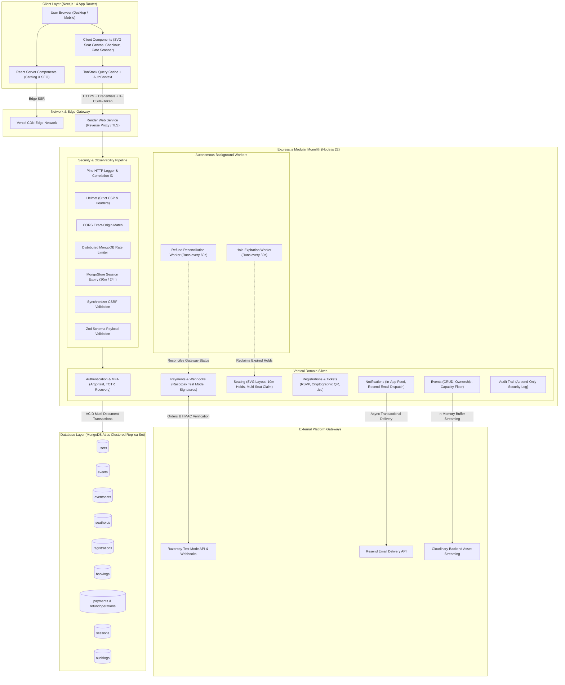

# Eventora

> **Production-grade Event Booking, Visual Seat Reservation & Digital Ticketing Platform**<br />
> Built with Next.js 14 App Router, Node.js 22, Express.js, MongoDB Atlas (Replica Sets), and Tailwind CSS.

[](https://eventora.omslabs.tech)
[](https://eventora-server-omslabs.onrender.com/api/v1)
[](https://github.com/OmSardar/Eventora)
[](LICENSE)

---

## 1. Project Overview

**Eventora** is a full-stack event reservation and management platform engineered for high-concurrency seat booking, ticket security, and resilient event operations.

In high-demand event launches, conventional ticketing systems frequently suffer from overselling race conditions, orphaned seat reservations, payment drop-offs, and counterfeit digital passes. Eventora addresses these challenges through a **Modular Monolith** architecture with strict **Vertical Slice** domain isolation, MongoDB replica set ACID transactions, real-time 10-minute seat hold state machines, and cryptographic HMAC-SHA256 digital pass verification.

### Core Objectives & Architecture Principles
- **Guaranteed Zero Overselling:** Conditional atomic updates and multi-document transactions prevent over-allocation even under simultaneous booking traffic.
- **Visual Multi-Tier Seat Reservation:** Interactive client-side SVG seat map featuring VIP, Premium, and Standard seating with real-time hold countdowns.
- **Defense-in-Depth Security:** Argon2id password hashing, stateful MongoStore sessions, synchronizer CSRF tokens, RFC 6238 TOTP authenticator MFA, and backend-only media streaming.
- **Fail-Safe Operational Resilience:** Unreferenced background workers for seat hold reclamation (30s) and exponential backoff refund reconciliation (60s).

### Live Production Endpoints
- **Web Application:** [https://eventora.omslabs.tech](https://eventora.omslabs.tech)
- **REST API Gateway:** [https://eventora-server-omslabs.onrender.com/api/v1](https://eventora-server-omslabs.onrender.com/api/v1)
- **API Health Check:** [https://eventora-server-omslabs.onrender.com/api/v1/health](https://eventora-server-omslabs.onrender.com/api/v1/health)
- **Source Code Repository:** [https://github.com/OmSardar/Eventora](https://github.com/OmSardar/Eventora)

---

## 2. Key Features

### 🔐 Authentication & Identity Assurance
- **Role-Based Access Control:** Strict role segregation for **`ORGANIZER`** and **`ATTENDEE`** accounts.
- **Argon2id Password Cryptography:** Configured with OWASP-recommended parameters ($64\text{ MB}$ memory cost, $3$ iterations, $4$ parallelism). Enforces a 10-character minimum policy requiring uppercase, numbers, and special symbols.
- **Stateful MongoStore Sessions:** Server-managed sessions stored in MongoDB with `httpOnly: true`, `secure: true` in production, `sameSite: "none"` (cross-domain) or `"lax"` (local).
- **Session Lifecycle Controls:** Automatic 30-minute idle inactivity timeout, 24-hour absolute session ceiling, and session fixation protection (`req.session.regenerate()` on authentication and privilege elevation).
- **Multi-Factor Authentication (MFA):**
  - **Authenticator App (TOTP):** RFC 6238 compliant, 30-second time-step, 6 digits, with AES-256-GCM encryption at rest.
  - **Email OTP:** 6-digit cryptographically random numeric codes with a 10-minute TTL.
  - **Recovery Codes:** 10 single-use salted and hashed backup codes for emergency account access.
- **Email Verification Gating:** Critical mutating actions (event authoring, seat holds, checkout) require a verified email address.

### 📅 Event Authoring & Capacity Lifecycle
- **Scheduling Safeguards:** Events must be scheduled at least 12 hours in advance and no more than 3 months in the future.
- **Capacity Floor Protection:** Organizers cannot reduce an event's seat limit below the currently booked count.
- **Backend-Only Cloudinary Streaming:** Banner images are uploaded via server-side Multer memory storage and verified byte-by-byte for valid magic numbers (JPEG, PNG, WebP only), eliminating client-side API secret exposure.
- **Atomic Event Cancellation:** Cascading rollback marking the event `CANCELLED`, releasing physical seats, initiating automated refunds for paid registrations, dispatching in-app alerts, and sending Resend cancellation emails.

### 🔍 Discovery & Dynamic Filtering
- **Multi-Parametric Catalog:** Full-text search across event titles, keynote descriptions, and venue locations.
- **City & Hub Filtering:** Dedicated location filters for top hubs (Kolkata, Bengaluru, Mumbai, Delhi NCR, Hyderabad, Pune, San Francisco, New York) and regional destinations.
- **Seat Availability Filter:** Real-time filtering by seat availability status (`All Seats`, `Available`, `Sold Out`) using MongoDB `$expr` capacity evaluation.
- **Category & Sorting:** Filter by category (Technology, Design, Workshop, Sustainability, Business) and sort by date, price, popularity, or alphabetical order.

### 💺 Visual Seating & Concurrency Control
- **Interactive SVG Seating Canvas:** Responsive venue seat map displaying sections, rows, and individual seats with tier-based pricing (VIP, Premium, Standard).
- **Multi-Seat Atomic Claims:** Claim up to 6 seats simultaneously in a single isolated MongoDB replica set transaction.
- **10-Minute Ephemeral Holds:** Held seats transition to `HELD` status with an automatic expiration timestamp (`heldUntil = now + 10m`).
- **Hold Expiration Worker (`holdExpirationWorker.js`):** Runs every 30 seconds on an unreferenced background timer to release expired holds back to `AVAILABLE`.
- **Double-Booking Immunity:** Compound unique index `{ eventId: 1, attendeeId: 1 }` prevents duplicate attendee RSVPs. Compound unique index `{ eventId: 1, seatLabel: 1 }` guarantees physical seat uniqueness.

### 💳 Payments & Resilient Refunds
- **Razorpay Test Mode:** Full payment lifecycle in test mode using test cards and UPI simulators.
- **Cryptographic Signature Verification:** Timing-safe HMAC-SHA256 signature verification (`crypto.timingSafeEqual`) preventing parameter tampering and timing attacks.
- **Late Capture Protection:** If an attendee authorizes payment after an event has been cancelled, the backend rejects registration creation, aborts seat allocation, and triggers an immediate automated refund.
- **Durable Refund Operations:** Refunds create persistent `RefundOperation` records with unique idempotency keys (`refund_reg_${regId}` or `refund_pay_${paymentId}`).
- **Refund Reconciliation Worker (`refundReconciliationWorker.js`):** Runs every 60 seconds, polling pending refunds and executing exponential backoff retries ($2^{\text{retryCount}} \times 60\text{s}$) against the Razorpay API.
- **Authoritative Webhook Listener:** Server-to-server webhook ingestion (`payment.captured`, `refund.processed`, `refund.failed`) with cryptographic HMAC validation and deduplication storage (`WebhookEvent`).

### 🎟️ Cryptographic Tickets & Gate Admission
- **HMAC-SHA256 Signed Ticket Tokens:** Tickets encode booking references, attendee IDs, event IDs, and cryptographic signatures to prevent counterfeit passes.
- **Interactive Digital Passes:** Attendee ticket modal renders an interactive pass with an embedded QR code, seat labels, and venue details.
- **Camera-Based Gate Scanner Tool (`/tickets/verify`):** Organizers scan physical or mobile QR passes using real-time camera scanning or manual token entry.
- **Atomic Double-Scan Immunity:** Gate check-in marks tickets as redeemed via conditional atomic update (`isRedeemed: false -> true`), preventing ticket re-use.
- **Cancelled Event Ticket Rejection:** Tickets associated with cancelled events are rejected at the gate with an explicit reason.

### 📬 Communication & Calendar Integration
- **Transactional Email Confirmations:** Branded email notifications via the **Resend API** for account verification, login security alerts, booking receipts, and event cancellation refund details.
- **In-App Notification Feed:** Real-time notification center with unread badge counter, single-click mark-as-read, and batch mark-all-read.
- **RFC 5545 Calendar (.ics) Download:**
  > Eventora currently supports downloading `.ics` files that attendees can import into Google Calendar, Apple Calendar, Microsoft Outlook, and compatible applications. Direct Google Calendar API integration, one-click Google Calendar creation, and automatic calendar synchronization are NOT implemented. These capabilities are planned as future enhancements.
  - Native `.ics` generator with strict UTC formatting (`YYYYMMDDTHHmmssZ` per RFC 5545 Form #2) and 75-octet line folding with UTF-8 character safety.
  - Authenticated and authorized: attendees can only download calendar passes for confirmed events they own; cancelled events return HTTP 400.

### 🎨 Design & Experience
- **Monochrome Design System:** Dark-mode first design tokens using Tailwind CSS, dynamic theme switching (`next-themes`), and accessible Radix UI primitives.
- **Inertial Smooth Scrolling:** Lenis smooth scrolling integrated with GSAP ScrollTrigger, automatically disabled when `prefers-reduced-motion` is active.
- **Export Security:** Attendee roster CSV export includes formula injection defense (CWE-1236), RFC 4180 quote escaping, and UTF-8 Byte Order Mark (`\uFEFF`) compatibility.

---

## 3. Product Preview & User Journeys

| Interface | Capabilities & Highlights |
|---|---|
| **Event Discovery Hub** | Search bar with debounce, 8 hub city selector, category pills, seat availability toggle (`All Seats`, `Available`, `Sold Out`), and responsive card grid. |
| **Interactive SVG Seat Map** | Multi-tier visual seating (VIP, Premium, Standard), real-time seat lock state indicators, 10-minute hold countdown timer, and order summary pane. |
| **Razorpay Test Checkout** | INR order generation, paired seat reservation hold, Razorpay modal checkout, and instant ticket pass confirmation. |
| **Digital Ticket Pass** | High-contrast printable pass with cryptographic HMAC QR code, assigned seat badges, and RFC 5545 `.ics` calendar pass download button. |
| **Organizer Gate Scanner** | Camera-based QR ticket scanner (`/tickets/verify`) with instant attendee check-in and atomic double-redemption rejection. |
| **Organizer Analytics Dashboard** | Real-time hosted event analytics, total registrations, gross revenue, capacity utilization gauges, and attendee roster management. |

---

## 4. Technology Stack

| Layer | Technologies | Purpose |
|---|---|---|
| **Frontend Framework** | [Next.js 14.2.23](https://nextjs.org/) (App Router, React 18) | Hybrid Server-Side Rendering (SSR) & Client Components |
| **Language** | [TypeScript 5](https://www.typescriptlang.org/) (Strict Mode) | End-to-end type safety and compile-time API contract enforcement |
| **Styling & Design System** | [Tailwind CSS 3](https://tailwindcss.com/) + [Radix UI](https://www.radix-ui.com/) | Dark-mode first monochrome design tokens & accessible primitives |
| **Client State & Fetching** | [TanStack React Query v5](https://tanstack.com/query) | Caching, pagination, background re-fetching, and optimistic mutations |
| **Animations & Scrolling** | [Lenis](https://lenis.darkroom.engineering/) + [GSAP ScrollTrigger](https://greensock.com/) | Inertial smooth scrolling physics and responsive choreographies |
| **QR Gate Scanner** | [html5-qrcode](https://github.com/mebjas/html5-qrcode) | Camera-based barcode and QR code decoding at venue check-in |
| **Backend Runtime** | [Node.js 22 LTS](https://nodejs.org/) (ES Modules) | High-performance asynchronous JavaScript server runtime |
| **API Framework** | [Express.js 4](https://expressjs.com/) | Modular Monolith pipeline with Vertical Slice Architecture |
| **Database & ODM** | [MongoDB Atlas](https://www.mongodb.com/atlas) + [Mongoose 8](https://mongoosejs.com/) | Clustered replica sets with multi-document ACID transactions |
| **Session Store** | [express-session](https://github.com/expressjs/session) + [connect-mongo](https://github.com/jdesboeufs/connect-mongo) | Stateful server-side session persistence with automatic TTL |
| **Password Hashing** | [argon2](https://github.com/ranisalt/node-argon2) | Memory-hard password hashing (OWASP standard: 64MB, 3 iterations) |
| **Security Middleware** | [Helmet](https://helmetjs.github.io/), custom CSRF, CORS | Restrictive CSP, synchronizer CSRF tokens, exact-origin matching |
| **Rate Limiting** | [express-rate-limit](https://github.com/express-rate-limit/express-rate-limit) + [rate-limit-mongo](https://github.com/wyattjoh/rate-limit-mongo) | Distributed multi-tier rate limiting across auth and state mutations |
| **File Uploads & Media** | [Multer](https://github.com/expressjs/multer) + [Cloudinary SDK](https://cloudinary.com/) | In-memory buffering, magic-bytes verification, backend streaming |
| **Payment Gateway** | [Razorpay Node SDK](https://razorpay.com/) (Test Mode) | Order creation, HMAC verification, automated refunds, and webhooks |
| **Email Delivery** | [Resend SDK](https://resend.com/) | Transactional email delivery with HTML templates and plain-text fallback |
| **Structured Logging** | [Pino](https://getpino.io/) + [pino-http](https://github.com/pinojs/pino-http) | Fast JSON logging with request correlation IDs and PII masking |
| **Automated Testing** | Node.js Native Runner (`node:test`), [Playwright](https://playwright.dev/) | Unit (82 tests), Integration (106 tests), Security (34 tests), E2E (25 tests) |
| **Cloud Hosting** | [Vercel](https://vercel.com) (Frontend), [Render](https://render.com) (Backend) | Global CDN edge delivery and containerized Web Service execution |

---

## 5. System Architecture

Eventora is structured as a **Modular Monolith** employing **Vertical Slice Architecture**. Rather than dividing code horizontally across controllers, models, and repositories, each business capability encapsulates its routing, validation, business logic, persistence, and error handling.

### High-Level Architecture Diagram



---

## 6. Repository Structure

```text
EVENTORA/
├── client/                                    # Frontend Application (Next.js 14 App Router)
│   ├── playwright/                            # End-to-end browser test suites & config
│   │   └── tests/                             # Specs: auth, roleGuard, events, rsvp, seating, scanner, seo
│   ├── public/                                # Static brand marks, favicon suite, web manifest, OG images
│   ├── src/
│   │   ├── app/                               # Route groups: (attendee), (auth), (organizer), (public)
│   │   ├── components/                        # UI components: auth, events, seating, tickets, payments, ui
│   │   ├── features/                          # Feature contexts: authentication (AuthContext)
│   │   ├── lib/                               # API client (with CSRF interceptor), calendar .ics helper, env
│   │   └── types/                             # Centralized TypeScript domain interfaces and contracts
│   ├── .env.example                           # Frontend environment template
│   ├── next.config.mjs                        # Next.js build settings & image domain whitelists
│   └── package.json                           # Frontend dependencies and lifecycle scripts
│
├── server/                                    # Backend REST API (Node.js 22 LTS, Express.js 4)
│   ├── src/
│   │   ├── infrastructure/                    # Adapters: database, cloudinary, email, logging, security, session
│   │   ├── modules/                           # Vertical feature slices:
│   │   │   ├── audit/                         # Append-only compliance audit trail
│   │   │   ├── authentication/                # Argon2id, session rotation, TOTP & email MFA, recovery codes
│   │   │   ├── bookings/                      # Multi-seat orders, cryptographic ticket verification
│   │   │   ├── events/                        # Event lifecycle, capacity management, atomic cancellations
│   │   │   ├── notifications/                 # In-app alerts and Resend email templates
│   │   │   ├── payments/                      # Razorpay orders, timing-safe signatures, refund worker
│   │   │   ├── registrations/                 # Free RSVP, attendee rosters, RFC 5545 .ics generator
│   │   │   ├── seating/                       # Venue layouts, 10m temporary holds, hold expiration worker
│   │   │   └── users/                         # User profiles and attendee lookups
│   │   ├── scripts/                           # Database seeding utilities (`seed.js`)
│   │   ├── shared/                            # Constants, error hierarchy, middleware, Zod schemas, utils
│   │   ├── app.js                             # Express pipeline, middleware chain, and route mounting
│   │   └── server.js                          # Bootstrap, worker initialization, and graceful shutdown
│   ├── tests/                                 # Automated test suites (222 tests via node:test):
│   │   ├── unit/                              # 82 unit tests (crypto, email, RFC 5545, seating, secrets)
│   │   ├── integration/                       # 106 integration tests (HTTP flows, concurrency, cancellations)
│   │   └── security/                          # 34 security tests (RBAC, CSRF, rate limits, session expiry)
│   ├── .env.example                           # Backend environment template (safe placeholders)
│   └── package.json                           # Backend dependencies and test scripts
│
├── Docs/                                      # Engineering Documentation Library
│   ├── 01-requirements/                       # SRS and requirements traceability matrix
│   ├── 02-system-design/                      # Architecture, High-Level (HLD) & Low-Level (LLD) designs
│   ├── 03-database-design/                    # Mongoose schemas, data dictionaries, and compound indexes
│   ├── 04-api-documentation/                  # REST API reference and OpenAPI 3.0 specification
│   ├── 05-security/                           # STRIDE threat model and distributed rate-limiting policies
│   ├── 06-testing/                            # Quality assurance and test automation strategy
│   ├── 07-deployment/                         # Infrastructure guide for Render, Vercel, and Atlas
│   ├── 08-seo/                                # Dynamic Schema.org JSON-LD and SEO architecture
│   ├── 09-production-readiness/               # Upload, MFA, notification, and payment subsystem designs
│   ├── 10-seat-booking/                       # Seating specifications, state machines, and concurrency plan
│   ├── README.md                              # Technical documentation index
│   └── REPOSITORY_STRUCTURE.md                # Codebase structural mapping
│
├── .github/                                   # GitHub Actions Continuous Integration workflows
├── .gitignore                                 # Strict ignore patterns for dependencies, builds, and env files
├── LICENSE                                    # Open-source MIT License
├── README.md                                  # Master repository documentation (this file)
└── render.yaml                                # Infrastructure as Code for Render Web Service deployment
```

---

## 7. Local Development Setup

### Prerequisites
- **Node.js:** `v20.x` or `v22.x LTS` (Node 22 LTS recommended)
- **npm:** `v10.x` or higher
- **MongoDB:** Local Community Server (`mongodb://127.0.0.1:27017/eventora`) or a free MongoDB Atlas replica set URI

### Step-by-Step Installation

```bash
# 1. Clone the repository
git clone https://github.com/OmSardar/Eventora.git
cd Eventora

# 2. Configure Backend Environment
cd server
cp .env.example .env
# Edit .env if custom database or session secrets are needed

# 3. Install Backend Dependencies
npm install

# 4. Seed Verified Demo Accounts and Events (Optional)
# Seeds 15 production-ready demo events across top hubs with complete seat layouts:
npm run seed:local

# 5. Start Backend Development Server
npm run dev
# Backend API boots at http://localhost:5000 (Health: http://localhost:5000/api/v1/health)

# 6. Open a new terminal and configure Frontend Environment
cd ../client
cp .env.example .env.local

# 7. Install Frontend Dependencies
npm install

# 8. Start Frontend Development Server
npm run dev
# Frontend application boots at http://localhost:3000
```

---

## 8. Environment Variables

The repository includes safe, documented environment templates in `server/.env.example` and `client/.env.example`. Never commit actual secrets or production credentials.

### Backend Configuration (`server/.env`)
| Variable | Required | Description | Development Default |
|---|:---:|---|---|
| `PORT` | No | HTTP server listen port | `5000` |
| `NODE_ENV` | Yes | Runtime environment mode | `development` |
| `MONGODB_URI` | Yes | MongoDB connection string (Replica Set required for transactions) | `mongodb://127.0.0.1:27017/eventora` |
| `SESSION_SECRET` | Yes | Cryptographic secret for signing session cookies (min 32 chars) | `your_development_session_secret_min_32_chars!` |
| `CLIENT_URL` | Yes | Canonical frontend application origin for CORS and CSRF | `http://localhost:3000` |
| `COOKIE_SAME_SITE` | No | SameSite cookie attribute (`lax` for local, `none` for cross-site) | `lax` |
| `COOKIE_SECURE` | No | Forces `Secure` flag on session cookies | `false` |
| `RESEND_API_KEY` | Optional | Resend API key for transactional emails (simulated in logs if omitted) | `re_YourResendApiKeyHere` |
| `EMAIL_FROM` | No | Verified domain email sender identity | `Eventora <notifications@mail.omslabs.tech>` |
| `RAZORPAY_KEY_ID` | Optional | Razorpay test mode Key ID | `rzp_test_YourTestKeyId` |
| `RAZORPAY_KEY_SECRET` | Optional | Razorpay test mode Key Secret | `your_test_key_secret_here` |
| `RAZORPAY_WEBHOOK_SECRET` | Optional | Secret for verifying incoming Razorpay webhooks | `your_test_webhook_secret_here` |
| `CLOUDINARY_CLOUD_NAME` | Optional | Cloudinary account cloud name | `your_cloud_name` |
| `CLOUDINARY_API_KEY` | Optional | Cloudinary API Key | `your_cloudinary_api_key` |
| `CLOUDINARY_API_SECRET` | Optional | Cloudinary API Secret | `your_cloudinary_api_secret` |

### Frontend Configuration (`client/.env.local`)
| Variable | Required | Description | Development Default |
|---|:---:|---|---|
| `NEXT_PUBLIC_SITE_URL` | Yes | Canonical public frontend URL for OpenGraph metadata & SEO | `http://localhost:3000` |
| `NEXT_PUBLIC_API_URL` | Yes | Public REST API gateway base URL | `http://localhost:5000/api/v1` |
| `INTERNAL_API_URL` | No | Server-to-server API URL for Next.js SSR sitemaps | `http://localhost:5000/api/v1` |
| `NEXT_PUBLIC_RAZORPAY_KEY_ID` | Optional | Public Razorpay Key ID for browser checkout modal | `rzp_test_YourTestKeyId` |

---

## 9. Demo Accounts

The database seeder (`server/src/scripts/seed.js`) initializes verified evaluation accounts seeded consistently across both local databases and the live production deployment:

| Role | Email Address | Password | Permissions & Features to Explore |
|---|---|---|---|
| **Organizer** | `organizer@eventora.demo` | `Organizer@123` | Create and edit events, upload banners via Cloudinary streaming, view real-time organizer analytics, inspect paginated attendee rosters, export sanitized CSVs, scan QR ticket passes at `/tickets/verify`, and review cancellations. |
| **Attendee** | `attendee@eventora.demo` | `Attendee@123` | Browse catalog with city, category, and availability filters, reserve seats via Free RSVP or interactive SVG seat map, 10-minute hold window, Razorpay test checkout, view digital tickets, and download `.ics` calendar passes. |

---

## 10. Automated Testing & Verification

Eventora maintains comprehensive test automation across unit, integration, security, and end-to-end browser suites.

### Verified Test Results Summary
- **Backend Test Suites:** 38 suites (`node:test`)
- **Backend Tests:** **222 passed, 0 failed, 0 skipped** (82 unit, 106 integration, 34 security)
- **Playwright E2E Tests:** **25 passed, 0 failed, 0 skipped** (7 multi-browser specs)
- **Frontend Code Quality:** **0 ESLint warnings, 0 errors** (`next lint`)
- **Production Build:** **19 static and dynamic routes successfully compiled** (`next build`)

### Test Commands

```bash
# ====================================================
# Backend Automated Tests (Node.js Native Test Runner)
# ====================================================

# Run all 222 backend tests (Unit + Integration + Security)
npm test --prefix server

# Run unit tests only (82 tests: crypto, email, RFC 5545, seating, secrets)
npm run test:unit --prefix server

# Run integration tests only (106 tests: HTTP flows, concurrency, cancellations, pagination)
npm run test:integration --prefix server

# Run security tests only (34 tests: RBAC, CSRF, rate limiting, session expiry)
npm run test:security --prefix server

# ====================================================
# Frontend Code Quality & Production Build
# ====================================================

# Run ESLint code quality verification
npm run lint --prefix client

# Run Next.js production build and TypeScript type-check
npm run build --prefix client

# ====================================================
# Playwright End-to-End Browser Tests
# ====================================================

# Run all 25 Playwright E2E browser tests (Chromium)
npm run test:e2e --prefix client

# Run Playwright tests with visible browser UI
npm run test:e2e:ui --prefix client
```

---

## 11. Deployment Architecture

Eventora is designed for cloud-native deployment with decoupled frontend edge delivery and a containerized backend:

- **Frontend:** Deployed on **[Vercel](https://vercel.com)** connected to the Next.js App Router with automatic CDN caching and edge headers.
- **Backend:** Deployed on **[Render](https://render.com)** as a Node.js Web Service defined via [`render.yaml`](render.yaml) (specifying `plan: starter`) with automatic health-check polling on `/api/v1/health`.
- **Database:** Hosted on **[MongoDB Atlas](https://www.mongodb.com/atlas)** with a 3-node replica set cluster providing multi-document ACID transactions.
- **Media Storage:** **[Cloudinary](https://cloudinary.com)** backend streaming SDK with non-guessable asset identifiers.
- **Email Delivery:** **[Resend](https://resend.com)** transactional email delivery through verified domain senders.

### Production URLs
- **Web Application:** [https://eventora.omslabs.tech](https://eventora.omslabs.tech)
- **Backend API Gateway:** [https://eventora-server-omslabs.onrender.com/api/v1](https://eventora-server-omslabs.onrender.com/api/v1)
- **Health Check Endpoint:** [https://eventora-server-omslabs.onrender.com/api/v1/health](https://eventora-server-omslabs.onrender.com/api/v1/health)

---

## 12. Hosting Behavior and Availability

An external Google Apps Script periodically sends a health-check request to the backend to reduce inactivity-related spin-down. This is an availability mitigation rather than an uptime guarantee. Occasional latency may still occur due to hosting conditions, restarts, or network performance.

The Render service deployment is configured in [`render.yaml`](render.yaml) specifying `plan: starter`.

---

## 13. Known Limitations

- **Payment Gateway Mode:** Razorpay currently operates in **Test Mode** using simulated cards and mock UPI handles. Live commercial billing requires merchant activation.
- **Calendar Integration:** Calendar synchronization is provided through downloadable RFC 5545 `.ics` files that attendees can import into their calendar applications. Direct Google Calendar API integration, one-click Google Calendar creation, and automatic two-way calendar synchronization are planned future enhancements and are not implemented in the current release.
- **Hosting Cold Starts:** While external periodic health checks maintain service activity, hosting cold starts or network latency may occasionally introduce brief delays on the first incoming request after server restarts.
- **Third-Party Service Dependencies:** Live email delivery and Cloudinary banner uploads depend on external carrier availability. When running without API keys in local development, email delivery and image uploads gracefully simulate clean mock operations.

---

## 14. Future Improvements

- **Direct Google Calendar API Integration:** Automatic, one-click calendar event insertion and two-way synchronization via Google Calendar OAuth2 API.
- **Real-Time Seat Synchronization:** WebSockets or Server-Sent Events (SSE) to push live seat lock/unlock state transitions instantly across all browsing clients on the interactive seat canvas.
- **Mobile Wallet Passes:** Native `.pkpass` generation for Apple Wallet and Google Wallet integration.
- **Advanced Organizer Analytics:** Deep aggregation pipelines for ticket sales velocity, demographic attendance ratios, and cohort retention.
- **Promotional Discount Engine:** Coupon codes with percentage-based and fixed-tier discounts during checkout.

---

## 15. License

This project is open-source software licensed under the **[MIT License](LICENSE)**.
