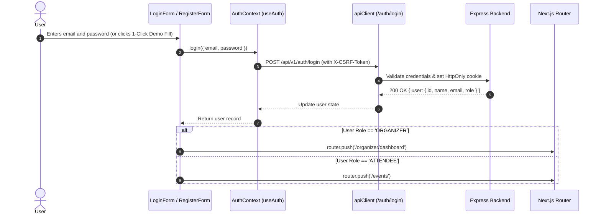
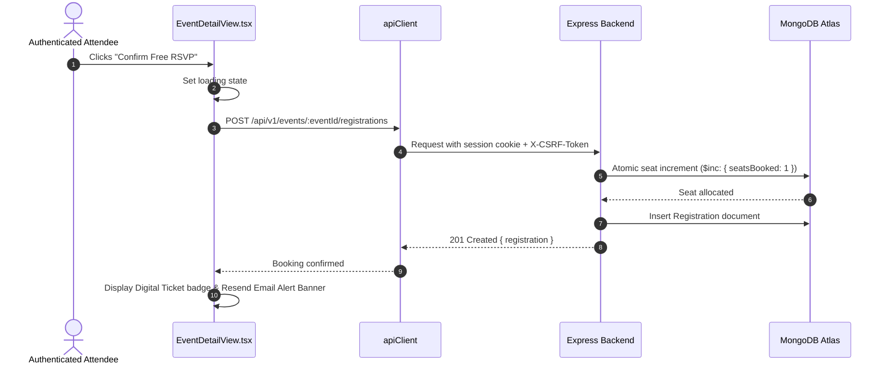
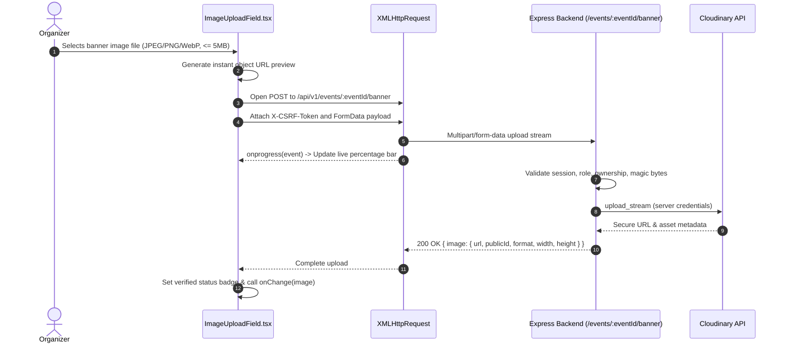

# Eventora Frontend Application Root Documentation (`client/client_root.md`)

> **Note:** The comprehensive, production-ready frontend guide is maintained in [`client/README.md`](./README.md).

## 1. Application Overview
The Eventora frontend is a modern, high-performance web application built with **Next.js 14 (App Router)**, **React 18**, and **TypeScript (Strict Mode)**. It delivers a fast, responsive user interface for discovering events, executing atomic Free RSVPs, managing attendee tickets, reviewing in-app alerts, and providing organizers with event authoring, attendee roster inspection, and backend-only Cloudinary banner upload tools.

The frontend is styled using Tailwind CSS and minimal monochrome shadcn/ui design tokens, featuring smooth scrolling powered by **Lenis** and **GSAP ScrollTrigger**, full dark and light mode themes, and enterprise-grade technical SEO (canonical URLs, OpenGraph cards, JSON-LD structured data, dynamic `robots.txt` and `sitemap.xml`).

---

## 2. Responsibilities and Architectural Boundaries
- **In Scope (Frontend Responsibilities):**
  - Server-Side Rendering (SSR) and Client-Side Hydration (CSR) via Next.js App Router.
  - Client-side route authorization and role guards (`(attendee)` and `(organizer)` layouts).
  - Client state management via React Context (`AuthContext`) and server state caching via TanStack Query.
  - Interactive forms with inline Zod schema validation (`react-hook-form`).
  - Search filtering and debounced keyword queries.
  - Lenis smooth scrolling engine synchronized with GSAP ScrollTrigger.
  - Theme toggling (`next-themes`) across light and dark modes.
  - Client-side image validation (size <= 5MB, format check), instant preview, and multipart streaming directly to the Express backend.
  - Dynamic SEO metadata generation and anti-XSS JSON-LD rendering.
- **Out of Scope (Backend Responsibilities):**
  - Session state persistence in MongoDB.
  - Database document locking and atomic seat increments.
  - Cloudinary credentials, API keys, and server-side upload streams.
  - Resend API keys and transactional email dispatch.
  - Password cryptography (Argon2id).

---

## 3. Technology Stack

| Technology | Actual Version | Responsibility in Frontend |
|---|---|---|
| **Next.js** | 14.2.23 (App Router) | React framework with SSR, streaming, and metadata API |
| **React & React DOM** | ^18.3.1 | Core UI component library |
| **TypeScript** | ^5.7.2 | Strict static typing and contract enforcement |
| **Tailwind CSS** | ^3.4.17 | Utility-first styling and theme token system |
| **TanStack React Query** | ^5.62.16 | Server state management, caching, and optimistic invalidation |
| **React Hook Form** | ^7.54.2 | High-performance form state management |
| **Zod** | ^3.24.1 | Schema validation for forms and inputs |
| **@hookform/resolvers** | ^3.9.1 | Bridge connecting React Hook Form with Zod schemas |
| **Lenis (`lenis`)** | ^1.1.18 | Smooth scrolling physics engine |
| **GSAP (`gsap`)** | ^3.12.5 | Animation platform and ScrollTrigger synchronization |
| **next-themes** | ^0.4.4 | Dark and light mode theme persistence without flash |
| **Lucide React** | ^0.469.0 | Minimalist iconography |
| **Playwright** | ^1.49.1 | End-to-end browser testing framework (17 automated tests) |

---

## 4. Actual Folder Structure
```text
client/
├── client_root.md       # This root frontend documentation
├── package.json         # Frontend dependencies and scripts
├── tsconfig.json        # Strict TypeScript compiler configuration
├── tailwind.config.ts   # Tailwind CSS configuration and theme tokens
├── postcss.config.mjs   # PostCSS configuration
├── next.config.mjs      # Next.js configuration and image domains
├── .env.example         # Template for client environment variables
├── public/              # Static brand assets, favicon, manifest, OG image
│   ├── favicon.ico      # Multi-resolution ICO
│   ├── favicon.svg      # Theme-adaptive SVG icon
│   ├── icon.png         # 512x512 PNG icon
│   ├── apple-icon.png   # 180x180 iOS touch icon
│   ├── og-image.png     # 1200x630 OpenGraph card
│   └── site.webmanifest # PWA web manifest
├── playwright/          # E2E test suites and Playwright configuration
│   └── playwright.md
└── src/                 # Client source code
    ├── src.md           # Source root documentation
    ├── app/             # App Router layouts, providers, routes, and metadata
    │   └── app.md
    ├── components/      # UI primitives, branding, layout shells, views, shared cards
    │   └── components.md
    ├── features/        # Feature slices and AuthContext
    │   └── features.md
    ├── lib/             # API client, siteConfig, and Tailwind utilities
    │   └── lib.md
    └── types/           # TypeScript interfaces and domain type contracts
        └── types.md
```

---

## 5. Next.js App Router Architecture & Route Hierarchy

```mermaid
flowchart TD
    RootLayout["Root Layout (src/app/layout.tsx)"] --> Providers["Providers (providers.tsx)"]
    Providers --> PublicGroup["(public) Route Group"]
    Providers --> AuthGroup["(auth) Route Group"]
    Providers --> AttendeeGroup["(attendee) Route Group"]
    Providers --> OrganizerGroup["(organizer) Route Group"]

    PublicGroup --> Home["/ (Landing Page)"]
    PublicGroup --> Events["/events (Event Catalog)"]
    PublicGroup --> EventDetail["/events/[eventId] (Details & RSVP)"]

    AuthGroup --> Login["/login (Sign In & 2FA Challenge)"]
    AuthGroup --> Register["/register (Create Account)"]
    AuthGroup --> VerifyEmail["/verify-email (Token Verification)"]

    AttendeeGroup --> AttDash["/attendee/dashboard (Overview)"]
    AttendeeGroup --> AttRegs["/attendee/registrations (My Tickets & Cancel)"]

    OrganizerGroup --> OrgDash["/organizer/dashboard (KPIs & Approvals)"]
    OrganizerGroup --> OrgEvents["/organizer/events (Events List)"]
    OrganizerGroup --> OrgCreate["/organizer/events/create (Host Event)"]
    OrganizerGroup --> OrgEdit["/organizer/events/[eventId]/edit (Edit Event)"]
    OrganizerGroup --> OrgAttendees["/organizer/events/[eventId]/attendees (Roster)"]

    Providers --> SettingsGroup["settings/ Route Group"]
    SettingsGroup --> SecuritySettings["/settings/security (MFA, TOTP, Email OTP, Logs)"]
```



---

## 6. Critical User Journeys and Execution Flows

### 6.1 Authentication and Role Redirection Flow


### 6.2 Free RSVP Booking Flow


### 6.3 Backend-Only Banner Upload Flow


---

## 7. State Management and Provider Architecture

Application providers are unified in [`src/app/providers.tsx`](file:///d:/THE%20OMS%20DEVS/WEB%20DEVS/MERN%20PROJECTS/PERSONAL/EVENTORA/client/src/app/providers.tsx):
1. **`ThemeProvider` (`next-themes`):** Injects `class="dark"` onto `<html>`, synchronizing theme preferences with `localStorage` and system media queries.
2. **`QueryClientProvider` (`@tanstack/react-query`):** Configured with:
   ```typescript
   defaultOptions: {
     queries: {
       staleTime: 60 * 1000, // 1 minute
       refetchOnWindowFocus: false,
       retry: 1
     }
   }
   ```
3. **`AuthProvider` (`features/authentication/AuthContext.tsx`):** Bootstraps session state on mount via `GET /auth/me`. Exposes `user`, `isLoading`, `login`, `register`, `logout`, and `refetchUser`.
4. **`SmoothScrollProvider` (`components/layout/SmoothScrollProvider.tsx`):** Bootstraps Lenis smooth scroll and synchronizes scroll delta frames with GSAP ScrollTrigger. Disables physics when `prefers-reduced-motion` is active.

---

## 8. Forms and Validation Architecture
All user input forms use **React Hook Form** paired with **Zod** resolvers (`@hookform/resolvers/zod`):
- `LoginForm.tsx`: Validates email format and non-empty password.
- `RegisterForm.tsx`: Validates password complexity (8+ chars, uppercase, lowercase, number, symbol), password confirmation equality, and role selection.
- `CreateEventForm`: Validates title, description, venue, future date, positive integer seat limits, and image URLs.

---

## 9. Animation and Smooth Scrolling Architecture
Eventora integrates **Lenis** and **GSAP**:
- **Engine:** `Lenis` handles smooth inertial vertical scrolling.
- **Synchronization:** `lenis.on('scroll', ScrollTrigger.update)` synchronizes GSAP scroll triggers with Lenis virtual scroll offsets.
- **Cleanup:** All `requestAnimationFrame` IDs and GSAP tickers are cleaned up in React `useEffect` teardown functions, preventing memory leaks during App Router route transitions.

---

## 10. Technical SEO and Brand Identity
- **Metadata Base & Canonicals:** Root layout configures `metadataBase: new URL(siteUrl)`. Dynamic canonical tags ensure no duplicate-content penalties.
- **OpenGraph & Twitter Cards:** Pre-rendered 1200x630 card at `/og-image.png`.
- **Structured Data:** Safe anti-XSS JSON-LD rendered for `WebSite`, `Organization`, and `Event` without leaking private attendee data.
- **Dynamic Metadata Endpoints:**
  - `/robots.txt`: Managed by `robots.ts`.
  - `/sitemap.xml`: Managed by `sitemap.ts` (queries published events).
- **Brand Identity System:** Minimalist monochrome geometric ticket beacon monogram rendered in:
  - `favicon.svg` (adaptive to `@media (prefers-color-scheme: dark)`)
  - `favicon.ico` (multi-resolution 16/32/48 ICO)
  - `icon.png` (512x512 PNG)
  - `apple-icon.png` (180x180 iOS touch icon)
  - `site.webmanifest` (PWA application manifest)

---

## 11. Configuration and Environment Variables

| Variable | Purpose | Required | Sensitive |
|---|---|---|---|
| `NEXT_PUBLIC_SITE_URL` | Canonical frontend domain for SEO canonicals and sitemaps (default: `http://localhost:3000`) | Yes | No |
| `NEXT_PUBLIC_API_URL` | Public Express API URL consumed by client browser (default: `http://localhost:5000/api/v1`) | Yes | No |
| `INTERNAL_API_URL` | Server-side internal API URL for SSR fetches (optional) | No | No |

> **Security Note:** All `NEXT_PUBLIC_CLOUDINARY_*` variables have been permanently removed. The frontend holds zero Cloudinary credentials.

---

## 12. Automated Testing (Playwright E2E)
The frontend is verified by **17 automated Playwright browser tests** passing at 100%:
- **Authentication:** Demo organizer and attendee login journeys.
- **Authorization:** Route guards redirecting unauthorized guests and blocking cross-role access.
- **Events Discovery & Uploads:** Browse filters, category pills, and backend image upload UI.
- **Free RSVP Flow:** Instant ticket booking, Resend confirmation alerts, and attendee rosters.
- **SEO & Branding:** Metadata, canonical tags, JSON-LD schemas, robots.txt, sitemaps, and brand assets.

Command:
```bash
npm run test:e2e --prefix client
```

---

## 13. Links to Directory-Level Documentation
- **[Source Root Documentation (`client/src/src.md`)](src/src.md)**
- **[App Router Documentation (`client/src/app/app.md`)](src/app/app.md)**
  - [`(public)/`](src/app/(public)/(public).md)
  - [`(auth)/`](src/app/(auth)/(auth).md)
  - [`(attendee)/`](src/app/(attendee)/(attendee).md)
  - [`(organizer)/`](src/app/(organizer)/(organizer).md)
- **[Components Documentation (`client/src/components/components.md`)](src/components/components.md)**
  - [`ui/`](src/components/ui/ui.md)
  - [`brand/`](src/components/brand/brand.md)
  - [`seo/`](src/components/seo/seo.md)
  - [`auth/`](src/components/auth/auth.md)
  - [`shared/`](src/components/shared/shared.md)
  - [`landing/`](src/components/landing/landing.md)
  - [`layout/`](src/components/layout/layout.md)
  - [`events/`](src/components/events/events.md)
- **[Features Documentation (`client/src/features/features.md`)](src/features/features.md)**
  - [`authentication/`](src/features/authentication/authentication.md)
- **[Libraries Documentation (`client/src/lib/lib.md`)](src/lib/lib.md)**
- **[Types Documentation (`client/src/types/types.md`)](src/types/types.md)**
- **[Playwright Root Documentation (`client/playwright/playwright.md`)](playwright/playwright.md)**
  - [`tests/`](playwright/tests/tests.md)

