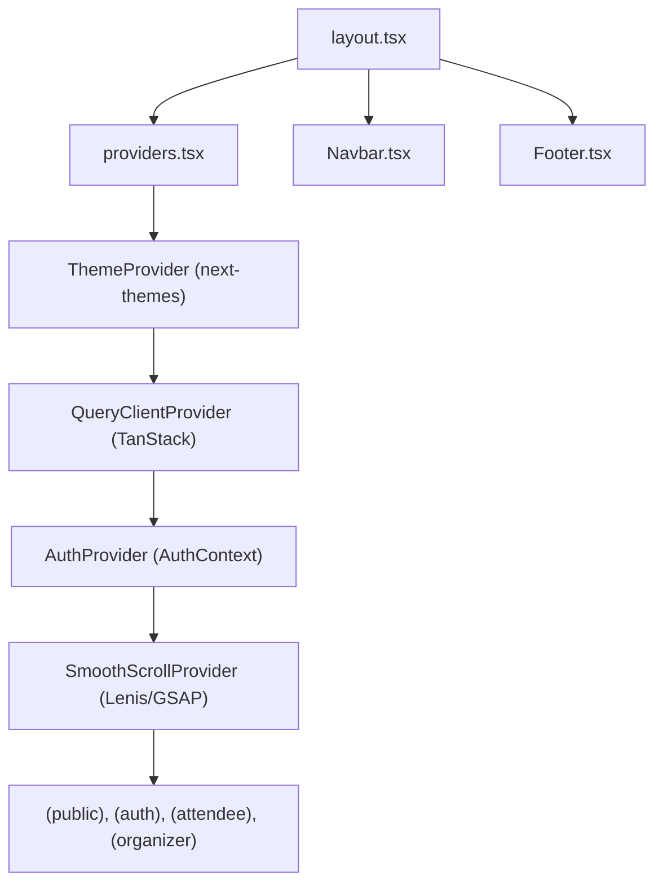

# App Router Directory Documentation (`client/src/app`)

## A. Directory Overview
The `client/src/app` directory is the root of the Next.js 14 App Router application. It establishes the global layout shell (`layout.tsx`), root client providers (`providers.tsx`), global Tailwind styles (`globals.css`), dynamic metadata routes (`robots.ts`, `sitemap.ts`), and organizes pages into clean route groups (`(public)`, `(auth)`, `(attendee)`, `(organizer)`).

## B. Directory Structure
```text
client/src/app/
├── app.md               # This documentation file
├── favicon.ico          # Multi-resolution binary ICO icon
├── globals.css          # Tailwind CSS and shadcn CSS variable theme tokens
├── layout.tsx           # Global RootLayout with SEO metadata and HTML shell
├── providers.tsx        # Client providers (next-themes, TanStack Query, AuthProvider, SmoothScroll)
├── robots.ts            # Dynamic robots.txt route handler
├── sitemap.ts           # Dynamic sitemap.xml route handler
├── (public)/            # Public routes (/, /events, /events/[eventId])
│   └── (public).md
├── (auth)/              # Authentication routes (/login, /register)
│   └── (auth).md
├── (attendee)/          # Attendee routes (/attendee/dashboard, /attendee/registrations)
│   └── (attendee).md
└── (organizer)/         # Organizer routes (/organizer/dashboard, /organizer/events/*)
    └── (organizer).md
```

## C. File-by-File Documentation

### 1. `layout.tsx`
- **File Type:** Next.js Root Layout (`.tsx`)
- **Primary Responsibility:** Top-level HTML shell and global SEO foundation.
- **Exported Symbols:**
  - `viewport`: `{ themeColor, width, initialScale }`.
  - `metadata`: Global `Metadata` object defining `metadataBase: new URL(siteUrl)`, title template (`%s | Eventora`), canonical `/`, robots directives, OpenGraph cards (1200x630 `/og-image.png`), Twitter summary cards, and icon links.
  - `default RootLayout({ children })`: Renders `<html>`, `<body>` with Inter font, mounts `Providers`, `Navbar`, `{children}`, and `Footer`.

### 2. `providers.tsx`
- **File Type:** React Client Component (`"use client"`)
- **Primary Responsibility:** Composite provider wrapping the React component tree.
- **Provider Composition Order:**
  1. `ThemeProvider` (`next-themes`, `attribute="class"`, `defaultTheme="dark"`).
  2. `QueryClientProvider` (`@tanstack/react-query`, `staleTime: 60s`, `retry: 1`).
  3. `AuthProvider` (`AuthContext.tsx`, session management).
  4. `SmoothScrollProvider` (Lenis + GSAP smooth scrolling).

### 3. `globals.css`
- **File Type:** CSS Stylesheet
- **Primary Responsibility:** Global styles, Tailwind directives (`@tailwind base; components; utilities;`), and CSS custom properties (`:root` light mode variables and `.dark` dark mode variables for background, foreground, card, popover, border, and input).

### 4. `robots.ts`
- **File Type:** Next.js Metadata Route (`.ts`)
- **Primary Responsibility:** Generates `/robots.txt` dynamically.
- **Rules:**
  - Allows `/`, `/events`, `/events/*`.
  - Disallows private application paths: `/login`, `/register`, `/attendee/*`, `/organizer/*`.
  - Points to `${siteUrl}/sitemap.xml`.

### 5. `sitemap.ts`
- **File Type:** Next.js Metadata Route (`.ts`)
- **Primary Responsibility:** Generates `/sitemap.xml` dynamically.
- **Rules:**
  - Includes static public routes (`/`, `/events`).
  - Queries published events from backend API and appends dynamic `<url>` entries for `/events/[eventId]` with `lastModified: event.updatedAt`.

### 6. `favicon.ico`
- **File Type:** Binary Icon Asset
- **Primary Responsibility:** Legacy browser favicon fallback (16x16, 32x32, 48x48 multi-resolution).

## D. Child Directory Documentation

1. **[`(public)/`]((public)/(public).md)**: Homepage, public event catalog, and event details.
2. **[`(auth)/`]((auth)/(auth).md)**: Login and registration card layout and routes.
3. **[`(attendee)/`]((attendee)/(attendee).md)**: Attendee dashboard, confirmed tickets, and cancellation requests.
4. **[`(organizer)/`]((organizer)/(organizer).md)**: Organizer dashboard, event management, attendee rosters, and editing.

## E. Internal Relationships


## F. Execution Flow
Request arrives -> `layout.tsx` constructs HTML shell and head metadata -> `providers.tsx` initializes themes and contexts -> matched route group layout applies authorization -> page renders view.

## G. External Dependencies and Integrations
- `next`, `@tanstack/react-query`, `next-themes`, `lenis`, `gsap`.

## H. Important Implementation Notes
- **Crawler Isolation:** Private dashboards strictly enforce `robots: { index: false, follow: false }`, ensuring attendee records and organizer tools are never indexed.

## I. Related Documentation
- [Client Source Root (`client/src/src.md`)](../src.md)
- [Client Root Documentation (`client/client_root.md`)](../../client_root.md)

