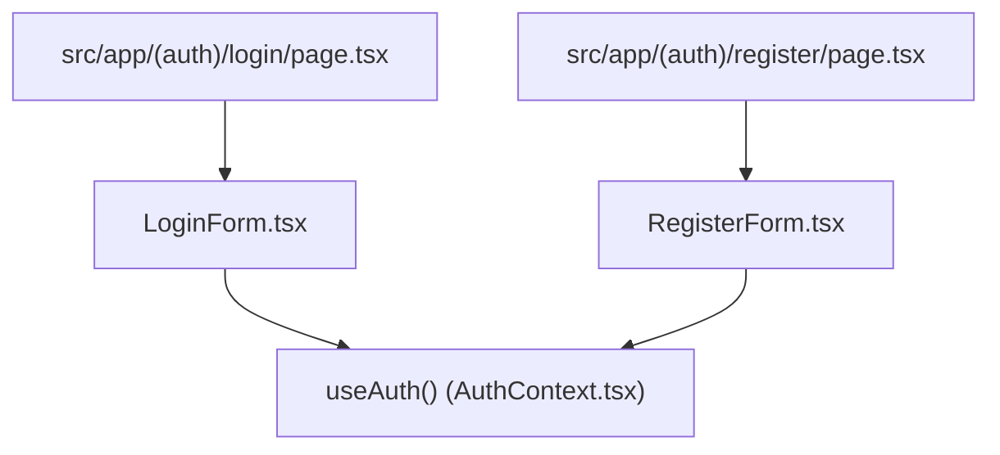

# Auth Components Directory Documentation (`client/src/components/auth`)

## A. Directory Overview
The `client/src/components/auth` directory contains the interactive client-side authentication forms for user login and account registration. Built with React Hook Form, Zod schema validation, and Lucide icons, these forms feature inline validation errors, server-side error banners, dynamic role-based redirects, and 1-Click Demo Fill capabilities for instant evaluator testing.

## B. Directory Structure
```text
client/src/components/auth/
├── auth.md              # This documentation file
├── LoginForm.tsx        # Login form with 1-Click demo account autofill
└── RegisterForm.tsx     # Registration form with role picker and password complexity checks
```

## C. File-by-File Documentation

### 1. `LoginForm.tsx`
- **File Type:** React Client Component (`"use client"`)
- **Primary Responsibility:** User authentication form.
- **Features:**
  - Client-side validation using `react-hook-form` and `zodResolver(loginSchema)`.
  - **1-Click Demo Fill:** Dedicated buttons to automatically populate:
    - Organizer Demo: `organizer@eventora.demo` / `Organizer@123`
    - Attendee Demo: `attendee@eventora.demo` / `Attendee@123`
  - Dynamic Role-Based Redirects: Redirects organizers to `/organizer/dashboard` and attendees to `/events`.
  - Error state handling with accessible alert banners (`role="alert"`).

### 2. `RegisterForm.tsx`
- **File Type:** React Client Component (`"use client"`)
- **Primary Responsibility:** User account creation form.
- **Features:**
  - Role selection radio/card buttons (`ATTENDEE` or `ORGANIZER`).
  - Strong password validation (8+ chars, uppercase, lowercase, number, special character).
  - Password confirmation matching check.
  - Automatically logs the user in upon successful registration and redirects to role dashboard.

## D. Child Directory Documentation
No child subdirectories exist in this directory.

## E. Internal Relationships


## F. Execution Flow
User enters credentials -> Zod validates locally -> submits to `useAuth().login()` or `register()` -> redirects based on `user.role`.

## G. External Dependencies and Integrations
- `react-hook-form`, `@hookform/resolvers/zod`, `zod`.
- `lucide-react` icons.

## H. Important Implementation Notes
- **Accessibility:** All form inputs include explicit `<label>` associations, `aria-invalid`, and error descriptions.

## I. Related Documentation
- [Components Parent Directory (`client/src/components/components.md`)](../components.md)
- [Client Root Documentation (`client/client_root.md`)](../../client_root.md)

