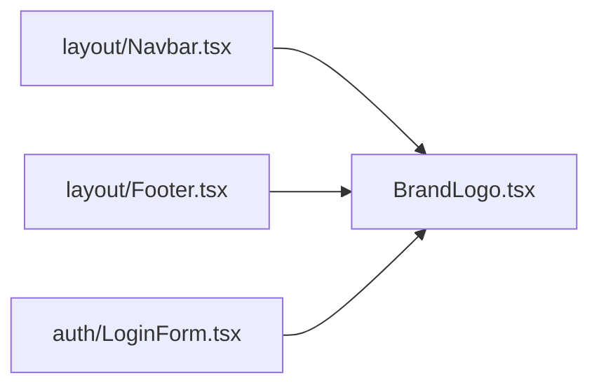

# Brand Components Directory Documentation (`client/src/components/brand`)

## A. Directory Overview
The `client/src/components/brand` directory houses the official visual identity components of Eventora. It renders the minimalist monochrome geometric ticket beacon monogram and wordmark across the navigation bar, footer, and authentication screens.

## B. Directory Structure
```text
client/src/components/brand/
├── brand.md             # This documentation file
└── BrandLogo.tsx        # Geometric ticket icon and stylized typography component
```

## C. File-by-File Documentation

### 1. `BrandLogo.tsx`
- **File Type:** React Functional Component
- **Primary Responsibility:** Renders accessible brand mark and typography.
- **Exported Symbols:**
  - `BrandLogo({ className, iconOnly, size })`: Component rendering inline SVG ticket monogram with clean modern type.
- **Props:**
  - `className`: Optional custom Tailwind classes.
  - `iconOnly`: Boolean to render only the geometric ticket icon.
  - `size`: `'sm' | 'md' | 'lg'`.
- **Implementation Logic:**
  - Renders inline SVG consisting of a geometric card silhouette with ticket notches and central beacon element.
  - Automatically respects Tailwind dark mode (`stroke-foreground`).
  - Wrapped in accessible `<Link href="/">` in headers with `aria-label="Eventora Home"`.

## D. Child Directory Documentation
No child subdirectories exist in this directory.

## E. Internal Relationships


## F. Execution Flow
Rendered client-side and server-side in navigation and branding headers.

## G. External Dependencies and Integrations
- `next/link` for root navigation.

## H. Important Implementation Notes
- **Vector Rendering:** Inline SVG eliminates external network waterfall requests for logo imagery.

## I. Related Documentation
- [Components Parent Directory (`client/src/components/components.md`)](../components.md)
- [Client Root Documentation (`client/client_root.md`)](../../client_root.md)

