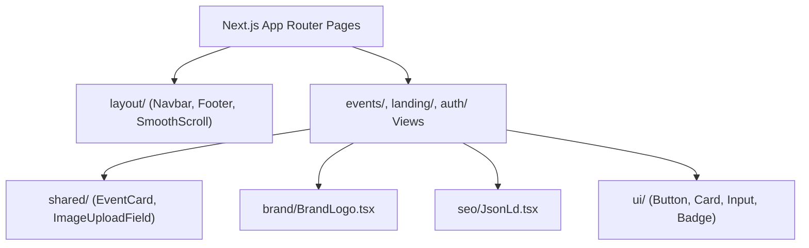

# Components Directory Documentation (`client/src/components`)

## A. Directory Overview
The `client/src/components` directory organizes all React visual components and views for the Eventora frontend. It follows a modular hierarchy separating generic UI primitives, branding marks, layout shells, domain-specific feature views, and cross-cutting shared widgets.

## B. Directory Structure
```text
client/src/components/
├── components.md        # This documentation file
├── auth/                # Login and Registration forms with demo account autofill
│   ├── auth.md
│   ├── LoginForm.tsx
│   └── RegisterForm.tsx
├── brand/               # Official Eventora vector logo and monogram mark
│   ├── brand.md
│   └── BrandLogo.tsx
├── events/              # Event catalog browsing and detailed RSVP view
│   ├── events.md
│   ├── EventDetailView.tsx
│   └── EventsBrowseView.tsx
├── landing/             # Homepage presentation view and value proposition sections
│   ├── landing.md
│   └── LandingView.tsx
├── layout/              # Header, footer, notification bell, smooth scroll, and theme toggle
│   ├── layout.md
│   ├── Footer.tsx
│   ├── Navbar.tsx
│   ├── NotificationBell.tsx
│   ├── SmoothScrollProvider.tsx
│   └── ThemeToggle.tsx
├── seo/                 # Structured data (Schema.org JSON-LD) injection
│   ├── seo.md
│   └── JsonLd.tsx
├── shared/              # Reusable domain cards and backend-only image uploader
│   ├── shared.md
│   ├── EventCard.tsx
│   └── ImageUploadField.tsx
└── ui/                  # Minimalist design tokens and primitive UI elements
    ├── ui.md
    ├── badge.tsx
    ├── button.tsx
    ├── card.tsx
    ├── input.tsx
    ├── select.tsx
    └── textarea.tsx
```

## C. File-by-File Documentation
There are no direct source files in `client/src/components/`; all components are organized into the 8 specialized subdirectories documented below.

## D. Child Directory Documentation

1. **[`auth/`](auth/auth.md)**: Login and registration forms with validation and 1-click demo fill buttons.
2. **[`brand/`](brand/brand.md)**: Vector ticket monogram and responsive wordmark components.
3. **[`events/`](events/events.md)**: Event catalog with filters and single-click Free RSVP event details view.
4. **[`landing/`](landing/landing.md)**: Homepage presentation view with animated highlights.
5. **[`layout/`](layout/layout.md)**: Global site shell, Navbar, Footer, NotificationBell, and SmoothScrollProvider.
6. **[`seo/`](seo/seo.md)**: Anti-XSS sanitized JSON-LD structured data renderer.
7. **[`shared/`](shared/shared.md)**: Event presentation cards and backend-only Cloudinary media upload field.
8. **[`ui/`](ui/ui.md)**: Accessible UI primitives (Button, Card, Input, Badge, Select, Textarea).

## E. Internal Relationships


## F. Execution Flow
Next.js App Router pages import top-level views (e.g. `LandingView`, `EventsBrowseView`, `EventDetailView`), which compose shared domain widgets and primitive UI elements into responsive client interfaces.

## G. External Dependencies and Integrations
- `lucide-react`, `lenis`, `gsap`, `next-themes`, `react-hook-form`, `zod`.

## H. Important Implementation Notes
- **Client vs Server Components:** Leaf components requiring state or hooks declare `"use client"` at the top; layout containers and static icons run cleanly across both environments.

## I. Related Documentation
- [Client Source Root (`client/src/src.md`)](../src.md)
- [Client Root Documentation (`client/client_root.md`)](../../client_root.md)

