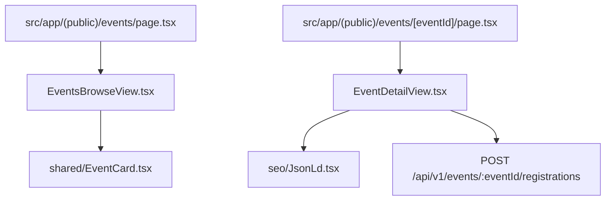

# Events Components Directory Documentation (`client/src/components/events`)

## A. Directory Overview
The `client/src/components/events` directory contains the core interactive views for discovering events and completing Free RSVPs. It houses the multi-filter event catalog (`EventsBrowseView`) and the complete event detail page with dynamic ticket reservations (`EventDetailView`).

## B. Directory Structure
```text
client/src/components/events/
├── events.md            # This documentation file
├── EventDetailView.tsx  # Event details, Free RSVP action, digital tickets, and Resend confirmation banner
└── EventsBrowseView.tsx # Filterable, searchable catalog with pagination
```

## C. File-by-File Documentation

### 1. `EventDetailView.tsx`
- **File Type:** React Client Component (`"use client"`)
- **Primary Responsibility:** Full event view, booking execution, and ticket rendering.
- **Features:**
  - Displays banner image, full description, date/time, venue, and live capacity badge.
  - **Free RSVP Action:** Single-click atomic booking button (`POST /events/:eventId/registrations`).
  - **Resend Confirmation Alert:** Displays an alert banner notifying the attendee that a booking receipt was dispatched to their email address.
  - Sold-Out & Past Event handling: Disables booking button with clear status messaging.
  - Injects dynamic `schema.org` Event structured data via `JsonLd.tsx`.

### 2. `EventsBrowseView.tsx`
- **File Type:** React Client Component (`"use client"`)
- **Primary Responsibility:** Public event catalog and search interface.
- **Features:**
  - Keyword search input with debounced server filtering.
  - Category pill filter tabs (All, Tech, Design, Workshop, etc.).
  - Grid of `EventCard` components.
  - Clean pagination controls and empty-state illustrations.

## D. Child Directory Documentation
No child subdirectories exist in this directory.

## E. Internal Relationships


## F. Execution Flow
- User browses `/events` -> `EventsBrowseView` renders results.
- User clicks an event -> navigates to `/events/[eventId]` -> `EventDetailView` allows RSVP -> backend confirms seat and triggers Resend email -> UI displays success alert and ticket details.

## G. External Dependencies and Integrations
- `lucide-react`, TanStack Query.

## H. Important Implementation Notes
- **Free RSVP Alignment:** Completely free of legacy payment modal dependencies; RSVPs are processed in a single atomic step.

## I. Related Documentation
- [Components Parent Directory (`client/src/components/components.md`)](../components.md)
- [Client Root Documentation (`client/client_root.md`)](../../client_root.md)

