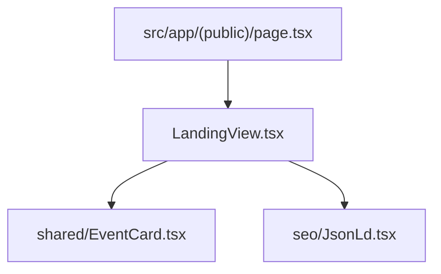

# Landing Components Directory Documentation (`client/src/components/landing`)

## A. Directory Overview
The `client/src/components/landing` directory contains the presentation view for Eventora's homepage. It showcases the value proposition, platform highlights, animated hero sections, and featured upcoming events.

## B. Directory Structure
```text
client/src/components/landing/
├── landing.md           # This documentation file
└── LandingView.tsx      # Comprehensive landing page presentation component
```

## C. File-by-File Documentation

### 1. `LandingView.tsx`
- **File Type:** React Client Component (`"use client"`)
- **Primary Responsibility:** Landing page layout and animations.
- **Props:**
  - `featuredEvents`: Array of initial `EventItem` records fetched server-side.
- **Sections:**
  - Hero Section: High-impact typography, value proposition, CTA buttons ("Discover Events", "Host an Event").
  - Platform Features: Minimal monochrome cards detailing zero double-booking, atomic concurrency, and instant digital tickets.
  - Featured Events Carousel / Grid: Interactive `EventCard` components.
  - JSON-LD Structured Data: Injects `WebSite` and `Organization` schemas via `JsonLd.tsx`.

## D. Child Directory Documentation
No child subdirectories exist in this directory.

## E. Internal Relationships


## F. Execution Flow
Server-fetches upcoming events in `page.tsx` -> passes to `LandingView` -> client renders responsive sections and initializes smooth scroll bindings.

## G. External Dependencies and Integrations
- `lucide-react`, Next.js `<Link>`.

## H. Important Implementation Notes
- **SSR Hydration:** Server-rendered markup ensures immediate First Contentful Paint (FCP) and optimal SEO indexing.

## I. Related Documentation
- [Components Parent Directory (`client/src/components/components.md`)](../components.md)
- [Client Root Documentation (`client/client_root.md`)](../../client_root.md)

