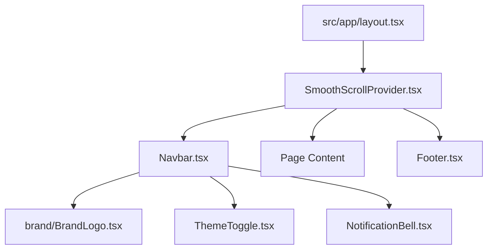

# Layout Components Directory Documentation (`client/src/components/layout`)

## A. Directory Overview
The `client/src/components/layout` directory contains the chrome and shell components that frame every page in the application. It includes the responsive navigation bar (`Navbar`), global site footer (`Footer`), live notification bell (`NotificationBell`), theme toggle (`ThemeToggle`), and the smooth scrolling engine (`SmoothScrollProvider`).

## B. Directory Structure
```text
client/src/components/layout/
├── layout.md               # This documentation file
├── Footer.tsx              # Application footer with site links and copyright
├── Navbar.tsx              # Main navigation header with role-aware action buttons
├── NotificationBell.tsx    # Live polling notification bell and unread alert popover
├── SmoothScrollProvider.tsx # Lenis + GSAP ScrollTrigger integration
└── ThemeToggle.tsx         # Dark / Light mode toggle button (`next-themes`)
```

## C. File-by-File Documentation

### 1. `Navbar.tsx`
- **File Type:** React Client Component (`"use client"`)
- **Primary Responsibility:** Global header navigation.
- **Features:**
  - Role-aware rendering: Displays "Host an Event" for organizers, "My Tickets" for attendees, or "Sign In" / "Register" for guests.
  - Houses `BrandLogo`, `ThemeToggle`, and `NotificationBell`.
  - Mobile responsive drawer menu with accessible toggle button.

### 2. `Footer.tsx`
- **File Type:** React Functional Component
- **Primary Responsibility:** Site-wide footer displaying brand wordmark, quick links, and platform information.

### 3. `NotificationBell.tsx`
- **File Type:** React Client Component (`"use client"`)
- **Primary Responsibility:** Real-time in-app notification dropdown.
- **Features:**
  - Queries `GET /api/v1/notifications` every 30 seconds via TanStack Query.
  - Displays unread count badge.
  - Popover dialog listing recent alerts with "Mark all as read" capability (`PATCH /api/v1/notifications/read-all`).

### 4. `SmoothScrollProvider.tsx`
- **File Type:** React Client Component (`"use client"`)
- **Primary Responsibility:** Initializes Lenis smooth scrolling and synchronizes with GSAP ScrollTrigger.
- **Features:**
  - Cancels smooth scrolling if user enables `prefers-reduced-motion`.
  - Ensures accurate internal anchor link scrolling without competing animation frame loops.

### 5. `ThemeToggle.tsx`
- **File Type:** React Client Component (`"use client"`)
- **Primary Responsibility:** Light/dark mode toggle using `next-themes`.

## D. Child Directory Documentation
No child subdirectories exist in this directory.

## E. Internal Relationships


## F. Execution Flow
Mounted at the root layout; `SmoothScrollProvider` intercepts vertical wheel events; `Navbar` and `Footer` surround page components.

## G. External Dependencies and Integrations
- `lenis`, `gsap`, `next-themes`, `lucide-react`.

## H. Important Implementation Notes
- **Accessibility:** Respects reduced-motion preferences and includes full keyboard focus management.

## I. Related Documentation
- [Components Parent Directory (`client/src/components/components.md`)](../components.md)
- [Client Root Documentation (`client/client_root.md`)](../../client_root.md)

