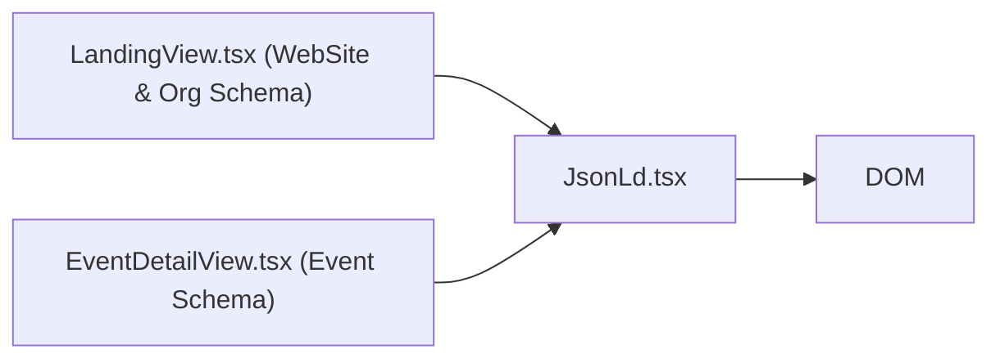

# SEO Components Directory Documentation (`client/src/components/seo`)

## A. Directory Overview
The `client/src/components/seo` directory contains search engine optimization components for structured data rendering. It injects anti-XSS sanitized JSON-LD script tags (`schema.org`) into the DOM to provide structured metadata for search engine crawlers (Google Search, Bing).

## B. Directory Structure
```text
client/src/components/seo/
├── seo.md               # This documentation file
└── JsonLd.tsx           # Anti-XSS sanitized Schema.org JSON-LD component
```

## C. File-by-File Documentation

### 1. `JsonLd.tsx`
- **File Type:** React Server/Client Component
- **Primary Responsibility:** Generates valid `<script type="application/ld+json">` tags.
- **Exported Symbols:**
  - `JsonLd({ schema })`: React component.
- **Props:**
  - `schema`: Record containing valid Schema.org structure (`WebSite`, `Organization`, or `Event`).
- **Security & XSS Protection:**
  - Sanitizes JSON string representation using safe Unicode replacement (`replace(/</g, '\\u003c')`), completely preventing script injection attacks even if dynamic user event titles contain HTML-like strings.

## D. Child Directory Documentation
No child subdirectories exist in this directory.

## E. Internal Relationships


## F. Execution Flow
Included in page components; server-renders directly into initial HTML so crawlers parse structured data before client hydration.

## G. External Dependencies and Integrations
- Native JSON serialization.

## H. Important Implementation Notes
- **Privacy Compliance:** In accordance with Eventora security policies, `JsonLd.tsx` never embeds attendee names, emails, or booking rosters in structured crawler schemas.

## I. Related Documentation
- [Components Parent Directory (`client/src/components/components.md`)](../components.md)
- [Client Root Documentation (`client/client_root.md`)](../../client_root.md)

