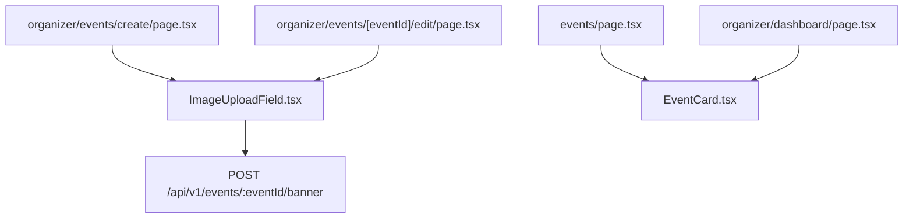

# Shared Components Directory Documentation (`client/src/components/shared`)

## A. Directory Overview
The `client/src/components/shared` directory contains cross-cutting domain components used across multiple pages and user roles. These include the multi-variant event presentation card (`EventCard`) and the backend-only media uploader (`ImageUploadField`).

## B. Directory Structure
```text
client/src/components/shared/
├── shared.md            # This documentation file
├── EventCard.tsx        # Event display card with capacity badges, dates, and actions
└── ImageUploadField.tsx # Backend-only image upload component with progress tracking and preview
```

## C. File-by-File Documentation

### 1. `EventCard.tsx`
- **File Type:** React Functional Component
- **Primary Responsibility:** Renders event metadata in card format for discovery lists and dashboards.
- **Props:**
  - `event`: `EventItem` data object.
  - `isOrganizerView`: Boolean indicating whether to render organizer controls (edit, attendee count).
  - `priority`: Boolean for Next.js image loading priority.
- **Features:**
  - Dynamic status and capacity badges: `'SOLD OUT'`, `'X seats left'`, `'DRAFT'`, `'CANCELLED'`.
  - Responsive image display with fallback placeholder.
  - Clean date, venue, and organizer formatting.

### 2. `ImageUploadField.tsx`
- **File Type:** React Client Component (`"use client"`)
- **Primary Responsibility:** Handles event banner selection, drag-and-drop, client validation, preview, and backend upload.
- **Props:**
  - `value`: `EventImage | string`.
  - `onChange`: `(image: EventImage) => void`.
  - `error`: Error message string.
  - `disabled`: Boolean.
  - `eventId`: Optional event identifier for existing event banner replacement.
- **Features & Security:**
  - **Zero Direct Cloudinary Calls:** Transmits binary directly to `${API_BASE_URL}/events/${eventId}/banner` or `/events/banner` via `XMLHttpRequest`.
  - Live upload percentage progress bar.
  - Client-side size check (<= 5MB) and format whitelist (`image/jpeg`, `image/png`, `image/webp`).
  - Automatic `X-CSRF-Token` retrieval and header injection.
  - Dual-Tab Interface: Direct File Upload and External URL fallback.
  - Instant image preview with "Replace Image" and "Remove" controls.

## D. Child Directory Documentation
No child subdirectories exist in this directory.

## E. Internal Relationships


## F. Execution Flow
Organizer selects image file -> `ImageUploadField` validates size -> opens XHR stream to backend -> tracks progress event -> backend returns `{ image }` -> `onChange` updates form state.

## G. External Dependencies and Integrations
- `lucide-react` icons.
- `@/lib/api`.

## H. Important Implementation Notes
- **Zero Frontend Secrets:** No Cloudinary API keys or secrets exist in this component.

## I. Related Documentation
- [Components Parent Directory (`client/src/components/components.md`)](../components.md)
- [Client Root Documentation (`client/client_root.md`)](../../client_root.md)

