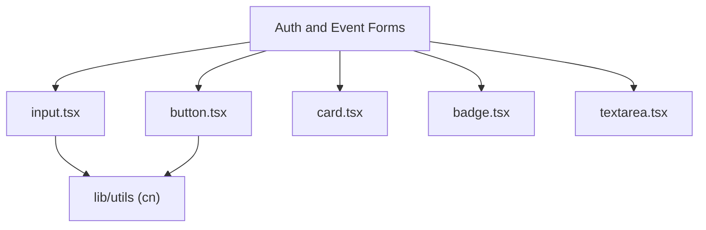

# UI Components Directory Documentation (`client/src/components/ui`)

## A. Directory Overview
The `client/src/components/ui` directory contains reusable, accessible, unstyled-to-minimalist primitive UI components built on Tailwind CSS. Modeled after shadcn/ui design tokens, these components provide consistent typography, focus rings, hover transitions, and keyboard accessibility across light and dark themes.

## B. Directory Structure
```text
client/src/components/ui/
├── ui.md                # This documentation file
├── badge.tsx            # Status indicator badge with variant styles
├── button.tsx           # Standard button with variant, size, and loading states
├── card.tsx             # Card container, CardHeader, CardTitle, CardContent, CardFooter
├── input.tsx            # Form text, email, and password input with focus rings
├── select.tsx           # Dropdown select input
└── textarea.tsx         # Multi-line text area input
```

## C. File-by-File Documentation

### 1. `badge.tsx`
- **File Type:** React Functional Component
- **Primary Responsibility:** Displays small status pills (e.g., `'PUBLISHED'`, `'CONFIRMED'`, `'SOLD OUT'`).
- **Variants:** `default`, `secondary`, `destructive`, `outline`, `success`.
- **Props:** Extends `React.HTMLAttributes<HTMLDivElement>`, `variant`.

### 2. `button.tsx`
- **File Type:** React ForwardRef Component
- **Primary Responsibility:** Standard interactive button.
- **Variants:** `default` (monochrome black/white), `destructive`, `outline`, `secondary`, `ghost`, `link`.
- **Sizes:** `default`, `sm`, `lg`, `icon`.
- **Props:** Extends `React.ButtonHTMLAttributes<HTMLButtonElement>`, `variant`, `size`, `asChild`.

### 3. `card.tsx`
- **File Type:** React Functional Components
- **Primary Responsibility:** Structured content container with borders and subtle backgrounds.
- **Exports:** `Card`, `CardHeader`, `CardTitle`, `CardDescription`, `CardContent`, `CardFooter`.

### 4. `input.tsx`
- **File Type:** React ForwardRef Component
- **Primary Responsibility:** Standard single-line form text inputs.
- **Styling:** Dynamic border, focus-visible outline, muted placeholder, and disabled opacity.

### 5. `select.tsx`
- **File Type:** React ForwardRef Component
- **Primary Responsibility:** Native styled `<select>` element for category filters and role selection.

### 6. `textarea.tsx`
- **File Type:** React ForwardRef Component
- **Primary Responsibility:** Multi-line text field for event descriptions and cancellation notes.

## D. Child Directory Documentation
No child subdirectories exist in this directory.

## E. Internal Relationships


## F. Execution Flow
Imported directly by views and forms to compose complex layouts with uniform design tokens.

## G. External Dependencies and Integrations
- `clsx` and `tailwind-merge` via `@/lib/utils`.

## H. Important Implementation Notes
- **Zero Heavy Component Libraries:** Pure Tailwind primitives without heavy external UI dependencies, keeping initial JavaScript bundles minimal (87 kB first load).

## I. Related Documentation
- [Components Parent Directory (`client/src/components/components.md`)](../components.md)
- [Client Root Documentation (`client/client_root.md`)](../../client_root.md)

