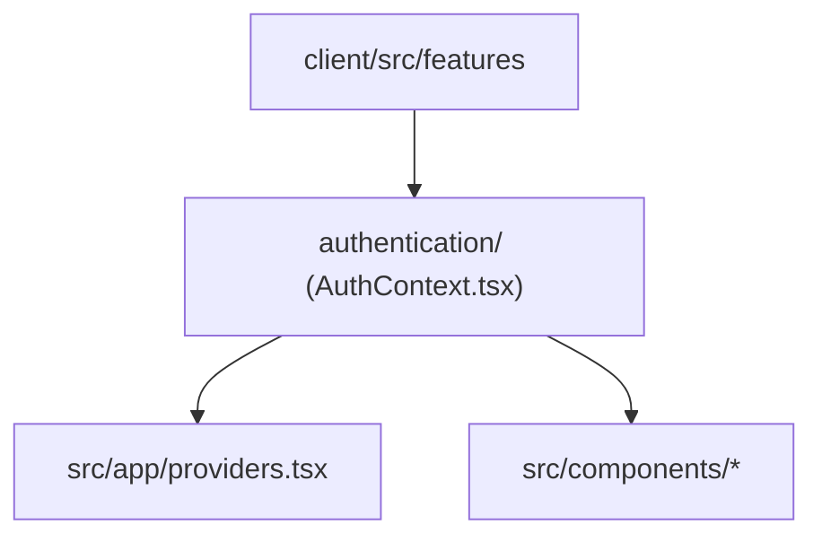

# Features Directory Documentation (`client/src/features`)

## A. Directory Overview
The `client/src/features` directory contains domain-driven feature modules and stateful business slices for the frontend application. Unlike generic UI primitives, feature modules encapsulate specific application capabilities, domain contexts, and reactive state stores.

## B. Directory Structure
```text
client/src/features/
├── features.md          # This documentation file
└── authentication/      # Client authentication state, session bootstrapping, and credentials context
    ├── authentication.md
    └── AuthContext.tsx
```

## C. File-by-File Documentation
There are no direct source files in `client/src/features/`; feature logic is compartmentalized into domain subdirectories documented below.

## D. Child Directory Documentation

1. **[`authentication/`](authentication/authentication.md)**
   - **Responsibility:** Client-side authentication context (`AuthContext.tsx`), `useAuth` hook, session state, login/register/logout methods.
   - **Documentation:** [`client/src/features/authentication/authentication.md`](authentication/authentication.md)

## E. Internal Relationships


## F. Execution Flow
Feature context providers are registered at the application root (`src/app/providers.tsx`), making domain state reactively accessible to all page components and route layouts.

## G. External Dependencies and Integrations
- React Context API.
- TanStack Query / REST API layer.

## H. Important Implementation Notes
- **Extensibility:** Additional complex domains (e.g. ticket booking cart, real-time notification streams) can be added as peer feature slices following this structure.

## I. Related Documentation
- [Client Source Root (`client/src/src.md`)](../src.md)
- [Client Root Documentation (`client/client_root.md`)](../../client_root.md)

