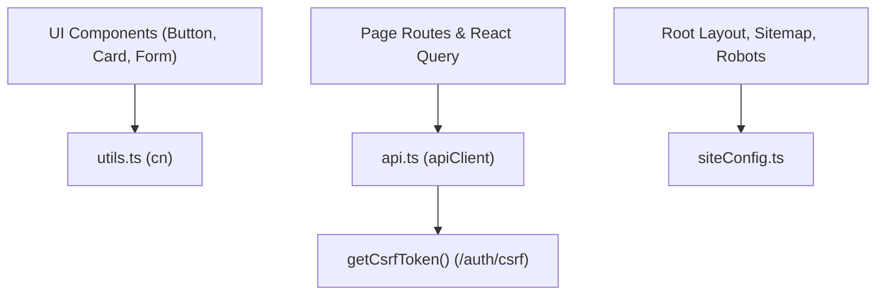

# Lib Directory Documentation (`client/src/lib`)

## A. Directory Overview
The `client/src/lib` directory contains foundational client utilities, network abstractions, configuration constants, and UI helper functions. It establishes the HTTP communication layer (`apiClient`), centralizes site-wide SEO metadata parameters (`siteConfig`), and provides Tailwind class merging utilities (`cn`).

## B. Directory Structure
```text
client/src/lib/
├── lib.md               # This documentation file
├── api.ts               # HTTP client with CSRF token caching, FormData detection, and error parsing
├── siteConfig.ts        # Canonical SEO site metadata, author information, and navigation links
└── utils.ts             # Tailwind CSS class merger (`clsx` + `tailwind-merge`)
```

## C. File-by-File Documentation

### 1. `api.ts`
- **File Type:** TypeScript Module (`.ts`)
- **Primary Responsibility:** Standardized HTTP client wrapping native `fetch`.
- **Exported Symbols:**
  - `getCsrfToken()`: Fetches or returns cached CSRF token from `/api/v1/auth/csrf`.
  - `resetCsrfToken()`: Clears the in-memory CSRF token cache upon logout.
  - `apiClient<T>(endpoint, options)`: Typed request utility.
- **Dependencies:** `ApiResponse` from `@/types`.
- **Used By:** `AuthContext.tsx`, TanStack Query hooks, page components.
- **Implementation Logic:**
  - Automatically attaches `credentials: 'include'` for cross-origin cookie exchange with Render backend.
  - Injects `X-CSRF-Token` header on state-changing methods (`POST`, `PUT`, `PATCH`, `DELETE`).
  - **Multipart Safety:** Detects `data instanceof FormData` and deliberately omits manual `Content-Type` header, allowing the browser/runtime to append the dynamic boundary string.
  - Automatically serializes JSON objects for non-FormData payloads.
  - Extracts and formats backend error messages from `{ error: { message } }` envelopes, throwing descriptive JavaScript errors.

### 2. `siteConfig.ts`
- **File Type:** TypeScript Module (`.ts`)
- **Primary Responsibility:** Centralized configuration for technical SEO, OpenGraph cards, and branding.
- **Exported Symbols:**
  - `siteConfig`: Frozen object defining `name: 'Eventora'`, `description`, `url` (reads `NEXT_PUBLIC_SITE_URL` with localhost fallback), `ogImage: '/og-image.png'`, `links`, and `navItems`.
- **Dependencies:** None.
- **Used By:** `layout.tsx`, `robots.ts`, `sitemap.ts`, `JsonLd.tsx`, Navbar and Footer components.

### 3. `utils.ts`
- **File Type:** TypeScript Module (`.ts`)
- **Primary Responsibility:** Merges conditional Tailwind CSS class names.
- **Exported Symbols:**
  - `cn(...inputs)`: Combines `clsx` and `twMerge`.
- **Dependencies:** `clsx`, `tailwind-merge`.
- **Used By:** All UI components in `components/ui/` and custom views.
- **Implementation Logic:** Resolves Tailwind class precedence collisions (e.g., `p-4` vs `p-2`) deterministically.

## D. Child Directory Documentation
No child subdirectories exist in this directory.

## E. Internal Relationships


## F. Execution Flow
- Network requests invoke `apiClient(endpoint, options)`.
- If mutating, `apiClient` ensures CSRF token is attached via `getCsrfToken()`.
- Executes fetch, unwraps JSON envelope, and returns typed response or throws parsed error.

## G. External Dependencies and Integrations
- `clsx`: Class string manipulation.
- `tailwind-merge`: Tailwind utility de-duplication.

## H. Important Implementation Notes
- **Zero Frontend Secrets:** `api.ts` only consumes `NEXT_PUBLIC_API_URL`. No credentials or private API keys are ever accessed in client utilities.

## I. Related Documentation
- [Client Source Root (`client/src/src.md`)](../src.md)
- [Client Root Documentation (`client/client_root.md`)](../../client_root.md)

