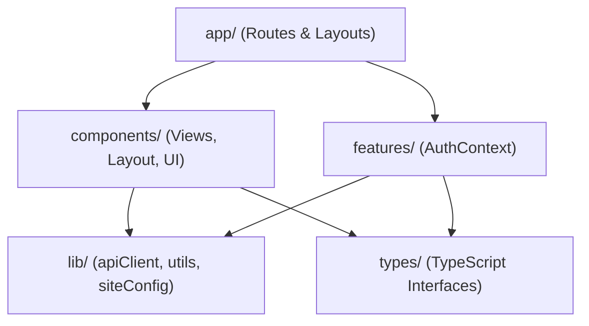

# Client Source Root Documentation (`client/src`)

## A. Directory Overview
The `client/src` directory contains the complete frontend source code for Eventora. Built on Next.js 14 (App Router) and React 18 in strict TypeScript mode, the frontend provides responsive discovery, atomic RSVP booking, live notifications, organizer event management with backend banner uploads, smooth scrolling (Lenis + GSAP), and technical SEO structured data.

## B. Directory Structure
```text
client/src/
├── src.md               # This documentation file
├── app/                 # Next.js App Router layouts, providers, routes, and metadata
│   └── app.md
├── components/          # UI primitives, branding, layout shells, views, and shared cards
│   └── components.md
├── features/            # Domain feature slices and authentication context
│   └── features.md
├── lib/                 # HTTP client, siteConfig, and Tailwind utilities
│   └── lib.md
└── types/               # Global TypeScript definitions and API interfaces
    └── types.md
```

## C. File-by-File Documentation
There are no direct files in `client/src/`; all application code is structured into the 5 primary subdirectories documented below.

## D. Child Directory Documentation

1. **[`app/`](app/app.md)**
   - App Router architecture, root layout, client providers (`providers.tsx`), global CSS, metadata routes (`robots.ts`, `sitemap.ts`), and route groups (`(public)`, `(auth)`, `(attendee)`, `(organizer)`).
   - [Documentation](app/app.md)

2. **[`components/`](components/components.md)**
   - Reusable React components: `ui`, `brand`, `seo`, `auth`, `shared`, `landing`, `layout`, and `events`.
   - [Documentation](components/components.md)

3. **[`features/`](features/features.md)**
   - Client feature slices and global authentication state context (`AuthContext.tsx`).
   - [Documentation](features/features.md)

4. **[`lib/`](lib/lib.md)**
   - HTTP client (`api.ts`), SEO metadata constants (`siteConfig.ts`), and class merging (`utils.ts`).
   - [Documentation](lib/lib.md)

5. **[`types/`](types/types.md)**
   - Global TypeScript interfaces and domain type contracts (`index.ts`).
   - [Documentation](types/types.md)

## E. Internal Relationships


## F. Execution Flow
Browser requests route -> Next.js resolves layout in `app/` -> wraps in `providers.tsx` -> renders matched route component from `components/` -> communicates with backend via `lib/api.ts` -> validates types against `types/`.

## G. External Dependencies and Integrations
- `next`, `react`, `@tanstack/react-query`, `tailwindcss`, `lucide-react`, `lenis`, `gsap`.

## H. Important Implementation Notes
- **Zero Cloudinary Secrets:** The entire client source tree is completely decoupled from Cloudinary and Resend credentials. All uploads and emails are delegated exclusively to the Express backend.

## I. Related Documentation
- [Client Root Documentation (`client/client_root.md`)](../client_root.md)
- [Root Project README (`README.md`)](../../README.md)

