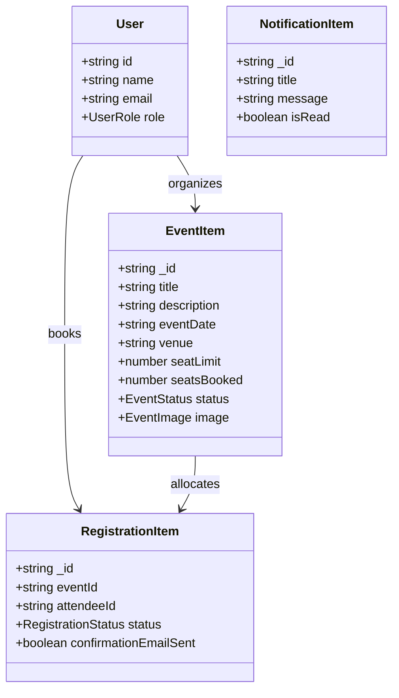

# Types Directory Documentation (`client/src/types`)

## A. Directory Overview
The `client/src/types` directory defines the unified TypeScript interfaces, type aliases, and contract definitions for the Eventora frontend application. It bridges the gap between backend REST API envelopes and React components, ensuring strict type safety across TanStack Query hooks, React Hook Form schemas, and page routes.

## B. Directory Structure
```text
client/src/types/
├── types.md             # This documentation file
└── index.ts             # Global TypeScript type definitions and interfaces
```

## C. File-by-File Documentation

### 1. `index.ts`
- **File Type:** TypeScript Definition File (`.ts`)
- **Primary Responsibility:** Central type registry for user models, events, registrations, notifications, and API responses.
- **Exported Types & Interfaces:**
  - `UserRole`: Union `'ATTENDEE' | 'ORGANIZER'`.
  - `User`: `{ id, name, email, role, createdAt? }`.
  - `EventStatus`: Union `'DRAFT' | 'PUBLISHED' | 'CANCELLED'`.
  - `EventImage`: `{ source: 'URL' | 'CLOUDINARY', url, publicId?, format?, width?, height?, bytes? }`.
  - `EventItem`: Core event interface containing `_id`, `title`, `description`, `eventDate`, `venue`, `seatLimit`, `seatsBooked`, `remainingSeats?`, `isPast?`, `status`, `category?`, `bannerUrl?`, `image?`, `organizerId`, `createdAt`, `updatedAt`.
  - `RegistrationStatus`: Union `'CONFIRMED' | 'CANCELLATION_REQUESTED' | 'CANCELLED' | 'REJECTED'`.
  - `RegistrationItem`: Detailed booking record populated with event information.
  - `NotificationItem`: In-app notification record with `isRead`, `type`, `channel`, `title`, `message`.
  - `ApiResponse<T>`: Standard envelope `{ success: boolean, data?: T, message?: string, error?: { message, code, details } }`.
  - `PaginatedResponse<T>`: Paginated envelope `{ data: T[], total, page, limit, totalPages }`.
- **Dependencies:** None (pure TypeScript definitions).
- **Used By:** `lib/api.ts`, `features/authentication/AuthContext.tsx`, all React views and page components.

## D. Child Directory Documentation
No child subdirectories exist in this directory.

## E. Internal Relationships


## F. Execution Flow
Imported across components, pages, and hooks during development and compiled away during the Next.js production build.

## G. External Dependencies and Integrations
Standard TypeScript compiler (`tsc`).

## H. Important Implementation Notes
- **Backwards Compatibility:** Fields like `bannerUrl` exist alongside `image` subdocument properties to support both legacy and new backend formats gracefully.

## I. Related Documentation
- [Client Source Root (`client/src/src.md`)](../src.md)
- [Client Root Documentation (`client/client_root.md`)](../../client_root.md)

