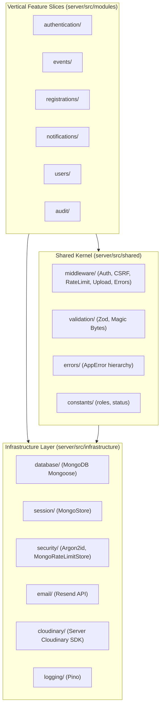
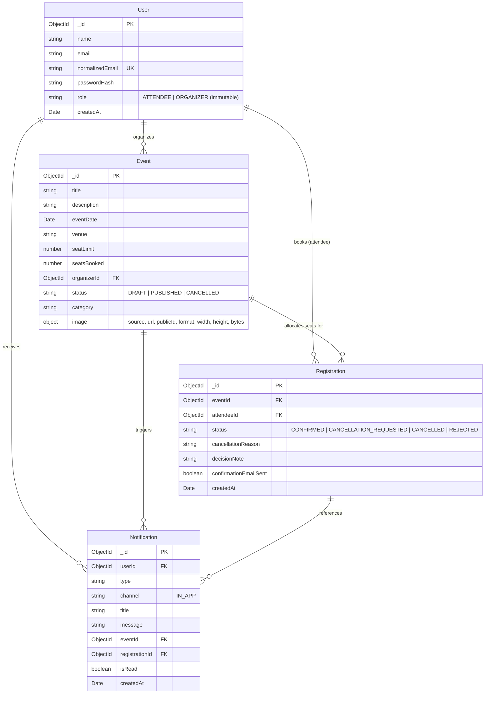
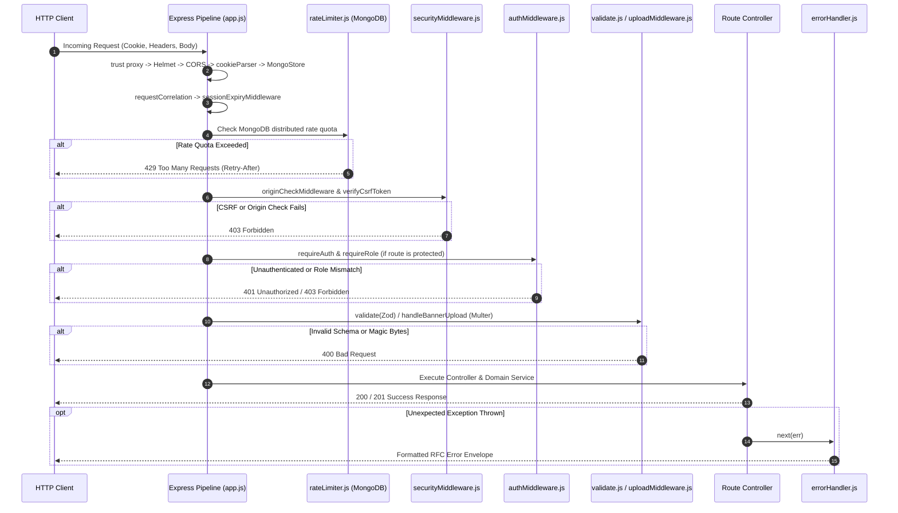
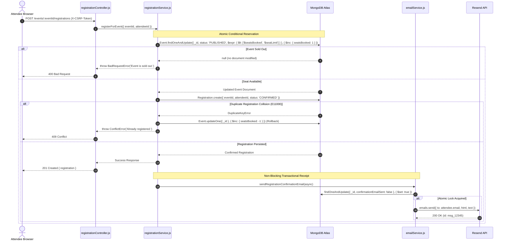
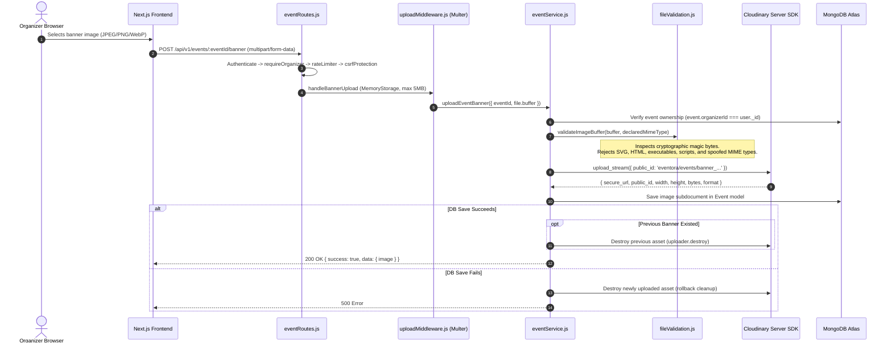

# Eventora Backend Application Root Documentation (`server/server_root.md`)

## 1. Application Overview
The Eventora backend is a production-grade, secure REST API engineered with Node.js 22 LTS, Express.js 4, and MongoDB Atlas (via Mongoose 8). It powers event lifecycle management, high-concurrency atomic seat reservation (RSVP), double-booking immunity, organizer attendee rosters, transactional email receipts via the Resend API, and secure backend-only Cloudinary media uploads.

The backend acts as an uncompromising security perimeter: all sessions, roles, file magic bytes, and concurrency controls are evaluated and enforced exclusively on the server.

---

## 2. Responsibilities and Architectural Boundaries
- **In Scope (Backend Responsibilities):**
  - Session lifecycle management using `express-session` backed by MongoDB (`connect-mongo`).
  - Cryptographic password hashing and verification using Argon2id.
  - Role-Based Access Control (`ATTENDEE` and `ORGANIZER` roles).
  - Event CRUD, search queries, pagination, and capacity floor enforcement.
  - High-concurrency seat reservation guarantees using conditional atomic MongoDB expressions.
  - Attendee cancellation requests and organizer approval/rejection workflows.
  - Transactional email confirmation receipts using the Resend API.
  - In-app notification creation, unread counts, and feed persistence.
  - Backend-only Cloudinary media uploads with binary magic bytes validation.
  - Multi-tier defense-in-depth: CSRF synchronizer tokens, CORS exact-origin matching, distributed MongoDB rate limiting, Helmet CSP headers.
- **Out of Scope (Frontend Responsibilities):**
  - UI state rendering, browser-level routing, animation (GSAP/Lenis), and search engine markup (SSR JSON-LD / metadata).

---

## 3. Technology Stack

| Technology | Actual Version | Responsibility in Backend |
|---|---|---|
| **Node.js** | 22 LTS (ESM) | Server runtime environment |
| **Express.js** | ^4.21.2 | HTTP web framework and routing |
| **MongoDB & Mongoose** | ^8.9.5 | Clustered database engine and Object Data Modeling (ODM) |
| **express-session** | ^1.18.1 | Stateful HTTP session management |
| **connect-mongo** | ^5.1.0 | MongoDB-backed session store with native TTL cleanup |
| **Argon2id (`argon2`)** | ^0.41.1 | OWASP-compliant password hashing algorithm |
| **Resend (`resend`)** | ^6.37.0 | Official SDK for transactional email confirmation delivery |
| **Cloudinary (`cloudinary`)**| ^2.11.0 | Official server-side SDK for media asset storage |
| **Multer (`multer`)** | ^2.5.0 | In-memory multipart/form-data upload parsing |
| **Helmet (`helmet`)** | ^8.0.0 | HTTP security headers & Restrictive CSP |
| **CORS (`cors`)** | ^2.8.5 | Cross-origin resource sharing with credentials support |
| **express-rate-limit** | ^7.5.0 | Rate limiting middleware framework |
| **Zod (`zod`)** | 3.25.76 | Runtime payload schema validation |
| **Pino (`pino`)** | ^9.6.0 | High-performance JSON logger with automated redaction |
| **Node Test Runner** | Native (Node 22) | Automated test execution framework (`node:test`) |
| **Supertest** | ^7.0.0 | HTTP integration test assertions |

---

## 4. Actual Folder Structure
```text
server/
├── server_root.md       # This root backend documentation
├── package.json         # Backend dependencies and test scripts
├── package-lock.json    # Deterministic dependency tree
├── .env.example         # Production and development environment template
├── src/                 # Application source code
│   ├── src.md           # Source root documentation
│   ├── app.js           # Express application & middleware pipeline
│   ├── server.js        # Bootstrap entry point & graceful shutdown
│   ├── infrastructure/  # External adapters, DB, logging, security, session, storage, email
│   │   └── infrastructure.md
│   ├── modules/         # Vertical slice feature modules (auth, events, registrations, notifs)
│   │   └── modules.md
│   ├── scripts/         # Database seeding and migration utilities
│   │   └── scripts.md
│   └── shared/          # Shared kernel (constants, errors, middleware, validation)
│       └── shared.md
└── tests/               # Test pyramid (Unit, Integration, Security)
    └── tests.md
```

---

## 5. Direct Child Files and Directory Breakdown

### Files
- **[`package.json`](file:///d:/THE%20OMS%20DEVS/WEB%20DEVS/MERN%20PROJECTS/PERSONAL/EVENTORA/server/package.json):** Declares backend metadata, production dependencies, test commands (`test`, `test:unit`, `test:integration`, `test:security`), and specifies `"type": "module"` and `"main": "src/server.js"`.
- **[`package-lock.json`](file:///d:/THE%20OMS%20DEVS/WEB%20DEVS/MERN%20PROJECTS/PERSONAL/EVENTORA/server/package-lock.json):** Exact pinned dependency versions supporting `npm ci`.
- **[`.env.example`](file:///d:/THE%20OMS%20DEVS/WEB%20DEVS/MERN%20PROJECTS/PERSONAL/EVENTORA/server/.env.example):** Comprehensive documentation of required environment variables.

### Directories
- **[`src/`](src/src.md):** Express application, server entry point, domain modules, infrastructure clients, and shared utilities.
- **[`tests/`](tests/tests.md):** 68 automated backend tests structured across unit, integration, and security suites.

---

## 6. Architecture and Internal Organization

Eventora is structured as a **Modular Monolith** employing **Vertical Slice Architecture** alongside a well-defined **Shared Kernel**.



---

## 7. Database Entity Relationships (ER Diagram)



---

## 8. Critical Request and Execution Lifecycles

### 8.1 Express Middleware Lifecycle


### 8.2 Atomic Registration and Resend Email Receipt Flow


### 8.3 Backend-Only Cloudinary Upload Flow


---

## 9. Configuration and Environment Variables

| Variable | Purpose | Required | Sensitive |
|---|---|---|---|
| `PORT` | HTTP port listener (default: 5000) | No | No |
| `NODE_ENV` | `development`, `test`, or `production` | Yes | No |
| `LOG_LEVEL` | Pino logging threshold (`info`, `debug`, `warn`, `error`) | No | No |
| `MONGODB_URI` | MongoDB Atlas Replica Set connection URI | **Yes** | **Yes** |
| `SESSION_SECRET` | 32+ character random string for signing session cookies | **Yes** | **Yes** |
| `ALLOWED_ORIGINS` | Comma-separated trusted frontend origins for CORS | **Yes** | No |
| `APP_BASE_URL` | Canonical frontend domain for digital ticket links in emails | **Yes** | No |
| `RESEND_API_KEY` | Official Resend API Key for transactional receipts | **Yes** | **Yes** |
| `EMAIL_FROM` | Verified sender address (e.g. `Eventora <onboarding@resend.dev>`) | **Yes** | No |
| `CLOUDINARY_CLOUD_NAME` | Cloudinary account name | **Yes** | No |
| `CLOUDINARY_API_KEY` | Cloudinary server API key | **Yes** | **Yes** |
| `CLOUDINARY_API_SECRET` | Cloudinary server API secret (never sent to client) | **Yes** | **Yes** |

---

## 10. Testing Architecture
The backend is verified by **68 automated tests** passing at 100%:
- **11 Unit Tests (`npm run test:unit --prefix server`):** Argon2id cryptography, Zod schema validation, Resend email HTML and plain-text template interpolation.
- **13 Integration Tests (`npm run test:integration --prefix server`):** Concurrent flash crowds competing for the final remaining seat, past-event rejection, capacity floor protection, in-app notification state, Resend email deduplication, and error isolation.
- **44 Security Tests (`npm run test:security --prefix server`):** Synchronizer CSRF tokens, Origin header enforcement, RBAC guards, session timeouts, privacy boundaries, distributed rate limiting, and 15 image upload test cases (magic bytes, SVG Stored XSS blocking, executable rejection, MIME spoofing defense, asset replacement, rollback cleanup).

---

## 11. Links to Directory-Level Documentation
- **[Source Root Documentation (`server/src/src.md`)](src/src.md)**
- **[Shared Kernel Documentation (`server/src/shared/shared.md`)](src/shared/shared.md)**
  - [`constants/`](src/shared/constants/constants.md)
  - [`errors/`](src/shared/errors/errors.md)
  - [`middleware/`](src/shared/middleware/middleware.md)
  - [`validation/`](src/shared/validation/validation.md)
- **[Infrastructure Documentation (`server/src/infrastructure/infrastructure.md`)](src/infrastructure/infrastructure.md)**
  - [`cloudinary/`](src/infrastructure/cloudinary/cloudinary.md)
  - [`database/`](src/infrastructure/database/database.md)
  - [`email/`](src/infrastructure/email/email.md)
  - [`logging/`](src/infrastructure/logging/logging.md)
  - [`security/`](src/infrastructure/security/security.md)
  - [`session/`](src/infrastructure/session/session.md)
  - [`storage/`](src/infrastructure/storage/storage.md)
- **[Domain Modules Documentation (`server/src/modules/modules.md`)](src/modules/modules.md)**
  - [`audit/`](src/modules/audit/audit.md)
  - [`authentication/`](src/modules/authentication/authentication.md)
  - [`events/`](src/modules/events/events.md)
  - [`notifications/`](src/modules/notifications/notifications.md)
  - [`registrations/`](src/modules/registrations/registrations.md)
  - [`users/`](src/modules/users/users.md)
- **[Scripts Documentation (`server/src/scripts/scripts.md`)](src/scripts/scripts.md)**
- **[Tests Documentation (`server/tests/tests.md`)](tests/tests.md)**
  - [`unit/`](tests/unit/unit.md)
  - [`integration/`](tests/integration/integration.md)
  - [`security/`](tests/security/security.md)

---

## 12. Architectural Decisions and Trade-offs

1. **Stateful Sessions vs Stateless JWTs:**
   - *Decision:* Used `express-session` with `connect-mongo` and `HttpOnly` cookies.
   - *Rationale:* Eliminates the risk of token theft from browser `localStorage`. Allows instant server-side revocation on logout or timeout.
   - *Trade-off:* Requires database lookups for session resolution, mitigated via connection pooling and `touchAfter: 10 * 60` lazy timestamp updates.

2. **Atomic In-Database Concurrency vs Distributed Locks:**
   - *Decision:* Used MongoDB conditional atomic updates with `$expr: { $lt: ['$seatsBooked', '$seatLimit'] }`.
   - *Rationale:* Avoids introducing external Redis infrastructure while providing hardware-level document locking guarantees against overselling.

3. **Backend-Only Cloudinary Integration:**
   - *Decision:* All images uploaded as `multipart/form-data` to Express backend.
   - *Rationale:* Guarantees that clients never hold Cloudinary secrets or upload presets, and enables server-side binary magic-byte inspection (blocking SVGs and executables).
   - *Trade-off:* Image bytes traverse the backend server, mitigated by 5MB payload caps and memory buffering.

