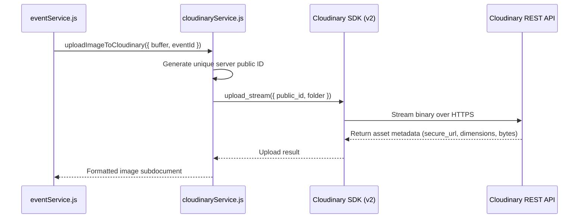

# Cloudinary Infrastructure Documentation (`server/src/infrastructure/cloudinary`)

## A. Directory Overview
The `server/src/infrastructure/cloudinary` directory encapsulates the server-side integration with Cloudinary's media management API. It provides a secure abstraction for streaming image buffers from memory directly to Cloudinary, generating server-controlled unique public IDs, destroying obsolete assets upon replacement, and supporting offline mock hooks for automated unit and security testing.

## B. Directory Structure
```text
server/src/infrastructure/cloudinary/
├── cloudinary.md        # This documentation file
└── cloudinaryService.js # Server SDK initialization, upload_stream, and destroy helpers
```

## C. File-by-File Documentation

### 1. `cloudinaryService.js`
- **File Type:** JavaScript Module (ESM)
- **Primary Responsibility:** Manages server-side Cloudinary operations with zero client-side credential exposure.
- **Exported Symbols:**
  - `uploadImageToCloudinary({ buffer, folder, eventId, format })`: Streams binary buffer using `cloudinary.uploader.upload_stream`.
  - `deleteCloudinaryAsset(publicId)`: Destroys media asset via `cloudinary.uploader.destroy()`.
  - `validateCloudinaryConfig()`: Returns `{ configured, isMock, cloudName }` without exposing API keys or secrets.
  - `setCloudinaryUploaderMock(mockFn)`: Testing hook for injecting mock upload responses.
  - `setCloudinaryDestroyerMock(mockFn)`: Testing hook for tracking asset deletions in tests.
- **Dependencies:** `cloudinary` (v2), `node:crypto`, `logger`, `AppError`.
- **Used By:** `eventService.js` (`uploadEventBanner`, `uploadDraftBanner`), `server/src/infrastructure/storage/cloudinary.js`.
- **Implementation Logic:**
  - Configures Cloudinary SDK singleton with `secure: true`.
  - Server-Generated IDs: Generates unique public IDs following the format:
    `eventora/events/banner_${eventId || 'draft'}_${Date.now()}_${crypto.randomBytes(4).toString('hex')}`. Client filenames are discarded.
  - Namespace Guard: Verifies that public IDs passed to `deleteCloudinaryAsset` strictly reside within `eventora/` namespace to prevent malicious deletion of external media.
  - In-Memory Streaming: Uses `upload_stream` to pipe `file.buffer` into Cloudinary without intermediate disk writes.

## D. Child Directory Documentation
No child subdirectories exist in this directory.

## E. Internal Relationships


## F. Execution Flow
Called by `eventService.js` during banner uploads. Receives validated in-memory buffer, streams it to Cloudinary, returns safe metadata (`url`, `publicId`, `format`, `width`, `height`, `bytes`), and deletes previous Cloudinary assets when replacing existing images.

## G. External Dependencies and Integrations
- `cloudinary`: Official Cloudinary Node.js SDK.

## H. Important Implementation Notes
- **Zero Frontend Secrets:** No credentials, upload presets, or upload signatures are ever transmitted to the frontend. All Cloudinary API keys and secrets reside strictly in the Express backend environment.

## I. Related Documentation
- [Infrastructure Parent Directory (`server/src/infrastructure/infrastructure.md`)](../infrastructure.md)
- [Storage Facade (`server/src/infrastructure/storage/storage.md`)](../storage/storage.md)
- [Server Root Documentation (`server/server_root.md`)](../../../server_root.md)

