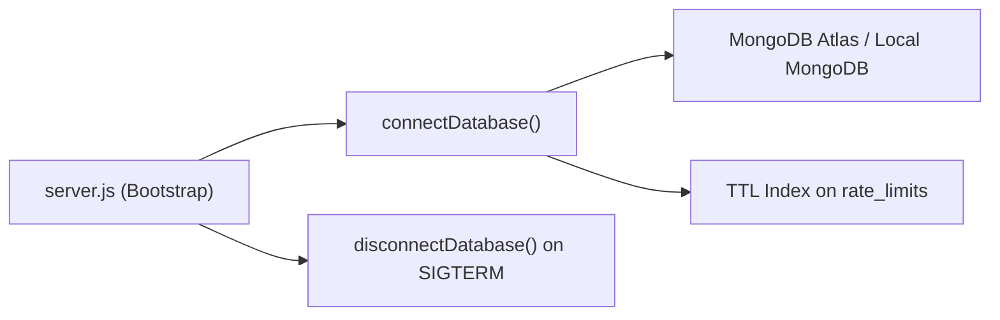

# Database Infrastructure Documentation (`server/src/infrastructure/database`)

## A. Directory Overview
The `server/src/infrastructure/database` directory manages the application's connection lifecycle to MongoDB via Mongoose. It encapsulates database connection pooling, auto-reconnection event handlers, graceful teardown hooks, and index bootstrap logic (such as TTL indexes for distributed rate limiting).

## B. Directory Structure
```text
server/src/infrastructure/database/
├── database.md          # This documentation file
└── connection.js        # Mongoose connection manager and lifecycle hooks
```

## C. File-by-File Documentation

### 1. `connection.js`
- **File Type:** JavaScript Module (ESM)
- **Primary Responsibility:** Manages singleton MongoDB connection pool.
- **Exported Symbols:**
  - `connectDatabase(uri)`: Asynchronous function establishing Mongoose connection.
  - `disconnectDatabase()`: Asynchronous function closing active Mongoose connection pool.
- **Dependencies:** `mongoose`, `logger` from `../logging/logger.js`.
- **Used By:** `server.js` (application bootstrap and SIGINT/SIGTERM shutdown), test setup hooks across `tests/`.
- **Implementation Logic:**
  - Configures connection pool: `minPoolSize: 2`, `maxPoolSize: 20`, `serverSelectionTimeoutMS: 5000`, `socketTimeoutMS: 45000`.
  - Sets `strictQuery: true` to prevent unintended query filtering vulnerabilities.
  - Automatically provisions background TTL index `{ expiresAt: 1 }` on `rate_limits` collection for distributed throttling cleanup.
  - Attaches connection event listeners (`'error'`, `'disconnected'`) emitting structured Pino logs.
  - Protects against redundant connections via module-level `isConnected` flag.

## D. Child Directory Documentation
No child subdirectories exist in this directory.

## E. Internal Relationships


## F. Execution Flow
1. Server entry point (`server.js`) calls `await connectDatabase(mongoUri)` before invoking `app.listen()`.
2. Connection establishes pool and verifies connectivity.
3. Upon process termination (`SIGINT` or `SIGTERM`), server calls `disconnectDatabase()` for graceful shutdown.

## G. External Dependencies and Integrations
- `mongoose`: MongoDB Object Data Modeling (ODM) library.

## H. Important Implementation Notes
- **Auto-Indexing Control:** `autoIndex` is disabled in production (`process.env.NODE_ENV === 'production'`) to avoid blocking production database operations during startup, relying on pre-built database indexes.

## I. Related Documentation
- [Infrastructure Parent Directory (`server/src/infrastructure/infrastructure.md`)](../infrastructure.md)
- [Server Root Documentation (`server/server_root.md`)](../../../server_root.md)

