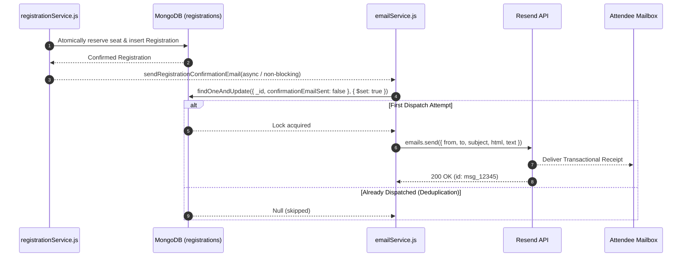

# Email Infrastructure Documentation (`server/src/infrastructure/email`)

## A. Directory Overview
The `server/src/infrastructure/email` directory implements Eventora's transactional email delivery pipeline using the official Resend API (`resend`). Following clean outbox principles, the service dispatches responsive HTML and plain-text booking confirmation receipts non-blockingly after database transactions commit, guaranteeing atomic deduplication and resilient failure isolation.

## B. Directory Structure
```text
server/src/infrastructure/email/
├── email.md             # This documentation file
└── emailService.js      # Resend client integration, HTML/text templates, and dispatch logic
```

## C. File-by-File Documentation

### 1. `emailService.js`
- **File Type:** JavaScript Module (ESM)
- **Primary Responsibility:** Manages transactional email formatting, Resend API communication, and idempotent dispatch.
- **Exported Symbols:**
  - `sendRegistrationConfirmationEmail({ registration, event, attendee })`: Asynchronous function delivering booking receipt.
  - `buildConfirmationEmailHtml({ attendeeName, eventTitle, eventDate, venue, registrationId, ticketUrl })`: Generates responsive HTML template.
  - `buildConfirmationEmailText({ attendeeName, eventTitle, eventDate, venue, registrationId, ticketUrl })`: Generates clean plain-text fallback.
  - `getResendClient()`: Factory returning initialized `Resend` instance or `null` in test/mock mode.
  - `setResendClient(mock)`: Testing hook for injecting mock clients.
- **Dependencies:** `resend`, `Registration` model, `logger`.
- **Used By:** `registrationService.js` (`registerForEvent`).
- **Implementation Logic:**
  - **Atomic Deduplication:** Checks and updates the registration document via:
    `Registration.findOneAndUpdate({ _id: registrationId, confirmationEmailSent: { $ne: true } }, { $set: { confirmationEmailSent: true } })`
    Guarantees that an email receipt is dispatched exactly once per confirmed RSVP, even across retries.
  - **Graceful Failure Isolation:** Executed asynchronously **after** seat allocation and registration records commit to MongoDB. Any downstream network failure or provider rate limit is logged at `WARN` level and never rolls back confirmed registrations.
  - **Mock Fallback:** When `RESEND_API_KEY` is omitted, placeholder, or during `NODE_ENV === 'test'`, operates in offline mock simulation mode, logging receipt details to console without outbound network egress.
  - **Branded Minimal Design:** Generates a clean, monochrome responsive HTML email containing event details, venue, date/time, registration reference, and a direct digital ticket link.

## D. Child Directory Documentation
No child subdirectories exist in this directory.

## E. Internal Relationships


## F. Execution Flow
1. Attendee submits RSVP -> `registrationService` atomically confirms seat in MongoDB.
2. `registrationService` triggers `sendRegistrationConfirmationEmail()` without awaiting response on the client thread.
3. `emailService` verifies atomic deduplication flag in MongoDB.
4. Generates HTML and text templates and calls `resend.emails.send()`.
5. Logs delivery status to Pino structured logger.

## G. External Dependencies and Integrations
- `resend`: Official SDK for Resend REST API.

## H. Important Implementation Notes
- **Resilience Policy:** An email failure must never impair an attendee's ability to attend an event. The RSVP state in MongoDB is the single source of truth; email is a notification layer.

## I. Related Documentation
- [Infrastructure Parent Directory (`server/src/infrastructure/infrastructure.md`)](../infrastructure.md)
- [Registration Service (`server/src/modules/registrations/registrations.md`)](../../modules/registrations/registrations.md)
- [Server Root Documentation (`server/server_root.md`)](../../../server_root.md)

