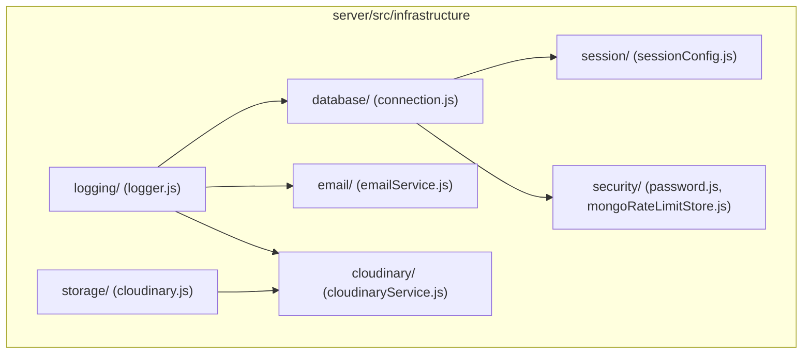

# Infrastructure Directory Documentation (`server/src/infrastructure`)

## A. Directory Overview
The `server/src/infrastructure` directory houses external adapters, third-party service clients, persistence drivers, and system-level plumbing. Following the hexagonal architecture and vertical slice patterns, domain feature modules depend on these infrastructure abstractions rather than binding directly to external APIs or raw sockets.

## B. Directory Structure
```text
server/src/infrastructure/
├── infrastructure.md    # This documentation file
├── cloudinary/          # Server-side Cloudinary media upload and asset destruction
│   ├── cloudinary.md    # Cloudinary documentation
│   └── cloudinaryService.js
├── database/            # MongoDB connection lifecycle and pooling
│   ├── database.md      # Database documentation
│   └── connection.js
├── email/               # Transactional email confirmations via Resend
│   ├── email.md         # Email documentation
│   └── emailService.js
├── logging/             # Structured JSON logging via Pino with sensitive data redaction
│   ├── logging.md       # Logging documentation
│   └── logger.js
├── security/            # Password hashing (Argon2id) and distributed rate-limit stores
│   ├── security.md      # Security documentation
│   ├── mongoRateLimitStore.js
│   └── password.js
├── session/             # Stateful session persistence in MongoDB via connect-mongo
│   ├── session.md       # Session documentation
│   └── sessionConfig.js
└── storage/             # Backward-compatible media storage facade
    ├── storage.md       # Storage documentation
    └── cloudinary.js
```

## C. File-by-File Documentation
There are no direct source files in `server/src/infrastructure/`; all logic is compartmentalized into the 7 child subdirectories documented below.

## D. Child Directory Documentation

1. **[`cloudinary/`](cloudinary/cloudinary.md)**
   - **Responsibility:** Server-side Cloudinary SDK streaming, server-controlled unique public IDs, and asset deletion.
   - **Documentation:** [`server/src/infrastructure/cloudinary/cloudinary.md`](cloudinary/cloudinary.md)

2. **[`database/`](database/database.md)**
   - **Responsibility:** MongoDB Atlas connection management, pooling (`min: 2, max: 20`), and graceful process termination.
   - **Documentation:** [`server/src/infrastructure/database/database.md`](database/database.md)

3. **[`email/`](email/email.md)**
   - **Responsibility:** Transactional email confirmations powered by Resend API with HTML/plain-text templates and atomic deduplication.
   - **Documentation:** [`server/src/infrastructure/email/email.md`](email/email.md)

4. **[`logging/`](logging/logging.md)**
   - **Responsibility:** Asynchronous structured logging via Pino with automatic redaction of cookies, passwords, and tokens.
   - **Documentation:** [`server/src/infrastructure/logging/logging.md`](logging/logging.md)

5. **[`security/`](security/security.md)**
   - **Responsibility:** Cryptographic password hashing (Argon2id) and distributed MongoDB rate-limit stores with TTL auto-cleanup.
   - **Documentation:** [`server/src/infrastructure/security/security.md`](security/security.md)

6. **[`session/`](session/session.md)**
   - **Responsibility:** `express-session` configured with `connect-mongo`, `HttpOnly` SameSite cookies, and idle/absolute expiry.
   - **Documentation:** [`server/src/infrastructure/session/session.md`](session/session.md)

7. **[`storage/`](storage/storage.md)**
   - **Responsibility:** Re-export facade for media storage engines.
   - **Documentation:** [`server/src/infrastructure/storage/storage.md`](storage/storage.md)

## E. Internal Relationships


## F. Execution Flow
- Process startup: `database/connection.js` connects -> `session/sessionConfig.js` hooks store -> `logging/logger.js` records state.
- Runtime requests: `security/` hashes passwords or checks rate limits; `cloudinary/` uploads banners; `email/` delivers booking receipts.

## G. External Dependencies and Integrations
- `mongoose`: Database ODM.
- `argon2`: Password cryptography.
- `resend`: Email API.
- `cloudinary`: Image hosting.
- `pino`: Logger.
- `connect-mongo`: Session persistence.

## H. Important Implementation Notes
- **Decoupled Architecture:** Infrastructure components provide mock hooks for automated unit and integration tests without network latency or external API dependencies.

## I. Related Documentation
- [Server Source Root (`server/src/src.md`)](../src.md)
- [Server Root Documentation (`server/server_root.md`)](../../server_root.md)

