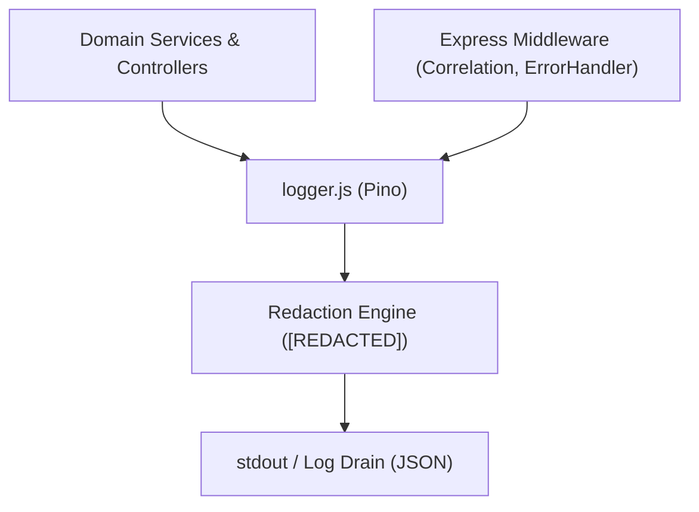

# Logging Infrastructure Documentation (`server/src/infrastructure/logging`)

## A. Directory Overview
The `server/src/infrastructure/logging` directory encapsulates the structured logging subsystem for Eventora. Built on Pino, the logger outputs high-performance, asynchronous JSON logs with automated cryptographic and credential redaction, protecting secrets from log aggregation systems in development and production.

## B. Directory Structure
```text
server/src/infrastructure/logging/
├── logging.md           # This documentation file
└── logger.js            # Pino structured logger with redaction rules
```

## C. File-by-File Documentation

### 1. `logger.js`
- **File Type:** JavaScript Module (ESM)
- **Primary Responsibility:** Configures and exports domain logger singleton.
- **Exported Symbols:**
  - `logger`: Configured Pino logger instance.
- **Dependencies:** `pino`, `pino-pretty` (in development).
- **Used By:** `server.js`, `app.js`, `errorHandler.js`, `requestCorrelation.js`, `connection.js`, `emailService.js`, `rateLimiter.js`.
- **Implementation Logic:**
  - Configures dynamic log level from `process.env.LOG_LEVEL` (defaults to `info` in production, `debug` in development).
  - Uses `pino.stdTimeFunctions.isoTime` for ISO-8601 timestamps.
  - Formats human-readable console logs using `pino-pretty` in non-production environments.
- **Security & Redaction:**
  - Automatically censors sensitive paths with `[REDACTED]`:
    - `req.headers.cookie`, `res.headers["set-cookie"]`
    - `req.headers["x-csrf-token"]`
    - `password`, `passwordHash`, `body.password`
    - `credentials`, `session.user.passwordHash`
  - Eliminates accidental credential leakage into SIEM, Papertrail, or Render log drains.

## D. Child Directory Documentation
No child subdirectories exist in this directory.

## E. Internal Relationships


## F. Execution Flow
Any module imports `logger` and emits events (e.g., `logger.info({ eventId }, 'Event created')`). Pino redacts matching sensitive keys before streaming formatted output to `stdout`.

## G. External Dependencies and Integrations
- `pino`: Ultra-fast JSON logger.
- `pino-pretty`: Development log formatter.

## H. Important Implementation Notes
- **Non-blocking IO:** Pino formats logs in a minimal overhead pipeline, maintaining high throughput under concurrent load.

## I. Related Documentation
- [Infrastructure Parent Directory (`server/src/infrastructure/infrastructure.md`)](../infrastructure.md)
- [Server Root Documentation (`server/server_root.md`)](../../../server_root.md)

