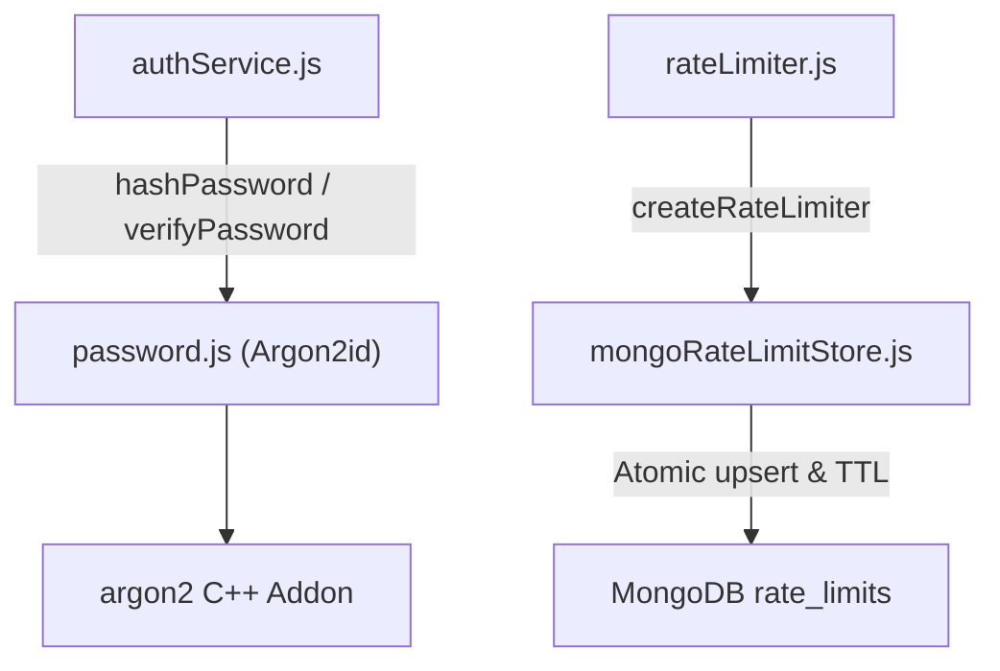

# Security Infrastructure Documentation (`server/src/infrastructure/security`)

## A. Directory Overview
The `server/src/infrastructure/security` directory implements foundational cryptographic mechanisms and distributed persistence stores required to safeguard user authentication and enforce API rate limits. It provides OWASP-compliant password hashing via Argon2id and a distributed rate limit storage engine built on MongoDB TTL collections.

## B. Directory Structure
```text
server/src/infrastructure/security/
├── security.md                 # This documentation file
├── mongoRateLimitStore.js      # Distributed rate limit store using MongoDB atomic updates
└── password.js                 # Argon2id password hashing and constant-time verification
```

## C. File-by-File Documentation

### 1. `mongoRateLimitStore.js`
- **File Type:** JavaScript Module (ESM)
- **Primary Responsibility:** Custom storage adapter for `express-rate-limit` using MongoDB.
- **Exported Symbols:**
  - `MongoRateLimitStore`: Class implementing `increment(key)`, `decrement(key)`, `resetKey(key)`, and `ensureIndex()`.
- **Dependencies:** `mongoose`, `logger` from `../logging/logger.js`.
- **Used By:** `server/src/shared/middleware/rateLimiter.js`.
- **Implementation Logic:**
  - Operates on the `rate_limits` collection.
  - Automatically provisions a MongoDB TTL index on `expiresAt` (`{ expireAfterSeconds: 0 }`), ensuring stale throttle documents are purged automatically by MongoDB's background thread without manual housekeeping queries.
  - In `increment(key)`:
    - Attempts atomic `$inc: { count: 1 }` on `{ _id: key, expiresAt: { $gt: now } }`.
    - If no document is updated, upserts a fresh window document `{ _id: key, count: 1, resetTime, expiresAt }`.
    - Handles concurrent duplicate-key (`E11000`) race conditions by catching the collision and falling back to updating the newly created document.
  - Provides graceful in-memory fallback if the database connection temporarily drops.

### 2. `password.js`
- **File Type:** JavaScript Module (ESM)
- **Primary Responsibility:** Cryptographic password hashing and verification using Argon2id.
- **Exported Symbols:**
  - `hashPassword(plainPassword)`: Returns Argon2id hashed string.
  - `verifyPassword(plainPassword, passwordHash)`: Returns boolean indicating whether password matches.
- **Dependencies:** `argon2`.
- **Used By:** `authService.js`, `User.js`, `seed.js`.
- **Implementation Logic:**
  - Adheres strictly to OWASP password storage guidelines:
    - `type: argon2.argon2id` (hybrid memory-hard algorithm resistant to both side-channel and GPU cracking attacks).
    - `memoryCost: 19456` (19 MiB RAM allocation per hash).
    - `timeCost: 2` (2 iterations).
    - `parallelism: 1` (1 execution thread).
  - Handles null, undefined, or empty strings safely without throwing unhandled exceptions.

## D. Child Directory Documentation
No child subdirectories exist in this directory.

## E. Internal Relationships


## F. Execution Flow
- During registration: `authService` passes plain password to `hashPassword()`, saving the Argon2id hash to the user document.
- During login: `authService` retrieves the user and executes `verifyPassword()`.
- During HTTP requests: `rateLimiter.js` invokes `mongoRateLimitStore.increment(key)` to track requests across cluster instances.

## G. External Dependencies and Integrations
- `argon2`: Native cryptographic binding for Argon2id.
- `mongoose`: Direct collection access for throttling documents.

## H. Important Implementation Notes
- **Distributed State:** Unlike default in-memory rate limiters that reset on server restarts or fail across multi-instance clusters, `MongoRateLimitStore` maintains consistent quota enforcement across all Render web service instances.

## I. Related Documentation
- [Infrastructure Parent Directory (`server/src/infrastructure/infrastructure.md`)](../infrastructure.md)
- [Rate Limiter Middleware (`server/src/shared/middleware/middleware.md`)](../../shared/middleware/middleware.md)
- [Server Root Documentation (`server/server_root.md`)](../../../server_root.md)

