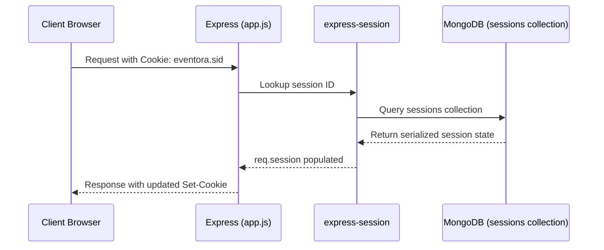

# Session Infrastructure Documentation (`server/src/infrastructure/session`)

## A. Directory Overview
The `server/src/infrastructure/session` directory encapsulates stateful authentication persistence using server-managed sessions. By storing session data in a dedicated MongoDB collection (`sessions`) via `connect-mongo` and communicating with the client exclusively through an encrypted, `HttpOnly`, `SameSite` cookie, it implements secure authentication boundaries without exposing JSON Web Tokens (JWT) to JavaScript browser storage.

## B. Directory Structure
```text
server/src/infrastructure/session/
├── session.md           # This documentation file
└── sessionConfig.js     # express-session factory with MongoStore integration
```

## C. File-by-File Documentation

### 1. `sessionConfig.js`
- **File Type:** JavaScript Module (ESM)
- **Primary Responsibility:** Configures and instantiates `express-session` with MongoDB persistence.
- **Exported Symbols:**
  - `createSessionMiddleware(mongoUrl)`: Middleware factory creating `session({ ... })`.
  - `IDLE_TIMEOUT_MS`: 30 minutes in milliseconds (`1800000`).
  - `ABSOLUTE_TIMEOUT_MS`: 24 hours in milliseconds (`86400000`).
- **Dependencies:** `express-session`, `connect-mongo`.
- **Used By:** `app.js` (attached to the Express pipeline before routes).
- **Implementation Logic:**
  - Configures `MongoStore` with collection name `sessions`, 24-hour TTL, and `touchAfter: 10 * 60` (updates last-access at most once per 10 minutes to reduce database write traffic).
  - Cookie security settings:
    - `name: 'eventora.sid'` (avoids framework fingerprinting like `connect.sid`).
    - `httpOnly: true` (strictly inaccessible via `document.cookie` in browser, neutralizing XSS credential theft).
    - `secure: isProduction || process.env.COOKIE_SECURE === 'true'` (enforces HTTPS transport).
    - `sameSite: sameSiteSetting` (`'none'` in cross-origin production between Vercel and Render, `'lax'` in local development).
    - `proxy: isProduction` (instructs cookie engine to trust reverse proxy TLS headers).
    - `resave: false`, `saveUninitialized: false` (prevents empty session collection bloat).

## D. Child Directory Documentation
No child subdirectories exist in this directory.

## E. Internal Relationships


## F. Execution Flow
Every request entering `app.js` runs through `createSessionMiddleware()`. It reads the signed cookie, retrieves the corresponding session document from MongoDB, and exposes `req.session` to subsequent middleware and route handlers.

## G. External Dependencies and Integrations
- `express-session`: HTTP session manager.
- `connect-mongo`: MongoDB session store adapter.

## H. Important Implementation Notes
- **Cross-Site Authentication:** In production, Render backend and Vercel frontend run on distinct domains. `sameSite: 'none'` combined with `secure: true` allows cross-origin credentialed requests (`credentials: 'include'`) while strict Origin and CSRF checks prevent unauthorized cross-site submissions.

## I. Related Documentation
- [Infrastructure Parent Directory (`server/src/infrastructure/infrastructure.md`)](../infrastructure.md)
- [Session Expiry Middleware (`server/src/shared/middleware/middleware.md`)](../../shared/middleware/middleware.md)
- [Server Root Documentation (`server/server_root.md`)](../../../server_root.md)

