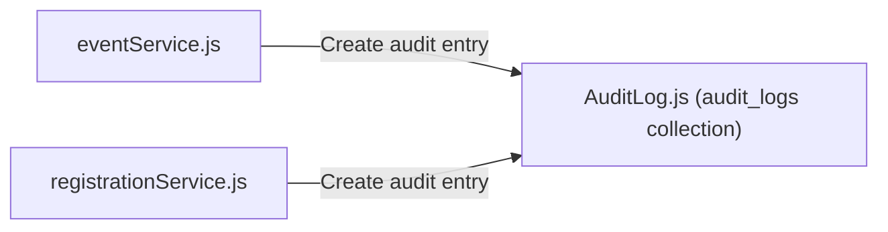

# Audit Module Documentation (`server/src/modules/audit`)

## A. Directory Overview
The `server/src/modules/audit` directory provides immutable record-keeping of security events, administrative state transitions, and sensitive actions (e.g., event cancellations, capacity adjustments, banner uploads). Stored in the `audit_logs` collection, these records offer compliance visibility and forensic auditability.

## B. Directory Structure
```text
server/src/modules/audit/
├── audit.md             # This documentation file
└── AuditLog.js          # Mongoose schema and model for audit trail entries
```

## C. File-by-File Documentation

### 1. `AuditLog.js`
- **File Type:** JavaScript Module (ESM)
- **Primary Responsibility:** Defines Mongoose schema and model for historical audit records.
- **Exported Symbols:**
  - `AuditLog`: Mongoose model mapped to `audit_logs` collection.
- **Dependencies:** `mongoose`.
- **Used By:** `eventService.js`, `registrationService.js`.
- **Schema Fields:**
  - `action`: String (required, indexed) — e.g., `'EVENT_CREATED'`, `'BANNER_UPLOADED'`, `'REGISTRATION_CONFIRMED'`.
  - `actorId`: ObjectId (ref: `User`, indexed) — Initiating user identifier.
  - `actorRole`: String — Role of the actor at the time of execution.
  - `resourceId`: ObjectId (indexed) — Target entity ID (e.g. event ID).
  - `resourceType`: String (indexed) — Target entity type (`'Event'`, `'Registration'`).
  - `status`: String (`'SUCCESS'`, `'FAILURE'`, default: `'SUCCESS'`).
  - `ipAddress`: String — Client IPv4/IPv6 address.
  - `userAgent`: String — Client browser user agent.
  - `details`: Mixed — Context-specific metadata (e.g., old vs new seat limits).
  - `timestamp`: Date (default: `Date.now`, indexed).
- **Compound Indexes:** `{ resourceType: 1, resourceId: 1, timestamp: -1 }`, `{ actorId: 1, timestamp: -1 }`.

## D. Child Directory Documentation
No child subdirectories exist in this directory.

## E. Internal Relationships


## F. Execution Flow
When significant state changes occur (e.g., an organizer modifies seat limits or approves a cancellation), services construct and persist an `AuditLog` entry asynchronously.

## G. External Dependencies and Integrations
- `mongoose`: Data persistence.

## H. Important Implementation Notes
- **Append-Only:** Audit documents are strictly append-only; update and delete operations are disallowed by design.

## I. Related Documentation
- [Modules Parent Directory (`server/src/modules/modules.md`)](../modules.md)
- [Server Root Documentation (`server/server_root.md`)](../../../server_root.md)

