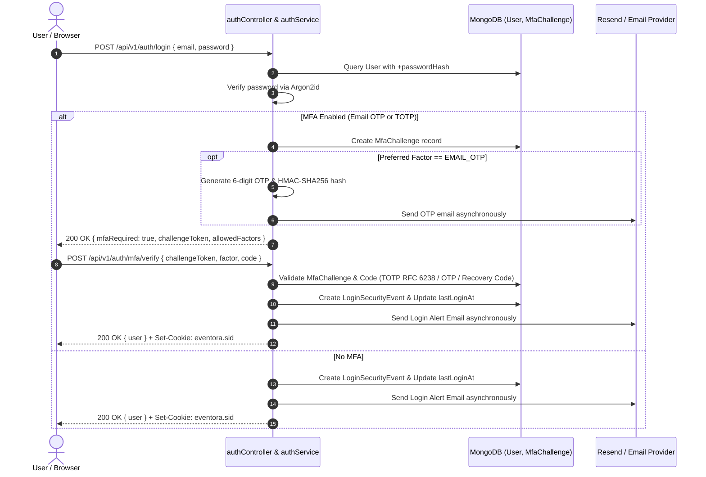

# Authentication & MFA Module Documentation (`server/src/modules/authentication`)

## A. Directory Overview
The `server/src/modules/authentication` directory implements comprehensive user registration, credential verification, session lifecycle management, email verification, multi-factor authentication (Email OTP, Authenticator App TOTP RFC 6238, recovery codes), login alert notifications, session rotation against session-fixation attacks, and CSRF token distribution for the Eventora backend.

## B. Directory Structure
```text
server/src/modules/authentication/
├── authentication.md           # This documentation file
├── authController.js           # HTTP handlers for auth, verification, MFA challenge & factor management
├── authRoutes.js               # Express router with rate limits and validation bindings
├── authService.js              # Business logic for auth, tokens, MFA challenges, OTP, TOTP, and recovery codes
├── EmailVerificationToken.js   # Single-use email verification tokens (SHA-256 hashed, 30m expiry)
├── LoginSecurityEvent.js       # Audited sign-in history tracking IP, GeoIP location, device/OS/browser
└── MfaChallenge.js             # Short-lived pending MFA challenges (HMAC-SHA256 hashed OTP, 10m TTL)
```

## C. File-by-File Documentation

### 1. `EmailVerificationToken.js`
- **File Type:** Mongoose Model (ESM)
- **Primary Responsibility:** Stores single-use tokens for email address verification.
- **Fields:**
  - `userId`: ObjectId reference to `User` (indexed).
  - `tokenHash`: SHA-256 hex digest of the 32-byte cryptographically random token string.
  - `expiresAt`: TTL timestamp (30 minutes default, 1-hour automatic index expiration).
  - `usedAt`: Nullable timestamp recording token consumption.

### 2. `MfaChallenge.js`
- **File Type:** Mongoose Model (ESM)
- **Primary Responsibility:** Manages transient authentication states between primary password verification and MFA secondary factor verification.
- **Fields:**
  - `challengeToken`: 32-byte secure random challenge identifier returned to the client.
  - `userId`: ObjectId reference to `User`.
  - `allowedFactors`: Array of available MFA factors (`EMAIL_OTP`, `TOTP`, `RECOVERY_CODE`).
  - `preferredFactor`: Primary factor (`EMAIL_OTP` or `TOTP`).
  - `emailOtpHash`: HMAC-SHA256 digest of active 6-digit numeric OTP.
  - `emailOtpExpiresAt`: Timestamp for OTP expiration (5 minutes).
  - `attempts`: Failed attempt counter (gated at 5 maximum).
  - `expiresAt`: Challenge TTL expiration (10 minutes).

### 3. `LoginSecurityEvent.js`
- **File Type:** Mongoose Model (ESM)
- **Primary Responsibility:** Stores immutable audit history of successful sign-ins.
- **Fields:**
  - `userId`: ObjectId reference to `User` (indexed).
  - `ipAddress`: Client IPv4/IPv6 address.
  - `location`: GeoIP parsed country, region, city, coordinates (derived offline via `geoip-lite`).
  - `device`: User-Agent parsed browser, OS, device type (derived via `ua-parser-js`).
  - `authFactor`: Factor used (`PASSWORD`, `EMAIL_OTP`, `TOTP`, `RECOVERY_CODE`).
  - `loginNotificationSent`: Boolean indicating whether a login alert email was dispatched.

### 4. `authController.js`
- **File Type:** JavaScript Module (ESM)
- **Primary Responsibility:** Bridges HTTP transport and `authService`, managing session state, cookies, and asynchronous notifications.
- **Exported Handlers:**
  - `getCsrfToken(req, res, next)`: Generates/retrieves CSRF synchronizer token from session and returns `{ csrfToken }` (200 OK).
  - `register(req, res, next)`: Calls `authService.register`, regenerates session (`req.session.regenerate`), triggers asynchronous verification email dispatch, and returns safe user profile (201 Created).
  - `login(req, res, next)`: Validates credentials. If MFA is enabled, returns `{ mfaRequired: true, challengeToken, allowedFactors, preferredFactor }` (200 OK). Otherwise regenerates session, records login event, asynchronously dispatches login alert email, and returns `{ user }` (200 OK).
  - `verifyMfa(req, res, next)`: Completes an MFA challenge via OTP, TOTP, or recovery code, establishes authenticated session, and triggers login alert email (200 OK).
  - `resendMfaOtp(req, res, next)`: Issues and sends a new 6-digit OTP for an active challenge with a 60s cooldown (200 OK).
  - `verifyEmail(req, res, next)`: Validates token from query param or body, updates `emailVerified: true`, and returns success message (200 OK).
  - `resendVerificationEmail(req, res, next)`: Re-issues email verification token with 60-second cooldown protection (200 OK).
  - `getSecurityStatus(req, res, next)`: Returns MFA configuration and recent login events for authenticated user (200 OK).
  - `setupTotp(req, res, next)`: Generates RFC 6238 secret and returns QR code data URL + manual setup key (200 OK).
  - `confirmTotp(req, res, next)`: Verifies initial code, encrypts secret via AES-256-GCM, activates TOTP, and returns 10 backup recovery codes (200 OK).
  - `setupEmailOtp(req, res, next)`: Dispatches test OTP to user's verified email (200 OK).
  - `confirmEmailOtp(req, res, next)`: Validates test OTP, enables Email OTP, and returns 10 backup recovery codes (200 OK).
  - `regenerateRecoveryCodes(req, res, next)`: Requires password confirmation, invalidates old codes, generates and stores 10 hashed codes, and returns plaintext codes once (200 OK).
  - `disableMfa(req, res, next)`: Requires password confirmation, clears TOTP secret and recovery codes, and marks MFA disabled (200 OK).
  - `logout(req, res, next)`: Destroys session in MongoDB (`req.session.destroy`) and clears `eventora.sid` cookie with matching flags (200 OK).
  - `getCurrentUser(req, res, next)`: Inspects active session; returns `{ user }` if logged in or `{ user: null }` if unauthenticated (200 OK).

### 5. `authRoutes.js`
- **File Type:** JavaScript Module (ESM)
- **Primary Responsibility:** Express router mounted at `/api/v1/auth`.
- **Endpoints:**
  - `GET /csrf`: Public endpoint providing synchronizer token.
  - `POST /register`: Public (`authRateLimiter`, `csrfProtection`, `validateBody(registerSchema)`).
  - `POST /login`: Public (`authRateLimiter`, `csrfProtection`, `validateBody(loginSchema)`).
  - `POST /mfa/verify`: Public (`authRateLimiter`, `csrfProtection`, `validateBody(verifyMfaSchema)`).
  - `POST /mfa/resend-otp`: Public (`authRateLimiter`, `csrfProtection`, `validateBody(resendOtpSchema)`).
  - `POST /verify-email`: Public (`csrfProtection`).
  - `POST /resend-verification`: Authenticated / Public with email (`authRateLimiter`, `csrfProtection`).
  - `GET /security/status`: Authenticated (`requireAuth`).
  - `POST /security/totp/setup`: Authenticated (`requireAuth`, `csrfProtection`).
  - `POST /security/totp/confirm`: Authenticated (`requireAuth`, `csrfProtection`).
  - `POST /security/email-otp/setup`: Authenticated (`requireAuth`, `csrfProtection`).
  - `POST /security/email-otp/confirm`: Authenticated (`requireAuth`, `csrfProtection`).
  - `POST /security/recovery-codes/regenerate`: Authenticated (`requireAuth`, `csrfProtection`).
  - `POST /security/mfa/disable`: Authenticated (`requireAuth`, `csrfProtection`).
  - `POST /logout`: Public / Authenticated (`csrfProtection`).
  - `GET /me`: Public (reads active session).

### 6. `authService.js`
- **File Type:** JavaScript Module (ESM)
- **Primary Responsibility:** Core cryptographic and business logic for authentication, verification tokens, MFA challenges, TOTP verification, and recovery code verification.

## D. Execution Flows

### 1. Two-Factor Authentication Login Flow


## E. Security Hardening Notes
1. **No Plaintext Secrets at Rest:**
   - Email verification tokens: SHA-256 hashed.
   - Email OTP codes: HMAC-SHA256 hashed.
   - TOTP secrets: Encrypted with AES-256-GCM using key derived from `MFA_ENCRYPTION_KEY` or `SESSION_SECRET`.
   - Recovery backup codes: SHA-256 hashed with salt.
2. **Session Fixation Prevention:**
   - `req.session.regenerate()` is executed upon both regular login and MFA challenge completion.
3. **Non-Blocking Email Delivery:**
   - Login alerts and confirmation emails execute in background promises so email provider latency never blocks user HTTP responses.

## F. Related Documentation
- [Security Threat Model (`Docs/05-security/threat-model.md`)](../../../../Docs/05-security/threat-model.md)
- [Rate Limiting Policy (`Docs/05-security/rate-limiting-policy.md`)](../../../../Docs/05-security/rate-limiting-policy.md)
- [Users Module (`server/src/modules/users/users.md`)](../users/users.md)
- [Server Root Documentation (`server/server_root.md`)](../../../server_root.md)


