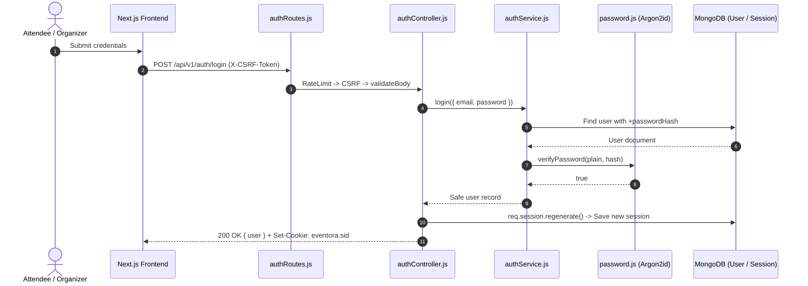

# Authentication Module Documentation (`server/src/modules/authentication`)

## A. Directory Overview
The `server/src/modules/authentication` directory implements user registration, credential verification, session lifecycle management, session rotation against session-fixation attacks, and CSRF token distribution for the Eventora backend.

## B. Directory Structure
```text
server/src/modules/authentication/
├── authentication.md    # This documentation file
├── authController.js    # HTTP handlers for register, login, logout, me, and csrf token
├── authRoutes.js        # Express router with rate limits and validation bindings
└── authService.js       # Business logic for account registration and Argon2id verification
```

## C. File-by-File Documentation

### 1. `authController.js`
- **File Type:** JavaScript Module (ESM)
- **Primary Responsibility:** Bridges HTTP transport and `authService`, managing session state and cookies.
- **Exported Handlers:**
  - `getCsrfToken(req, res, next)`: Generates/retrieves CSRF synchronizer token from session and returns `{ csrfToken }` (200 OK).
  - `register(req, res, next)`: Calls `authService.register`, regenerates session (`req.session.regenerate`) to prevent session fixation, binds `req.session.user`, and returns safe user profile (201 Created).
  - `login(req, res, next)`: Calls `authService.login`, regenerates session (`req.session.regenerate`), binds `req.session.user`, and returns safe user profile (200 OK).
  - `logout(req, res, next)`: Destroys session in MongoDB (`req.session.destroy`) and clears `eventora.sid` cookie with matching flags (200 OK).
  - `getCurrentUser(req, res, next)`: Inspects active session; returns `{ user }` if logged in or `{ user: null }` if unauthenticated without throwing errors (200 OK).

### 2. `authRoutes.js`
- **File Type:** JavaScript Module (ESM)
- **Primary Responsibility:** Express router mounted at `/api/v1/auth`.
- **Endpoints:**
  - `GET /csrf`: Public endpoint providing synchronizer token.
  - `POST /register`: Public (`authRateLimiter` 10 req/15m, `csrfProtection`, `validateBody(registerSchema)`).
  - `POST /login`: Public (`authRateLimiter` 10 req/15m, `csrfProtection`, `validateBody(loginSchema)`).
  - `POST /logout`: Public / Authenticated (`csrfProtection`).
  - `GET /me`: Public (reads active session).

### 3. `authService.js`
- **File Type:** JavaScript Module (ESM)
- **Primary Responsibility:** Account creation and password verification.
- **Exported Functions:**
  - `register({ name, email, password, role, ipAddress, userAgent })`:
    - Checks normalized email for uniqueness; throws `ConflictError (409)` if taken.
    - Hashes password using Argon2id.
    - Creates `User` document.
    - Emits `AuditLog` event (`USER_REGISTERED`).
    - Returns sanitized user record.
  - `login({ email, password, ipAddress, userAgent })`:
    - Queries user by `normalizedEmail` selecting `+passwordHash`.
    - If user missing or `verifyPassword` returns false, logs audit event and throws `UnauthorizedError ('Invalid email or password.')` to prevent username enumeration.
    - Emits `AuditLog` event (`USER_LOGGED_IN`).
    - Returns sanitized user record.

## D. Child Directory Documentation
No child subdirectories exist in this directory.

## E. Internal Relationships


## F. Execution Flow
User navigates to `/login` -> fetches `/auth/csrf` -> submits login form with `X-CSRF-Token` -> `authRoutes` validates payload -> `authService` checks Argon2id hash -> `authController` rotates session ID in MongoDB -> returns session cookie to client.

## G. External Dependencies and Integrations
- `User` model: User data.
- `password.js`: Argon2id cryptography.
- `express-session`: Session state management.

## H. Important Implementation Notes
- **Session Fixation Immunity:** `req.session.regenerate()` is executed upon both registration and login, ensuring a pre-existing unauthenticated session ID cannot be hijacked.

## I. Related Documentation
- [Modules Parent Directory (`server/src/modules/modules.md`)](../modules.md)
- [Users Module (`server/src/modules/users/users.md`)](../users/users.md)
- [Server Root Documentation (`server/server_root.md`)](../../../server_root.md)

