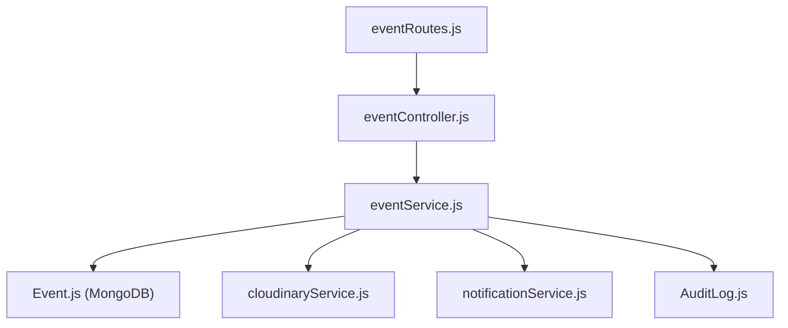

# Events Module Documentation (`server/src/modules/events`)

## A. Directory Overview
The `server/src/modules/events` directory encapsulates all event management and discovery capabilities for Eventora. It encompasses public browsing and search filters, organizer event creation and updates, capacity floor protection, event cancellation notifications, attendee roster visibility for organizers, and the backend-only Cloudinary banner upload pipeline.

## B. Directory Structure
```text
server/src/modules/events/
├── events.md            # This documentation file
├── Event.js             # Mongoose schema, compound indexes, and virtual properties
├── eventController.js   # HTTP request parsing, status codes, and response formatting
├── eventRoutes.js       # Express route definitions, rate limiters, and middleware binding
└── eventService.js      # Core business logic, ownership checks, capacity guards, Cloudinary stream
```

## C. File-by-File Documentation

### 1. `Event.js`
- **File Type:** JavaScript Module (ESM)
- **Primary Responsibility:** Mongoose schema for the `events` collection.
- **Exported Symbols:**
  - `Event`: Mongoose model.
- **Schema Properties:**
  - `title`: String (3–200 chars, required).
  - `description`: String (10–5000 chars, required).
  - `eventDate`: Date (required).
  - `venue`: String (3–300 chars, required).
  - `seatLimit`: Number (min: 1, required).
  - `seatsBooked`: Number (min: 0, default: 0).
  - `organizerId`: ObjectId (ref: `User`, indexed).
  - `status`: String (enum: `DRAFT`, `PUBLISHED`, `CANCELLED`, default: `PUBLISHED`, indexed).
  - `category`: String (default: `'General'`, indexed).
  - `image`: Subdocument containing `source` (`URL` or `CLOUDINARY`), `url`, `publicId`, `format`, `width`, `height`, `bytes`.
  - `bannerUrl`: Virtual and root field synchronized with `image.url`.
  - `seatsRemaining`: Virtual getter computing `Math.max(0, this.seatLimit - this.seatsBooked)`.
  - `isSoldOut`: Virtual getter returning `this.seatsBooked >= this.seatLimit`.
- **Database Indexes:**
  - Compound: `{ status: 1, eventDate: 1 }` (for public browsing).
  - Compound: `{ organizerId: 1, createdAt: -1 }` (for organizer dashboard).
  - Text Index: `{ title: 'text', description: 'text', venue: 'text' }` (for keyword search).

### 2. `eventController.js`
- **File Type:** JavaScript Module (ESM)
- **Primary Responsibility:** Intercepts incoming HTTP requests, extracts parameters, delegates to `eventService`, and returns standard JSON envelopes.
- **Exported Handlers:**
  - `getEvents(req, res, next)`: Retrieves paginated public events.
  - `getEventById(req, res, next)`: Retrieves single event by ID.
  - `getMyEvents(req, res, next)`: Lists events owned by authenticated organizer.
  - `createEvent(req, res, next)`: Creates new event (201 Created).
  - `updateEvent(req, res, next)`: Updates event details (200 OK).
  - `cancelEvent(req, res, next)`: Cancels event and notifies attendees (200 OK).
  - `getEventAttendees(req, res, next)`: Returns attendee roster for owned event (200 OK).
  - `uploadEventBanner(req, res, next)`: Handles draft or existing event banner upload via Multer (200 OK).

### 3. `eventRoutes.js`
- **File Type:** JavaScript Module (ESM)
- **Primary Responsibility:** Defines endpoints under `/api/v1/events`.
- **Endpoints:**
  - `GET /`: Public event discovery.
  - `GET /organizer/my-events`: Protected (`requireAuth`, `requireOrganizer`).
  - `POST /banner`: Pre-creation upload (`requireAuth`, `requireOrganizer`, `uploadBannerRateLimiter`, `csrfProtection`, `handleBannerUpload`).
  - `GET /:eventId`: Public event details.
  - `POST /:eventId/banner`: Existing event upload with ownership check (`requireAuth`, `requireOrganizer`, `uploadBannerRateLimiter`, `csrfProtection`, `handleBannerUpload`).
  - `POST /`: Create event (`requireAuth`, `requireOrganizer`, `csrfProtection`, `validateBody(createEventSchema)`).
  - `PATCH /:eventId`: Update event (`requireAuth`, `requireOrganizer`, `csrfProtection`, `validateBody(updateEventSchema)`).
  - `POST /:eventId/cancel`: Cancel event (`requireAuth`, `requireOrganizer`, `csrfProtection`).
  - `GET /:eventId/attendees`: Attendee roster (`requireAuth`, `requireOrganizer`).

### 4. `eventService.js`
- **File Type:** JavaScript Module (ESM)
- **Primary Responsibility:** Domain logic and invariant enforcement.
- **Exported Functions:**
  - `getEvents(query)`: Applies search filters, status guards (`PUBLISHED`), and pagination.
  - `getEventById(eventId)`: Fetches event with virtuals.
  - `getOrganizerEvents(organizerId)`: Lists events for organizer dashboard with attendee counts.
  - `createEvent(data, organizerId)`: Validates future date, creates document, records `AuditLog`.
  - `updateEvent(eventId, updateData, organizerId)`: Enforces ownership. **Capacity Floor Guard:** Rejects reducing `seatLimit` below currently booked `seatsBooked`.
  - `cancelEvent(eventId, organizerId)`: Sets status to `CANCELLED`, notifies confirmed attendees via in-app notifications.
  - `getEventAttendees(eventId, organizerId)`: Enforces ownership; queries `Registration` model populated with user `name` and `email`.
  - `uploadEventBanner({ eventId, file, organizerId })`: Validates buffer magic bytes via `validateImageBuffer`, uploads to Cloudinary with server-generated ID, replaces old asset, updates MongoDB, and destroys new asset if DB update fails (rollback).

## D. Child Directory Documentation
No child subdirectories exist in this directory.

## E. Internal Relationships


## F. Execution Flow
- **Creation:** Organizer submits POST -> validated by `createEventSchema` -> `createEvent` ensures date is future -> saved to MongoDB -> Audit logged.
- **Banner Upload:** Organizer submits multipart -> buffered in memory -> magic bytes checked -> streamed to Cloudinary -> saved to `Event.image` -> old asset deleted -> response returned.

## G. External Dependencies and Integrations
- `mongoose`: Data storage.
- `cloudinaryService`: Image hosting.
- `AuditLog`: Governance.

## H. Important Implementation Notes
- **Privacy Enforcement:** `getEventAttendees` is strictly restricted to the event organizer. Attendee rosters are never exposed to public endpoints or crawling bots.

## I. Related Documentation
- [Modules Parent Directory (`server/src/modules/modules.md`)](../modules.md)
- [Registration Module (`server/src/modules/registrations/registrations.md`)](../registrations/registrations.md)
- [Server Root Documentation (`server/server_root.md`)](../../../server_root.md)

